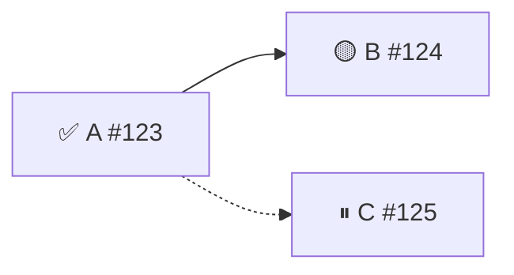

<!-- This body is the live status and the source of truth for the release. Rewrite it after every merge, owner decision, paid run or change of plan, and keep these comments. A comment that records an owner decision is not done until this body reflects it. Chronology goes in dated progress comments; detail goes in linked issues and PRs. Keep durable records here, never only in .context/ or a private link. -->
<!-- Parallel work: one worktree and branch per worker; pass the original requirements verbatim (https://github.com/anycloud-sh/anycloud/blob/main/CONTRIBUTING.md#task-context); when an owner decision allows stacking, stack dependent PRs and retarget them after the lower PR merges. Paid or live runs: spikes and live reproductions go through spike.yml, never local cloud credentials (https://github.com/anycloud-sh/anycloud/blob/main/CONTRIBUTING.md#directory-ownership); one run per purpose, no redundant reruns, confirm native cleanup, and record the run ID. -->
<!-- Lanes: record the owner's lane decision under Owner decisions and follow it literally. Serial means one PR in flight: no stacking, and no pre-building the next row while a PR is in review or CI. Parallel lanes and stacks need an explicit owner decision. -->
<!-- Workspaces: the coordinator works from one parent workspace for this tracker, named after the release. Each worker gets its own worktree inside it, as https://github.com/anycloud-sh/anycloud/blob/main/CONTRIBUTING.md#parallel-agent-work describes; never check out outside it. For a snapshot of an older commit, `git archive <sha> | tar -x` into a gitignored directory inside the worktree. -->
<!-- Cleanup: once a PR merges, stop its worker and remove its worktree. At each handoff, close idle sessions. -->

**Last updated:** <!-- UTC time -->, by <!-- agent or person -->

## Opening

- [ ] Triage posted as the first comment (read-only): done, superseded, rewrite, partly done, no owner, later, plus planned items with no issue
- [ ] Main is green and every merge went through the gate; otherwise Stabilization is the first workstream

## Lineage and records

<!-- One coordinator per release: it owns every row, lane, train, owner question and the release itself, and its workers run in child worktrees. Any other coordinator-level session on this tracker posts a handoff comment (open PRs with head, review and CI state; branches and worktrees; running runs; promises made) and stops. -->
<!-- Each coordinator with its time span, and where its logs or handoff live, and its parent workspace. Name any automation that was stopped, link its stop report, and say "don't restart". -->
<!-- The coordinator, its workers and any session handing off sync here: file claims, lane order, paid-run notices, decisions and worker questions unanswered for 30 minutes go in this body or its comments. Workers ask their coordinator directly; separate coordinator-level sessions never message each other directly, except to link a comment here. Announce a paid run on a shared workflow here before dispatching it. Ask about work in another milestone on that milestone's tracker. -->

## Owner decisions

| When (UTC) | Decision |
| ---------- | -------- |

<!-- Newest first. Name what each decision supersedes, and copy scope changes onto the affected issue. A scope change re-baselines size estimates: https://github.com/anycloud-sh/anycloud/blob/main/CONTRIBUTING.md#size-estimates-and-justification -->

## Constraints

- **Owner review holds:**
- **Merge gate:** everything [Pull Requests](https://github.com/anycloud-sh/anycloud/blob/main/CONTRIBUTING.md#pull-requests) requires, including its description sections and the green dispatches it calls for; an independent review in a fresh context, not by the author; a full `yarn verify`; all applicable CI green on the exact head, with no waivers or loosened thresholds; at most one rerun, with evidence the failure was environmental; [size estimate](https://github.com/anycloud-sh/anycloud/blob/main/CONTRIBUTING.md#size-estimates-and-justification) and actual reported, with owner approval for an overrun; `gh pr merge --match-head-commit <sha>`, then check the merged tree matches the merged head.
- **Migration numbers reserved:**
- **Reading rehearsals:** cover each materially different kind of change the tracker claims to improve.
- **Owner sizes:** a ceiling above 800 needs `split:` or `whole:` ([the over-800 rule](https://github.com/anycloud-sh/anycloud/blob/main/CONTRIBUTING.md#module-structure)).

<!-- Owner-directed small doc changes may go straight to main. Reserve a migration number above before writing one. Note any environment-specific verification setup here. -->

## 🚂 Merge train

- **Paid rounds:** <!-- the owner pre-approves every train for this release, or approves each one -->
- **Current train:** <!-- `train/<release>-N`, boarded PRs in order with their heads, run IDs, state -->

<!-- Ready PRs share one paid round on a train branch, then merge in order. A PR boards when every commit other than a listed text-only nit fix has its own fresh review, free CI is green on its own head, and size approval and owner decisions are done; its owning worker then comments "🚂 boarding train N at `<sha>`" here. A PR's owning worker, or the owner, keeps it off the train by saying so here. -->
<!-- Departure: as soon as a PR has boarded and no train is running; PRs that become ready during a run board the next train. The coordinator builds `train/<release>-N` from `main` plus each boarding head in boarding order, by merges only with no edits; a PR that conflicts leaves the train and rebases for the next one. Announce the paid round here, then dispatch the union of the boarding PRs' required paid members once on the train branch. Production actions (deploys, DNS, certificates) are never part of a train. -->
<!-- On green: the coordinator announces a merge window here; until the train arrives only its PRs merge, except PRs touching none of its files (docs, website). Boarding lets the coordinator merge the PR under the Merge gate; a green train run containing its head is the gate's green dispatch. Run `yarn train:merge --train origin/train/<release>-N <pr>=<head> ...`: it squash-merges each PR in boarding order at its reviewed head, with no rebases, stops at the first failure (including a stacked PR not yet retargeted to `main`), and prints the 🚂 arrival line to post here. `main`'s tree must then equal the train tree; the script prints any difference, which only the excepted PRs may explain. The script never rebases, but a stacked PR may need one: squashing the PR below it cuts their shared history, so it can conflict at merge time even though the train built cleanly. When it boards, check `git merge-tree` of its head against `main` plus a simulated squash of the PR below it, and again if that PR's head moves. If it conflicts, its owner rebases onto `main`, shows an unchanged `git range-diff`, gets the rebase reviewed and posts the new head here; it then merges on the same train, and the tree check confirms `main` matches what the train tested. A conflict while building the train still removes the PR from it. On red: triage the failure to its PR from the failing stage; that PR leaves the train, the train is rebuilt and only the failed workflows rerun. If attribution is unclear, split the train. -->

## Workstreams

| ID  | Workstream | Issue / PR | State | Waits on | Next |
| --- | ---------- | ---------- | ----- | -------- | ---- |

<!-- State: ✅ done, 🟡 active, ⏸ queued (waiting on another row), 👤 waiting on the owner. Waits on lists row IDs; write ~id for an ordering chosen to avoid conflicts rather than a real dependency. State keeps only the latest merge SHA; the merge history lives in progress comments. A family with its own matrix below (for example, contracts × clouds) gets one row. -->

<!-- Optional view of the Waits on column, once it has more than a few straight chains. Redraw it from the table; the table wins if they disagree. Solid arrow: waits on. Dotted arrow: ~id. Delete the block if unused. -->

## Owner questions

<!-- Numbered, each with your recommendation in parentheses. Strike through each one when answered, and link to its decision row. -->

## Resuming

1. Read this issue. Re-check live state: `gh pr list`, `gh pr checks`, `git status` in each worktree of the tracker's parent workspace, and any running `yarn verify`.
2. Preserve uncommitted work you didn't write. Replay only the tip commits of stale branches.
3. Add yourself to Lineage, stop your predecessor's automation, take over every other session's rows from its handoff comment, and work from the tracker's parent workspace. Read recent comments for workers' claims and paid-run notices, and post yours here.
4. Continue from rows whose Waits on rows are all ✅, and update this body at each milestone. Check Merge train for a running train, and for boarding comments since the last train left.
5. Post a progress comment, then start the newly ready rows in the same turn after each merge, under the recorded lane and merge-authority decisions, without asking. Stop only for what Owner decisions leave open: an overrun past the size threshold, a new scope decision, or an uncovered outward-facing action.

## Closing

- [ ] Every workstream is ✅, or moved off the milestone into a follow-up issue
- [ ] Every owner question is answered, or deferred to a named issue
- [ ] Every owner decision recorded in a comment is also in this body
- [ ] Owner changelog digest of `changelog-unreleased/` merged
- [ ] `yarn changelog:fold`, then a green `e2e-cluster-cloud` `hosted_stage` run on that tree ([Release gate](https://github.com/anycloud-sh/anycloud/blob/main/RELEASE.md#release-gate)), linked here
- [ ] Release workflow dispatched, and the RELEASE.md Verify checks done
- [ ] Every worker stopped and its worktree removed, then the parent workspace removed
- [ ] Final summary comment posted, then this issue closed
