# AnyCloud Architecture

AnyCloud runs containerized Jobs, Services, and persistent VM environments on a
selected API target. The CLI and Python SDK are clients; the API owns request
validation, durable state, placement, provider mutations, runtime operations,
and recovery.

This document describes implementation boundaries and lifecycle guarantees.
User-facing commands and feature constraints live in [`docs/`](./docs/) and are
linked from [Related Documentation](#related-documentation).

## System Overview

### Workload types

| Type    | Purpose                                            | Lifetime                                           | Runtime support |
| ------- | -------------------------------------------------- | -------------------------------------------------- | --------------- |
| Job     | Finite container work                              | Publishes an exit outcome, then releases resources | VM-host         |
| Service | Long-running HTTP workload                         | Runs until termination or URL-preserving upgrade   | VM-host         |
| VM      | Persistent development container on one cloud host | Runs until termination                             | VM-host         |

The CLI exposes these as `anycloud job`, `anycloud service`, and
`anycloud vm`, and the Python SDK supports Jobs and Services. Each Workload
provisions one VM. AnyCloud does not implement replica autoscaling.

### Terminology

**Workload** is the shared durable Job/Service/VM record, represented by
`StoredWorkload`, the `workloads` table, and `/v1/workloads`. Jobs, Services,
and VMs need a product prefix only when the surrounding context leaves a real
ambiguity.

Migration 0105 renames shared records from Deployment to Workload, and has a
separate auditor for its intermediate `workloads`/`workers` schema. Provider
tags (`anycloud_deployment`, `anycloud:deployment-id`) and Docker labels
(`sh.anycloud.deployment-id`) keep their original bytes. These are durable
resource identities, not API aliases.

### API modes

The same API image can run in two modes:

- **Local API**: a CLI-managed Docker container. The default client target is
  `http://localhost:8080`; the host port is bound to loopback. Durable state is
  stored under `~/.anycloud/` and mounted into the container.
- **Hosted API**: a Helm release on the installation's Kubernetes cluster,
  created by `anycloud api create` and served at
  `https://<cluster-id>.anycloud.sh`. Its `ANYCLOUD_DIR` is `/mnt/checkpoint`
  on the `anycloud-api-state` PersistentVolumeClaim, which holds the live
  SQLite database and cipher key. The API backs both up to the cluster's
  checkpoint bucket; the bucket is read only by a restore.

Both built-in launch paths mount `/run/anycloud-ssh` as a cluster-only tmpfs for
OpenSSH control sockets and transient private-key files. Direct API-image
runners must provide the same non-durable mount. Background ControlMasters fork
beyond Node's tracked child and become PID 1's responsibility, so the image runs
its command behind `tini` to adopt and reap them, and to forward shutdown
signals to Node.

The active target is selected with `anycloud api use`, persisted in
`~/.anycloud/api-url`, and overridable per command with `API_URL`. The local
API that created the cluster (the installer) owns its lifecycle; the hosted API
updates itself through its `system-release` surface (`anycloud api upgrade`).
The chart and the image are one release unit: `release.yml` publishes the chart
to `oci://ghcr.io/anycloud-sh/api-k8-chart` at the release version, then
builds the image with that chart's digest-pinned reference in its
`ANYCLOUD_API_CHART` environment. Bootstrap and an upgrade read the reference
from the target image's config, so the pinned image digest pins its chart, and
an upgrade writes the chart reference and the values in one `HelmChart` patch:
Helm renders once and the API restarts once. helm-controller pulls the chart by
digest. At start, once helm-controller's install Job has finished (succeeded or
failed), a hosted API whose `HelmChart` names another chart, or still carries
the inline `chartContent` of a release before 0.1.68, writes its own reference,
keeping values and release annotations. That repair is a no-op after an
upgrade. It leaves a `HelmChart` whose release names another version alone, so
the next start finds the chart current and nothing loops. Only an upgrade from
a release before 0.1.68, which patched values alone, still relies on the new
image starting and passing the ready check under the previous chart.

One API process must own one SQLite database. Multiple API replicas sharing a
database are unsupported because workload work ownership and fairness are
currently process-local.

### API identity and state binding

Every API installation has one 128-bit identity, and it lives in exactly one
place: an `api_identity` stamp in `_metadata`. Official hosted APIs also derive
that value from their trusted `WORKLOAD_ID`, the cluster id the chart renders.
A restore keeps the cluster id from the backup, so it reproduces the value and a
hosted API always has a second opinion to compare
the stamp against. A local API has no such second source, which is deliberate:
hostnames change and are reused by containers, and a file next to the database
travels with any copy of it.

After migrations and before reconciliation or HTTP readiness, the API attaches
to the stamp. A database with none is stamped and the write is logged; that is
the ordinary first boot. A hosted API whose derived value disagrees with the
stamp refuses to start, because a hosted API restoring another installation's
backup is a mistake rather than a move. A local API has nothing
to disagree with and takes whatever it finds, so it cannot detect a copied
database — accepted knowingly, since a copy is inert without `cipher.key`, and
the credentials it protects are the real security boundary. Cloud resources
carry the owning identity in their own tags, which is where ownership is
enforced per resource.

The stamp records the scheme that derived it. Changing how identities are
derived would otherwise invalidate every stamp in the field and read as a
copied database; recording the scheme keeps that a recognisable, repairable
condition instead.

This identity is the API's own. The cluster record's `kubernetes_identity` is
not: it is the `kube-system` namespace UID observed from the installation's
control plane, and it answers whether the control plane behind the record is
still the one recorded — not who created it. One is minted and stamped, the
other is observed and compared, and they must not be conflated. The hosted API
compares them on every start: it records the cluster it runs in from the
release values bootstrap rendered, and refuses to start when the UID it
observes through its own ServiceAccount differs from the one those values name.
A restored database that recorded the lost cluster's UID instead adopts the
new cluster (see [Cluster lifecycle and restore](#cluster-lifecycle-and-restore)).

New provider resources record their owning API in tags, labels, or Kubernetes
annotations as `anycloud_owner_api`. On the first identity-aware boot, a
durable queue snapshots live, database-known VM rows and backfills only those
exact provider IDs. Backfill never discovers candidates from account inventory,
deletes resources, or overwrites a different owner. A provider may use a
filtered inventory lookup for an exact candidate when durable placement is
missing; for example, GCP resolves an instance's zone by its exact name before
updating labels. Provider IDs absent from the resolved lookup scope are recorded
as missing, while providers that cannot mutate legacy metadata are recorded as
unsupported. Their markerless resources remain eligible for ordinary exact
workload cleanup but not for a future owner-scoped orphan reconciliation.

### Cluster lifecycle and restore

The installer API runs `anycloud api create`; the cluster
record, its VM ledger and the compute credential stay there. `create` records
the full target before any cloud mutation, then creates the management VM, starts
K3s, and installs the chart its API image names as one `HelmChart`; re-running it resumes from
the last completed step. `anycloud api delete` runs through the seed
(`src/cli/services/seed-delete.ts`): a reachable hosted API deletes what it
manages and then itself, refused while Workloads still run; with the API
unreachable, the seed's guards decide whether its cloud CLI fallback may run.

The hosted API backs up hourly and before every self-update: `cipher.key`,
`database.sqlite` and last a `backup.json` manifest naming the cluster id,
backup time, schema version and database SHA-256, plus the saved credentials'
clouds and accounts, without secrets. `create` with a bucket that
holds a manifest is a restore: it reuses the backup's cluster id (so the URL
survives), refuses a backup from a newer API, and refuses while the cloud shows
a management VM tagged with that cluster, whether this installer still holds
the record or a fresh installer restores, so two APIs never write one bucket.
The chart's `restore-state` init container fills the empty state volume from
the backup before the API's first start. That start adopts the new cluster in
one transaction: it moves the cluster record to the new `kube-system` UID and
in-cluster connection.

### Hosted API ingress

Every hosted API answers at `<cluster-id>.anycloud.sh`, a proxied record in the
`anycloud.sh` zone. The DNS Worker (`worker/`, `dns.anycloud.sh`) holds the
zone's Cloudflare token; a caller owns a hostname for DNS when every A record
for it carries the caller's GitHub username, and for origin TLS when every
record of any type does. The management VM's Traefik release (`src/shared/api-ingress.ts`)
listens on 443 and 80, which the VM's firewall admits from Cloudflare's ranges
only.

On 443 Traefik serves a per-installation Cloudflare Origin CA certificate,
valid for 15 years and revoked whenever its hostname is released. The
installer generates the key and a CSR in `stepRelease` and writes the key only
into the `anycloud-api-tls` Secret; the Worker signs a CSR whose single subject
alternative name is the caller's hostname, and revokes that hostname's
certificates that expire earlier. No shared wildcard key exists (RFC 0032).
Before activation the installer re-applies the VM's firewall, so a resumed or
restored installation admits 443, and an on-node probe must see 443 serve the
new certificate. A Ready installation from before this never reaches that step.
It is converted once by hand: open 443 in its firewall, generate a key and CSR
on the VM, have the Worker sign the CSR, write the Secret and this release's
Traefik HelmChart, probe 443, then activate. The Worker then enables
per-hostname authenticated origin pulls with anycloud's client certificate (when
configured; the origin then requires it through the
`anycloud-api-origin-pull-ca` Secret and a `default` TLSOption, both removed
when no CA is configured) and adds the hostname to the bridge Configuration
Rule, which sets Full (strict) for installation hostnames only. Activation is
all or nothing: a full rule (4096 characters) is refused first, and a failed
rule edit voids the origin pulls. A Durable Object serializes edits to the
rule's host list. `delete` and `forget` undo both and revoke the certificates
before deleting the DNS record; deleting a hostname's last record or claiming an
unheld name also revokes them. Each Worker feature stays off until its secret is
set.

The bridge is temporary. Once VM Services serve TLS or are gone, an
operator sets the zone to Full (strict) with zone-level origin pulls, deletes
the bridge rule, and closes port 80.

### Component diagram

```text
CLI / Python SDK
        │ authenticated HTTP
        ▼
Selected API target (local or hosted)
        ├── Express listener
        │       ├── oRPC JSON procedures ─► domain services ─► SQLite
        │       │                                             durable authority
        │       └── native transport routes ─────────────────► SQLite
        └── scheduler + controller
                    │
                    ▼
             VM-host runtime ─► provider gateway ─► VM, SSH, Docker
                                      │
                         object storage and catalogs
```

### Implementation boundaries

| Area                                                     | Responsibility                                                                                  |
| -------------------------------------------------------- | ----------------------------------------------------------------------------------------------- |
| `src/cli/`                                               | Commands, API-target selection, authentication UX, and local SSH process                        |
| `src/cli/use-cases/`                                     | Terminal-free application operations behind command adapters; they never prompt, print, or exit |
| `src/cli/renderers/`                                     | Lines and picker choices built from use-case results; they never fetch, prompt, print, or exit  |
| `src/cli/prompts/`                                       | Interactive input over data the adapter hands them; they never call the API or render results   |
| `src/shared/api-contract/`                               | Zod/oRPC contracts for conventional JSON requests, responses, and declared errors               |
| `src/shared/services/api-client/`                        | Direct TypeScript contract client for migrated JSON procedures                                  |
| Other `src/shared/` modules                              | State definitions, provider policy, native transport types, and shared client behavior          |
| `src/api/composition.ts`                                 | Production wiring for domain ports, persistence, gateways, runtimes, environment, and telemetry |
| `src/api/rpc/`                                           | Express adapter, authentication middleware, and thin JSON procedure handlers                    |
| `src/api/routes/`                                        | Native health, NDJSON streaming, and binary transfer transports                                 |
| `src/api/services/*-domain.ts`                           | Transport-free stateful semantics for migrated route families                                   |
| `workload-reconciler.ts`, `monitor.ts`                   | Reconstructible work scheduling, controller handlers, and periodic services                     |
| `src/api/services/repositories/workload-creation.ts`     | The admission-only Workload insert with its owned container spec                                |
| `src/api/services/repositories/workload-lifecycle.ts`    | Step claims, transitions, retry admission, recovery, and Service upgrades                       |
| `src/api/services/repositories/workload-outcomes.ts`     | Terminal outcomes, termination, resubmission, and cleanup completion                            |
| `src/api/services/repositories/provisioning-attempts.ts` | Workload VM attempt ledger: registration, completion, release, endpoints, and billing identity  |
| `src/api/services/repositories/workload-events.ts`       | Workload event reads and the event writes made outside a state transition                       |
| `src/api/services/repositories/credential-secrets.ts`    | Encrypted credentials and named secrets, with their reference-guarded deletes                   |
| `src/api/services/repositories/workload-queries.ts`      | Workload reads and projections: list, status, terminal digest rows, scheduling, VM rows         |
| `src/api/services/repositories/workload-spend.ts`        | Spend reads: windowed cost report, budget-cap attribution, per-workload cost, digest spend      |
| `src/api/services/workload-workflows/`                   | Workflow policy: dispatch, startup, replay, recovery, retries, completion, cleanup, VM repair   |
| `src/api/services/host-runtime/`                         | Host effects: readiness, image delivery, container start and repair, release, and termination   |
| `src/api/services/workload-event-metadata.ts`            | Redacted workload-event metadata encoding and defensive decoding                                |
| `src/api/services/job/`, `src/api/services/serve/`       | Runtime contracts and routers                                                                   |
| `src/api/services/kubernetes/`                           | Kubernetes client, cluster connection and identity, and ServiceAccount tokens                   |
| `src/api/services/gateways/`                             | Compute, storage, SSH, GitHub, and provider-specific behavior                                   |
| `migrations/`                                            | Authoritative SQLite schema evolution                                                           |
| `test/`                                                  | Tests, fixtures, provider harnesses, and test-only helpers                                      |
| `ci/`                                                    | Workflow-only automation                                                                        |
| `experiments/`                                           | Temporary executable proofs with documented promotion and deletion criteria                     |
| `benchmarks/`                                            | Performance probes that do not define shipped behavior                                          |
| `scripts/`                                               | Supported developer, release, repository-policy, catalog, and recurring operator entrypoints    |

Production modules under `src/` must not import internal applications,
repository tooling, CI, tests, experiments, benchmarks, or `.context/`.
Scripts and internal applications must not depend on test or experiment code;
callers should invoke test-owned harnesses from `test/` directly.

### Enforced source boundaries

Repository policy applies the following static checks to reviewed source code:

- protected module ownership and directory boundaries are checked across the
  whole import graph; production source rejects dynamic loading, loader
  capabilities, and non-`node:` URL-scheme imports, so no dependency escapes
  the graph;
- `src/api/config.ts` owns unrestricted environment access, while exact
  per-file and per-key exceptions are declared centrally;
- no runtime repository exposes admission-only creation or credential writes;
  those operations live behind the narrow `workload-admission-writer.ts`
  capability consumed by admission persistence;
- exact VM lifecycle calls belong to `vm-compute.ts` and the named compute
  gateways; the Workload and cluster composition roots
  bind the handles consumed by orchestration;
- Express construction and HTTP-method registration are limited to the named
  server and native-route owner modules; and
- API-contract construction and inspection, raw database access, provider test
  mode, and dependency-free boundary modules remain limited to their declared
  owners.

The independent directive check runs before ESLint and rejects attempts to
suppress or reconfigure these protected rules unless an exact exception is
present in reviewed repository-policy data. Other style and correctness rules
are accidental-misuse guards, not architectural security boundaries. Static
source checks do not reason about generated code or runtime module loaders, and
they do not configure repository-hosting or merge policy.

### Dependency and type ownership

Contract-backed domain factories in `src/api/services/*-domain.ts` receive a
required dependency object whose members are their ports. They do not discover
concrete persistence, provider gateways, runtimes, environment values, clocks,
or telemetry themselves. `src/api/composition.ts` is the production composition
root that supplies those implementations; tests construct domains with focused
fakes or use that cluster with explicit overrides.

Shared types are owned by the smallest stable module for their concept:
`src/shared/cloud.ts`, `workload.ts`, `image.ts`, `runtime.ts`, and `quota.ts`.
Wire DTOs belong to their schema in `src/shared/api-contract/`, while durable
API workload records belong to `src/api/services/workload-record.ts`.
Consumers import each symbol directly from its owner. Source re-exports and
module dependency cycles are repository-policy failures enforced by lint and
`yarn check:boundaries`.

## Request and Admission Flow

Workload creation is asynchronous:

1. The client selects an API target, obtains its bearer token (a local API's
   per-install token or a hosted API's GitHub sign-in), and sends a
   workload type, image, hardware request, and a saved credential name or
   inline credentials. Separate storage credential names may be supplied for
   Job buckets and Service checkpoints.
2. The API authenticates the caller, applies hosted-API access policy, validates
   the request and provider capabilities, and inspects the image when possible.
3. The API resolves named credentials, generates an ED25519 keypair, encrypts
   sensitive stored fields, and inserts the workload in `queued`. Local
   compute is an API-instance capability and needs no saved compute
   credential.
4. The API returns the ID and, for a Service target with public ingress, its URL.
   Scheduling and runtime dispatch continue asynchronously.

Internally, admission is a one-way pipeline from resolution, through semantic
planning, to persistence. Resolution and planning perform no durable writes;
only a fully admitted opaque creation plan can enter persistence. Every
placement passes storage validation. The workload store repeats pure bucket-role checks
as defense in depth for callers outside admission.

CLI/API package versions are required to match for versioned operations. The
full command and request surfaces are intentionally not duplicated here; see
the [CLI reference](./docs/reference/cli/overview.md) and
[Python SDK reference](./docs/reference/python-sdk.md).

## Provider and Runtime Model

### Provider registry

`PROVIDER_DATA` in `src/shared/providers.ts` declares client-safe credential,
placement, and storage policy. The exhaustive `PROVIDER_IMPL`
registry in `src/api/services/cloud-config.ts` constructs server-only
`CloudCompute`, optional `CloudStorage`, and optional account-catalog-overlay
implementations. Capability interfaces cover behavior such as preemption, VM
restart, object storage, and scoped-token minting without spreading
provider-name branches through orchestration.

Every provider (AWS, Azure, GCP, Lambda, Local) is a VM host: AnyCloud
provisions one host and manages the workload over SSH and Docker. Kubernetes
runs only the hosted API on its management VM; it is not a provider.

Slurm attach shipped in v0.1.66 and is withdrawn until Slurm support returns;
RFC 0046 plans it as a substrate of its own, never a `CloudType`.

AWS, Azure, and GCP also provide native object-storage gateways. Providers
without one can use supported external storage through explicit storage
credentials. Workload-type availability and current provider constraints are
documented in the platform and CLI references.

AWS and GCP expose base-image lookup through the provider-neutral
`CloudBaseImageResolver` capability. VM launch and the base-image canary call
the same provider implementation; image checks do not construct a compute
gateway or invent a VM type merely to reach the provider image API.

Azure's account-catalog overlay reads Resource SKUs through bounded,
single-region requests derived from the downloaded catalog. Successful region
observations are cached in process memory and atomically persisted in the API's
durable AnyCloud directory. Persisted observations are reused only while their
regional catalog-target fingerprint matches; scoped invalidations update both
layers. Failed or not-yet-observed regions remain unknown and are retried
independently.

### VM-host runtime

A VM-host workload follows this pipeline:

1. **Provisioning**: resolve placement and storage, durably register one VM
   attempt, then adopt or create its deterministic provider identity.
2. **Initializing**: wait for SSH and install or configure host dependencies.
3. **Downloading**: pull the immutable image digest or requested image.
4. **Syncing**: hydrate input/checkpoint data when required.
5. **Starting**: create the workload container and perform readiness checks.
6. **Running**: expose operations and let the controller observe workload and
   provider health.

Jobs run one finite container; completion is read with Docker inspection.
Services keep one HTTP workload running and may own DNS/networking resources.
VM workloads run a long-lived development container with `/workspace` and
host Docker access. A VM's missing container can be recreated on the same live
host. An unreachable VM host is not replaced: provider `alive` or `unknown`
status preserves `running`, while provider-confirmed absence transitions the
workload to `failed` because its host-local workspace cannot be recovered.
The ledger row stays live so terminal cleanup still owns the host's
directly-attached resources, and ends it once their deletion is confirmed.

A Job, Service or VM container that names Secrets also mounts the host's
`/run/anycloud-secrets/files` read-only at `/run/anycloud-secrets`, with one
directory per Secret and a `0444` file per key. Each Secret's directory is a
symlink to a revision directory named from a hash of the stored ciphertext,
swapped in one rename. Saving a Secret wakes the poll of every Running Workload
that names it (`live-secret-files.ts`); each 30-second poll compares every
host's symlinks with the stored revisions over SSH and writes the newest values
where they differ, including after a reboot empties `/run`. Environment
variables keep the values from the container's start.

A `--host-docker` Job gets the dev box's host Docker socket and `/workspace`,
and with nesting `/dev/kvm`, each joined to its host group, in place of
`--privileged`. The container keeps Docker's default capabilities, seccomp and
AppArmor profiles, but the socket makes it root-equivalent on its VM: it can
read what the host holds for that Job, such as its runtime Secrets file and
bucket credentials. The trust boundary is the VM, which runs only that Job;
admission accepts the option only for a Job. A Job's VM takes only SSH from its network: AWS's
shared group and Azure's NSG admit nothing else, each Azure Job has its own
VNet, and on GCP every VM Job's VM carries the `anycloud-job-host` tag, whose
standing deny below the Job's own rules (priority 1001) outranks broad network
allows such as the default network's `default-allow-internal`; Services and
dev boxes keep their network's internal traffic. A cluster's management VM on
GCP denies that tag at priority 900, so a Job reaches it only through its
public address. A `--host-docker` Job's host also drops new connections
arriving on its default-route interface to containers (a `DOCKER-USER` rule
set at each container start).

## Durable Data Model

SQLite is authoritative for desired state, lifecycle history, and cleanup
ownership. Provider and scheduler APIs supply external facts, but ordinary
workload listing does not fan out to them. `list` uses bounded, filtered
SQLite queries and joins; live health checks belong to status and
reconciliation paths.

Database operations share a connection queue that gives I/O a turn before each
query or transaction. Bursts of synchronous commits therefore cannot run as
one uninterrupted chain of resolved promises. Transaction callbacks remain
synchronous from `BEGIN` through `COMMIT`, and a failed operation does not block
later work on the connection. Asynchronous queries reject and roll back manual
transaction openings; multi-statement operations use `db.transaction` callbacks
so another request cannot join their transaction.

`db.read` serves `list`, workload `status` and the access-policy check from a
second, read-only connection that skips the writer queue. It accepts only
read-only statements and runs them in one read transaction, so each read is a
consistent snapshot; settled writes are always visible to it.

A file database runs in WAL mode with `synchronous=FULL`: readers never wait
behind the writer, and each commit is durable when it returns. The last
shutdown step checkpoints the WAL into the database file and closes it, so the
file then stands alone.

Workload status reads the authorized workload and its events in one database
snapshot. A Retrying Workload's snapshot also carries the reconciler's retry facts (attempt
count, last retry time, failing state); status reports the next attempt as the
backoff window anchored to that retry, never the reconciler's in-memory sample.
Checkpoint health is not in the snapshot: status lists a live Workload's
checkpoint bucket through its storage provider, at most once a minute per
Workload, and omits health when the listing fails.

The diagram shows every table the migrations in `migrations/` create, with
the columns that carry relationships or fences. Solid lines are foreign keys;
dotted lines are references without one: JSON name lists.

```mermaid
erDiagram
  credentials |o--o{ clusters : "creates"
  credentials |o--o{ vms : "attempt credential"
  credentials |o--o{ workloads : "storage access"
  clusters ||--o{ cluster_releases : "release ledger"
  clusters |o--o{ vms : "management VM"
  workloads |o--o{ vms : "VM-host attempts"
  workloads ||--o{ workload_events : "history, status only"
  workloads |o--o| container_specs : "owns"
  secrets }o..o{ workloads : "secret_names"
  vms ||--o| api_ownership_backfill_targets : "backfill"
  quota_operations ||--o{ quota_operation_targets : "targets"

  clusters {
    text id PK
    text state
    text compute_credential_id FK
    text kubernetes_identity "kube-system UID"
    int identity_generation "adoption fence"
    text connection_kind "installer or in-cluster"
    text cloud_account "hosted record"
    text management_vm_id "hosted record"
  }
  cluster_releases {
    text cluster_id PK, FK
    int revision PK "increases"
    text api_image "digest-pinned"
  }
  workloads {
    text id PK
    text workload_type "job, service or vm"
    text input_storage_credential_id FK "also output, checkpoint"
    text session "spend scope"
    text secret_names "JSON names"
  }
  container_specs {
    text workload_id FK, UK
    text image
    text env "encrypted"
  }
  workload_events {
    int id PK
    text workload_id FK
    text state
    text metadata "JSON"
  }
  vms {
    int id PK "one VM provisioning attempt"
    text workload_id FK "exactly one owner"
    text cluster_id FK "exactly one owner"
    text credential_id FK
    text cloud_id
    text region "where it launched"
    text availability_zone
    text vm_type
    text launch_diagnosis "null unless the launch failed"
    text launch_region_denied "provider denial message"
    real price_per_hour
    int ended_at "billing end"
  }
  credentials {
    text id PK
    text name UK
    text encrypted_data
  }
  secrets {
    text name PK
    text encrypted_values
  }
  budgets {
    text period PK
    text scope PK
    int cap_usd
  }
  throttles {
    text scope PK
    int cap_usd
  }
  spend_block_alerts {
    int id PK
    text kind "throttle or budget"
    text scope "account or agent-session"
  }
  notification_channels {
    text channel PK
    text encrypted_config
  }
  notification_receipts {
    text kind PK "digest, release, vm-release-alert"
    text value
  }
  quota_operations {
    text id PK
    text status
  }
  quota_operation_targets {
    text id PK
    text operation_id FK
  }
  api_access_policy {
    int id PK "single row"
    text owner_user_id
  }
  api_access_users {
    text user_id PK
    text username
    text token_hash UK "service tokens only"
  }
  api_tokens {
    text user_id PK
    text token_hash UK
  }
  api_ownership_backfill_targets {
    int vm_id PK, FK
    text status
  }
  api_versions {
    text version
    int first_seen_at
  }
```



Each table, with its purpose, its writer and the invariants it carries:

- **`clusters`**: the installation's one cluster record. It holds bootstrap
  facts, the resumable creation `step`, the verified `kube-system` UID, the
  connection kind and the encrypted installer connection. On the hosted API's
  own row the facts are the cluster record bootstrap writes into the release
  values: cloud and account, location, VM type, the management VM's provider
  ID, the network scope, the K3s pin and the checkpoint bucket.
  `cluster-store.ts` and `cluster-installer-store.ts` write it. A unique index
  allows one active cluster, and creation facts are immutable. The
  `kube-system` UID and the hosted row's record change only when a restored
  API adopts a new cluster, which advances `identity_generation`.
- **`cluster_releases`**: the release ledger for that cluster, one row per
  revision of API image, chart and values. The installer and the system
  release intent store write it. Revisions increase, intent columns are
  immutable, and the API image must be digest-pinned.
- **`workloads`**: a Job, Service or VM. It holds identity, VM-host placement
  and storage requests, `secret_names`, the agent session, the lifecycle state
  and cleanup progress. The `repositories/workload-*.ts` modules and
  `provisioning-attempts.ts` (DNS record and public endpoint) write it.
  Identity is immutable.
- **`container_specs`**: container configuration owned by exactly one
  Workload, with its environment and registry token encrypted. It is written
  in the same transaction as its owner. Triggers keep the owner immutable,
  keep VM Job and VM specs fixed after admission, and refuse to detach a spec
  from an owner that still exists.
- **`workload_events`**: the history of a Workload's state changes, with
  diagnostic and provisioning metadata as JSON for status and retry backoff;
  launch-target selection never reads it. The workload repositories append rows and only add
  diagnostics to an existing row's metadata; state and time never change.
- **`vms`**: the **VM provisioning ledger**, not a live VM list: one row per
  attempt to stand up a cloud VM, owned by exactly one Workload or cluster. A failed attempt keeps its row so cleanup can find leaked resources,
  and a placeholder row may be reopened when cleanup raced it; billing fills
  `cost` once after `ended_at`. The row holds the provider identity, resolved
  placement, SSH endpoint, price, cost and teardown timestamps. A failed
  launch also records its `launch_diagnosis` and, when the provider denied the
  credential in that region, `launch_region_denied`. These rows are the
  launch-target picker's failure history, with disposition derived on read
  from the diagnosis and the owner's pins.
  `provisioning-attempts.ts`, `workload-lifecycle.ts`,
  `billing.ts` and the cluster stores write it. The row exists before the first provider call, and
  `ended_at` is both the billing end and the cleanup fence. Spend reads this
  table.
- **`credentials`** and **`secrets`**: encrypted named cloud credentials and
  named runtime secrets. `credential-secrets.ts` writes both. A credential is
  a key, or on a self-hosted API a role connection that stores no secret,
  only the cloud identifiers and the issuer, audience and subject it was
  checked with (RFC 0047 amendments 8 and 9). Deleting a
  credential that a cluster, VM or Workload storage request references keeps
  its row and clears only its name. A secret that an unfinished Workload
  names is kept unless deletion is forced.
- **`budgets`**, **`throttles`** and **`spend_block_alerts`**: spend caps in
  USD by scope (`account` or `agent-session`), and the record of block alerts
  already sent. `spend-controls-store.ts` writes them. Admission compares the
  caps with spend from `vms`, attributed through `workloads.session`.
- **`notification_channels`** and **`notification_receipts`**: encrypted
  notification channel configuration, and the last delivery of each scheduled
  notification (digest, release, VM release alert). `notifications-store.ts`
  writes both, one row per channel and one per kind.
- **`quota_operations`** and **`quota_operation_targets`**: history of quota
  increase submissions. New submissions are retired, so nothing writes them.
- **`api_access_policy`** and **`api_access_users`**: the hosted API's single
  owner identity and its explicit allowlist of GitHub accounts and
  owner-issued services, each service with the SHA-256 of its token. `api-access-policy.ts` writes them.
- **`api_tokens`**: a hosted API's own bearer, one per admitted GitHub account
  (the owner included), looked up by the token's SHA-256 and kept encrypted
  with the account's GitHub sign-in. `api-tokens.ts` writes it;
  `api-access-policy.ts` deletes a member's row on removal.
- **`api_ownership_backfill_targets`**: the resumable queue that labels legacy
  provider resources with their owning API, one row per VM.
  `api-ownership-store.ts` writes it.
- **`api_versions`**: an append-only timeline of the API versions that have
  run against this database. `persistence.ts` appends a row at startup.
  Which version did something is answered by
  joining on time, never by stamping each row.
- **`_metadata`** and **`_migrations`**: created by the migration runner, not
  by a migration. `_metadata` holds the API identity binding, the backfill
  seed, the legacy notification import marker and the last API version,
  which refuses a downgrade. `_migrations`
  records each applied migration.

Migrations 0171 and 0172 removed node pools, Deployments, the Jobs and
Services that targeted them, and their history (the `node_pools`,
`deployments`, `pool_occupancy`, `pod_attempts` and `workload_attempts` tables
and the pool and Deployment columns of `workloads`, `vms` and
`container_specs`). The migration runner refuses them while any such record is
still live (`src/api/services/repositories/removed-workloads-guard.ts`).

A subtype follows one schema pattern (RFC 0044 decision 24):

- one added reference is a nullable column with an exactly-one CHECK, as the
  `vms` owners are;
- a group of attributes read only by its own module is a 1:1 extension table
  keyed by the base row, with a CHECK-constrained discriminator on the base;
- kinds that share almost nothing are separate tables, as RFC 0046 plans an
  attached Slurm cluster beside `clusters`;
- never generic ID columns, or JSON for facts that are queried (RFC 0031
  rule 2).

The VM-Job-only `vms.input_host_path`, `output_host_path` and
`checkpoint_host_path` predate the rule; they go with the VM Job path.

### Container specifications

Each Workload owns exactly one `container_specs` row, identified by its unique
`workload_id`, with foreign keys, immutable ownership, replacement guards, and
completeness checks. Service upgrades encode only image, digest, command,
environment, and token; their scoped atomic write preserves username/options
without a second repository read. Public workload lists select public fields
without decrypting secrets.

### Requested versus provisioned state

User intent and provider facts are deliberately separate:

- Each Job, Service, and persistent VM owns one private `container_specs`
  row. Jobs and persistent VMs retain admitted values; Services update through
  atomic upgrade. There is no spec API, shared row, revision history, or
  configuration recovery from events.
- Owner creation and mutable updates commit parent/spec changes together.
  SQLite guards prevent changing owners, bypassing fixed specs, or detaching
  a spec from a retained owner. Repository completeness checks and a startup
  audit ensure every eligible owner has its spec; foreign keys alone do not.

- Placement request fields are not overwritten with per-attempt results. For
  example, an explicitly supplied region remains the requested region.
- Every scheduler claim writes the exact provider, credential, region or zone,
  VM type, and spot choice as `provisioningIntent` before pipeline handoff.
- VM provisioning inserts a stable `vms` attempt row before its first
  provider-side mutation. The row includes the deterministic requested cloud
  ID, resolved placement, and exactly one Workload or cluster owner.
- A successful provider call fills that attempt with returned connection,
  identity, image, and pricing facts. `ended_at` belongs to the VM attempt;
  `cleaned_at` belongs to the terminal workload lifecycle.
- Teardown records the request separately from its confirmation, and both VM
  owners record it the same way. `removal_requested_at` is written before the
  first teardown mutation and is reported, never billed from: the provider goes
  on charging the customer's own account until it releases the machine.
  `ended_at` means the provider confirmed the VM is gone, and remains both the
  billing end and the cleanup fence.
- Compute gateways split deletion into `rawRequestVMTermination()` and a single
  `observeVMReleaseOnce()` result: `present`, `release-candidate`, or `unknown`.
  The shared confirmer alone can produce final `released`, after applying the
  gateway's declared evidence count and minimum interval. Shared cleanup closes
  a VM row only on that confirmed result; every other state keeps the row open
  and blocks work that requires the old VM to be gone. Lambda requires two
  complete point/list agreements finished at least ten seconds apart; other
  gateways currently require one authoritative observation.
- `VmCompute` binds a native ID, provider, attempt credential provenance,
  region, and availability zone before release observation, termination,
  preemption, or restart. Its operations accept no replacement ID. Monitor
  confirmations use the full identity as their cache key. Termination retains
  provider batching and returns the original handles; ledger retirement checks
  the exact attempt row, native ID, and creation time, preserving a concurrently
  retargeted attempt or an equal ID in another scope.

Preparing a new placement (`resolveProvisioningConfig`) returns the admitted
target. Resolving an existing attempt (`loadWorkloadVmCompute`, and cleanup's
`prepareTermination`) returns an `ExistingAttempt`: `recorded` when the row
holds every credential, region, zone and (for cleanup) VM type its provider
needs, otherwise `legacy` with the missing facts and the fallback values used
for them, which are never written back as attempt facts.

Workload cleanup and ordinary Job/Service recovery retain the existing
configuration fallback for public-cloud legacy rows without `credentialId`.
Those handles explicitly record legacy provenance rather than claiming an
attempt credential. Their observation keys also bind a private fingerprint of
the selected credentials, so changing fallback scope starts fresh confirmation.
Persistent-VM host-loss observation instead defers such
rows. A present attempt credential must resolve exactly; it cannot borrow the
latest credential. Credentialless Local identities remain credentialless. An
unrecorded GCP zone stays unknown and uses authoritative
exact-name discovery for observation, deletion, preemption, and restart, without
inheriting the latest or default provisioning zone. Restart discovery shares
the restart deadline.

VM endpoint representations deliberately separate raw provider observations
from the complete values used by operations:

- `GatewayVM` is the sparse contract behind gateway `raw*` methods and
  inventory reads. Its optional SSH fields carry only provider-specific facts.
- `CloudVM` is the public provisioning contract. `createCloudCompute()`
  resolves every successful create or adoption to a required SSH host, port,
  and username before returning it.
- `VMRow` is the literal persistence shape. Its SSH columns remain nullable for
  unresolved provisioning attempts and databases written by older versions;
  newly completed VM rows store the resolved endpoint.
- `DbVM` adds persistence-owned lifecycle, placement, credential, and bucket
  path fields. Every live, historical, and by-IP read also hydrates legacy null
  endpoint fields before returning the VM to runtime consumers.

AWS, Azure, GCP, and Lambda normally resolve to `ip:22` as `root`. Local raw
facts include its mapped SSH port.

When a region is not pinned, the optimizer may choose another eligible target
after a classified capacity, quota, or provider failure. Reuse and cleanup read
the latest attempt's concrete placement rather than rewriting the original
request.

This layout closes the important restart windows: a durable intent without an
attempt resumes the same target, while an incomplete attempt can be adopted or
cleaned by its deterministic provider identity. Only real cloud machines that
AnyCloud provisions, for Workloads or as the management VM, enter `vms`.

## Workload Lifecycle

### Canonical states

| State or group                                       | Meaning                                                                                    |
| ---------------------------------------------------- | ------------------------------------------------------------------------------------------ |
| `queued`                                             | Durable request waiting for provisioning admission                                         |
| `provisioning`                                       | Exact target claimed; provider or scheduler resources are being adopted or created         |
| `initializing`, `downloading`, `syncing`, `starting` | VM-host setup pipeline; `syncing` is optional                                              |
| `running`                                            | Job executing, Service serving, or VM environment available                                |
| `finalizing`                                         | A finished Job is preserving final output/checkpoint artifacts                             |
| `retrying`                                           | Retryable setup or runtime-infrastructure failure is being prepared for another attempt    |
| `recovering`                                         | Spot recovery or Service replacement owns the workload                                     |
| `completed`                                          | Job exited with code 0                                                                     |
| `errored`                                            | Job workload exited non-zero                                                               |
| `failed`                                             | Infrastructure, persistent-VM host, recovery budget, or final artifact preservation failed |
| `invalid`                                            | User configuration is invalid and will not be retried                                      |
| `terminated`                                         | User termination was committed                                                             |

```text
submit
  │
  ▼
queued ──► provisioning ─► initializing ─► downloading ─► [syncing]
                                                        └─► starting ─► running

running Job ─► [finalizing] ─► completed | errored
running Service/VM ───────────────────────► remains running

retryable failure ─► retrying ─► cleanup/backoff ─► queued
preemption/upgrade ─► recovering ─► in-place resume or cleanup ─► queued
invalid request/configuration ──────────────────────────────────► invalid
retry/recovery/finalization exhausted ──────────────────────────► failed
user termination from an active state ─────────────────────────► terminated

completed | errored | failed | invalid | terminated
  └─ asynchronous cleanup ─► cleaned_at set; no additional state event
```

State transitions are compare-and-set updates constrained by the finite-state
transition map in `src/shared/workload.ts`. A stale controller cannot overwrite a
newer transition. Errors are metadata on the relevant transition event; there
is no separate `error` workload state.

Terminal outcome and resource cleanup are separate facts. `completed_at`
records when the terminal outcome is published. `cleaned_at` remains null until
all owned resources are confirmed removed, and each VM attempt keeps its own
`ended_at`. Resubmission is blocked while terminal cleanup is pending.

## Scheduling, Reconciliation, and Recovery

### Provisioning scheduler

The provisioning scheduler admits queued workloads into a bounded active
pipeline. It checks spend controls; resolves credentials and placement from
catalogs, capabilities, quota/capacity facts, and prior failures; then persists
`provisioningIntent` and atomically claims `provisioning`. The claimed ID enters
the same pipeline entrypoint used by restart recovery. Queued rows do not count
against the active-pipeline limit. A queued retry may retain VMs explicitly
eligible for reuse; every VM requiring replacement must have confirmed release.

### Workload controller

The workload reconciler is reconstructible: SQLite holds durable facts, while
its in-memory map contains only due times, in-flight membership, duplicate
suppression, and fairness. Discovery rebuilds the map after startup.

The internal [reconciliation scheduler](./src/api/services/reconciliation/README.md)
owns keyed entries, fair selection, concurrency slots, and completion refill.
`workload-reconciler.ts` supplies workload classification, deadlines, discovery,
preflight, error handling, and durable-state refresh. The scheduler imports no
application modules; its mechanism tests use plain work items while controller
tests cover workload policy and integration.

Work is divided into fair lanes:

- **poll**: Job completion, VM-container repair, and spot checks
- **retry**: immediate retry preparation followed by backoff-gated launch
- **finalization**: final Job artifact preservation
- **cleanup**: idempotent terminal resource teardown
- **stuck recovery**: replay of orphaned active pipeline states

Retry preparation and queue admission share one durable VM eligibility rule.
The queue transaction checks the retry revision and all unended VM attempts
before committing the state and event together. Ordinary Downloading, Syncing,
and Starting failures can reuse a VM host only when exactly one unended attempt
remains, it is complete, and no removal has been requested. Recovering always
requires retirement.

A fulfilled teardown can leave release unconfirmed. Preparation then remains
pending without creating another retry event or resetting its backoff deadline.
Release-pending work is paced from the start of its last attempt, so a long
confirmation batch does not incur an additional idle retry interval. Short
failures remain paced, and ongoing operations retain their work fence.

Fresh dispatch and restart recovery both enter through
`wakeWorkloadPipeline(workloadId)`. A process-local registry fences each
workload until its pipeline and child operations settle, even if a foreground
timeout stops waiting.

`workload-work-registry.ts` owns this shared registry directly. Its focused
tests cover registration and settlement; task and monitor integration tests
cover which pipeline and child-operation lifetimes require ownership.

An inconclusive provider observation defers work without fabricating a state
change. Retry cleanup and exhaustion checks happen before the sampled backoff;
only the transition back to `queued` waits. Backoff is anchored to durable event
time, while the sampled in-memory deadline may be reconstructed after restart.

### Completion and cleanup

For a running Job, the VM-host runtime detects completion by inspecting the
Docker container over SSH.

Jobs with final output or checkpoint work enter `finalizing` before publishing
`completed` or `errored`. After a terminal outcome, the cleanup lane removes
runtime resources, managed networking/DNS, and workload-owned storage.
Cleanup is idempotent and retried until it can set `cleaned_at`.
The notification monitor independently scans an index over durable VM rows, so
any workload-owned attempt that remains live five minutes after
`removal_requested_at` is visible even while a provider call is still in
flight. All overdue attempts form one aggregate alert: a successful delivery
stores one durable timestamp, reminders are limited to once every six hours,
and observing no overdue attempts silently clears the timestamp. Provider
confirmation remains authoritative through `ended_at`; Slack does not announce
routine recovery.

CI cleanup is a separate account resource sweep. It calls each provider's
`CloudResourceSweeper` with an explicit ownership and age policy, discovers
leaked resources from provider metadata, and never reads workload state or
sets `cleaned_at`. `CloudCompute` retains only targeted termination operations
used by the workload cleanup lane.

`DELETE /v1/workloads/{id}` commits `terminated` before responding and
immediately wakes cleanup; it does not wait for provider deletion in the
request path.

### Spot preemption

Spot-capable VM gateways implement preemption observation and `startVM` behind
a shared capability. The polling lane atomically claims `recovering` and marks
the affected VM attempt before taking recovery action.

- Preemption during setup tears down the partial attempt and requeues a fresh
  workload attempt.
- Preemption while running first tries an in-place provider restart. A Job
  resumes its startup path on the restarted VM; a Service returns to `running`.
- If the provider cannot restart the resource, cleanup owns the old attempt and
  normal retry admission provisions a replacement.

Provider-specific stopped/terminated states are intentionally confined to the
AWS, Azure, and GCP gateways rather than duplicated in this document.

## Artifact Storage

| Role       | Container path    | Behavior                                                               |
| ---------- | ----------------- | ---------------------------------------------------------------------- |
| Input      | `/mnt/input`      | Read-only hydration before a Job starts                                |
| Output     | `/mnt/output`     | Upload-only periodic and final copies for Jobs                         |
| Checkpoint | `/mnt/checkpoint` | Restore at startup and upload during/finally after supported workloads |

VM-host runtimes configure rclone on the host and bind-mount the provider's
resolved host paths into the workload container. Input uses `rclone sync`;
output and checkpoint uploads use `rclone copy`, so concurrent writers do not
delete unrelated objects. Final Job copies are part of `finalizing`.

Same-cloud VM-host storage normally uses the VM's cloud-native identity.
Supported external storage uses bucket-scoped, short-lived credentials instead
of saved long-lived cloud keys. Explicit checkpoint buckets are user-owned; an
implicit spot-Job checkpoint is workload-owned and deleted during cleanup.
Running Services with separate checkpoint credentials join the existing bounded
reconciler poll lane. A process-local deadline uses the provider's actual token
expiration minus five minutes; API restart remints immediately. Renewal replaces
the VM credential file atomically, and each upload pass reloads it. The workload
work registry fences renewal against teardown, with a current-state and VM check
before installing the token. Failures remain retryable and enter the existing
reconciler diagnostics.

See [Buckets](./docs/platform/buckets.md) for the detailed consistency,
ownership, and provider-support contract.

## Credentials, Authentication, and Security

### Authentication and API access

`/health` and `/v1/version` are public. A hosted API also serves its K3s
ServiceAccount issuer publicly: K3s signs tokens as `https://<cluster-id>.anycloud.sh`,
and the API answers `/.well-known/openid-configuration` and `/openid/v1/jwks`
from its own Kubernetes API on every request, so the clouds a role connection
trusts read the current signing key. A hosted API admits only the opaque
API tokens it issues (`acapi_` plus 32 random bytes), one per admitted GitHub
account, never a GitHub token. `anycloud login <api>` (or the CLI's first
command to it) exchanges a GitHub sign-in at `POST /v1/api-token`. The exchange
skips GitHub unless the token starts with `gho_`, requires GitHub to list
exactly `read:org` and `read:packages` for it, and checks the access policy. It
then stores the sign-in encrypted, for private GHCR pulls, Service hostnames
and clusters, and returns the account's existing token or mints the first. The
exchange and `POST /v1/api-token/rotate` are the only routes that return a
token; both are logged without it. Rotation replaces the hash and ciphertext in
one statement, `api access remove` deletes the member's row, and a stale token
is refused with the command that fetches the current one. Each request looks
the token up by its SHA-256, checks the access policy again, records use at
most hourly, and never calls GitHub. A hosted API refuses to start with
`IS_TEST`, which stubs GitHub identities.

The CLI keeps API tokens per API URL in `$ANYCLOUD_DIR/api-tokens.json` (mode
`0600`). A hosted target's bearer is `ANYCLOUD_API_TOKEN` when `API_URL` names
the same API, then the saved token, then an exchange. When the exchange answers
404 or `CLIENT_VERSION_MISMATCH`, the API predates tokens, and the CLI sends it
the GitHub sign-in so `api upgrade` still works. The cluster installer's
calls to the hosted API exchange the owner's stored sign-in the same way and
never rotate. Revoking anycloud at GitHub no longer cuts API access: it stops
further exchanges, and rotation or removal then cuts the token.

A local API (one started without a hosted
owner) refuses to start without the per-install token `api start` writes to
`$ANYCLOUD_DIR/local-api-token` (mode `0600`). It admits only a bearer equal to
that token, compared in constant time, on a request addressed to `localhost`,
`127.0.0.1` or `[::1]`. The CLI and SDK send that token to loopback URLs only. A
signed-in caller's GitHub token rides beside it in `AnyCloud-GitHub-Token`,
unverified, for the features that need GitHub: private GHCR pulls, Service
hostnames and clusters, which otherwise answer `GITHUB_SIGN_IN_REQUIRED`.
Cluster creation resolves that token to the GitHub account the hosted API is
bound to. Every user-authenticated request, from the CLI or the SDK, also
carries `AnyCloud-Client-Version`, checked before authentication. The
workload and credential read, quota status, cost and
token-rotation routes, including workload logs and exec, accept this release or the one before it, which the
release workflow records as `previousVersion` in `package.json`. That promise
covers the CLI, which doesn't validate responses: an added response field
keeps the previous release's CLI working, while a removed or changed field
breaks it. A unit test snapshots their OpenAPI and the streams' requests so
either shows in review. The Python SDK forbids unknown fields, so it is
upgraded with the API.
`/v1/version` reports both, so `api use` accepts an API one release newer. The `api upgrade` procedures
and the token exchange also accept any newer client in the same major
version. Every other route needs an exact match.

A local API has one owner, the holder of its token, recorded as
`local:<api identity>`. A hosted API admits its bound owner plus explicit `api_access_users`
entries by immutable GitHub ID. Successful authentication refreshes stored
usernames as display metadata without changing identity.

The owner's `api access add --service <name>` adds `service:<name>` to
`api_access_users` with the SHA-256 of a new `acapi_` token, printed once and
never stored; `api token rotate --service` replaces the hash. An `acapi_`
bearer that matches no member's API token is looked up there; a match admits
the service as a peer with no GitHub sign-in.

Like any peer, a member or a service may mint storage tokens
(`POST /v1/credentials/{name}/storage-tokens`) for any grant; the API mints
with the saved credential and returns only the scoped token.

Everyone a hosted API admits is an equal peer within that API surface.
Workloads, credentials, secrets, spend controls, read-only database inspection,
and the allowlist listing are reachable by every admitted caller. Only the bound
owner, the identity the API starts under, can grant or remove access
(`api access add` and `api access remove`). A member gets
`API_ACCESS_OWNER_REQUIRED`, and the owner cannot be removed. Separately, the
installer API that created the cluster keeps control of its lifecycle. Removal
leaves the member's workloads reachable by every remaining caller, so no
workload is left that nobody can stop.

Reaching a workload includes reaching its runtime secrets. A workload container
receives only its named Secrets, which any admitted caller can read through
`anycloud exec` or `anycloud ssh`. Any admitted caller can also save any
Secret, and the save reaches the files of running VM-host containers that name
it within seconds; this grants no new authority, since that caller could
already change a running workload through `exec`. The submitter's GitHub token
only pulls private GHCR images (a Docker login on the VM host) and publishes Service hostnames; it never enters the
container.

Workload reads and mutations reach every workload in the API's database: a
hosted API's admitted callers are peers, and a local API has one owner, who
also reaches rows earlier releases keyed by GitHub account. Workload-type and
state rules still apply — for example, only Services support upgrade and VMs
cannot be resubmitted. An allowlist entry disappearing leaves the workloads it
started reachable. Creator identity stays recorded on every row for
attribution.

Reachability and presentation are separate. A hosted `list` request is
API-wide by default and can narrow with `--user`, `--session`, or other
filters. Non-interactive agent invocations automatically add their detected
session filter unless the caller overrides it. Human-readable output adds a
`USER` column only when the returned rows span multiple creators. Other
commands can reach any workload by id, subject to the workload's normal
operation rules. The owner comes from the chart's release values, and a
self-update patches only the image and revision, so an update never moves the
account that API authorizes against.

### Encryption at rest

Credentials, named secret values, SSH private keys, environment maps, and
container-spec registry usernames and tokens are encrypted with libsodium
XSalsa20-Poly1305 (`crypto_secretbox_easy`). Each value is stored as
base64-encoded nonce plus authenticated ciphertext.

Fresh container-spec writes use independent nonces for environment, registry
username, and token. The proposed migration authenticates existing non-empty SSH
and environment/token ciphertext, then preserves those bytes under the same key
and format. Image, digest, command, and Docker options are operational plaintext;
credentials embedded in commands/options are not protected
by their storage representation. Registry identity is captured with configuration,
not inferred from mutable authentication or attribution at execution time.

The 32-byte cipher key is loaded from `CIPHER_KEY` or
`$ANYCLOUD_DIR/cipher.key`. If neither exists, the API creates a mode-0600 key
only when no existing database could depend on a missing key. Local mode keeps
the key under `~/.anycloud/`; the cluster-hosted API keeps it with the database
on its state volume, and every `db.backup()` snapshot uploads `cipher.key`,
`database.sqlite` and then a `backup.json` manifest to the versioned bucket, so
the bucket alone can restore the API.
Anyone who can read that bucket can decrypt every stored credential, secret
and API token; the bucket must stay private to its owner, the installer and
the API, and after a restore every member rotates their API token.
The API's bucket routes refuse it, and no API route returns decrypted
credentials: `credentials edit` sends only the changed fields, which the API
merges into the stored credential.

Credential rows use a deterministic SHA-256 ID of the plaintext credential and
a fresh encryption nonce. Workloads and VM attempts reference the row that
owns their resources; rotation preserves referenced historical rows for
cleanup.

### Cluster authority

The hosted API's authority over the installation's Kubernetes cluster is its
own Pod ServiceAccount, bound by the API chart to a `ClusterRole`
(`charts/anycloud-api/templates/rbac.yaml`) that covers only what the hosted
API still does there: its namespaces and release material (Secrets and
ServiceAccounts), the management Node's label, read access to release, hook
and host-step Pods with their logs and events, its own rollout, release hook
and host-step Jobs, and the `HelmChart` resources for registry add-ons and its
own release. The boundary is that **no credential for it is stored or
exported** — no kubeconfig, no token row. The cluster record the hosted API
writes on first start carries the connection kind `in-cluster` with the
public endpoint and certificate authority, and nothing a client could present.
The only stored cluster credential is the installer's bootstrap-time
ServiceAccount token, encrypted on the installer's cluster record (`installer`
kind) and used only by the installer's `cluster` commands. No client-authored
kubeconfig is parsed anywhere. A separate Role lets the API request tokens for
its own ServiceAccount and the trust probe's, bound to a cloud's audience,
which role connections exchange for cloud sessions.

### Credential and SSH flow

The workload CLI normally sends credential names, not saved secrets. The API
resolves them and keeps long-lived cloud credentials out of the workload.
Persisted credential-auth failures pause retry and cleanup until corrected.

The API generates one ED25519 keypair per workload and stores the private key
encrypted. VM startup installs the public key. Managed Job/Service hosts store
the private key for platform operations; user-controlled VM hosts omit that
copy and receive no ambient storage identity.

The API uses the system `ssh-keygen` and `ssh` clients. Key generation,
public-key derivation, and ControlMaster bootstrap materialize private bytes only
as mode-0600 files in the cluster-only `/run/anycloud-ssh` tmpfs and delete those
files before returning. Each VM endpoint and workload key can lazily create
two authenticated masters: platform monitoring and lifecycle work use one,
while user-controlled exec and log streams use the other. This keeps an
indefinite user stream from consuming the platform connection's session
capacity without changing the guest's stock sshd limits.

Each user master admits at most ten active or bootstrapping sessions. The
eleventh fails immediately with a stable capacity error and never opens a direct
fallback connection; a slot is released on success, failure, timeout, or
cancellation. Both masters retain the identity in memory, persist for 60 idle
seconds, coalesce concurrent bootstrap, and recreate dead or stale sockets on
the next operation. This isolates SSH channel capacity, not VM CPU or memory
pressure caused by user commands.

The API delegates `ssh` and `ssh-keygen` launches to one persistent Node helper
with a small address space. Key generation and public-key derivation are awaited
asynchronously, so bursts of workload admission and VM startup also leave HTTP
responsive. They share a 32-operation limit held from before temporary-key file
creation through cleanup. The helper imports only the process and private
communication modules, keeping database and provider SDK initialization in the
API. This avoids repeating Linux fork overhead against the API's large resident
memory.

The internal interface runs a command with input bytes, output callbacks, a
cancellation signal, and a deadline. `birpc` correlates requests and responses over
Node's private inherited IPC channel. The helper uses Execa to run SSH with
streamed input and output, cancellation, and forced termination after a one-second
grace period. Each output sink waits for its callback before accepting more data;
uploads pull bounded chunks. The helper does not retain captured output. The
transport keeps ownership of connection and retry decisions. SSH clients inherit
an empty environment and stay in the helper's process group so the API can clean
up commands if the helper dies before its own cleanup runs.
Cancellation also closes the local pipe handles, including when a shared
ControlMaster retains their other ends after the command client exits.

Platform operations that already permit retry reuse an established master without
launching a preflight check on every command. User connections and non-replayed
streams retain preflight checks. New masters and transport failures are still
checked, and concurrent recreation is coalesced. Successful preflight checks
preserve the cached descriptor; a replacement daemon gets a new descriptor so a
late failure from an older client cannot invalidate it.

The helper owns command clients. A failed client affects its own operation;
helper failure terminates owned clients and rejects affected operations without
replay. A subsequent request can create a new helper. Cancellation and deadlines
remain active through output consumption, including when the producer has already
exited. Daemonized ControlMasters belong to Tini for reaping. After HTTP requests,
background work, and managed recovery drain, transport shutdown closes admission
and then stops the helper.

For interactive SSH, an authenticated client requests the current live VM's
endpoint and private key. The CLI writes the key to a mode-0600 temporary file,
runs the system `ssh` client, and deletes the file when the process exits.
Terminal Job snapshot access is best-effort
only while an eligible live VM still exists before asynchronous cleanup removes
it.

## Background Services and Operational Limits

API shutdown closes admission before draining its HTTP listener. Accepted RPC
and native handler promises remain owned after socket closure or an observation
timeout, so recovery preparation cannot race their remaining mutations. After
a short HTTP grace period, remaining connections close and native streams
release their resources. The API then drains accepted handlers, stops background
reconciliation and the backup timer, and closes the database after
checkpointing its WAL. These stages share an elapsed deadline below the
container stop budget. A failed drain exits nonzero. Stage logs identify incomplete work without recording
request payloads or credentials.

The API starts the workload reconciler and periodic services:

| Service                  | Default cadence                             | Responsibility                                                     |
| ------------------------ | ------------------------------------------- | ------------------------------------------------------------------ |
| Workload reconciler      | 30-second discovery, 1-second due-work pump | Poll, retry, finalization, cleanup, and active-step recovery       |
| Database backup          | 1 hour, and before every self-update        | Hosted API only: back the database and cipher key up to the bucket |
| Provisioning scheduler   | 5 seconds                                   | Admit queued workloads up to the active-pipeline limit             |
| Catalog refresh          | 1 hour                                      | Refresh provider pricing/capacity catalogs                         |
| Cost calculation         | 1 hour                                      | Settle provider billing data for ended VM attempts                 |
| Notification digest      | 15 minutes                                  | Send workload/spend summaries                                      |
| VM release notifications | 1 minute                                    | Send aggregate delayed-release alerts and reminders                |
| Update notifications     | 1 hour                                      | Check and publish release availability                             |
| API health               | 1 minute                                    | Watch for degradation and log it before it becomes an outage       |

`monitor.ts` starts and stops these services; the provisioning scheduler lives in
`src/api/services/workload-workflows/provisioning-scheduler.ts`. Catalog refresh,
cost calculation, the notification digest, VM
release notifications, update notifications and API health live in
`catalog-readiness.ts`, `src/api/services/cost-calculation/monitor.ts`, `notifications-digest.ts`
(its text and Slack rendering in `notifications-digest-format.ts`),
`vm-release-notifications.ts`, `update-notifications.ts` and `api-health.ts`.

Cost calculation uses the repository's ordered pending-group index to examine
at most 20 resource/credential identities per page, including ineligible groups.
Each sweep fixes its billing cutoff, preserves complete allocation groups, and
yields to I/O between pages. Eligibility gained behind the cursor waits for the
next sweep; cursors are not persisted. Provider requests remain concurrent,
while ready settlements run one at a time with an I/O turn before each
synchronous transaction. Each transaction commits all returned costs for a group
using immutable VM row IDs. A failed transaction retains the original retry
membership and does not block later groups. One arbitrarily large group remains
an unbounded synchronous/memory case.

Architecture-significant limits are:

| Limit                      | Default                                                               |
| -------------------------- | --------------------------------------------------------------------- |
| Provisioning-pipeline rows | 50; queued, retry/recovery, finalizing, and running rows are excluded |
| Reconciler work in flight  | 40                                                                    |
| Live VM-host capacity      | 1 VM per workload                                                     |
| Service capacity           | 1 replica                                                             |
| Base setup retry budget    | 100 attempts; invalid configuration is never retried                  |

Exact task timeouts, retry policies, and OpenSSH keepalive/control-persistence
settings are implementation constants in `src/api/config.ts`,
`src/shared/utils.ts`, and `src/api/services/gateways/ssh.ts`; they are not
duplicated here.

## Related Documentation

- [Introduction](./docs/introduction/overview.md)
- [Jobs](./docs/platform/jobs.md)
- [Services](./docs/platform/services.md)
- [Buckets](./docs/platform/buckets.md)
- [Cloud Credentials](./docs/platform/cloud-credentials.md)
- [CLI Reference](./docs/reference/cli/overview.md)
- [API Targets and Utilities](./docs/reference/cli/api-utilities.md)
- [Python SDK Reference](./docs/reference/python-sdk.md)
- [Contributing](./CONTRIBUTING.md)
- [Adding Providers](./ADDING_PROVIDERS.md)
- [Testing](./test/README.md)
- [Debugging](./debugging.md)
