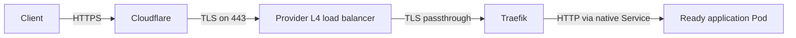

# RFC 0032: Cluster-backed Services

<span id="rfc-0032-cluster-backed-anycloud-services"></span>

> Status: Accepted
> Date: 2026-09-01
> Author: Claude draft
> Decision state: The first release shipped as Services on node pools with one
> replica and a stable HTTPS URL (see the implementation outcome dated
> 2026-09-27). Upgrades, checkpoint storage, multi-replica Services and the
> pool-internal Pod network they need are pending.
> Depends on: RFC 0015's cluster substrate and RFC 0033's capacity-tier
> vocabulary. RFC 0029 Kubernetes Deployments are an adjacent workload, not a public Service
> dependency.
> Number claim: 0031 is claimed by the in-flight teardown-provenance draft.

## Summary

An HTTP workload placed on a Kubernetes Cluster remains an ordinary **Service**
Workload. Users select that placement with `anycloud service ... --cluster`
or Python `serve(..., cluster=...)`; they do not create a Deployment record with
an ingress mode. The Service keeps the existing `$PORT`, stable URL, upgrade,
status, logs, and termination contracts across VM-backed and cluster-backed
placement.

The initial release supports managed Clusters with one warm replica and native
Kubernetes execution. Anycloud owns desired configuration and lifecycle intent;
Kubernetes owns scheduling, Pod replacement, readiness, and rollout execution.
Native resources remain runtime details. Attached Clusters, replica controls,
blue/green, canaries, autoscaling, and scale-to-zero are follow-ups.

The preferred ingress profile is Traefik with Gateway API, cert-manager with
Let's Encrypt DNS validation, a provider L4 load balancer passing TLS through
to Traefik, Cloudflare Full (strict), and Flannel WireGuard for cross-node Pod
traffic. Draft A qualifies this candidate on one managed provider before it
becomes a supported configuration. Service and Cluster configuration remain
authoritative in Anycloud.

Checkpoint bucket support remains a first-release requirement. Its separate
investigation supplies the storage decision before runtime implementation; this
proposal neither selects a storage mechanism nor treats native Pod shutdown as
a successful checkpoint flush.

## Context / problem

RFC 0029 originally considered request serving as a mode of its persistent
Kubernetes workload. That model makes an HTTP Service look like a Deployment,
introduces mode-specific Deployment fields, and duplicates Anycloud's existing
Service lifecycle. Placement should not change the resource users manage.

Anycloud already defines a Service as a long-running HTTP workload with these
contracts:

- the container listens on `0.0.0.0:$PORT`;
- creation returns a stable Service ID and, where supported, a stable URL;
- upgrade replaces the backing workload while preserving that identity and
  URL;
- existing workload status, wait, logs, termination, and deletion
  operations continue to apply; and
- HTTP delivery is not a durable or exactly-once queue.

A Kubernetes Cluster is another execution substrate for that resource. It is
not evidence for a new public workload kind.

### Networking inherited from the jobs-only split

RFC 0033 removes peer networking from jobs-only cluster capacity. Kubernetes Deployment Pods
select Jobs through outbound API calls and need no cross-node Service or
cluster DNS. A cluster-backed Service does require routing to replicas on any
node, so this RFC is the restoration home for the peer-networking machinery
removed from that path.

RFC 0015's prior design used scope-peer rules for UDP 8472 and TCP 10250,
provider-specific private networks, `ClusterFirst` DNS, and a multi-replica
CoreDNS readiness gate. Those remain candidate implementation details for a
Service-capable capacity tier rather than universal cluster requirements. The
preferred WireGuard profile needs its own qualified peer rules; do not copy the
historical VXLAN port configuration unchanged.

## Proposal

- **Smallest useful release:** A user can deploy and operate an ordinary Service
  on a qualified managed Kubernetes Cluster with one warm replica, a stable
  HTTPS URL, and the existing Service operations and checkpoint guarantees.
- **Implementation choice:** Reuse Service identity, validation, configuration,
  and durable intent while delegating execution and routing to native
  Kubernetes controllers. Share Cluster and native-resource helpers with
  Kubernetes Deployments; keep HTTP requests separate from Job claims.
- **Accepted limitations:** The replica incurs idle cost and cannot expand for
  traffic spikes. Upgrades may interrupt requests. Operators supply enough
  Cluster capacity and investigate persistent Pod or routing failures through
  existing diagnostics. Native rollout failure does not imply automatic rollback.

### One Service resource, two placement paths

The existing Service creation interface gains a Cluster placement option:

```bash
anycloud service ghcr.io/acme/api:sha-123 \
  --cluster web-cluster \
  -- python -m acme.api
```

```python
service = client.serve(
    "ghcr.io/acme/api:sha-123",
    cluster="web-cluster",
    command=["python", "-m", "acme.api"],
)
```

`cluster` is a placement choice on Service admission. V1 accepts only qualified
managed Clusters; attached Clusters remain deferred. It is mutually exclusive
with direct-provider placement fields that cannot apply to an existing
Cluster. Admission resolves one substrate before persisting the Service; it
does not create a Deployment and does not accept Deployment configuration such as
`max_concurrent_jobs_per_replica`.

There is no `ingress` object, `ingress_port`, `--ingress-port`, Deployment mode, or
generic `accepts` discriminator. The port remains the existing `$PORT`
environment contract. A cluster-backed Service receives no Deployment identity,
cannot accept targeted Jobs, and does not use the Deployment workload API.

### Preserve the Service lifecycle

Placement does not fork the user-facing lifecycle:

```text
Service intent + placement
  -> VM-host runtime or Kubernetes runtime
  -> stable Service ID and URL
  -> status, logs, upgrade, termination, and deletion
```

`anycloud service upgrade` and the corresponding API operation keep the
Service ID and URL while reconciling a new image and command. Status reports
the same Service-facing states and bounded reasons regardless of substrate.
Generic `/v1/workloads` lifecycle records continue to back Jobs, Services,
and VMs; a cluster-backed Service does not become a row in `deployments`.

The runtime may reconcile an `apps/v1` Kubernetes Deployment, a Kubernetes
Service, an ingress or gateway implementation, and certificates. Their names,
selectors, addresses, and conditions are runtime facts. None becomes a public
Anycloud resource or leaks a second lifecycle through the Service API.

### Native execution and shared machinery

Each Service owns one native Kubernetes Deployment and one stable native
Service, with a route through a qualified gateway. The Cluster owns shared
networking and gateway infrastructure. Service identity, application revision,
and routing configuration remain distinct so a later rollout strategy can
change revision overlap without replacing the public Service.

Reuse Cluster connections, Pod configuration, resource identity, apply, and
ownership-checked cleanup from the existing
[Kubernetes runtime](../src/api/services/kubernetes/deployment-workload.ts).
The [Service runtime boundary](../src/api/services/serve/runtime.ts) selects the
execution substrate. Move VM-only assumptions in the
[upgrade domain](../src/api/services/service-upgrade-domain.ts), including Docker
command construction and VM replacement, behind the VM runtime. Shared
authorization, image/configuration validation, and upgrade intent remain shared.
The Kubernetes path applies desired resources and observes them; it does not
run the VM teardown/provisioning pipeline around Pod replacement.

### Upgrades on the existing Cluster

`anycloud service upgrade` updates the existing Service Workload and native
Kubernetes Deployment. The Service ID, Cluster placement, native Service, route,
DNS name, and TLS configuration remain stable:

1. Validate the requested image and configuration before disturbing the serving
   revision. Persist the requested revision under the existing Service lifecycle
   concurrency checks; stale work cannot override a newer revision or termination.
2. For a stateless Service, update the native Kubernetes Deployment's Pod
   template using `strategy.type: Recreate`. For a checkpoint-enabled Service,
   first satisfy the separately defined finalization and writer-handoff contract.
3. Kubernetes stops the old Pod before starting the replacement. The replacement
   uses eligible Cluster capacity and may land on a different Node. Changing an
   image does not itself require replacing a capacity VM or reserving a second
   application replica.
4. Observe the requested revision and native generation, application readiness,
   and public reachability before reporting a completed upgrade. A stale ready
   Pod or an accepted Kubernetes write alone is not completion. API restart
   resumes reconciliation from durable intent and native observations.

`Recreate` matches v1's accepted downtime and supports capacity sufficient for
only one application Pod, including its GPU allocation. It replaces the Pod and
application process; it does not preserve their memory or Pod-local files.
Failed startup can leave the Service unavailable. Report the blocked or failed
revision through the existing Service status and diagnostics without claiming
success or automatic rollback. Kubernetes' stop-before-create rule applies to
Deployment upgrades, not every Pod-loss or eviction path; it is not a storage
writer fence. See [native rollout semantics](https://kubernetes.io/docs/concepts/workloads/controllers/deployment/#strategy).

### URL and routing ownership

Anycloud owns the stable public URL and maps it to the active Service
revision. The container continues to listen on `0.0.0.0:$PORT`. Kubernetes
networking selects ready Pods without exposing native object names to the
client.

Keep DNS pointed at the qualified public entry point across Pod replacements.
Preserve existing Service URL conventions and integrate ownership-checked DNS
with that stable address; neither the application Pod nor its Node address
becomes the public identity. Qualification covers the required record type and
address updates, including providers that return a load-balancer hostname rather
than an IP address. Existing DNS machinery must satisfy the authorization
contract below before it can support certificate issuance.

Traffic eligibility follows application readiness through the native Service
and EndpointSlices. The native Service must not publish unready Pods as eligible
backends. The gateway must honor readiness and terminating endpoints; an external
HTTP check remains useful for end-to-end observation, not as a replacement for
Pod readiness.

### Preferred ingress and TLS profile

Qualify the following conventional Kubernetes configuration first. A manifest
accepted by Kubernetes, or an HTTPS response from Cloudflare, does not establish
working origin TLS or a supported provider configuration.

| Layer           | Preferred configuration                                                                                                                              | Owner                                                                                                      |
| --------------- | ---------------------------------------------------------------------------------------------------------------------------------------------------- | ---------------------------------------------------------------------------------------------------------- |
| Public entry    | Provider L4 load balancer forwards TCP 443 without terminating TLS; capacity Nodes accept only the qualified private load-balancer/peer traffic.     | Cluster lifecycle and its provider integration                                                             |
| Routing         | Traefik implements a shared Gateway API `Gateway`; each Service has an owned `HTTPRoute` to its stable native Service.                               | Cluster owns the gateway; Anycloud reconciles each Service route                                           |
| Certificates    | cert-manager obtains hostname-specific Let's Encrypt certificates through ACME DNS-01 and stores and renews keys/certificates in Kubernetes Secrets. | Cluster owns controller/issuer infrastructure; Service owns its Certificate and dedicated Secret resources |
| Cloudflare edge | Full (strict) validates the origin certificate; public HTTP redirects at the edge before reaching the origin.                                        | Anycloud's central DNS/edge integration                                                                    |
| Pod networking  | Flannel `wireguard-native` protects cross-node Pod traffic, with working cluster DNS.                                                                | Cluster lifecycle                                                                                          |



TLS terminates at Cloudflare and Traefik. The gateway-to-application HTTP path
uses WireGuard when it crosses Nodes; qualification must observe that actual
path. Same-node traffic remains inside the host trust boundary. This profile
provides transport encryption, not application mutual TLS or protection from a
compromised gateway, Node, or application.

Draft A selects one initial provider and pins k3s, Gateway API CRDs, Traefik,
cert-manager, and the provider load-balancer integration. Record network rules,
kernel requirements, gateway capacity/replicas, readiness and drain defaults,
load-balancer and certificate quotas, recurring cost, and recovery/cleanup
ownership. The current managed control plane disables Traefik and ServiceLB;
installing a native `LoadBalancer` Service does not supply a provider controller.
Keep Node ingress private and explicitly resolve controller ownership instead
of enabling ServiceLB on all capacity Nodes. The qualification is limited to the
provider and configuration actually demonstrated.

Anycloud authorizes DNS and certificate operations for the exact Service
hostname using stable owner and Service identities, including concurrent
hostname claims and deletion. Draft A chooses isolated DNS-01 challenge
delegation or a centrally authorized challenge service. Shared `anycloud.sh`
zone credentials and shared wildcard private keys stay outside customer
Clusters; application Pods receive neither issuer credentials nor gateway TLS
keys. Draft B owns the required DNS authorization and challenge integration,
including any hardening needed before reusing existing DNS operations.
cert-manager owns certificate/key generation and renewal; Traefik must load the
renewed Secret without an application revision change.

The issuer decision also owns ACME accounts, authorization reuse, and hostname
retention or reassignment. Removing a challenge grant or local Secret alone
does not invalidate reusable CA authorization or an issued certificate. Keep a
hostname reserved until the qualified handoff conditions are satisfied. See
[Let's Encrypt authorization reuse](https://letsencrypt.org/docs/profiles/#authorization-reuse-period).

Full (strict) must cover the new endpoints without changing existing VM Service
behavior in the shared zone. Draft A proves a scalable scoped edge policy,
including its limits, installation, and cleanup. A missing, untrusted, expired,
or wrong-host certificate fails the origin connection; failures never trigger
HTTP fallback or a weaker SSL mode. Existing VM origin TLS migration remains a
separate task. Scope any qualification changes to disposable test hostnames.

Unsupported Cluster capabilities are rejected before Service persistence.
After admission, a Service may be creating while its DNS, Certificate, or route
is pending. Report those reasons and require the requested application revision
and verified public HTTPS before reporting it ready.

Sources: [k3s gateway and load-balancer integration](https://docs.k3s.io/networking/networking-services),
[WireGuard networking](https://docs.k3s.io/networking/basic-network-options),
[certificate lifecycle](https://cert-manager.io/docs/usage/certificate/),
[DNS-01 delegation](https://cert-manager.io/docs/configuration/acme/dns01/),
[Cloudflare Full (strict)](https://developers.cloudflare.com/ssl/origin-configuration/ssl-modes/full-strict/),
and [scoped SSL settings](https://developers.cloudflare.com/rules/configuration-rules/settings/).

### Startup and graceful shutdown

Render a startup allowance and application-readiness probe for the configured
`$PORT`. Readiness must establish that the application can serve requests, not
just that its container process exists. Slow initialization remains unready;
failure to become ready within the qualified allowance produces an actionable
status. Qualification records the probe policy and timing defaults for the
supported application contract before they are implemented.

Use a finite termination grace period, application signal handling, and the
qualified gateway's drain behavior. Endpoint withdrawal and Pod shutdown
propagate concurrently; there is no instantaneous routing fence. Requests and
long-lived connections may be interrupted, and shutdown can be forced when the
grace period expires. These bounds must be documented and tested rather than
promising that every request drains. See [Pod termination](https://kubernetes.io/docs/concepts/workloads/pods/pod-lifecycle/#pod-termination).

### One warm replica

An active Service has a fixed desired replica count of one. Kubernetes replaces
failed Pods, while upgrades retain the existing Service contract and may have
downtime. Admission exposes no replica-count or autoscaling controls. There is
no request-demand observer, scaling policy, or scale-to-zero activator in this
release.

### Cluster networking

Cluster-backed Services require node-to-node request routing, ClusterIP or an
equivalent service network, and cluster DNS. Admission therefore requires a
capacity tier that supplies those semantics:

```text
tier none          Deployment/jobs capacity; cluster-backed Services rejected
tier private-peer  provider private network plus scoped peer rules
tier overlay       encrypted WireGuard mesh over node public addresses
```

`private-peer` restores RFC 0015's provider mappings: an AWS scope security
group with self-referencing peer rules, an Azure scope VNet and NSG with the
virtual network as peer source, and a GCP scope network tag with matching
source and target tags. It also restores `ClusterFirst` Pod DNS and the
cross-node DNS readiness gate for Service-capable clusters.

These tiers describe connectivity; private addressing alone does not establish
encryption. The preferred profile uses Flannel `wireguard-native` for cross-node
Pod traffic over the selected private or public peer addresses. `overlay` uses
public peer addresses when private networking is unavailable, but still needs a
qualified public load-balancer integration. Control-plane connections retain
their separate TLS/agent-tunnel contract; WireGuard is not evidence that every
host connection uses the Pod overlay. Collective communication belongs to a
separate fabric-capacity design.

Networking is a Cluster capability, not a per-Service provisioning tier. The
initial qualification selects one supported configuration and explicitly owns
its installation, recovery, and cleanup. A tier name alone does not establish
public reachability or working TLS. Admission requires the qualified capability
before persisting Service intent or creating its resources.

The in-cluster Traefik gateway sits behind the provider load balancer, preserving
RFC 0015's no-public-ingress posture for capacity VMs. Qualification must
demonstrate this path and the encrypted cross-node path rather than assume
ClusterIP is publicly reachable. Existing jobs-only Clusters retain tier `none`;
Service networking, DNS, and ingress health do not become their admission or
readiness requirements.

### Status and authority

Anycloud remains the source of truth for desired Service configuration: image,
command, environment and secret references, resources, placement, revision,
permissions, URL, and lifecycle intent. The existing API, CLI, and Python
interfaces write that configuration. Anycloud renders native Kubernetes
Deployment, Service, HTTPRoute, and Certificate specifications from it; native
resources do not become a second configuration API or a Deployment record.

Cluster gateway/networking settings and selected component versions belong to
Cluster infrastructure configuration managed through Anycloud. Kubernetes
controllers own scheduling, Pod replacement, endpoints, routing observations,
and native status. cert-manager owns certificate material and renewal in
Kubernetes Secrets. Anycloud reconciles its owned desired fields and observes
controller-owned state; manual native changes are not adopted as user
configuration. It does not overwrite renewed key material or duplicate every
Kubernetes condition into durable configuration.

The existing Service status reports readiness and physical Cluster capacity
or routing blocks for the one-replica target. It does not expose unsafe native
addresses or credentials.

### Checkpoint integration boundary

The existing [Service checkpoint contract](../docs/platform/services.md) remains
required: restore before serving, synchronize while running, renew scoped
credentials, and complete a final upload before relinquishing the last retained
copy during upgrade or termination. A failed final upload retains recoverable
data and blocks destructive replacement or cleanup until retry succeeds.

An earlier merged PR supplies the
VM Service foundation for separate S3 credentials and renewal. It does not
implement Kubernetes storage, finalization, or writer fencing. The separate
Kubernetes Service bucket-sync investigation must establish the supported
storage lifecycle, Cluster prerequisites, credential isolation/renewal,
restart recovery, cross-cloud guarantees, and implications for future revision
overlap. A retained PVC or shutdown hook is not assumed to satisfy these by
itself.

Runtime implementation waits for that decision. The native-runtime issue owns
the accepted storage prerequisites, restore, periodic sync, and credential
integration; the operations issue owns finalization, handoff, and retained-data
cleanup. The investigation supplies evidence and a decision, not an implicit
shipped implementation. Its GitHub issue/result link still needs to be supplied;
the dedicated-Job bucket-sync migration is not a substitute.

Checkpoint restrictions apply only to checkpoint-enabled Services. Stateless
Services retain the native rollout path and an independent future path to
overlapping revisions. This distinction does not remove checkpoint support
from the first-release requirements.

### Ownership and recoverable cleanup

Record termination/deletion intent durably and resume cleanup after API restart.
Reuse deterministic resource identities, owner labels, and exact UID
preconditions from [managed-resource cleanup](../src/api/services/kubernetes/managed-resources.ts).
The native Kubernetes Deployment owns its ReplicaSets and Pods through native
garbage collection. Explicitly inventory and clean up each Service-owned native
Service, route, Secret, and any dedicated certificate resources; do not assume
the database Workload record is a Kubernetes owner reference.

Native owner references must obey Kubernetes scope rules. Shared gateways,
Cluster capacity, operator-owned certificates, and other Services are preserved.
Stop owned certificate issuance and remove challenge grants before releasing
hostname ownership under A's qualified retention/handoff policy; interrupted
cleanup must not let stale work issue for a new owner. External DNS cleanup
remains Anycloud's responsibility. Loss of connectivity,
partial deletion, or a same-name object with a different UID must not be treated
as successful removal of the owned resource. Storage cleanup additionally waits
for the checkpoint contract; user-owned buckets are preserved. See
[native ownership](https://kubernetes.io/docs/concepts/overview/working-with-objects/owners-dependents/).

## Decision requirements

**R1 — Keep Service as the public resource.** Cluster placement must not
create, target, or return a Deployment record.

**R2 — Preserve existing Service contracts.** `$PORT`, stable identity and
URL, upgrade, status, logs, termination, and deletion must behave consistently
across supported substrates.

**R3 — Keep the interface small.** Add `--cluster` and `serve(...,
cluster=...)`; do not add `ingress`, `ingress_port`, Deployment mode, or a generic
workload discriminator.

**R4 — Keep Kubernetes subordinate.** Native Kubernetes Deployments, Services, ingress or
gateway objects, certificates, and network addresses remain runtime details.

**R7 — Gate placement at admission.** V1 admits a Service only to a qualified
managed Cluster with the required network, DNS, public ingress, and TLS
capabilities. Tier `none`, unsupported placement fields, and attached Clusters
are rejected before durable intent or provider mutation.

**R8 — Do not regress Deployment capacity.** Service networking, DNS, and
readiness requirements must not become requirements for jobs-only Deployments or
their providers.

**R9 — Preserve the authority split.** Anycloud owns desired Service and Cluster
configuration, permissions, lifecycle intent, and stable routing. Kubernetes
supplies runtime facts and cert-manager owns certificate material/renewal.
Observed native changes never become authoritative user configuration or a
second public lifecycle.

**R10 — Keep one warm replica.** An active Service targets one replica, with
normal Pod replacement and Service upgrades. Replica controls, demand-based
scaling, and activation are outside this release.

**R11 — Upgrade native resources in place.** Preserve the Service identity,
native Kubernetes Deployment, native Service, and public routing while updating
the Pod template with `Recreate`. Require readiness of the requested revision;
do not require surge capacity or promise automatic rollback.

**R12 — Make readiness and draining observable.** Native probes and endpoints
own traffic eligibility. Qualify startup and shutdown bounds and expose failed
readiness without promising atomic traffic withdrawal or uninterrupted requests.

**R13 — Preserve cleanup ownership.** Durable intent, UID-checked deletion,
native garbage collection, and external DNS cleanup must recover from partial
failure without deleting shared or operator-owned infrastructure.

**R14 — Preserve checkpoint guarantees.** Incorporate the separate storage
decision before runtime implementation. Restore, credential renewal, successful
finalization, and failed-upload retention remain required for checkpoint-enabled
Services, without constraining the stateless path to their storage lifecycle.

**R15 — Verify each transport boundary.** The qualified profile validates origin
TLS through the L4 load balancer and encrypts cross-node Pod traffic. Certificate
or network failures are observable and never weaken encryption. Scoped edge
configuration preserves existing VM Service behavior.

**R16 — Bound certificate authority to owned hostnames.** DNS claims, issuance,
renewal, and cleanup enforce stable Service ownership. Customer Clusters receive
no shared-zone credentials or shared wildcard private keys. Renewal remains
independent of application revisions.

## Acceptance scenarios

Coverage records current evidence, not intended tests. All entries below remain
review-only until implementation supplies tests carrying their `0032/S<id>`
tokens, following [RFC 0025](./0025-enforcement-ledgers.md#scenario-coverage).

| ID  | Scenario                     | Required result                                                                                                                                                                                                                            | Coverage                                                      |
| --- | ---------------------------- | ------------------------------------------------------------------------------------------------------------------------------------------------------------------------------------------------------------------------------------------ | ------------------------------------------------------------- |
| S1  | Cluster placement            | CLI `service --cluster` and Python `serve(cluster=...)` create one Service Workload on a qualified managed Cluster, with one desired replica and no Deployment record.                                                                     | review — native-runtime implementation pending                |
| S2  | Existing contract            | The container receives `$PORT`; status, logs, wait, termination, and deletion retain the ordinary Service interfaces.                                                                                                                      | review — operations implementation pending                    |
| S3  | Stable upgrade               | Upgrade preserves Service ID, HTTPS URL, native Kubernetes Deployment and native Service identities, and routes to the requested ready revision.                                                                                           | review — upgrade implementation pending                       |
| S4  | Contract rejection           | Attached Clusters, conflicting direct-provider placement, `ingress`, `ingress_port`, Deployment concurrency, targeted Jobs, and replica/scaling controls are rejected for a Service.                                                       | review — admission implementation pending                     |
| S5  | Runtime boundary             | Native resources derive from Anycloud configuration; drift does not replace that authority. No Deployment record, VM replacement pipeline, or second lifecycle is added; terminal cleanup remains owned.                                   | review — native runtime and cleanup pending                   |
| S8  | Tier admission               | Tier `none` and missing required ingress/TLS capability are rejected before Service persistence or provider mutation.                                                                                                                      | review — capability implementation pending                    |
| S9  | Cross-node routing           | Qualified networking routes to ready Pods across Nodes and resolves required internal names, including after Pod movement.                                                                                                                 | review — networking qualification pending                     |
| S10 | Jobs isolation               | Enabling Service networking preserves existing jobs-only Deployment admission, DNS, next-Job behavior, and Node-scaling ownership.                                                                                                         | review — regression qualification pending                     |
| S11 | Constrained-capacity upgrade | With capacity for one application Pod and no spare allocation, `Recreate` stops the old revision and starts the new one without replacing a capacity VM or requiring surge capacity.                                                       | review — constrained-capacity qualification pending           |
| S12 | Slow or failed startup       | An initializing application receives no traffic until its readiness signal succeeds; exhausted startup allowance is observable and never reported as a ready upgrade.                                                                      | review — probe policy and runtime pending                     |
| S13 | Bounded shutdown             | Endpoint withdrawal and application shutdown follow the qualified drain policy; requests exceeding the finite grace period may fail, consistently with documented behavior.                                                                | review — gateway and shutdown qualification pending           |
| S14 | API unavailability           | Kubernetes replaces a deleted stateless application Pod while the Anycloud API is unavailable; the stable route follows the ready replacement and status reconciles when the API returns.                                                  | review — recovery qualification pending                       |
| S15 | Shared-resource cleanup      | Deleting one Service removes its owned native resources and DNS while preserving another Service, shared gateway, Cluster capacity, and operator-owned certificates.                                                                       | review — ownership qualification pending                      |
| S16 | Restart during operations    | API restart or an interrupted Kubernetes request resumes the requested upgrade or cleanup without duplicating identity, losing intent, or declaring unconfirmed deletion complete.                                                         | review — reconciliation implementation pending                |
| S17 | Ownership collision          | Cleanup does not delete a same-name native object with a different UID or owner, and reports the unresolved operation.                                                                                                                     | review — ownership checks pending                             |
| S18 | Failed or stale rollout      | A bad image, failed readiness, scheduling block, or stale ready revision cannot complete a newer upgrade; status identifies the current failure without promising automatic rollback.                                                      | review — revision observation pending                         |
| S19 | Checkpoint lifecycle         | The separately selected storage design demonstrates restore, periodic sync, renewal, final upload, failed-upload retention, and retry after API restart without competing writers or premature data cleanup.                               | review — separate checkpoint decision and integration pending |
| S20 | Stable HTTPS entry point     | Public HTTPS remains valid across Pod replacement; gateway/certificate failures are observable and per-Service cleanup respects the selected DNS/TLS ownership.                                                                            | review — ingress and TLS qualification pending                |
| S21 | Origin TLS enforcement       | Valid origin TLS passes through the L4 load balancer; missing, untrusted, expired, and wrong-host certificates fail without HTTP fallback. Edge HTTP redirects do not reach the origin, and scoped settings preserve existing VM Services. | review — origin TLS and scoped edge qualification pending     |
| S22 | Certificate renewal          | cert-manager renews/rotates certificate material and Traefik serves it without an application revision change. Issuer outages are observable, retry safely, and never weaken transport protection.                                         | review — certificate lifecycle qualification pending          |
| S23 | Hostname authorization       | Concurrent hostname claims, challenge grants, issuance, renewal, and deletion enforce stable Service ownership; unowned names are rejected, credential isolation holds, and stale cleanup cannot affect a later owner.                     | review — DNS and issuer authorization qualification pending   |
| S24 | Encrypted cross-node traffic | Observations of synthetic requests prove the gateway-to-application traffic is encrypted on the inter-node network before and after Pod movement; a broken encrypted path never falls back to plaintext.                                   | review — WireGuard transport qualification pending            |
| S25 | Shared ingress recovery      | Gateway/controller restart and interrupted provider load-balancer provisioning or cleanup recover without duplicate owned resources; the public hostname survives recovery and another Service's infrastructure remains intact.            | review — provider and gateway recovery qualification pending  |

## Deferred work

R5/R6 and S6/S7 retain their original identifiers below. They do not gate the
one-replica release.

### Attached Clusters and richer rollouts

Attached Clusters need their own capability qualification and infrastructure
ownership contract before admission. Discovering an arbitrary native Service
does not establish support.

Blue/green, canaries, and zero-downtime upgrades require explicit promotion,
traffic switching, rollback, and capacity contracts. Keep identity, revisions,
and routing separate now; do not make stop-before-replace a permanent rule for
all Services. Native rollout controllers may implement later policies while
Anycloud retains configuration authority. Stateful overlap additionally needs
the storage investigation's writer-handoff and data-compatibility assessment.

### Service autoscaling (R5)

Revisit when measured traffic exceeds one replica's capacity and operators
repeatedly need additional replicas. The future design needs one Service
replica owner, revision fencing, demand observation, and safe connection drain.
It must specify missing-data, stream, and WebSocket behavior without borrowing
Deployment Job retry semantics. HPA, KEDA, or RFC 0030 machinery may be reused only
under that Service ownership contract.

### Scale-to-zero and activation (R6)

Revisit when measured idle cost justifies the cold-start latency and request
buffering. A zero minimum would require an activator reachable at zero replicas
with explicit count, byte, and time bounds and documented overflow/timeout
errors. It would remain internal Service machinery and would not make HTTP
requests durable. Observer and activator topology are decisions for that work.

| ID  | Scenario            | Required result if adopted                                                                                                  | Coverage                              |
| --- | ------------------- | --------------------------------------------------------------------------------------------------------------------------- | ------------------------------------- |
| S6  | Concurrency scaling | Qualified request observations raise and lower Service replicas within bounds under one replica owner.                      | review — autoscaling remains deferred |
| S7  | Scale-to-zero       | A bounded activator holds an eligible request until capacity is ready and returns documented errors on overflow or timeout. | review — activation remains deferred  |

## Alternatives considered

### Deployment ingress mode

Rejected. It makes placement define the public resource, adds mode-specific
Deployment fields, and forks the existing Service lifecycle. A Deployment remains a
logical finite-Job consumer; a request-serving workload remains a Service.

### A public Kubernetes Service resource

Rejected as a separate abstraction. The public noun is the existing Service
Workload. A native Kubernetes Service may implement it but is not independently
addressable through the Anycloud API.

### Kubernetes HPA or KEDA owns replicas

Deferred with Service autoscaling. Any chosen controller would remain
subordinate to the Service policy, fencing, status, and upgrade contract.

### Node-port addressing without cluster networking

Rejected as the primary design. It exposes capacity-node topology, requires
per-port firewall changes, and rebuilds service discovery outside Kubernetes.

### Keep peer networking on every Cluster

Rejected by RFC 0033. Jobs-only Deployments do not consume it, and retaining the
requirement would exclude otherwise valid capacity providers. Service-capable
networking is admitted and qualified only where needed.

### Other ingress and certificate configurations

Cloudflare Tunnel, Origin CA certificates, Envoy Gateway, and conventional
Ingress remain alternatives if qualification identifies a concrete blocker in
the preferred profile. Record the evidence and amend the selected design before
implementation relies on a substitute. The first investigation qualifies one
provider configuration rather than claiming support for every combination.

## Risks and caveats

- Stable public routing needs an owner that remains available independently
  of the Service replica.
- One warm replica incurs idle cost and offers no automatic capacity increase.
  Pod loss or upgrades can interrupt requests and long-lived connections under
  the existing Service lifecycle contract.
- The WireGuard overlay is suitable for request and control traffic, not a
  high-bandwidth collective data plane.
- VM-backed and cluster-backed implementations can drift unless the same
  black-box Service lifecycle suite qualifies both.
- Stateful finalization and writer handoff remain unresolved until the separate
  checkpoint decision; a passing stateless rollout does not qualify them.
- Provider load-balancer integration adds recurring cost and recovery/cleanup
  obligations; provider support must be demonstrated rather than inferred from
  its ability to provision VMs.
- ACME quotas and availability of the authorized DNS challenge path affect
  issuance and renewal. Record retry, monitoring, and expiry behavior while
  preserving strict TLS during an issuer or coordinator outage.

## Non-goals

- implementing the runtime or running the storage investigation in this RFC and
  issue-preparation change;
- attached Cluster support, blue/green, or canary rollout controls in v1;
- replica-count controls, autoscaling, scale-to-zero, or request buffering;
- changing Deployment Job selection or RFC 0030 Deployment autoscaling;
- migrating existing VM Services to origin TLS, retiring their runtime, or moving
  the hosted Anycloud API into the Cluster;
- durable or exactly-once HTTP delivery;
- multi-Cluster routing, spillover, or failover;
- gang or collective-communication traffic on the overlay;
- promising zero-downtime upgrades before a separate rollout contract; or
- exposing Kubernetes Deployments, Services, ingress objects, gateways, or
  activators as public Anycloud resources.

## Open questions

1. Which initial provider, load-balancer/controller integration, exact component
   versions, cost, gateway capacity, and readiness/drain defaults qualify the
   preferred profile? Resolve in
   [draft A](./0032-kubernetes-ingress-deployments/issue-drafts.md#a-qualify-conventional-kubernetes-ingress-and-tls-on-one-managed-provider).
2. Which DNS-01 delegation or authorized challenge service, hostname-claim
   mechanism, and scoped Cloudflare edge policy meet the authorization and VM
   compatibility requirements, within provider/CA/edge limits? Draft A records
   the decision; B implements it, including required DNS record-type support.
3. How is the qualified configuration represented and reconciled through
   Anycloud's Cluster lifecycle without changing jobs-only Clusters or adding a
   public native-object configuration API? A specifies this and B/C implement it.
4. Which checkpoint lifecycle, storage prerequisites, and writer fence preserve
   the required guarantees across the investigation's selected clouds? Resolve
   in the separate bucket-sync investigation and link its decision here before
   draft C begins. No Kubernetes storage result is claimed by that earlier PR.

## Tracking

A parent tracking task coordinates
the six [implementation sub-issues](./0032-kubernetes-ingress-deployments/issue-drafts.md)
and their blocking dependencies. The parent and sub-issues are assigned to the
[Anycloud Releases project](https://github.com/orgs/anycloud-sh/projects/3),
iteration **0.1.65**; qualification and the separate checkpoint decision remain
prerequisites for implementation. The issues own progress; publication does not
establish completed implementation or qualification evidence.

| Issue | Outcome                                                                                         | Prerequisites                                                           |
| ----- | ----------------------------------------------------------------------------------------------- | ----------------------------------------------------------------------- |
| A     | Qualify the preferred conventional ingress/TLS profile on one managed provider                  | Existing Cluster substrate                                              |
| B     | Implement Cluster networking, gateway, provider/issuer/edge integrations, and capability checks | A                                                                       |
| C     | Add Service admission and native runtime, including accepted storage integration                | A, B, and the separate checkpoint decision                              |
| D     | Add upgrades, observations, logs, restart recovery, and owned cleanup                           | C                                                                       |
| E     | Qualify the complete lifecycle and affected regressions                                         | B, C, D; coordinate shared fixture work with the migration              |
| F     | Document supported behavior and operator actions                                                | C and D define behavior; E is required before publishing release claims |

RFC 0017's existing Service baseline, upgrade, and GPU migration remains VM-host
work. New Kubernetes Service coverage belongs to this feature; it does not
authorize early Bash retirement or make finishing the migration depend on
shipping Services on Kubernetes.

Coordinate changes to shared fixtures, observations, cleanup, registrations, and
workflows with the migration handoff
and shared integration.
The queued provider-boundary refactor
is an issue, not a merged prerequisite; consume its agreed interfaces when that
work lands. Isolated RFC and product work can proceed within their own design
dependencies while shared harness changes follow the migration's coordination.

## Implementation outcome (2026-09-27)

Current state as shipped on `main`; the decisions above are unchanged. The
first release shipped as **Services on node pools** (RFC 0033's tier-`none`
capacity), one replica, `https://<id>.anycloud.sh`. Where the shipped shape
departs from the approved profile, the departure is recorded here rather than
edited into the proposal.

- **Placement**.
  `anycloud service … --node-pool <id-or-name>` admits an ordinary Service
  onto a `ready` node pool whose cluster passes the connection check; the
  request is rejected before durable intent otherwise (R7's gate, keyed on
  pool readiness rather than a capability tier). The placement unit is the
  node pool, not the cluster — the collapse left one cluster per installation
  and pools carry provider, credential, region, zone and VM type, so the
  Service may not select those (R1, R3 kept: no Deployment record, no new
  discriminator). The Python `serve(..., cluster=...)` form has not shipped.
  Native execution follows the proposal: one native Deployment (`Recreate`),
  Service and Secret in the Service's own namespace under Anycloud's
  configuration authority (R4, R9, R10). GPU pools are refused for Services.
- **Readiness order.** A Service
  reaches `running` only after its endpoint is ready and a thirty-second
  startup dwell has passed, measured on the product's own event times;
  an unobservable probe (DNS not yet resolvable) is not a refusal (R12).
- **Ingress, slice 2a**
  (live-proven).
  Each pool that hosts Services elects a sticky **ingress entry** Node and
  runs its own Traefik release there; the pool scope admits TCP 80 from the
  Cloudflare edge ranges to that entry and nothing else.
- **Public URL, slice 2b**
  (live-proven in
  run 36263136609).
  A per-Service Traefik `IngressRoute` for `<id>.anycloud.sh`, a proxied DNS
  record published with the creator's token once the Service runs and the
  entry serves, re-pointed in place when the pool elects a new entry, removed
  at termination; `anycloud status` shows `URL:` and `Public endpoint:`. The
  live cluster check's `pool_ingress` stage covers entry loss and re-point.
- **Departures from the approved ingress/TLS profile.** Routing uses Traefik's
  `IngressRoute` CRD, not Gateway API `HTTPRoute`. TLS terminates at
  Cloudflare on a proxied record; the origin path is HTTP on 80 from the edge
  ranges — no cert-manager, no Let's Encrypt origin certificate, no provider
  L4 load balancer, no Full (strict). No cross-node Pod network and no
  WireGuard: the pool keeps RFC 0033's tier `none`, and the replica is
  **co-located with the ingress entry** (Deployment `nodeSelector`, native
  Service `internalTrafficPolicy: Local`), recreated on the new entry when
  the pool re-elects it. Draft A's qualification of the approved profile did
  not happen; the shipped profile was proven by the live cluster check instead.
- **Not shipped yet.** `anycloud service upgrade` for pool Services (R11);
  `anycloud logs`, `ssh` and `exec` for them (R2 in part); checkpoint storage
  (refused at admission until the retained-volume binding exists); attached
  Clusters, replica controls, autoscaling and scale-to-zero (R5/R6, deferred
  as decided). Multi-replica Services (slice 3) depend on a pool-internal Pod
  network; a design for it is with the owner and would replace the entry
  co-location above. Its RFC 0033 amendment is not part of this note.

## Change log

- **2026-09-22:** Published the six implementation sub-issues under a parent
  tracking task, recorded their blocking dependencies, and assigned
  Anycloud Releases iteration 0.1.65. The RFC remains Proposed and all
  qualification prerequisites remain.

- **2026-09-01:** Created as the deferred home for ingress Deployments,
  ingress autoscaling, and the peer-network restoration design, per the
  jobs-only split of RFCs 0029 and 0030.
- **2026-09-01:** Clarified that RFC 0029 exposes no reserved ingress field;
  this RFC adds the optional selector with the request-serving contract.
- **2026-09-03:** Reframed request-serving Kubernetes workloads as ordinary
  cluster-backed Anycloud Services, removed Worker ingress mode and its
  selector fields, and made this RFC the exclusive owner of Service
  autoscaling.
- **2026-09-16:** Reconfirmed that RFC 0017's VM-host Service migration does not
  create Kubernetes Service membership while this RFC remains deferred.
- **2026-09-22:** Tightened the managed-Cluster native execution, upgrade,
  readiness, routing, cleanup, and checkpoint boundaries; added acceptance
  coverage accounting and dependency-ordered issue drafts. Runtime and storage
  implementation remain pending their design prerequisites.
- **2026-09-22:** Selected the conventional ingress/TLS profile for qualification,
  made Anycloud configuration authority explicit, and added transport,
  certificate, authorization, and recovery scenarios S21–S25. Extended drafts
  A–F with the corresponding infrastructure, runtime, and qualification duties.
- **2026-09-27:** Status set to Accepted and the implementation outcome
  recorded: `service --node-pool`, the readiness-order contract,
  the per-pool ingress entry and the Service URL with live evidence, the departures from the approved ingress/TLS
  profile, the entry-Node co-location and its pending replacement by a
  pool-internal Pod network, and what has not shipped. No earlier entry was
  changed.

## Decision

Scope approved on 2026-09-10: the first release adds Cluster placement for the
existing Service with one warm replica and its existing lifecycle. Autoscaling
and scale-to-zero, including R5/R6 and S6/S7, remain deferred.

RFC and issue preparation scope recorded on 2026-09-22: use managed Clusters, native
execution under Anycloud configuration authority, stable HTTPS, and `Recreate`
upgrades on existing Cluster capacity. Preserve checkpoint support as a
first-release requirement while its separate investigation supplies the storage
decision. This revision delivers the design and issue drafts; the RFC remains
Proposed and product implementation remains deferred pending the networking
qualification and checkpoint decision.

Ingress/TLS amendment approved on 2026-09-22: qualify Traefik with Gateway API,
cert-manager with Let's Encrypt DNS-01, a provider L4 load balancer with TLS
passthrough, Cloudflare Full (strict), and Flannel WireGuard on one managed
provider. Anycloud retains desired Service and Cluster configuration authority.
Approval covers the RFC and issue-draft amendment; the candidate is not yet a
qualified or shipped configuration, and the RFC remains Proposed.

Accepted, recorded 2026-09-27. The 2026-09-10 scope shipped: an ordinary
Service placed on managed capacity with one replica, its existing lifecycle
minus upgrade, and a stable HTTPS URL, delivered as `service --node-pool`
and proven by the live cluster check. The
2026-09-22 ingress/TLS profile was not the one built; the shipped profile
(Traefik `IngressRoute` on a per-pool entry, Cloudflare-terminated TLS, HTTP
origin from the edge ranges, replica co-located with the entry, no cross-node
Pod network) is recorded in the implementation outcome as the accepted
departure. Draft A is closed by that record. Upgrades, checkpoint storage and
multi-replica Services remain pending; the pool-internal Pod network that
slice 3 needs is a separate decision, recorded in RFC 0033 when taken.
