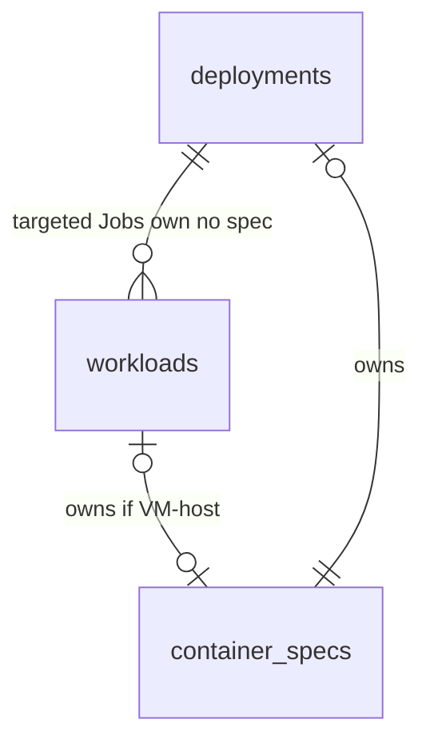

# RFC 0036: Shared container specifications and configuration authority

> Status: Proposed
> Date: 2026-09-04
> Author: Codex draft
> Depends on: RFC 0025 and RFC 0029

## Summary

Use one private `container_specs` table for the container configuration owned
by VM-backed Jobs, Services, persistent VMs, and Kubernetes Deployments. Each resource owns
its own row: sharing a schema does not mean sharing a row, mutation policy,
or lifecycle. VM-backed Jobs and persistent VMs retain their admitted values;
Services update through Service upgrade; Deployments update through generation
CAS. Deployment-targeted Jobs own no spec and bind to their Deployment's configuration
at execution time. They store no container snapshots. `workloads` loses its
common container columns and gains no replacement columns; `submitted_at` and
the existing identity, target, and lifecycle fields remain.

There is no revision history, content deduplication, independent spec lifecycle,
or public Spec API. Ship the entire model in **one product release**, with one
combined configuration cutover after existing migration history. Earlier
experimental Deployment state has no upgrade-continuity guarantee. The sole known
0.1.62 database contains none; preserve its shipped VM-host workloads without
adding Deployment conversion machinery.

## Scope and decision

This revises the initial Jobs-and-Deployments-only scope to include the common
container fields of Services and persistent VMs. Their existing admission,
upgrade, and repair paths already use the same VM-host representation; excluding
them would retain a second canonical representation solely because of the
original audit boundary. Including them justifies moving the common columns
out of `workloads` altogether. It does not unify their lifecycle rules.

Job remains the single public finite-work resource: it either uses the existing
VM-host pipeline or targets a separate mutable Kubernetes Deployment. No public
Execution, Target, or Spec resource is introduced. No per-Job Deployment overrides,
new Service/VM update operations, or mutable Deployment placement are proposed.
Resource naming follows separate earlier renames. Provider placement, storage, SSH, VM attempt
ownership, Kubernetes rollout, and resource retention retain their meanings.

At the audit baseline, the Worker rename had not shipped. Its experimental predecessor,
`cluster_deployments`, and creation APIs were included in the publicly released
[v0.1.62](https://github.com/anycloud-sh/releases/releases/tag/v0.1.62). This RFC
makes an explicit support decision: earlier experimental Deployment state has no
upgrade-continuity guarantee. A read-only audit of the only 0.1.62 database, as
identified by its operator, found no such records. The shared model is the first
supported Deployment configuration model; publication of its predecessor is not a
reason to implement unused compatibility paths.

### Proposed data-model diff

```diff
 workloads
-  image, image_digest, command, env, github_token, docker_options
   id, workload_type, deployment_id, current_execution_id, submitted_at
   identity, lifecycle, VM placement/storage/SSH, diagnostic docker_command
   gpu_type, image_runtime, secret_names, ...

 deployments
-  template                       # encrypted aggregate JSON
+  gpu_count
   identity, cluster_id, concurrency, generation, deletion lifecycle

+container_specs
+  workload_id UNIQUE nullable FK -> workloads
+  deployment_id     UNIQUE nullable FK -> deployments
+  image, image_digest, command, docker_options
+  env, registry_username, registry_token  # independently encrypted
+  exactly one owner: workload_id XOR deployment_id

 workload_events, vms
   unchanged
```

| Owner                   | Spec count | Configuration authority and mutation                                   |
| ----------------------- | ---------- | ---------------------------------------------------------------------- |
| VM-backed Job           | One        | Admitted values, immutable across provisioning retry and resubmission  |
| Service                 | One        | Current accepted configuration; replaced through Service upgrade       |
| Persistent VM           | One        | Admitted values, immutable; missing-container repair reuses them       |
| Deployment              | One        | Current desired configuration; updated in place with generation CAS    |
| Deployment-targeted Job | Zero       | Its Deployment supplies configuration when the runtime selects the Job |



Each spec has exactly one owner across the two relations. Owner IDs occupy
separate namespaces; identical IDs in the two parent tables do not collide.
There is no surrogate spec ID or independent lookup/lifecycle.

## Current authority and lifecycle

The audit baseline is `origin/main` at `d64cf6736`, after the Worker rename and through
`0100_rename_cluster_deployments_to_workers.sql`. The subsequent Azure
experiment commits do not change these authorities. Number 0036 retains this
draft's allocation under the repository's RFC convention. This section records
the baseline, including the descriptive copies removed by the recommendation,
using current Workload and Deployment names. The migration section retains the
literal historical schema names.

An authority determines behavior; a projection describes another authority.
A placeholder satisfies a physical record shape or records intent before an
external operation completes. Similar fields can serve different purposes.

### `workloads`

The row owns resource identity, owner scope, attribution, state, timestamps,
and cleanup lifecycle. Its `workload_type` distinguishes Job, Service, and
persistent VM; a Job's immutable `deployment_id` selects its execution path.

For VM-host resources, admission stores image/digest, command, environment,
Docker options, registry token, SSH key, secret names, compute and credential
selectors, storage, disk, spot/GPU request, and detected image runtime.
VM-backed Job retries and resubmission reuse this admitted configuration.
Persistent VMs have no supported configuration-update or resubmission operation;
a missing container can be recreated on the same live host from admitted values.
An interactive change inside a VM is not a durable configuration update.

Services are the existing exception to insert-only container configuration.
`beginServiceUpgrade` writes replacement image, digest, command, environment,
token, and diagnostic command, claims `Running → Recovering`, and then inserts
an event separately. Upgrade preserves placement, storage, Docker options,
attribution, and existing image-runtime metadata. Recovery tears down the old
VM before provisioning the accepted replacement. Service resubmission uses
the current accepted configuration, not an original version.

Canonical environment/token/SSH values are encrypted. `docker_command` is a
diagnostic rendering with heuristic secret-key redaction: ordinary environment
values can be plaintext. Launch rebuilds its command from canonical values;
the diagnostic is neither execution authority nor a complete secret boundary.
`user_id` is captured attribution and also supplies the VM-host registry
username/`GITHUB_USER`, even without a token.

Deployment-Job admission accepts the target, optional Job ID, and attribution, not
container overrides. It copies image/digest/command/options for display. It
writes empty `docker_command`, encrypted empty SSH, false spot, and null
VM/storage/environment/token fields to fit the wide table. Released 0.1.62
also copied Deployment GPU type; that historical value is descriptive, not runtime
configuration.

Sources: [admission plan](../src/api/services/workload-admission-plan.ts),
[targeted admission](../src/api/services/targeted-job-admission.ts),
[Workload creation](../src/api/services/repositories/workload-creation.ts),
[Service upgrade](../src/api/services/service-upgrade-domain.ts),
[management](../src/api/services/workload-management-domain.ts), and
[VM container repair](../src/api/services/host-runtime/vm-container-repair.ts).

### `deployments`

A Deployment owns identity, owner, globally case-insensitive active name, immutable
Cluster, mutable desired container configuration, GPU count, concurrency,
generation, and deletion timestamps. Container fields currently live together
in the encrypted `template`. Creation starts generation 1. Every successful
update increments generation, including GPU-only and concurrency-only updates.

Update merges the patch, validates supplied command/environment fields, and
checks merged Docker/GPU/Cluster relationships. Omitted fields retain their
stored representation; unrelated updates do not re-admit legacy environment
names under today's policy. An explicitly supplied image triggers inspection
against the selected accelerator runtime and refreshes actor registry
credentials; unrelated updates do not. Omitted Docker options preserve the map
and admitted GPU count while revalidating current capacity. Explicit replacement
of Docker options, including `{}` or `null`, resolves capacity defaults again.

The controller prevents stale generations from selecting new work, drains
unreleased executions before replacement, and soft-deletes only after targeted
work is terminal and cleaned. Configuration remains with soft-deleted Deployments.
Sources: [store](../src/api/services/deployment-store.ts),
[domain](../src/api/services/deployments-domain.ts), and
[controller](../src/api/services/deployment-controller.ts).

### `workload_events`

Events retain ordered transition evidence and selected execution facts.
They are append-oriented, not byte-immutable: bounded enrichment can add
diagnostics or telemetry. Current state and its event are transactionally
maintained in the scoped Job paths; Service upgrade currently has the separate
write noted above.

A targeted running event records execution UUID, Deployment generation, Pod UID,
and container ID. Its generation identifies the selected runtime for replay and
later reports; `deployments.generation` governs current desired state and fresh
selection. Central redaction applies to metadata. Events are not a secret store
or a configuration-history mechanism.

### `vms`

Each row belongs to exactly one workload or managed Cluster. It records a real
provisioning attempt, not a desired execution target. Before provider mutation,
the orchestrator commits a placeholder with synthetic cloud ID, resolved
placement, credential, price, and bucket facts. IP, base image, and connection
facts arrive later; the provider can refine identity, zone, price, and timing.
Requested workload placement remains separate from these resolved facts.

Rows survive retries and teardown as attempt/cost history. Removal request and
confirmed `ended_at` differ; workload `cleaned_at` is the resource's cleanup
boundary. Deployment execution creates no synthetic VM row. During Service upgrade,
VM and event records still identify the old host and checkpoint obligations
even though current container configuration already describes its replacement.
Sources: [attempt ledger](../src/api/services/repositories/provisioning-attempts.ts),
[teardown](../src/api/services/host-runtime/termination.ts), and
[checkpoint ownership](../src/api/services/vm-runtime-storage.ts).

### `current_execution_id`

This nullable, uniquely indexed workload field is the latest targeted
execution fence. Selection commits it together with running state and the
execution event. It remains through outcome/retry/cleanup, changes on replacement
selection, and is cleared on explicit resubmission. Runtime operations must
match the current UUID and the event's generation/Pod/container tuple; an old
generation can finish its still-current execution but cannot act on a replacement.
It is neither a spec reference nor a new public Execution resource.
Sources: [selection and fences](../src/api/services/repositories/deployment-executions.ts) and
[runtime authentication](../src/api/services/deployment-workload-domain.ts).

### Classification of repeated fields

| Similar fields                                                      | Classification                                           | Consequence                                                                                |
| ------------------------------------------------------------------- | -------------------------------------------------------- | ------------------------------------------------------------------------------------------ |
| Common container serialization, encryption, and lossless mapping    | Genuine implementation duplication where semantics match | Share the representation and codec; keep VM-host/Kubernetes admission policy separate      |
| VM-host container values versus Deployment values                   | Harmless parallel ownership                              | Same table, different exclusively owned rows; no cross-resource reuse                      |
| Deployment GPU count versus VM GPU type/placement                   | Different semantics and ownership                        | GPU count stays on Deployment; provider selection stays on workload                        |
| Requested placement/credentials versus resolved VM facts            | Required request/fact parallelism                        | Neither overwrites the other                                                               |
| Deployment image/digest/command/options copied into a Job           | Existing response-shape duplication                      | Remove copies; show Deployment target and obtain current configuration from the Deployment |
| Environment versus diagnostic command                               | Canonical data plus projection                           | Do not reconstruct configuration from the command or claim it encrypts all values          |
| State/timestamps versus events; current UUID versus execution event | Useful current-state/history duplication                 | Maintain transaction and fence checks                                                      |
| Desired Deployment generation versus selected event generation      | Distinct current-state/execution-fact authority          | Retain both without implying reconstructable revisions                                     |
| Hydrated cloud provider versus requested/provider-attempt fields    | Derived description                                      | Keep explicit derivation, not another persisted authority                                  |
| Empty Deployment-Job SSH/command, false spot, null VM fields        | Physical defaults for retained columns                   | Keep defaults inside persistence; no VM-shaped admission input or dummy SSH encryption     |
| Missing connection facts in a pending VM row                        | Required crash-safety placeholders                       | Keep placeholder-before-provider lifecycle                                                 |

## Recommendation: owned container specs without history

### Complete affected-table schema

The schema below uses the final names from migrations 0105 and 0106. Migration
0102 itself retains the earlier `deployments`/`workers` names recorded in the
[migration section](#one-release-migration-and-delivery).

This is final-state SQLite DDL, not a migration to run verbatim against populated
tables. The migration builds replacement parents, copies prepared rows, recreates
the listed indexes/guards, and validates before commit. All other tables remain
unchanged. The two unique owner references identify each spec; no surrogate
spec ID, public resource, or separate repository lookup is needed.

```sql
CREATE TABLE deployments (
  id TEXT PRIMARY KEY NOT NULL,
  owner_user_id TEXT NOT NULL CHECK (length(trim(owner_user_id)) > 0),
  name TEXT NOT NULL CHECK (length(trim(name)) > 0),
  cluster_id TEXT NOT NULL REFERENCES clusters(id) ON DELETE RESTRICT,
  gpu_count INTEGER NOT NULL CHECK (
    typeof(gpu_count) = 'integer' AND gpu_count BETWEEN 0 AND 9007199254740991
  ),
  max_concurrent_jobs_per_replica INTEGER NOT NULL DEFAULT 1 CHECK (
    typeof(max_concurrent_jobs_per_replica) = 'integer'
    AND max_concurrent_jobs_per_replica BETWEEN 1 AND 9007199254740991
  ),
  generation INTEGER NOT NULL DEFAULT 1 CHECK (
    typeof(generation) = 'integer' AND generation BETWEEN 1 AND 9007199254740991
  ),
  deletion_requested_at INTEGER,
  deleted_at INTEGER,
  created_at INTEGER NOT NULL,
  updated_at INTEGER NOT NULL,
  CHECK (deletion_requested_at IS NULL OR deletion_requested_at >= created_at),
  CHECK (deleted_at IS NULL OR (
    deletion_requested_at IS NOT NULL AND deleted_at >= deletion_requested_at
  ))
);

CREATE UNIQUE INDEX idx_deployments_active_name ON deployments(lower(name))
  WHERE deleted_at IS NULL;
CREATE INDEX idx_deployments_cluster ON deployments(cluster_id, deleted_at, created_at);

CREATE TABLE workloads (
  id TEXT PRIMARY KEY NOT NULL,
  user_id TEXT NOT NULL,
  owner_user_id TEXT,
  workload_type TEXT NOT NULL CHECK (workload_type IN ('job', 'service', 'vm')),
  deployment_id TEXT REFERENCES deployments(id) ON DELETE RESTRICT,
  current_execution_id TEXT,
  state TEXT NOT NULL,
  started_at INTEGER NOT NULL,
  submitted_at INTEGER,
  completed_at INTEGER,
  cleaned_at INTEGER,
  cleanup_attempts INTEGER,
  docker_command TEXT NOT NULL,
  region TEXT,
  vm_type TEXT,
  gpu_type TEXT,
  spot INTEGER DEFAULT 0,
  availability_zone TEXT,
  credential_id TEXT,
  requested_compute_provider TEXT,
  disk_size_gb INTEGER,
  disk_tier TEXT,
  image_runtime TEXT,
  ssh_private_key TEXT NOT NULL DEFAULT '',
  secret_names TEXT,
  input_bucket TEXT,
  input_storage_credential_id TEXT REFERENCES credentials(id) ON DELETE RESTRICT,
  input_storage_region TEXT,
  output_bucket TEXT,
  output_storage_credential_id TEXT REFERENCES credentials(id) ON DELETE RESTRICT,
  output_storage_region TEXT,
  checkpoint_bucket TEXT,
  checkpoint_storage_credential_id TEXT REFERENCES credentials(id) ON DELETE RESTRICT,
  checkpoint_storage_region TEXT,
  dns_record_id TEXT,
  session TEXT,
  agent TEXT,
  session_label TEXT,
  CHECK (
    (deployment_id IS NULL AND current_execution_id IS NULL)
    OR (deployment_id IS NOT NULL AND workload_type = 'job')
  )
);

CREATE INDEX idx_workloads_user ON workloads(user_id, started_at DESC);
CREATE INDEX idx_workloads_state ON workloads(user_id, state);
CREATE INDEX idx_workloads_credential ON workloads(credential_id);
CREATE INDEX idx_workloads_session ON workloads(session) WHERE session IS NOT NULL;
CREATE INDEX idx_workloads_agent ON workloads(agent) WHERE agent IS NOT NULL;
CREATE INDEX idx_workloads_state_started ON workloads(state, started_at);
CREATE INDEX idx_workloads_state_completed ON workloads(state, completed_at)
  WHERE completed_at IS NOT NULL;
CREATE INDEX idx_workloads_submitted_at ON workloads(submitted_at);
CREATE INDEX idx_workloads_pending_cleanup ON workloads(state, completed_at)
  WHERE completed_at IS NOT NULL AND cleaned_at IS NULL;
CREATE INDEX idx_workloads_owner_user ON workloads(owner_user_id, started_at DESC)
  WHERE owner_user_id IS NOT NULL;
CREATE INDEX idx_workloads_owner_state ON workloads(owner_user_id, state)
  WHERE owner_user_id IS NOT NULL;
CREATE INDEX idx_workloads_legacy_user ON workloads(user_id COLLATE NOCASE, started_at DESC)
  WHERE owner_user_id IS NULL;
CREATE INDEX idx_workloads_legacy_state ON workloads(user_id COLLATE NOCASE, state)
  WHERE owner_user_id IS NULL;
CREATE UNIQUE INDEX idx_workloads_current_execution ON workloads(current_execution_id)
  WHERE current_execution_id IS NOT NULL;
CREATE INDEX idx_workloads_deployment ON workloads(deployment_id, state, submitted_at, id)
  WHERE deployment_id IS NOT NULL;

CREATE TABLE container_specs (
  workload_id TEXT UNIQUE REFERENCES workloads(id) ON DELETE CASCADE,
  deployment_id TEXT UNIQUE REFERENCES deployments(id) ON DELETE CASCADE,
  image TEXT NOT NULL CHECK (length(trim(image)) > 0),
  image_digest TEXT,
  command TEXT CHECK (
    CASE WHEN command IS NULL THEN 1
      WHEN json_valid(command) THEN json_type(command) = 'array' ELSE 0 END
  ),
  docker_options TEXT CHECK (
    CASE WHEN docker_options IS NULL THEN 1
      WHEN json_valid(docker_options) THEN json_type(docker_options) = 'object' ELSE 0 END
  ),
  env TEXT CHECK (env IS NULL OR length(env) > 0), -- encrypted JSON map
  registry_username TEXT NOT NULL CHECK (length(registry_username) > 0), -- encrypted string
  registry_token TEXT CHECK (registry_token IS NULL OR length(registry_token) > 0),
  CHECK ((workload_id IS NOT NULL AND deployment_id IS NULL)
    OR (workload_id IS NULL AND deployment_id IS NOT NULL))
);

CREATE TRIGGER container_specs_insert_collision
BEFORE INSERT ON container_specs
WHEN EXISTS (
  SELECT 1 FROM container_specs s
  WHERE s.rowid = NEW.rowid
    OR (NEW.workload_id IS NOT NULL AND s.workload_id = NEW.workload_id)
    OR (NEW.deployment_id IS NOT NULL AND s.deployment_id = NEW.deployment_id)
)
BEGIN
  SELECT RAISE(ABORT, 'container spec already exists');
END;

CREATE TRIGGER container_specs_workload_owner
BEFORE INSERT ON container_specs
WHEN NEW.workload_id IS NOT NULL AND NOT EXISTS (
  SELECT 1 FROM workloads d WHERE d.id = NEW.workload_id
    AND d.deployment_id IS NULL AND d.workload_type IN ('job', 'service', 'vm')
)
BEGIN
  SELECT RAISE(ABORT, 'container spec requires a VM-host owner');
END;

CREATE TRIGGER container_specs_owner_immutable
BEFORE UPDATE ON container_specs
WHEN NEW.rowid IS NOT OLD.rowid
  OR NEW.workload_id IS NOT OLD.workload_id
  OR NEW.deployment_id IS NOT OLD.deployment_id
BEGIN
  SELECT RAISE(ABORT, 'container spec owner is immutable');
END;

CREATE TRIGGER container_specs_fixed_workload
BEFORE UPDATE ON container_specs
WHEN EXISTS (
  SELECT 1 FROM workloads d WHERE d.id = OLD.workload_id
    AND d.workload_type IN ('job', 'vm')
)
BEGIN
  SELECT RAISE(ABORT, 'admitted Job or VM container spec is immutable');
END;

CREATE TRIGGER container_specs_no_detach
BEFORE DELETE ON container_specs
WHEN EXISTS (SELECT 1 FROM workloads WHERE id = OLD.workload_id)
  OR EXISTS (SELECT 1 FROM deployments WHERE id = OLD.deployment_id)
BEGIN
  SELECT RAISE(ABORT, 'container spec owner remains');
END;

CREATE TRIGGER workloads_identity_immutable
BEFORE UPDATE ON workloads
WHEN NEW.rowid IS NOT OLD.rowid
  OR NEW.id IS NOT OLD.id OR NEW.workload_type IS NOT OLD.workload_type
  OR NEW.deployment_id IS NOT OLD.deployment_id OR NEW.user_id IS NOT OLD.user_id
  OR NEW.owner_user_id IS NOT OLD.owner_user_id
BEGIN
  SELECT RAISE(ABORT, 'workload identity and target are immutable');
END;

CREATE TRIGGER workloads_insert_collision
BEFORE INSERT ON workloads
WHEN EXISTS (
  SELECT 1 FROM workloads d WHERE d.rowid = NEW.rowid OR d.id = NEW.id
    OR (NEW.current_execution_id IS NOT NULL
      AND d.current_execution_id = NEW.current_execution_id)
)
BEGIN
  SELECT RAISE(ABORT, 'workload identity already exists');
END;

CREATE TRIGGER workloads_execution_collision
BEFORE UPDATE ON workloads
WHEN NEW.current_execution_id IS NOT NULL AND EXISTS (
  SELECT 1 FROM workloads d WHERE d.id <> OLD.id
    AND d.current_execution_id = NEW.current_execution_id
)
BEGIN
  SELECT RAISE(ABORT, 'execution identity already exists');
END;

CREATE TRIGGER deployments_insert_collision
BEFORE INSERT ON deployments
WHEN EXISTS (
  SELECT 1 FROM deployments w WHERE w.rowid = NEW.rowid OR w.id = NEW.id
    OR (NEW.deleted_at IS NULL AND w.deleted_at IS NULL
      AND lower(w.name) = lower(NEW.name))
)
BEGIN
  SELECT RAISE(ABORT, 'Deployment identity already exists');
END;

CREATE TRIGGER deployments_identity_immutable
BEFORE UPDATE ON deployments
WHEN NEW.rowid IS NOT OLD.rowid
  OR NEW.id IS NOT OLD.id OR NEW.owner_user_id IS NOT OLD.owner_user_id
  OR NEW.name IS NOT OLD.name OR NEW.cluster_id IS NOT OLD.cluster_id
  OR (OLD.deletion_requested_at IS NOT NULL
    AND NEW.deletion_requested_at IS NOT OLD.deletion_requested_at)
  OR (OLD.deleted_at IS NOT NULL AND NEW.deleted_at IS NOT OLD.deleted_at)
BEGIN
  SELECT RAISE(ABORT, 'Deployment identity or deletion lifecycle is immutable');
END;
```

SQL checks JSON outer shapes; the stored codec checks string-array command
members, environment maps, supported Docker representation, and ciphertext
decoding. Current admission policy is a separate operation. SQL cannot check
that arbitrary nonempty text was correctly encrypted.

### Completeness, ownership, and authorization

Choose **repository-enforced completeness plus a fail-closed startup audit**,
not cyclic deferred reverse foreign keys. XOR, uniqueness, FKs, and the owner
trigger establish at most one correctly attached spec. They do not establish
that every eligible parent has one.

Every VM-host admission and Deployment creation must insert parent and spec in one
synchronous transaction and assert exactly one spec for that parent before
returning from the callback. Deployment-Job admission asserts zero. Mutable updates
must affect exactly one existing child; a missing child throws and rolls back.
The affected-row check, owner uniqueness, and unchanged ownership in that same
transaction establish completeness; do not repeat a `COUNT` after proving it.
Creation can likewise check that exactly one child was inserted. Keep the
zero-spec check for Deployment Jobs and all rollback guarantees.
The startup audit checks every parent, including terminal workloads and
soft-deleted Deployments, plus orphan/incorrect-owner rows and foreign keys before
readiness. This is a repository contract, not a database commit-time guarantee:
unsupported raw SQL can still commit an eligible parent without a child.

There is no attach, detach, transfer, or standalone spec writer. Parent type and
target changes are forbidden, preventing an immutable Job/VM from being relabeled
as a mutable Service. Guard spec owner keys and all parent unique keys, including
each table's implicit SQLite rowid, against `INSERT OR REPLACE`/`UPDATE OR REPLACE`.
Checking `NEW.rowid` and `OLD.rowid` also covers writes through `_rowid_` and `oid`;
do not depend on recursive delete triggers being enabled. Direct child deletion is rejected while its
parent exists. Explicit physical parent deletion can cascade; current resource
retention/soft deletion does not invoke it or introduce a purge API.

Authorize through the workload or Deployment, including scope predicates in
mutating transactions. Owner references grant no independent rights. Keep captured `user_id` and
nullable `owner_user_id` unchanged; legacy username-scoped rows are not silently
rebound to current accounts. These identity values remain parent authority,
not configuration credentials. See [ownership filtering](../src/api/services/repositories/ownership-filter.ts).

The implementation must add a narrow container-write ownership check to
`eslint-plugin-local/index.mjs` and `eslint.config.mjs`, confining writes to
workload admission/Service upgrade, Deployment create/update, and the numbered
migration. No public bare spec repository mutator is exposed. Existing raw-DB
graph checks alone cannot prove correct transactions inside permitted stores.
Transaction checks, rollback tests, and the audit supply that enforcement.
Keep the five approved file/export locations in one fixed registry; no
configurable ownership schema is needed. The lint rule restricts source writes,
while database constraints and transaction tests enforce runtime behavior.

### Extraction and read authority

| Source resource | Container authority after cutover            | Retained parent authority                                                     |
| --------------- | -------------------------------------------- | ----------------------------------------------------------------------------- |
| VM-backed Job   | Its immutable admitted spec                  | Lifecycle, placement/storage/SSH and diagnostic command                       |
| Service         | Its current accepted spec                    | Upgrade/recovery, URL/DNS, placement/storage/SSH and diagnostic command       |
| Persistent VM   | Its immutable admitted spec                  | Host identity through VM ledger, placement/storage/SSH and diagnostic command |
| Deployment Job  | None; execution binds through its Deployment | Target, identity/attribution, lifecycle, submission time and execution fence  |
| Deployment      | Its current desired spec                     | Cluster, GPU count, concurrency, generation and deletion lifecycle            |

Remove `image`, `image_digest`, `command`, `docker_options`, `env`, and
`github_token` from `workloads`. Add no replacement columns, including no
`submitted_image`, `submitted_image_digest`, `submitted_command`, or
`submitted_docker_options`. Keep `submitted_at` for every workload, including
VM-backed Jobs; it records admission time for scheduling/reporting, not container
configuration. VM-host SSH ciphertext, image-runtime metadata, secret names,
diagnostic commands, and the other existing columns retain their authority.
The empty Deployment table loses `template`; no Deployment blob is converted.

This supersedes the descriptive-copy requirement in [RFC 0029's targeted Job
admission](./0029-reusable-execution-primitives.md#object-and-cli-interface): those copies
served the old record/response shape, not runtime binding or a promised history.
Deployment-Job responses return null image/digest/command/options using the existing
Deployment target to distinguish them; VM-host response values remain unchanged.
List/status show the existing `deploymentId`; current configuration is available
through the Deployment. Cost views without a Deployment-target field identify the Job
and label it as Deployment work; CSV leaves its image cell empty. Do not substitute a
Deployment ID or current Deployment image into a machine-readable Job image field.
Update CLI/SDK response handling together. Free-text listing search includes
`deployment_id` for Deployment Jobs and the owned image for VM-host rows; apply predicates
before pagination and preserve existing identity/attribution filters and bounded
cost/VM/event aggregation. No Deployment configuration join is needed for display.

Use the shared encoded column names directly for VM-host runtime hydration,
removing `spec_*` aliases and reverse mapping. Keep LEFT JOIN missing-child checks
using the joined owner reference. Runtime consumers still decode and validate the
complete captured spec; Deployment Jobs never supply VM runtime configuration.

Public listing is a separate existing operation: select only its public fields
and compute ownership metadata, without loading or decrypting environment,
registry credentials, or SSH keys. Validate selected plaintext shapes and spec
presence; retain the public null/empty redactions without constructing a secret-
bearing runtime object first. Do not add a generic projection framework. Other
runtime operations keep their complete configuration read and validation.
Carry the public spec fields through the bounded listing/picker selection;
join the spec once and aggregate VM/event facts only for selected rows.

Targeted admission reads scoped Deployment identity and deletion metadata;
workload authentication reads that metadata by exact ID. Both check spec
presence without selecting or decrypting container fields. Preserve scoped
ID/name precedence and soft-deletion behavior. Authentication still verifies
the Pod identity and forwards its generation to execution fencing.

Deployment reconciliation discovery returns IDs only. Each scheduled reconciliation
then loads one fresh joined Deployment/spec snapshot, including generation. Removal
or mutation between discovery and reconciliation is handled by that read and the
existing deletion/generation checks. Queue selection likewise keeps its narrow
candidate row; neither discovery path needs full configuration decryption.

### Sensitive fields and shared rules

Encrypt environment, effective registry username, and registry token separately
through the existing crypto gateway. New encryption uses fresh nonces. Migration
validates existing VM-host environment/token ciphertext and every non-empty
retained SSH ciphertext once, then moves those bytes unchanged: the source and
destination use the same key and secretbox format, without a table/column binding.
Preserve validated command/options JSON text too. Encrypt only the newly captured
registry username; do not rotate unchanged ciphertext or require a
decode-after-re-encode round trip.
For VM-host resources, snapshot the exact stored `workloads.user_id` as registry
username; do not resolve a current account. Service upgrade refreshes the token
but preserves that captured username, matching existing behavior. Deployment creation
captures `actor.username`; image updates refresh the actor registry credentials,
and unrelated updates preserve them. There is no experimental-template identity
conversion or runtime fallback to mutable account data.

Image, digest, command, and Docker options are plaintext operational fields.
This is the supported Deployment storage boundary. The experimental aggregate
template encrypted these fields incidentally, but it is not converted. Treat
credentials placed in command/options as exposed.
Environment and registry fields must not be copied into new projections,
events, VM facts, API responses, logs, or errors in plaintext.

This is at-rest protection, not a claim that runtime manifests contain no
sensitive data. Deployment ordinary environment and selected `GITHUB_USER` are
rendered into the Pod; username can also enter the image-pull Secret, while the
token uses runtime/pull Secrets. Existing VM diagnostic commands can retain
ordinary environment plaintext. Canary tests distinguish these intentional
surfaces from new leaks; this RFC does not silently redesign either boundary.

Share lossless container codecs, encryption mapping, and identical validation.
Do not force VM GPU selection and Deployment GPU count into one field, broaden
Kubernetes Docker support, or retroactively apply current admission rules to
inherited stored values. Image inspection is already shared; substrate policy
and error interpretation remain owned by their domains.

### Creation, update, retry, and no-history behavior

Creation prepares validated values and ciphertext outside the transaction,
then writes parent/spec and checks completeness atomically. Deployment creation
also rechecks the scoped ready Cluster. A failed child insert leaves no parent.

Deployment-Job admission uses the existing targeted writer with an identity/attribution-
only input: Job ID, Deployment ID, actor ownership, and session/agent fields. It does
not construct the VM workload input or accept container/VM/storage overrides.
Persistence supplies retained physical defaults such as empty diagnostic/SSH
strings, false spot, and null placement/storage, without encrypting or later
decrypting a dummy SSH key. Keep the transactional accepting-Deployment check and
zero-spec assertion. When the caller omits the Job ID, use the existing
`generateJobId()` without an image; naming requires no Deployment configuration read.
Explicit IDs retain their existing validation and collision handling. VM-host
ID generation, bucket validation, secret preparation, and encryption remain on
the VM-host path.

For **Deployment update**, first read one authorized joined Deployment/spec snapshot;
merge and validate the public patch and perform image inspection/encryption
outside the database callback. The synchronous transaction then:

1. Updates `deployments.gpu_count`, concurrency, generation `+ 1`, and `updated_at`
   under ID, owner scope, expected generation, and both deletion-null predicates.
2. If the CAS matched, updates that Deployment's existing spec fields and asserts
   exactly one affected child; otherwise returns the existing conflict outcome
   without any writes.
3. Commits after the affected-row check establishes completeness. A spec write,
   row-count, or later assertion failure rolls back generation and all Deployment fields.

GPU-only and concurrency-only updates still advance generation. Omitted image
does not refresh credentials; omitted command/environment preserve stored
values. Readers capture GPU count, concurrency, generation, lifecycle, and spec
bytes in one query or read transaction, then decrypt the captured bytes. The
[database wrapper](../src/api/services/repositories/db.ts) requires synchronous
callbacks; never hold a transaction across `await`.

For **Service upgrade**, prepare inspection, inherited command/environment,
hosted-API owner command, token encryption, and diagnostic rendering outside the
transaction. Inside it, recheck ID, ownership, `workload_type = 'service'`,
and `state = 'running'`; claim recovery, write replacement image/digest/command/
environment/token to its spec, update diagnostic/lifecycle fields, append the
upgrade event, and establish completeness through the child affected-row check.
All succeed or all roll back. Preserve
Docker options, captured registry username, placement, storage, existing
image-runtime metadata, and URL/DNS. Encode only the five changed spec fields
through a narrowly typed encoder, sharing field codecs with full-spec writes.
Remove the redundant repository read and unused upgrade `userId`, `ownerUserId`,
and forwarded `version`; owner scope still constrains the transaction. Do not
introduce a generic partial-spec writer or re-encode preserved fields.
A competing upgrade that loses the running
state claim changes nothing. Do not add Deployment-style generation to Services.
Recovery and permitted resubmission use the current accepted spec. Old VM
cleanup and checkpoint ownership continue to use VM/event facts.

For **VM-backed Jobs**, retry/resubmission use the same immutable spec and
admitted candidate constraints; attempts may resolve different allowed provider
facts. For **persistent VMs**, missing-container repair uses the fixed spec on
the same live host; this does not authorize host replacement or resubmission.

For **Deployment Jobs**, queued work and replacement attempts can bind to a later
ready Deployment. An already selected execution remains authorized by its current
UUID and recorded runtime tuple. Keep the existing rollout drain and selection,
outcome, cancellation, and cleanup checks.

Overwriting a Service/Deployment spec loses its previous configuration. An event's
old generation or image description cannot recover an overwritten environment,
command, or credentials. Owner references identify the current row, not execution
provenance. No revision lookup, automatic rollback, or old-spec GC is promised.
Running old Pods/Secrets continue their existing lifecycle; they are not a
durable replacement for configuration history.

### Deployment identity, rollout, and external drift

Generation is the rollout identity and advances on every accepted update,
including environment-, GPU-, credential-, and concurrency-only updates. Remove
configuration hashing and the `spec-hash` annotation: neither configuration
comparison nor adoption consumes it in this model. Retain hashing for deterministic
resource names, Secret names, and Pod selectors, plus owner/generation metadata.

Authentication derives the expected ServiceAccount and Pod selector from Deployment
identity instead of rendering full manifests and Secrets. Keep namespace,
TokenReview audience and username, token-bound Pod UID, workload container ID,
readiness, and execution-tuple checks. This removes rendering work; it does not
require another metadata-only repository reader in this change.

Remove effective-template normalization/comparison, legacy-hash preservation,
`allowNewSelection`, same-generation template deferral, and their dependent
`existingOnly`/merge-patch path. Retain ordinary generation-change drain, exact
execution replay/reporting, process-loss recovery, resource ownership checks,
and UID-conditioned deletion.

This restores the baseline same-generation drift behavior: an authenticated,
current-generation Pod whose configuration was externally altered can select
Jobs until reconciliation repairs the drift. Repair can replace Pods and
interrupt active work; existing execution recovery then applies. Supported
Deployment updates still advance generation and drain before replacement. Stronger
protection against external drift is a separate runtime requirement, not a
prerequisite for this storage change.

## One-release migration and delivery

This section records migration 0102 with its original table, column, and Worker
names. Migration 0105 subsequently renames shared Deployment records to Workload;
migration 0106 renames persistent Workers to Deployments. Current startup uses
the final schema, while these historical migration readers retain their own names.

Ship VM-host and Worker readers/writers together in one release. Migration 0102
backfills shipped VM-host configuration and creates the final empty Worker
schema after unchanged historical migrations. No Worker template conversion,
legacy-Pod adoption, migration-only generation bump, or mixed authority is needed.

### Runner guarantees and measured source state

The runner prerequisite landed earlier: native SQLite script parsing handles
trigger bodies, and each numbered migration's SQL/data, receipt, and app-version
guard commit atomically. Preserve its audited historical transaction/FK envelopes,
rollback behavior, and rejection of conflicting SQL without inferred receipt
repair. Historical steps commit independently; restart resumes an aligned prefix.
Keep 0098–0101 and their receipts unchanged. Migration 0102's deployments rebuild
retains 0101's covering Worker queue index on `(worker_id, state, submitted_at, id)`.

On 2026-09-06 at 17:10 UTC, a read-only transaction inspected the database its
operator identified as the only database ever running 0.1.62. The API image was
0.1.62; the source had `cluster_deployments` and 97 recorded migrations:

| Source records                                                         | Count         |
| ---------------------------------------------------------------------- | ------------- |
| All `cluster_deployments`, including soft-deleted rows                 | 0             |
| Deployments with `cluster_deployment_id` or `current_execution_id` set | 0             |
| VM-backed Jobs / Services                                              | 296 / 102     |
| VM attempts / deployment events                                        | 1,121 / 6,049 |

This inventory requires no Worker-data conversion or purge, and no legacy-Pod
adoption step.
The claim that this is the only installation comes from the operator; the query
establishes its contents at that time. Do not create experimental Workers before
the cutover. Recheck at release while the API is stopped.

After normal historical replay, use only a small assertion inside 0102's write
transaction: `workers` must be empty, and no deployment may have `worker_id` or
`current_execution_id` set. Count all retained rows, regardless of deletion or
cleanup timestamps. Unexpected data aborts the numbered cutover rather than
being dropped. Reinspect and handle that measured installation separately if
this prerequisite changes; do not add a general converter or automatic purge.
Ordinary soft deletion would not satisfy this assertion. Earlier migrations may
already have committed, so this is not a promise of pre-0100 repair compatibility.

Remove Worker schema fingerprinting, legacy GPU/environment conversion,
prepared Worker snapshots, GPU staging tables, Worker copy branches, and the
entire early Worker preflight and its runner plumbing. No historical-name guard,
scoped purge facility, or general cleanup runbook is required for the observed
empty source. Keep keyed VM-host preparation, shipped-data preservation, and
existing migration failure behavior.

### Supported cutover and recovery

With HTTP/controllers/schedulers stopped, apply unchanged historical migrations,
then prepare all VM-backed Jobs, Services, and persistent VMs, including terminal
and legacy-owner rows. Preserve admitted image/digest/command/options, decrypted
environment/token, and the captured `user_id` registry identity. Validate stored
representation rather than today's admission policy. Preserve placement, storage,
SSH, identity, lifecycle, diagnostic columns, VM attempts, events, and references.

Validate source plaintext/ciphertext, including every non-empty retained SSH
ciphertext, and encrypt each captured registry username before the synchronous
write transaction. Retain source snapshots to detect changes during asynchronous
preparation. Transfer environment/token and SSH ciphertext plus validated JSON
text unchanged; field extraction is not key rotation.
Disable FK enforcement outside the transaction, recheck experimental emptiness
and prepared source consistency, rebuild parents without renaming old parents to
backup names, and insert specs by owner reference. Workers are empty; no GPU staging or Worker
copy is required. Recreate constraints, indexes, and guards. Before commit,
validate exact preserved data/references and ciphertext/JSON equality, captured
registry identities, ownership counts,
and `foreign_key_check`; commit SQL/data/receipt/app-version guard together.
Restore FK enforcement after success or rollback and audit ownership before
readiness. Readers have one authority after cutover, with no fallback fields.

Release with a newer app version so the existing downgrade guard distinguishes
binaries. After historical steps have advanced, restoring a pre-upgrade backup
requires its matching key and binary; do not promise an older API can repair a
partially advanced schema.

Rehearse migration against a protected offline copy with the matching key, using
only the migration runner. Never start a cloned API: controllers could reconcile
copied production identities against real infrastructure. The test-owned rehearsal
harness, removed once every database reached schema 0143, created a new
protected scratch database from a read-only source and ran no API/controllers.

Qualification must include fresh installs, empty historical Worker schemas, older
populated VM schemas, unexpected Worker/targeted-state rejection before the
cutover commits, and rollback/restart boundaries. Live shipped-resource fixtures
include:

- A Service recovering after upgrade while its old VM remains live: preserve the
  accepted replacement spec, old checkpoint/teardown authority, and URL.
- A persistent VM with a live host and missing container: preserve fixed
  configuration and repair on the same host without creating configuration history.

Normal Worker generation changes, drain, replacement, and tuple fencing are
runtime scenarios on the final schema, not experimental-data migration promises.

## Alternatives considered

Option 4 keeps one container representation with owner-specific mutation and
lifecycle rules. The alternatives explain the trade-off without defining
additional implementation work.

### Option 1: Separate relational columns with shared helpers

Keep VM-host container fields on `workloads` and relationalize only Deployments.
Shared codecs preserve encryption and owner-specific authority, and Deployment
updates remain a single-row CAS. This gives the smallest migration and fewest
joins, but retains two canonical container representations. It was not selected
because the approved scope includes one common representation for all owners.

### Option 2: Shared immutable specifications

Store immutable container revisions with owner-local current pointers. This
adds heads, revision constraints, and a history policy while retaining
superseded encrypted credentials for the parent's lifetime. It could reconstruct
post-cutover container history, but not overwritten pre-cutover values. That
capability was not requested and is unnecessary for sharing container fields.

### Option 3: Explicit VM-backed and Deployment execution-target tables

Move Job target authority into exclusive child tables while retaining the
existing Service/VM fields and separate Deployment configuration. This can remove
Job VM placeholders, but requires a broader migration of placement, storage,
SSH, lifecycle queries, and response hydration. It still leaves multiple
container representations; combining it with shared specs adds another
abstraction without a current requirement.

### Comparison

| Option                       | Main benefit                                                        | Main cost                                                                 |
| ---------------------------- | ------------------------------------------------------------------- | ------------------------------------------------------------------------- |
| 1. Separate columns/helpers  | Smallest schema migration; simple single-row updates                | Two canonical container representations remain                            |
| 2. Immutable shared specs    | Post-cutover container revision history                             | Heads, revisions, historical credentials, and provenance migration policy |
| 3. Explicit Job targets      | Stronger physical separation of Job target-specific fields          | Broad target/query migration without solving all shared container storage |
| 4. Owned mutable/fixed specs | One representation, unchanged public resources and owner lifecycles | Joins, cross-table transactions, and repository completeness enforcement  |

Do not copy Deployment configuration into each Job at submission, make VM Jobs read
mutable shared rows, or add a general template version framework. The empty
experimental-state prerequisite follows the audited installation and explicit
support decision; it is not an inherent data-model requirement.

## Effect on the subsequent relational Deployment RFC

The Deployment RFC implements the first supported Deployment configuration model using
this table: joined reads, atomic spec/GPU/concurrency/generation writes, and the
same ownership/encryption contract. It independently covers Kubernetes rendering,
supplied-versus-inherited validation, normal rollout drain, generation fencing,
and deletion. There is no legacy-template migration or Pod-adoption phase.

### Implementation simplification plan

Implement in the current workspace from checkpoint `8392d9612`, preserving the
existing shared-model work. Schema, migration, admission, and response/client work
form one coordinated cutover; these subdivisions are not independently mergeable.

1. **Remove unnecessary stored identity and copies.** Delete the spec surrogate ID
   and all four proposed `submitted_*` container columns from DDL, guards, inserts,
   readers, and fixtures. `workloads` receives only column removals; keep
   `submitted_at` and other existing lifecycle/target fields. Preserve owner
   namespaces, uniqueness, FKs, XOR, immutable ownership, and replacement guards.
2. **Narrow existing admission and read paths.** Give targeted admission its
   identity/attribution input, leaving physical defaults inside persistence and
   skipping VM-only validation/dummy-SSH encryption. Generate missing Deployment Job
   IDs with `generateJobId()` without an image; preserve explicit-ID validation.
   Adjust Deployment-Job responses,
   list/status/cost/CSV rendering, and filters to show target identity without
   container snapshots. Python `Client.list()` must parse the Deployment-specific null
   image; VM images remain required. Preserve sanitized environment/token/SSH
   placeholders. Listings read public fields without decrypting secrets;
   carry their projection through the bounded query without a second spec join.
   Admission and authentication use narrow Deployment metadata reads with the
   existing scope/deletion rules and missing-spec checks.
   Deployment discovery reads IDs before fresh joined reconciliation. These are small
   operation-specific changes, not a general repository/read-model framework.
3. **Simplify migration.** Remove early Deployment preflight, snapshots, fingerprints,
   GPU staging, conversion branches, and their runner plumbing. Keep the empty-
   state assertion inside 0102. Validate VM-host values once, copy unchanged
   ciphertext and JSON bytes, and encrypt only the captured registry username.
   Keep source consistency, native SQL execution, atomic bookkeeping, rollback,
   FK restoration, and shipped-data preservation checks.
4. **Simplify Deployment runtime identity.** Delete configuration hashes, template
   comparison/adoption, and deferred managed-resource paths. Derive authentication
   identity/selectors directly; preserve authentication, generation-change drain,
   execution fencing, and the documented external-drift behavior.
5. **Remove remaining redundant work.** Use shared encoded column names directly.
   Remove the extra Service read/full-spec encoding and unused upgrade arguments;
   retain a typed five-field encoder and owner-specific atomic writes. Remove
   completeness counts only where affected rows and owner constraints already
   prove the same invariant in the same transaction; retain startup completeness
   auditing and missing-child rollback.
   Use a fixed write-owner registry. Keep CI seeding in `nuke-db.ts`, delaying
   runtime imports until after the dry-run return; preserve encrypted, atomic
   parent/spec writes. The shell fixture helper only seeds; hosted tests observe
   state with parameterized readonly SQL. Retain the shared session formatter.
6. **Update evidence and delivery together.** Revise architecture/release guidance
   and CLI/SDK documentation, including Deployment resubmission binding to current
   configuration. Replace obsolete snapshot/conversion fixtures; retain ordinary
   rollout, ownership, and rollback tests. Cover identity-only admission, public
   listing without secret reads, ID discovery with intervening Deployment updates,
   exact ciphertext transfer, and preserved submission timestamps. Exercise
   Deployment admission/authentication tests through the real repository with
   decryption disabled; inspect actual listing query plans and returned columns.
   Run focused tests and `yarn verify` for review readiness. Track live rollout/recovery and
   measured-database rehearsal separately as release gates. The environment-only
   rollout must observe a harmless marker emitted by the replacement process.

The admission/list/discovery inefficiencies largely predate this change; removing
them keeps the new shared model from perpetuating unnecessary work. The current
unmerged implementation follows these steps; release qualification remains
separate from code verification.

## Required invariants

These annotations distinguish existing source enforcement from proposed changes
under RFC 0025; a landed Deployment mechanism is not a promise to migrate experimental
Deployment data. Shared-table and revised-cutover guarantees remain `review`. Earlier
implementation tests are evidence only for the behavior they actually exercise;
update annotations and scenario coverage as the simplified mechanisms land.

1. Public finite work is a Job with exactly a dedicated or Deployment-targeted
   admission shape; Deployment-targeted input carries no container overrides.
   _Enforcement: runtime — `src/shared/api-contract/workload-admission-schemas.ts`
   parses strict alternatives; landed earlier and renamed since._
2. No public Execution, Target, or Spec resource is introduced.
   _Enforcement: review — resource semantics and scope remain a product judgment._
3. Every VM-host workload and Deployment owns exactly one exclusive spec, while
   every Deployment Job owns zero.
   _Enforcement: review — migration constraints, owner transaction completeness
   checks, and startup ownership audit exist in the unmerged implementation;
   id-free owner/replacement guards have regression coverage._
4. Job/VM specs cannot change through update, replacement, deletion/reinsertion,
   reparenting, or parent type/target changes.
   _Enforcement: review — cross-table identity/immutability triggers and the
   protected container-spec writer rule and id-free owner-key/rowid guards have
   regression coverage in the unmerged implementation._
5. Service upgrade commits its accepted spec, recovery state, diagnostic, and
   event together under the scoped running-state claim.
   _Enforcement: review — beginServiceUpgrade now claims and writes all four
   pieces in one transaction using the five-field encoder, without re-reading or
   re-encoding preserved fields; concurrency/rollback tests cover the change._
6. Deployment updates atomically commit spec, GPU count, concurrency, and generation,
   and readers capture one complete generation snapshot.
   _Enforcement: review — owner-scoped CAS, parent/spec rollback, and captured
   joined reads are implemented and tested, pending landing._
7. New Deployment-Job selection requires the current accepting Deployment generation.
   _Enforcement: review — retired: migration 0171 removed Kubernetes
   Deployments, so no Deployment-Job selection remains._
8. A current execution remains bound to its UUID and recorded runtime tuple,
   even when its Deployment has newer desired configuration.
   _Enforcement: review — retired: migration 0171 removed Kubernetes
   Deployments and their executions._
9. Real VM attempts have exactly one workload or Cluster owner.
   _Enforcement: runtime — the owner-XOR constraint is exercised by
   `test/unit/services/repositories/migrations-upgrade-path.spec.ts`; landed earlier._
10. Deployment Jobs persist identity/lifecycle/target data without container copies,
    spec pins, or synthetic VM attempts; all workloads retain `submitted_at`.
    _Enforcement: review — narrow targeted admission, snapshot-free response
    handling, and submission-time preservation have regression coverage._
11. Credentials/environment have one encrypted canonical location, with
    authorization through the owning resource and no new plaintext projections.
    _Enforcement: review — field encryption and response exclusion exist in the
    unmerged implementation; public listing tests disable decryption and migration
    tests assert exact ciphertext/JSON preservation._
12. Retry, upgrade recovery, and persistent-VM repair use the specified owner
    authority without reinterpreting placement facts or display projections.
    _Enforcement: review — shared-spec unit scenarios cover these paths;
    mocked infrastructure is not live release qualification._
13. The cutover rejects unexpected experimental Deployment records and preserves
    shipped VM-host values and existing secret ciphertext; each numbered
    migration's SQL/data/bookkeeping commit atomically before readiness.
    _Enforcement: review — runner atomicity landed earlier; the in-transaction
    empty-state assertion and byte-preserving VM-host conversion are implemented
    with failure/rollback tests; live rehearsal is a release gate._
14. Overwritten configuration is not advertised as recoverable from generation,
    events, or owner references.
    _Enforcement: review — this is a deliberate no-history product limitation._
15. Shared representation does not broaden target policy or reject valid
    inherited historical values through unrelated updates.
    _Enforcement: review — representation/admission regressions and the revised
    local Kubernetes qualification passed; the implementation remains unmerged._
16. One release migrates shipped VM-host state and establishes the first supported
    Deployment model; published experimental Deployment state has no continuity guarantee.
    _Enforcement: review — this support boundary rests on the operator's inventory;
    release must recheck it and document the same-generation drift trade-off._

**0 of 16 verified wired, 2 cited, and 14 resting on review**: invariants 2, 3,
4, 5, 6, 7, 8, 10, 11, 12, 13, 14, 15, and 16.

RFC 0036 is registered now in both annotated and scenario-gated registries in
`scripts/validate-rfc-ledgers.mjs`; `yarn check:rfc-ledgers` validates its
annotations, rollup, and Coverage table. Implementation must replace Tracking
with its actual pull requests, replace applicable review tags with the real
mechanism and landing PR, and walk scenario coverage in the same changes.

Prefer discriminated runtime inputs and static writer boundaries first, SQL and
transaction guards second, then regression tests. Each new boundary must ship
with its mechanism, not an IOU. Tests must exercise trigger behavior with
`recursive_triggers` off, failed later writes, concurrent readers/updaters, and
startup integrity; merely finding a file with the right name proves none of these.

## Acceptance scenarios

| ID  | Scenario                                                                                                  | Required result                                                                                                                                                       | Coverage                                                                                                                     |
| --- | --------------------------------------------------------------------------------------------------------- | --------------------------------------------------------------------------------------------------------------------------------------------------------------------- | ---------------------------------------------------------------------------------------------------------------------------- |
| S1  | VM Job provisioning fails, retries, then is resubmitted after cleanup                                     | Same admitted spec/constraints; distinct real attempt facts; no config rewrite                                                                                        | test:0036/S1 — fake provider failure, retries, and resubmission preserve the exact spec and distinct attempts                |
| S2  | Deployment changes after Job submission but before selection                                              | Current accepting Deployment executes; Job owns no spec or container snapshot and retains its original submission time                                                | review — retired with migration 0171, which removed Kubernetes Deployments                                                   |
| S3  | Runtime loss and replacement after a Deployment update                                                    | New attempt can use later generation; stale tuple cannot report for it                                                                                                | review — retired with migration 0171, which removed Kubernetes Deployments                                                   |
| S4  | Failed spec insert after VM-host/Deployment parent creation; targeted admission races Deployment deletion | Owner admission rolls back on child failure; targeted admission requires an accepting Deployment and owns zero specs                                                  | test:0036/S4 — VM/Deployment child failure rolls back its owner; narrowed targeted writes require an accepting Deployment    |
| S5  | Duplicate owners, wrong parent, reparenting, type change, delete, and OR REPLACE without a spec ID        | Reject owner-key and parent-key bypasses; allow identical IDs in separate owner namespaces; startup rejects missing specs                                             | review — the Job/VM guards remain; the Deployment store tests that carried this token were removed with migration 0171       |
| S6  | Deployment spec/GPU/concurrency update races or fails after generation write                              | One CAS wins; failed writes roll back everything; GPU/concurrency-only updates advance generation                                                                     | review — retired with migration 0171, which removed Kubernetes Deployments                                                   |
| S7  | Deployment update commits between read and decryption                                                     | Returned config, GPU, concurrency, and generation are one captured snapshot                                                                                           | review — retired with migration 0171, which removed Kubernetes Deployments                                                   |
| S8  | Competing Service upgrades or failed spec/event write using the five-field encoder                        | One scoped running-state claim; changed fields/state/diagnostic/event commit together; username/options remain untouched                                              | test:0036/S8 — scoped competing upgrades and later-write rollback preserve untouched username/options                        |
| S9  | Restart during Service upgrade with old VM still live                                                     | Flush correct checkpoint, tear down exact old attempt, provision accepted config, preserve URL                                                                        | test:0036/S9 — repository and fault-fixture regressions; AWS restart/checkpoint/URL member added, live qualification pending |
| S10 | Removed VM-hosted API Service resubmission                                                                | Approved removal for 0.1.65 (2026-09-27): refuse legacy API Service resubmission without mutation; generic termination remains.                                       | test:0036/S10 — reject legacy API Service resubmission; generic termination still removes it.                                |
| S11 | Persistent VM loses its container, then host becomes unreachable                                          | Repair fixed config only on the same live host; preserve existing host-loss policy and resubmission rejection                                                         | test:0036/S11 — same-host repair, unreachable/confirmed-gone policy, and public resubmission rejection                       |
| S12 | Active, terminal, and legacy-owner VM-host records migrate                                                | Preserve identities/references/submitted_at and exact env/token ciphertext and JSON bytes; encrypt captured registry username                                         | review — retired with the 0102 cutover once every database reached schema 0143; fresh installs have no rows to migrate       |
| S13 | Direct shared-row decoding and a Service upgrade that preserves username/options                          | Preserve null/empty semantics and stored shape validation; decode joined fields once and encode only changed Service fields                                           | test:0036/S13 — shared field decoding and narrow Service update without preserved-field reads                                |
| S14 | Unexpected Deployment row, soft-deleted Deployment, targeted Job, or execution fence exists at 0102       | Abort the numbered cutover without data loss or its receipt/version advancement; perform no automatic cleanup                                                         | review — retired with the 0102 cutover once every database reached schema 0143; fresh installs have no rows to reject        |
| S15 | External configuration drift on an authenticated current-generation Pod                                   | Selection is not gated by template equality; reconciliation repairs drift and may interrupt work, invoking normal recovery                                            | review — retired with migration 0171, which removed Kubernetes Deployments                                                   |
| S16 | Trigger script and injected failures before/after migration bookkeeping                                   | Native trigger execution works; each numbered step and guard commit atomically; restart resumes aligned prefix                                                        | test:0036/S16 — trigger execution, receipt/guard rollback, FK restoration, and aligned-prefix restart                        |
| S17 | Generation N executes while N+1 is desired on the final schema                                            | N retains replay/outcome/cancel/cleanup rights; new selection requires current generation; replacement waits for drain                                                | review — retired with migration 0171, which removed Kubernetes Deployments                                                   |
| S18 | Canary environment/registry values in create/update/migration/runtime errors                              | Preserve encryption and sanitized errors; new encryption has fresh nonces, existing migrated ciphertext stays unchanged                                               | test:0036/S18 — independent encryption, sanitized errors, captured identity and byte-preserving migration                    |
| S19 | Deployment-Job list/status/search/cost/CSV after copied container columns disappear                       | Show target identity where available and null/blank image fields; VM-host image filters and bounded aggregation still work                                            | test:0036/S19 — null Deployment configuration across list/status/cost/CSV/Python with VM image and target filtering          |
| S20 | Fresh install, empty historical Deployment schemas, and older populated VM schemas                        | Same one-release final model; no Deployment conversion, new minimum version, dual authority, or downgrade window                                                      | test:0036/S20 — fresh install and downgrade refusal; older populated schemas retired once every database reached 0143        |
| S21 | Provider call fails after its VM placeholder commits                                                      | Pending real attempt remains recoverable; spec never substitutes for attempt facts                                                                                    | test:0036/S21 — provider failure leaves its committed real-attempt placeholder and admitted spec intact                      |
| S22 | Shared command/env/options enter VM-host and Kubernetes admission                                         | Share representation, preserve substrate restrictions and strict public resource variants                                                                             | test:0036/S22 — shared codec, strict public variants, VM Docker-GPU admission, and Deployment GPU-option rejection           |
| S23 | Pending non-idempotent migration conflicts with existing schema                                           | Abort without inferred repair; preserve pre-step schema, data, receipts, and app guard; restore FK enforcement                                                        | test:0036/S23 — missing-receipt conflict aborts without database or bookkeeping changes                                      |
| S24 | Deployment Job admission with an explicit ID or no ID                                                     | Identity/attribution input; missing ID uses generateJobId() without an image, explicit IDs stay validated; no copied config or VM-only crypto                         | review — retired with migration 0171, which removed Kubernetes Deployments                                                   |
| S25 | Public workload listing with secret reads/decryption disabled in the fixture                              | Return public fields, ownership and normal ordering/filtering without reading/decrypting secret columns; reject missing required spec or malformed selected plaintext | test:0036/S25 — public SQL excludes secret columns and listing succeeds with an unusable decryption key                      |
| S26 | Deployment changes or is deleted between ID discovery and reconciliation                                  | Discovery reads only IDs; reconciliation uses one fresh consistent config/generation snapshot or skips the deleted Deployment                                         | review — retired with migration 0171, which removed Kubernetes Deployments                                                   |

## Risks and caveats

The broad cutover touches every VM-host configuration reader, not only Deployment
storage. Joins and image filters need query-plan checks; ownership completeness
depends on repository entrypoints and startup audit, not FKs alone. Field-level
Deployment storage leaves operational fields plaintext. External same-generation
drift can interrupt active work during repair. Unexpected experimental state
requires reinspection rather than generic compatibility handling. Existing diagnostic
commands retain their limited redaction. Overwritten credentials/configuration
cannot be recovered from events, and this design does not add rollback history.

Do not expand the migration into provider lifecycle redesign, historical data
reconstruction, generic repair, or a public spec-management system. Operational
backup/key recovery and the one-release qualification are part of delivery.

## Tracking

The migration-runner prerequisite landed
earlier: native script execution,
audited historical envelopes, atomic migration/guard bookkeeping, and no inferred
receipt repair. Existing runner/upgrade-path tests cover S16 and S23.
Implementation and qualification work are tracked
separately.

Recorded qualification on 2026-09-07 for candidate `98aa873aa` passed
`yarn verify`, Python SDK/wire, targeted CLI, and hosted-access checks. Local
control-plane recovery (`acd4835b70`) and Deployment (`dc474eb4fd`) runs passed;
the Deployment run observed the updated environment marker from the replacement
Pod after draining active work. Detailed counts, probes, and receipt paths
remain in the dated qualification record.
The AWS S9 Service recovery member proves current-model restart, not historical
configuration recovery; its live run remains pending.

These results clear the revised live Deployment gate, not all release gates. Rehearse
the measured database offline with its matching key, qualify Service-upgrade and
persistent-VM recovery through their existing CI suites, and qualify the version
guard with the actual newer release and image. The Service Vitest member is
manual and non-blocking today: inspect its individual result, not only workflow
status. Never start an API on copied production identities. Earlier live runs
predating this simplification do not qualify it.

Keep this RFC Proposed until the remaining release gates pass. The release note
in `changelog-unreleased/1103.md` records the support boundary and required
backup/key steps. Keep unmerged mechanisms marked `review`; update the applicable
RFC 0025 enforcement annotations with actual landing evidence when they ship.

### Deployment follow-up: preserve unspecified settings

Deployment CLI flags, API requests, and Python updates use the existing
`dockerOptions` / `docker_options` field to change individual container options.
Omission preserves the stored option, `null` removes it, and supplied values
replace that option. Arrays replace the whole array, so `binds: []` clears
volumes; `privileged: false` disables privilege. Whole-field `null` clears all
options and reapplies GPU defaults. Empty option objects are rejected. The CLI
sets only supplied options and keeps the public operation named `update`.
CLI clearing is deferred; the API and Python client retain explicit removal.

This is a deliberate change to the previous full-map replacement behavior.
Callers that relied on replacement must explicitly null unwanted settings in the
same request; clear-all `{}` calls become whole-field `null`. Ship the changed
contract and clients together in a new release using existing exact API version
checks. Qualification uses matching candidate sources because version checks
cannot distinguish development builds with the same version. This decision
supersedes the earlier additive request proposal; no second options field is
retained. Creation and other resource update contracts are unchanged.

The domain applies these changes to its captured Deployment configuration, validates
the resulting options, and submits the existing generation-guarded transaction.
Spec, GPU allocation, concurrency, and generation still commit together; a
conflicting update returns 409 without a partial write or automatic replay.
Only an explicit `gpus` field change/clearing or whole-field clearing
recomputes GPU allocation from current capacity. Other field changes preserve
the admitted count and revalidate its capacity and runtime compatibility.

This follow-up needs no new persistence, revision counter, endpoint, retry, or
rollout policy. Generated SDK models expose the nullable Deployment update options
through `dockerOptions`; the Python client accepts them through `docker_options`.
Implementation and verification are tracked
separately; its delivery does not
change this RFC's outstanding release gates.

### Separate follow-up: concurrency without Pod replacement

Decide independently whether a concurrency-only Deployment update should avoid a
Pod replacement. A row revision for optimistic concurrency separate from
workload generation would change the
current contract: RFC 0036 deliberately advances generation for concurrency-only
updates and retains the resulting drain/rollout. Do not import row revisions,
selectively suppressed generation increments, or their assertions into this
cutover. A future proposal must specify stale-update detection, mixed configuration
and concurrency patches, atomic snapshots, and a live-Pod identity E2E assertion.

## Decision

Selected Option 4: exclusively owned `container_specs` with no
revision history, shared by all VM-host resource types and Deployments, preserving
each owner's existing mutation and execution contract. Deliver the complete
model and migration infrastructure together in one release.
