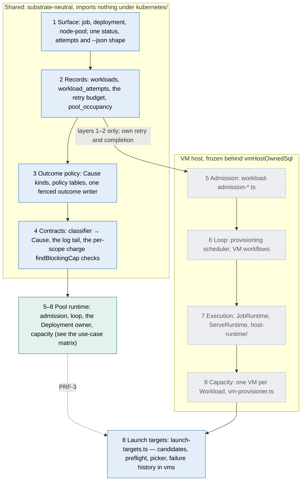
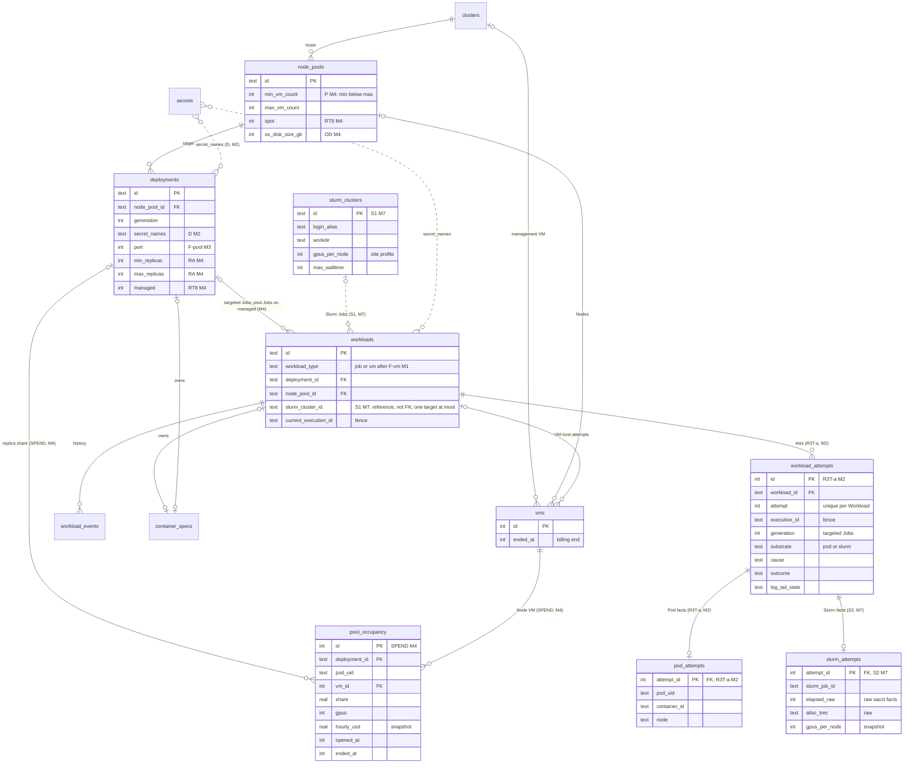
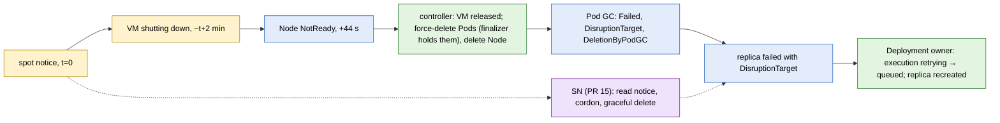

# RFC 0044: One pool runtime

> Status: Accepted
> Date: 2026-10-03
> Author: Claude draft, for Luis Fernando De Pombo

## Summary

Node pools ran two parallel stacks when this RFC was accepted. Deployments have
since moved onto the one pool loop (PRs 2, 4, 5 and 10); pool Services still
have their own controller, timer and native-object builder, and neither
Deployments nor pool Services go through a spend check that knows about
sessions. Command Jobs can't run on a pool at all. The owner decided that VM
Services retire once the session customer moves off them, that VM Jobs retire once the batch customer
does, and that VM replicas aren't supported. So this RFC builds one runtime for
pools only, and it doesn't make pool work look like VM work. It has:

- one watch-driven reconcile loop with one reconcile callback, the Deployment
  owner's (row 5b collapses the shipped `PoolOwner` seam into it);
- one owner, the Deployment owner, over `pool-objects.ts`, `pod-termination.ts`
  and `pod-logs.ts`, whose HTTP endpoint is an option;
- one substrate module, `kubernetes/pool-objects.ts`, that imports no product
  code;
- three new tables: `workload_attempts`, its Pod extension `pod_attempts`,
  and `pool_occupancy`.

Command Jobs run on warm Deployments (decision 26). `job --node-pool` queues
the Job on a Deployment that anycloud manages, one per pool, image and
resource shape. A **runner** in each replica claims one Job at a time through
the claim queue, stages its inputs into the paths VM Jobs use, runs its
command unchanged as a child process, uploads its outputs, resets, and claims
the next. Pool Jobs therefore share the session customer's runtime, replica autoscaling
and claim queue, and Kubernetes holds replicas, never one Pod per Job. The VM
code stays frozen behind `vmHostOwnedSql` until retirement deletes it.

The RFC also documents the layer "onion" the owner asked for: the surface,
records, outcome policy and shared contracts never import `kubernetes/`, and the
Kubernetes substrate never learns product nouns. The work is 14 numbered PRs
(PR 1 closed) plus three shared prerequisites, and the pool path nets about
+120 to +345 production lines before the autoscaler, including about +250 for
storage transfers that RFC 0043 counted before decision 26.

**Relations.** It absorbs the RFC 0042 draft (command Jobs on node pools). It
builds on RFC 0029 (Kubernetes Deployments for Jobs), RFC 0032 (Services on node
pools), RFC 0048 (node pool scaling, which supersedes RFC 0016) and
RFC 0025 (enforcement vocabulary). It amends RFC 0029 (Deployment env moves into
a Secret; decision 26 makes managed Deployments the one exception to R2's "no
hidden Pool" and to R5's "no supervisor", and the public noun stays `job`), RFC
0030 (managed Deployments scale from zero), RFC 0032 (pool Services fold into
`deployment --port` and leave the per-Service namespace) and RFC 0048 (demand is
Pending pool Pods; queued pool Jobs reach it as Pending replicas). Its siblings
are the RFC 0045 draft (three product nouns) and the RFC 0043 draft (pool
storage). Pool Jobs reuse `wait` and the `LOGS_CONTAINER_NOT_READY` code from
RFC 0041 (agent-safe workload waits). Pool Jobs and `--port`
Deployments become e2e members through an RFC 0017 amendment (invariants 10 and
13), landed before the first such member.

## Owner requests

These are the owner's words, verbatim:

- "cluster create creates the issue that some useres ike ansgtrom might want to
  have cluster jobs run in the devbox like they do today and not a hosted api"
- "once clusters autoscales they stand to save money though" / "they have their
  own heavy images" / "they have thousands of jobs and very few image"
- "its def worth it, q is how to keep their ux with their own image"
- "I dont want to maintain two runtimes though"
- "I was hoping job per pod without penalty would let us get rid of the
  deploiyment as an abstraction and simplify the code and yx" → later
  "[the session customer] is actively moving to jobs + deployments"
- "can you lay out the abstractions all the way down like an onion and explain
  where vm command jobs, k8 command jobs, k8 services, vm services, k8 [the session customer]
  pool jobs"
- "you tell me how our current abstractions size up to the wayu you laid it out
  and how will the change under one runtime so ideally the deeper layers of the
  onion change less frequenctly"
- "back to our four nouns, I am concerned we expose too much complexity even if
  we do layer abstractions properly under one runtime"
- "we dont need to suport Vm replicas at all and I imagine we eventually will
  phase out vm jobs". VM Services go "once [the session customer] moves off them", and VM
  Jobs retire "once [the batch customer] moves out of it".
- "what is problmatic is the possiblitiy that we might be trying to scope out
  too much in one go" and "fixed size non-spot pool is a nogo"

The standing rules also apply: no compatibility shims, delete first, keep
lines of code lean, and report estimates against actuals.

## Context

### Customers

Customer measurements are tracked privately; this section keeps only the
qualitative facts the design depends on.

**The batch customer.** Coding agents submit thousands of command Jobs
(`anycloud job <own image> -- cmd`, always with `--id`). They use a few heavy
images, spot capacity, and per-agent-session throttles and budgets.

- Their ML Jobs train on a large sharded dataset that several Jobs read at
  once.
- Each VM move after a preemption re-syncs the whole bucket, which takes most
  of the Job's wall-clock time, and the Azure OS disk's throughput cap bounds
  how fast that copy can go.
- Their start time is capacity wait plus image pull; most Jobs use one small
  GPU, so nothing packs; and same-VM in-place restarts, which a pool that
  deletes evicted VMs loses, are most of their Azure re-runs. That is why pool
  Jobs come after a node input cache and a configurable pool OS disk.
- Their Jobs are long fan-out batches of one command over many inputs, not
  repeated calls to a loaded model; decision 26 gives the aggregate profile.

On a K3s Node, a 4 GB image took 56 s to pull cold and 0.65 s to start from
the Node's cache.

**The session customer.** Sessions run as targeted Jobs on warm Deployments (RFC 0029),
not Pods per session, under a hard bound from admission to `ready`. One Pod
per session on a warm Node would fit inside that bound, but it loses: the
model process takes several seconds to start even with the image in page
cache, far longer than admission to media takes today, and two sessions per
GPU share one model process, so separate Pods would double VRAM or GPUs.
Every warm-pool technique that starts faster than the model process keeps a
warm process waiting for work, which is the claim queue again. Production
serving is VM-host GPU Services. Training is command Jobs on Lambda H100s,
which fits `job --node-pool` once Lambda node pools exist.

### Code on `main`

- **Admission refuses pool Jobs** (`node-pool-service-admission.ts`: "Only
  Service Workloads can target a node pool; Jobs target a Deployment with
  --deployment.").
- **No session spend on pools.** `vmHostOwnedSql`
  (`deployment_id IS NULL AND node_pool_id IS NULL`,
  `repositories/workload-queries.ts`) keeps pool and targeted rows out of
  `listQueued`, `countDeploying` and the VM monitor. Pool VMs pass only
  account caps (`spend-controls.ts`: "Capacity has no workload session").
  Session burn joins `vms.workload_id` (`spend-controls-store.ts`), so nothing
  on a pool counts toward session caps. A cap block on a pool scale-out
  throws, and the pool's `reconcile` marks the pool failed
  (`node-pool-controller.ts`).
- **Two stacks.** Pool Services still use
  `node-pool-service-{admission,controller,reconciler,runtime-default}.ts` and
  `kubernetes/service-workload.ts`, on their own 15 s timer. Deployments run on
  the pool loop (`pool-reconciler.ts`, PR 5) as the Deployment owner in
  `deployment-controller.ts` (PR 10), which builds the loop; PR 10
  deleted `kubernetes/deployment-workload.ts`. PR 2 moved pool
  admission into `node-pool-admission.ts`. F-pool (PR 11) deletes the Service
  stack.
- **The VM contracts serve VMs only.** `JobRuntime` has one VM-host adapter and
  refuses targeted Jobs (`job/runtime.ts`); an earlier change removed its Kubernetes
  refusal along with `CloudType.Kubernetes`. `ServeRuntime`'s node-pool adapter
  serves only the retry and cleanup lanes, and its `update` throws.
- **Pools are fragile for Jobs.** Pools are on-demand only (`spot: false` in
  `node-pool-controller.ts`), and scale-down ignores what runs on a Node
  (`selectScaleDownVms`).

## The onion

The figure is the runtime's main architecture view: four layers shared by
every substrate, then a split into the pool runtime and the frozen VM host.



Legend: blue = shared, one implementation for every substrate · teal = pool
runtime · grey dashed = VM host, frozen and deleted at retirement. The one
shared box below layer 4 is layer 8's launch-target module, which VM Jobs use
now and node pools adopt in PRF-3; see § Decision for the freeze
override.

**Dependency rule.** Layers 1–4 (the surface, Workload records and attempts,
the outcome policy and its fenced writer, and the shared contracts) are
substrate-neutral and import nothing under `kubernetes/`; layers 5 and inward
are per substrate. R3T-a's graph rule enforces this direction (invariant 17).
In the other direction, `kubernetes/` imports no product record or policy
(invariant 1), so product concepts reach it as parameters and the pool loop
and owners are where the two meet.

The table maps today's modules to the eight groups the change counts below
use, and names the onion layers each group becomes; outer layers change often
and inner layers rarely.

| Onion  | Group today                     | Purpose                                                                  | Modules on `main`                                                                                                                                                        | May not know                     |
| ------ | ------------------------------- | ------------------------------------------------------------------------ | ------------------------------------------------------------------------------------------------------------------------------------------------------------------------ | -------------------------------- |
| 1      | **Surface**                     | CLI, Python SDK, HTTP API                                                | `src/cli/commands/{submit,serve,deployment,vm,node-pool}.ts`, `src/api/rpc/`, `src/shared/api-contract/`, `python/extensions/anycloud_workflows/`                        | tables, Kubernetes, providers    |
| 2–3    | **Record**                      | durable intent; `queued → provisioning → running → terminal`, `retrying` | `workloads` (`workload-record.ts`, `repositories/workload-lifecycle.ts`), `deployments` (`deployment-store.ts`), targeted Jobs (`repositories/deployment-executions.ts`) | native objects, providers        |
| 5      | **Admission**                   | validate and choose a target                                             | `workload-admission-*.ts`, `node-pool-service-admission.ts`, `deployments-domain.ts`, `service-upgrade-domain.ts`                                                        | native objects, SSH              |
| 4, 6–7 | **Dispatch and product policy** | fairness, throttle and budget gates; the claim queue                     | VM: `workload-workflows/provisioning-scheduler.ts`; shared: `spend-controls.ts`; claim queue: `deployment-workload-domain.ts`                                            | Kubernetes packages, gateways    |
| 6–7    | **Lifecycle**                   | how one kind of Workload lives and dies                                  | VM: `job/runtime.ts`, `serve/runtime.ts`; pools: `deployment-controller.ts` (on the loop), `node-pool-service-controller.ts` (15 s timer)                                | native object shapes (for pools) |
| 7      | **Substrate**                   | lifecycle → effects                                                      | VM host: `host-runtime/`, `workload-workflows/vm-host-startup.ts`; Kubernetes: `kubernetes/*`                                                                            | product records and policy       |
| 8      | **Capacity**                    | machines                                                                 | `vm-provisioner.ts`, `repositories/provisioning-attempts.ts`; `node-pool-controller.ts`; shared: `launch-targets.ts`                                                     | which Workload kind uses a slot  |
| 8      | **Provider**                    | clouds                                                                   | `gateways/{aws,gcp,azure,lambda}.ts`                                                                                                                                     | everything above                 |

**Target.** On pools, today's lifecycle group becomes the loop (onion layer 6)
and the Deployment owner (layer 7), and pool dispatch is the
claim queue's claim; only the charge `findBlockingCap` checks stays shared, in
layer 4. The VM host's dispatch, lifecycle and substrate groups (its layers 6–7)
stay frozen behind `vmHostOwnedSql`. The one carve-out is layer 8's
launch-target module (2026-10-09): `optimizer.ts` and `vm-host-startup.ts` give
up target selection and launch-failure classification to `launch-targets.ts`,
and the VM-Job failure history reads `vms` instead of event metadata, with no
VM-Job behavior change. At retirement, the VM contracts disappear, and
`anycloud vm` calls `vm-host-startup.ts` directly.

### Change frequency

The commands below count commits on `main` since 2026-08-01 that touch each
layer's paths. The counts were taken at `c4c3d1197`, before an earlier change removed
`gateways/vast.ts`; the provider count includes it.

```bash
c(){ git log origin/main --since=2026-08-01 --format=%h -- "$@" | sort -u | wc -l; }
S=src/api/services
c src/cli/commands src/api/rpc src/shared/api-contract python/extensions/anycloud_workflows  # surface 140
c $S/workload-record.ts $S/deployment-store.ts $S/repositories/workload-lifecycle.ts \
  $S/repositories/deployment-executions.ts                                                   # record 73
c $S/workload-admission-{domain,resolution,plan,persistence}.ts $S/deployments-domain.ts \
  $S/node-pool-service-admission.ts $S/service-upgrade-domain.ts                             # admission 27
c $S/workload-workflows/provisioning-scheduler.ts $S/spend-controls.ts \
  $S/deployment-workload-domain.ts                                                           # dispatch 15
c $S/job/runtime.ts $S/serve/runtime.ts                                                      # contracts 23
c $S/kubernetes/                                                                             # k8s 69
c $S/host-runtime/ $S/workload-workflows/vm-host-startup.ts                                  # VM host 7
c $S/node-pool-controller.ts $S/vm-provisioner.ts $S/repositories/provisioning-attempts.ts   # capacity 29
c $S/gateways/{aws,gcp,azure,lambda}.ts                                                      # provider 82
```

- **What the churn is.** Most `kubernetes/` churn is feature work plus the
  substrate's own nouns (cluster and node pool), and both
  are allowed. The provider churn is acquisition and credential work.
- **What the rule stops.** Four of the 75 commits that touched `kubernetes/`
  or the two contracts were workload-noun renames.
- **Claim.** After this RFC, a product-noun rename doesn't touch
  `kubernetes/`, `reconciliation/` or the capacity modules. Two measurable
  targets back it: the number of `kubernetes/` modules that import product
  code falls from 4 to 0 and a graph rule keeps it there (invariant 1), and
  re-running the command a month after the pool Service fold shows no
  rename-only commit in those paths.

## Where each workload kind goes

**Today:**

| Layer           | VM command Job          | Pool command Job | VM Service             | Pool Service                                               | Customer session (targeted Job)              |
| --------------- | ----------------------- | ---------------- | ---------------------- | ---------------------------------------------------------- | -------------------------------------------- |
| 1 Surface       | `job <image> -- cmd`    | refused          | `service <image>`      | `service --node-pool`                                      | `job --deployment x`; app calls `next_job()` |
| 2 Record        | `workloads`             | —                | `workloads`            | `workloads` + `node_pool_id`                               | `workloads` + `deployment_id`                |
| 5 Admission     | VM placement            | refused          | VM placement           | `submitNodePoolService`                                    | `submitTargeted`                             |
| 4, 6–7 Dispatch | scheduler, session caps | —                | scheduler              | none; its controller claims `queued → provisioning` itself | none; waits until claimed                    |
| 6–7 Lifecycle   | `JobRuntime` VM-host    | —                | `ServeRuntime` VM-host | `node-pool-service-controller.ts` (15 s)                   | claim queue                                  |
| 7 Substrate     | VM, SSH, Docker         | —                | VM, Docker, DNS        | `service-workload.ts`, namespace per Service               | in the replica from `deployment-workload.ts` |
| 8 Capacity      | own VM                  | —                | own VM                 | pool node                                                  | pool node                                    |

**Target** (the use-case matrix in § Runtime structure splits the pool column
by use case):

| Layer           | VM host (until retired)                 | Pool runtime                                                                                  |
| --------------- | --------------------------------------- | --------------------------------------------------------------------------------------------- |
| 1 Surface       | `job <image> -- cmd`; `service`, frozen | `job --node-pool`, `job --deployment`, `deployment create --port` (RFC 0045)                  |
| 2 Record        | `workloads`                             | `workloads`, `deployments`, `workload_attempts` + `pod_attempts`, `pool_occupancy`            |
| 5 Admission     | VM placement                            | `node-pool-admission.ts`; a targeted Job's Deployment target                                  |
| 4, 6–7 Dispatch | VM scheduler                            | the claim queue for Jobs, after `findBlockingCap` at the replica's share for pool Jobs (SLOT) |
| 6–7 Lifecycle   | `JobRuntime`, `ServeRuntime`, frozen    | the Deployment owner; the runner in managed replicas                                          |
| 7 Substrate     | VM host                                 | `renderDeployment`, with the runner or `renderEndpoint`                                       |
| 8 Capacity      | own VM                                  | a replica's slot on a pool Node                                                               |

**Per layer, today → target.**

- **Surface.** Two long-running nouns today, after heavy rename churn.
  _Target:_ RFC 0045's `job`, `deployment` and `vm`. `service --node-pool`
  folds first, and bare `service` goes at VM Service retirement.
- **Record.** Two long-running models and two GPU reservation checks
  (`repositories/workload-creation.ts`, `deployment-store.ts`). _Target:_
  `workloads` holds Jobs and VMs; `deployments` absorbs the Service columns
  (RFC 0045); three new tables. `workloads` and `deployments` both stay: one is
  finite and one is long-running, and merging them would add a mode switch to
  every query.
- **Admission.** The pool checks are duplicated. _Target:_ one
  `node-pool-admission.ts`.
- **Dispatch.** Nothing on a pool passes session caps. _Target:_ the claim gates
  pool Jobs at their replica's share in their own session; the VM scheduler is
  unchanged, and the two share only `spend-controls.ts`. Pool Deployment
  replica-hours count at account scope from bind. Targeted Jobs on user
  Deployments stay ungated, with each Job's slot time charged to its own session
  (`workloads.session`) for `cost --session`.
- **Lifecycle.** The Deployment owner on the loop, the pool Service controller
  on its own 15 s timer, and VM contracts whose node-pool adapter is half-used.
  _Target:_ one loop, one owner (the Deployment owner), the runner for pool
  Jobs, and VM contracts that are frozen and later deleted.
- **Substrate.** `pool-objects.ts` (PR 4) beside the pool Service builder
  (`service-workload.ts`, 695 lines), two `kubernetes/` modules that import
  product code, and a noun enum in `identity.ts`. _Target:_ `pool-objects.ts`,
  zero product imports, and a graph rule.
- **Capacity.** No spot, no Job-aware scale-down, no per-Workload cost.
  _Target:_ spot pools, Job-aware scale-down and `pool_occupancy`
  attribution.
- **Provider.** No change.

## Proposal

### Smallest useful release

Milestones use GitHub's numbers (M1–M7), and each name below links its
GitHub milestone. On 2026-10-09 the owner moved the
runtime pieces the session customer's sessions use from M3 into M2
(decisions 25 and 27), then moved SPEND and SLOT to M4 (decision 28).

**M2, "Sessions on pool
Deployments".** The session customer's
sessions run on pool Deployments, with Deployment Secrets and Deployment
logs. The session customer's pool Deployments move onto the loop: the Deployment
owner (PRs 5 and 10) replaces `deployment-controller.ts`'s timer, and a replica
that dies mid-session is classified and retried. Pools keep a fixed size:
autoscaling is out of scope.

**M3, "Host open-source
models".** Serving only,
built on M2. A user serves an open-weights model with `deployment create --port`
(PR 11, with RFC 0045's F-pool) on a pool. Pool scaling (PR 7) is
M4's; serving uses it once it lands, and this milestone's exit doesn't wait on
it. `--port` replicas keep a fixed count until a later requests-in-flight
signal. Out of scope: pool Jobs; the optional KEDA HTTP add-on for
scale-to-zero; automatic placement across pools; `exec` into a pool workload;
surge rollouts.

**M4, "Pool Jobs for
batch work".** A batch-customer
agent runs `anycloud job <image> --node-pool P --gpus 1 -- cmd` on a spot pool
that scales out for queued Jobs and back in when idle, keeps its session caps,
and gets a clean retry after spot loss; until then the batch customer stays on VM Jobs
(the 10-02 pivot). Its Jobs run on managed Deployments through the runner
(decision 26), and their buckets come from RFC 0043's storage, which the runner
performs, in the same milestone. Spot pools (PR 9) and autoscaling (between `--min-vms` ≥ 1 and a required `--max-vms`) are required: a fixed-size
on-demand pool doesn't meet the milestone. Pool scaling (PR 7, and
FIT) and native replica autoscaling are built in this milestone; M3
uses the pool scaling. Pool occupancy and spend are built here too: SPEND counts
replica occupancy and pool Job shares, and SLOT each session's slot time
(decision 28). It builds on M2 and comes after a node input cache on a
persistent disk, a configurable pool OS disk and the S12 claim-queue burst test;
the replica's return to its Node after a deallocate (RD) and a JAX compile cache
moved to "M12: Batch customer improvements". Out of scope: CP1 and CP2 (closed by
decision 26; S12 can reopen them), CP3 enforcement, `main_started_at` charging,
per-Job directories in a replica, and the `placement` object.

| Milestone                            | This RFC's part                                                                                                                                                                                          |
| ------------------------------------ | -------------------------------------------------------------------------------------------------------------------------------------------------------------------------------------------------------- |
| M2: Sessions on pool Deployments     | PRs 2, 4, 5 and 10; the prerequisite R3T-a; no autoscaling. Deployment Secrets and Deployment logs are tracked separately; the Deployment-logs work is a prerequisite of PR 5 and Named Secrets of PR 11 |
| M3: Host open-source models          | PR 11; scaling comes from M4                                                                                                                                                                             |
| M1: Service retired                  | PR 13                                                                                                                                                                                                    |
| M4: Pool Jobs for batch work         | PRs 6, 8 and 9; SPEND (with SLOT); PR 7 with the autoscaler; FIT; native replica autoscaling; RFC 0043's storage; PR 1 closed                                                                            |
| M5: Batch customer off VM Jobs       | PRs 14 and 15; placement across pools and local control (new RFCs)                                                                                                                                       |
| M6: One pool runtime                 | PR 12 and leftovers                                                                                                                                                                                      |
| M7: Slurm on a pilot site (parallel) | none; planned in RFC 0046, on layers 1–4 and R3T-a; its Jobs (S2) build on `workload_attempts`, which R3T-a's second PR created                                                                          |

Sections that describe work after M4 are marked _(Later)_.

### Runtime structure: one owner, one runner

Cut at the Pod, not at the handler. One owner, the **Deployment owner** (PR
10, about +235–240, about 100 of it moved from `deployment-controller.ts`),
runs every pool Pod as a replica of a native Kubernetes Deployment, over
`kubernetes/pool-objects.ts` (one `podTemplate()`), `pod-termination.ts` (the
classifier) and `pod-logs.ts` (the log tail). It holds the finalizer, the
container-end record, the occupancy source and the busy-Node rule.

The onion has eight layers, and Loop is its own; Kubernetes' scheduler places
Pods, so there is no placement layer.

Pool Jobs add no owner. Each runs as a Job on a **managed Deployment**, and
the **runner** (PR 6) inside each replica turns the claim queue into one
command at a time (decision 26). The figure lays the three pool use cases
across the onion's layers: a blue bar is what all three share, a coloured tab
under a column is what only that use case adds, and a gap means it uses the
shared layer as is.



The figure's source is
[`use-case-matrix.mmd`](0044-one-pool-runtime/use-case-matrix.mmd), rendered
with mermaid-cli because GitHub's mermaid renderer doesn't display
`block-beta`.

Legend: blue = shared by all three · orange = Batch-customer Jobs (M4) ·
purple = customer sessions (M2) · green = open-model serving (M3).

Layer 2's `pool_occupancy`, layer 4's SLOT, replica autoscaling and layer 8
land in M4.

A Job on the frozen VM host shares only layers 1–2.

**Substrates.** This RFC builds only the Kubernetes pool substrate, and the VM
host stays frozen. Slurm is its own milestone, "Slurm on a pilot site", planned
separately: it shares layers 1–4 and never runs on the pool loop. Every
substrate writes attempt outcomes back to the records layer as a `Cause`.

**The outcome module (R3T-a).** `Cause`, `Outcome`, `OutcomePolicy` and
`batchPolicy` (RFC 0046) live in the substrate-neutral
`src/api/services/job-outcome.ts`.
The Pod classifier, `classify(pod)`, stays in `kubernetes/pod-termination.ts`
and imports `Cause` from it. Cause kinds say what happened, not which object
showed it (`unrecoverable` covers an image that can't be pulled and a
submission a scheduler refuses), and policy messages take their wording from
the cause's own detail, so `batchPolicy` never says "Pod" or "Node":
`disrupted: (c) => retrying(c.detail)` and
``lost: (c) => failed(`Job outcome lost: ${c.detail}`)``, where the Pod
classifier's detail is "its Pod was gone before its status was read".
`OutcomePolicy` is a mapped type over the kinds, so a new kind fails to
compile until every policy table handles it.

**Policy selection** (PR 6). One owner runs both pool Jobs and the session customer
sessions, so it picks the policy per execution by `deployments.managed`:
`batchPolicy` for a managed Deployment's Job, and `DEPLOYMENT_POLICY`, which
moves from `deployment-controller.ts` into `job-outcome.ts` beside it, for a
targeted Job on a user Deployment. The shipped warm policy retries every
cause, which is wrong for pool Jobs: an ephemeral-storage eviction must end
terminal `invalid`. PR 6 also renames `helper` to the runner's `transfer`
kind. Row 5b removes the `unbound` kind (nothing produces it since decision 1
dropped the Pending deadline) and the Pod-level `DeadlineExceeded` →
`deadline` mapping (there is no `activeDeadlineSeconds`); the `deadline` kind
stays for the runner's `timeLimit` report and Slurm.

### Records

- `workloads`: a targeted Job carries `deployment_id` and, with RFC 0045
  _(Later, optional)_, a payload and a result. A pool Job is a targeted Job
  on its managed Deployment, and its own container spec holds its command,
  env and buckets.
- `deployments.managed` (PR 8): set on a Deployment anycloud creates for
  `job --node-pool`. A unique index over the pool, the image digest and a hash
  of the replica shape (`--gpus`, `--cpus`, `--memory`, the replica options)
  finds it; `deployment list` shows it read-only with a managed label (decision
  29).
- **`workload_attempts`** (R3T-a's second PR, which also adds its one writer;
  the first PR adds the classifier and `job-outcome.ts`): one row per try of a
  targeted Job execution, pool Jobs included, or (M7) a Slurm Job. It holds only
  substrate-neutral columns: the Workload, the attempt number, the execution ID,
  the Deployment generation (targeted Jobs), the state, the `Cause` and outcome,
  the log-tail state, timestamps, and a `substrate` discriminator (`pod` or
  `slurm`, CHECK-constrained). It is the retry counter (one budget per Job) and
  has one fenced outcome writer, `recordAttemptOutcome`, which never touches an
  extension table. Identity is derived from the attempt ID: the Slurm job name
  is `ac-<attemptId>`; a pool Job's execution runs in a replica, so its Pod name
  isn't per attempt.
- **Attempt extensions** (owner decision 24, Class Table Inheritance): 1:1
  tables keyed by `attempt_id` (primary key and foreign key to
  `workload_attempts`, `ON DELETE CASCADE`). A CHECK or trigger allows at
  most one extension row per attempt, of the discriminator's kind. The row
  may be written after the attempt opens, because native IDs arrive later,
  but always in its substrate's own transaction. Recovery and adoption join
  on `attempt_id`.
  - **`pod_attempts`** (R3T-a's second PR): the Pod UID, the container ID, the
    Node and the termination evidence. The Deployment owner, outside
    `kubernetes/` (invariant 1), writes it.
  - **`slurm_attempts`** (Slurm S2, M7, planned outside this RFC):
    the Slurm job ID and the raw `sacct` facts. Slurm code writes it.
- **`pool_occupancy`** (SPEND): one row per replica Pod that holds capacity,
  keyed by its Deployment and the replica Pod's UID (`deployment_id`,
  `pod_uid`, unique together), with pool, the Node's `vms` row, `share`,
  `gpus`, an `hourly_usd` snapshot of the pool VM's price, `opened_at` (the
  first `spec.nodeName`) and `ended_at` (when the Pod is terminal). The
  Deployment owner opens and closes it.
  - **No session column.** Replica-hours count at account scope, where the whole
    VM already counts. Two reads use the rows: `deployment show` reports a
    Deployment's replica-hours and cost, split into busy time (covered by an
    execution's attempt, a pool Job's or a targeted Job's) and idle time (the
    rest), and SLOT reads `hourly_usd`. SLOT opens no row of its own: a targeted
    Job's slot time is computed when read, from its attempt's interval and its
    replica row (`hourly_usd` ÷ `--max-concurrent-jobs-per-replica`). For a Job
    on a managed Deployment the same join enters its session's burn and window
    spend, and the claim checks it (decision 26); slot time on a user Deployment
    never gates.
  - Session burn and window spend read the row's own snapshot. Account spend
    never reads it: it stays whole-VM time from `vms`, which includes idle
    Nodes, the scale-down delay and min Nodes, and is never computed as shares
    plus idle. _(Later)_ `main_started_at` from `main`'s `startedAt`, to
    exempt pulls; the name keeps it apart from `opened_at` and from
    `workloads.started_at`, which is the submit time.

These tables follow RFC 0031 rule 2 (typed, queryable columns). RFC 0029's
rule that Pods never become synthetic `vms` rows still holds. `pool_occupancy`
attributes the cost of a pool VM that already bills; it isn't a billing
ledger. RFC 0031 invariant 4 ("a resource-owning attempt lives in the
resource ledger") doesn't apply to `workload_attempts` or `pod_attempts`: a
Pod attempt owns no billable provider resource, since its Node is already a
`vms` row, so attempt rows stay outside `vms`.

After R3T-a, recovery reads a targeted Job's execution identity from its
open `workload_attempts` row (generation) joined to its `pod_attempts` row
(Pod UID and container ID). The
execution-start event keeps them as history only and is never read to drive
recovery, as RFC 0031 invariant 3 requires.

`WorkloadType.Service` is deleted with F-vm (M1), after F-pool has
converted pool Services into Deployments (RFC 0045).

**Target model.** Shipped tables plus the changes planned through M7;
Later changes are omitted. A label gives the row and milestone that adds an
edge or column; unlabeled parts are on
`main`. A dotted line is a name reference (a JSON name or a plain column), not
a foreign key. Tables this RFC doesn't touch (credentials, spend caps,
notifications) are left out; ARCHITECTURE.md's Durable Data Model section lists
them.



### The substrate: `kubernetes/pool-objects.ts`

One `podTemplate()` over `pod-parts.ts`, shared by thin wrappers. None of them
takes a product type. Each `podTemplate` option lands in the PR that first
uses it.

- **`renderDeployment(spec)`** renders the `Recreate` native Kubernetes
  Deployment, with `revisionHistoryLimit: 1` so old ReplicaSets don't keep a
  rotated value. It has an optional `runtimeIdentity`, the claim-queue token
  with audience `anycloud-runtime`, and an optional **runner** (PR 6) for
  managed Deployments:

  ```yaml
  # the managed Deployment's Pod template, beside today's replica parts
  initContainers:
    - name: runner-install # API image; copies anycloud-runner and rclone
      volumeMounts: [{ name: runner, mountPath: /anycloud }]
  containers:
    - name: workload
      image: <admitted digest> # unmodified
      command: [/anycloud/bin/anycloud-runner] # the Job's command is its child
      resources: <--gpus/--cpus/--memory>
      volumeMounts: # emptyDir each; between Jobs the runner syncs input and empties the rest
        - { name: input, mountPath: /mnt/input }
        - { name: output, mountPath: /mnt/output }
        - { name: checkpoint, mountPath: /mnt/checkpoint }
        - { name: runner, mountPath: /anycloud, readOnly: true }
  ```

  The Job's command, env and buckets arrive in the claim, never in the
  template, so one managed Deployment serves every Job of its shape.

  **The neutral Job spec (RFC 0046, amended 2026-10-08 and 2026-10-09).**
  Pool Jobs share the Job spec fields `nodes`, `gpusPerNode` (`--gpus`),
  `launch`, `mounts`, `timeLimit` and `resumable`. The runner enforces
  `timeLimit` (`--time-limit`) and reports a Job that reaches it as a
  deadline. For now, pool admission refuses `nodes > 1`,
  `launch: distributed`, path mounts and `state` mounts (owner, 2026-10-09).

- **`renderEndpoint(spec)`** renders the Kubernetes Service, the IngressRoute
  and the ingress-entry pin. Only the Deployment owner calls it, so a Job with
  an endpoint can't be expressed. The hostname helpers (`serviceHostname`,
  `assertServiceHostnameFree`) move to `node-pool-ingress.ts`.
- **`identity.ts`** takes a component string from its caller, so the noun enum
  goes and the bytes of existing resource names don't change.

### The loop: `pool-reconciler.ts`

```text
records (2) ──► node-pool-admission (5)
                        │ admitted rows
                        ▼
loop (6)        pool-reconciler.ts ── calls one reconcile callback,
                        │            the Deployment owner's (settle() in the owner)
                        ▼
execution (7)   kubernetes/pool-objects.ts
```

- **One loop.** It is built on `reconciliation/scheduler.ts`, which already
  has keys, slots and refill. `deployment-controller.ts` builds it with the
  Deployment owner's reconcile callback, so the loop imports no owner.
- **Watch-only reads.** Spike S1 (tracked privately) found per-Job GETs were
  about half of all API requests, and serving reads from the watch cache
  doubled saturated throughput. So the loop keeps one cluster-wide Pod
  list-and-watch, indexed by namespace, component label and Node, which serves
  the owner, fit, demand and the busy-Node check; plus one for native
  Deployments with the anycloud label, one for Nodes, and label-selected ones
  for the Secrets and ServiceAccounts a Deployment owns, whose events queue
  the owning Deployment's key (controller-runtime's `Owns()`). Lists use
  `resourceVersion: "0"`, which the API server answers from its watch cache.
  Watch sessions last several minutes, jittered, and resume from the last
  bookmark's `resourceVersion`; only a 410 relists (today's `pod-watch.ts`
  relists every 15 s per namespace). Handlers read through `latest` from that
  cache, with no per-object GET in steady state. Writes stay server-side
  apply, and deletes stay exact-UID. The claim queue's receiver waits use the
  same watch, which replaces `deployment-pod-changes.ts`.
- **Absence.** A `resourceVersion: "0"` list may be stale, so before the
  Deployment owner records "Job outcome lost" for an attempt whose Pod UID is
  missing from the synced cache, it confirms with one direct GET. That rare read
  is the only per-object read the loop makes.
- **Errors.** A failed reconcile reinstalls its key with an
  exponential backoff in `dueAt` (1 s doubling to 5 min, reset on success); a
  429's `Retry-After` sets `dueAt` directly.
- **Resync.** Not every database change sends a notify, so every 60 s a
  level-triggered resync re-lists the Deployment IDs and reconciles every
  key from SQLite and the cache alone, with no API reads. A reconcile writes
  only when the desired object differs from the cached one, so a resync of an
  unchanged pool makes no API call.
- **Cleanup.** The shared cleanup keeps its `cleaned_at` fence. Its node-pool
  branch in `workload-workflows/cleanup.ts` calls the loop's `remove` instead
  of `getDefaultServeRuntime().cleanup`.
- **RBAC.** Pods only, with no `jobs` verbs. The chart's ClusterRole gains
  `watch` on `nodes`, `secrets` and `serviceaccounts` (`pods` has it already),
  `patch` on `pods` (to remove the finalizer) and `get` on `pods/log` (the
  tail), with a test that the chart and the cluster preflight list stay equal
  (about +15). The local e2e API child runs under the chart's rendered
  ClusterRole from PR 5, so each new verb is exercised on every PR.

### Pool Jobs on managed Deployments

Decision 26 runs each pool Job as a targeted Job on a Deployment that anycloud
manages. Nothing below adds an owner: the Deployment owner, the claim queue and
replica autoscaling are the ones the session customer uses, and serving shares the
Deployment owner.

**Managed Deployments** (PR 8). Admission of
`job IMAGE --node-pool P --gpus N -- cmd` resolves the image to its digest and
finds the pool's managed Deployment for that digest and shape, or
creates it in the same transaction; the unique index makes a concurrent create
reuse the winner. It records the image's `Entrypoint` and `WorkingDir` from the
digest, so the runner starts the command as VM Jobs do. The shape is `--gpus`,
`--cpus`, `--memory` and the replica options: `--shm-size` and `--ipc host`
(both a memory-backed `/dev/shm` counted against `--memory`, never `hostIPC`)
and named Secrets such as `--secret github`, which most of the batch customer's Jobs need
to `git pull`. Each replica holds one Job at a time
(`--max-concurrent-jobs-per-replica 1`); on CPU pools several small replicas
share a Node, as Kubernetes packs them.

- **Replica count.** Native replica autoscaling (RA) with a minimum of 0: the
  desired count is the Jobs held plus the queued Jobs that would pass the
  claim's checks, capped at what the pool's `--max-vms` Nodes hold after the
  GPUs admitted user Deployments reserve; `nodePoolGpuReservationSql` leaves
  managed rows out. RA prices that demand from the shape, the Node shape and the
  pool VM's price, since no replica exists yet. RA scales down only once the
  ReplicaSet has settled on the Pods RA's cache lists, as many of them ready,
  because the ReplicaSet picks which Pods to remove from its own view; an
  earlier cut not yet carried out, a Pod the cache lags, or a replica the
  ReplicaSet still sees starting would let it remove one RA never closed.
  Then RA removes Pending, then not-ready, then ready replicas, in the
  order the ReplicaSet ranks them. It marks each idle one draining in the same SQLite transaction
  that confirms it holds no Job, so the claim refuses it. It closes every
  Pending and not-ready replica, not just the surplus: the ReplicaSet may still
  see one RA kept open as starting after it claims, and rank it below a closed
  one that started meanwhile. A busy replica would go before any in a
  later tier, so closes after its tier don't lower the count, and no ready
  replica is closed. Then it
  sets that Pod's `controller.kubernetes.io/pod-deletion-cost` to the minimum
  and lowers the count, so the ReplicaSet removes that Pod and never one that
  holds a Job; a draining mark whose Pod outlives the scale-down is
  cleared. Pending replicas are the node-pool controller's demand.
- **In-flight cap** (decision 6, amended). One per-cluster constant, about
  200 managed replicas, so about 200 Jobs held; RA fills it in the global
  submit order of claimable Jobs, so one large backlog can't starve another
  shape. Jobs above it stay queued. S12 is the path to about 500.
- **Upgrades** (decision 30).
  `runner-install` copies the runner from the API image. The runner sends its
  release with each call and the API refuses a mismatch, so runner calls are
  exact-match, unlike the existing exemption for application replicas.
  `anycloud api upgrade` drains pool Jobs first: it stops claims, waits for the
  pool Jobs in flight to finish and shows them. `--force` instead marks the
  executions it stops, sends their replicas SIGTERM and waits for the grace and
  the final upload's limit; each runner reports its Job `retrying`, and the
  Deployment owner builds `disrupted` with detail `forced upgrade: …` from that
  mark, not from `classify`, for a replica that stopped without reporting, once
  its container has stopped, with the finalizer still holding the Pod. Then the
  API upgrades and managed Deployments roll to the new runner. The new API
  refuses a still-running old runner's renewals and report, so its upload may be
  cut short and the next attempt restores the last checkpoint; the execution
  fence (invariant 10) keeps that attempt from running beside the old one. An
  idle old runner's refused claims retry with backoff until its replica is
  replaced.
- **Lifetime.** An idle managed Deployment stays at zero replicas, and the
  Deployment owner deletes it after 24 h with no Job or with its pool.
- **Visibility** (decision 29). `deployment list` shows managed Deployments
  read-only with a managed label, and `deployment` updates and deletes refuse
  them; `node-pool status` summarizes each pool's runners (busy, idle,
  Pending and why). They never take `--port`, and RFC 0045 keeps three nouns,
  because a managed Deployment is how `job --node-pool` runs. A Job's
  `status` names its pool and its replica's reason.

**Storage belongs to the Job** (decision 32). A Job's buckets, and the
storage credential that signs each role's grants, are resolved at admission
and kept on the Job's record (RFC 0043's O11), independently of the pool's
capacity: they don't enter the managed Deployment's shape, and the pool's
compute provider doesn't limit where the Job's data lives. The runner, claim
and renewal below are unchanged. This lets compute-only pool providers, which
offer GPUs, often spot, but no supported storage, run bucket-backed Jobs:

- **Pools first.** A new provider qualifies pool Jobs directly, with no VM Job
  support first, on the whole cross-cloud path: GPU execution, staging,
  checkpoint upload, eviction, restore and cleanup, measuring transfer time
  and cost beside the GPU price.
- **Spot is separate from restart.** Some providers delete an evicted machine;
  others, such as Nebius, stop it. Either way the pool replaces the capacity
  and confirms the old machine's cleanup, and the retry restores from the
  Job's storage, not from the machine.

**The runner** (PR 6). `anycloud-runner` is one executable, compiled the way
the CLI is (`bun build --compile`) and shipped with rclone in the API image;
the `runner-install` init container copies both into the replica. It runs as
the replica's entrypoint and PID 1 inside the user's unmodified image,
reaping orphans, and loops:

1. **Claim** one Job through the claim queue with the replica's runtime
   identity. The claim returns the Job's command, env, bucket prefixes and
   storage credentials scoped to that Job's prefixes or its own managed
   checkpoint bucket (RFC 0043), which the runner renews through the execution
   before they expire.
2. **Stage** (`syncing`): sync the input bucket into `/mnt/input` and restore
   the Job's checkpoint (`<checkpoint bucket>/<job-id>/`, or its managed
   bucket) into `/mnt/checkpoint`, the paths VM Jobs use.
3. **Run** (`running`): start the image's entrypoint with the command,
   unchanged, as a child with the Job's env and the image's working
   directory, and pass its output to the container log. Upload
   `/mnt/output` and `/mnt/checkpoint` about every 60 s, as VM Jobs do.
4. **Finish** (`finalizing`): when the command exits, is terminated
   (`kill(-1, SIGTERM)`, then SIGKILL after half the replica's grace period,
   leaving the other half to the upload) or reaches `timeLimit`, run the
   final upload, then report the outcome and exit code. The Job
   completes only once its outputs are uploaded; a failing upload retries and
   keeps the Job `finalizing`.
5. **Reset**: `kill(-1, SIGKILL)` from PID 1, which reaches every other
   process in the container, then reap; empty `/mnt/output`,
   `/mnt/checkpoint`, `/tmp` and `/dev/shm`, keeping the mounts
   (`/mnt/input` is synced or emptied by the next Job's staging); restore the
   working directory to its contents at replica start from a copy taken then,
   deleting what the Job added and re-copying what it changed, so each Job
   starts as a fresh container would and `git pull`s again. An image whose
   working directory is unset or `/` gets no restore, and one the runner's user
   can't wholly read can't be restored, so its replica restarts after every
   Job. A failed reset exits the runner, so the replica restarts; the runner
   resets before its first claim too, since a restarted container keeps its
   emptyDirs. Then claim the next Job.

   The reset's limits, which the user docs must state when pool Jobs unhide
   (RT8): files a Job changes outside the working directory aren't
   restored; files the restore re-copies belong to the runner's user, not
   their original owners; and an image whose working directory has paths
   the runner's user can't read restarts its replica after every Job, so
   the kubelet's restart back-off (10 s, doubling up to 5 min, reset after
   10 min running) can leave the replica not ready for up to 5 min between
   Jobs.

A SIGTERM to the replica (Node drain, a spot shutdown within
that grace period) reaches the command, the runner runs the final upload, and the
Job goes `retrying`, so the next attempt restores its last checkpoint. The
runner reuses the storage evaluation's transfer logic (decision 26), in the
replica rather than over Kubernetes exec. _(Later)_ Per-Job directories, so
a replica can hold several Jobs.

**Claim and spend.** The claim is the only dispatch point for pool Jobs,
first in, first out per managed Deployment. It skips a Job whose session cap
blocks it, and the Job stays `queued` with "blocked by session cap …". The
check is `findBlockingCap` with a per-scope charge: the replica's share at the
Job's session (`hourly_usd` from the replica's `pool_occupancy` row), and 0 at
account scope, where account budgets are checked and throttles skipped
(decision 22). A held pool Job's slot time enters its session's burn and
window spend (SLOT). Blocked Jobs add no replicas, so a capped session buys
nothing.

**States.** A pool Job is `queued` until a runner claims it, then `syncing`,
`running` and `finalizing`, then terminal or `retrying` → `queued`.
`VALID_TRANSITIONS` gains the `syncing` and `finalizing` edges for targeted
executions (PR 6 lists them).

**Outcomes.** Every pool Job outcome goes through `batchPolicy` (RFC 0046,
chosen by `deployments.managed`) and the fenced `recordAttemptOutcome`; every
retry, preemption included, draws from the Job's one budget, and the retry is
the Job's next claim.

| Event                                                                          | Workload outcome                                                           |
| ------------------------------------------------------------------------------ | -------------------------------------------------------------------------- |
| the command exits 0 and the final upload succeeds                              | `completed`                                                                |
| the command exits non-zero (OOM from the Job's `memory.events` delta)          | `errored` with the exit code, plus `OOMKilled`; outputs are still uploaded |
| `timeLimit` reached                                                            | `failed`, or `retrying` when the Job is resumable (RFC 0046)               |
| staging fails: a missing bucket or denied access                               | terminal `invalid`                                                         |
| storage credentials can't be renewed                                           | `retrying`                                                                 |
| the final upload makes no progress for 15 min                                  | `failed`, "Final bucket sync failed: …"                                    |
| `terminate`                                                                    | `cancelled` after the grace and the final upload                           |
| the replica dies holding the Job (`DisruptionTarget`, Node loss)               | preempted: `retrying`, then `queued` as attempt + 1                        |
| the replica is evicted for ephemeral storage                                   | terminal `invalid`, "Evicted: ephemeral storage exceeded its limit"        |
| `api upgrade --force` stops the replica before it reports, or while it uploads | `retrying`, then `queued` as attempt + 1, from the Job's one budget        |
| the replica is gone and nothing is observable                                  | `failed`, "Job outcome lost: …"                                            |

**Waiting for capacity.** A queued pool Job has no Pending deadline (decision
1, amended): it waits for a replica, and `status` says why (no replica yet,
the replica's pool reason, a cap block). `--timeout`, as on targeted Jobs,
bounds the wait for the first claim. A replica image pull that can't recover
(not found, unauthorized), or a runner that can't execute in the image (exit
126 or 127, or a missing loader, as without glibc) across several restarts
with no claim, fails the managed Deployment's queued Jobs as terminal
`invalid`. The runner retries API and connection errors with backoff and
never exits on them.

**Preemption.** Spike S2 (tracked privately) found that nothing in Kubernetes
resolves a lost Node's Pods, because the cloud controller is disabled
(`disable-cloud-controller: true`). The node-pool controller does it:
`finalizeReleasedVm` calls `deleteNodePoolNode`, which force-deletes the Node's
Pods (grace 0, exact UID) and then the Node. The anycloud finalizer keeps each
replica Pod until the Deployment owner records its execution; Pod GC then marks
it `Failed` with `DisruptionTarget`/`DeletionByPodGC`, so the classifier sees a
preemption, about 125 s from shutdown. The native Kubernetes Deployment
recreates the replica.



Legend: yellow = cloud provider · blue = Kubernetes · green = anycloud ·
purple = PR 15 (Later).

**Logs.** One Job per replica at a time, so `logs <job>` streams the replica's
log from the claim until the Job ends, and the tail captured at execution end
covers the same span. Both read with `timestamps=true` and keep only lines
between the claim and the execution's end, since `sinceTime` has one-second
precision, so neither holds an earlier Job's lines. The tail is kept for the Job
record's life. VM Jobs keep their last 100 lines on exit; the bucket log copy
(RFC 0043 LG) is Later.

**Share and charge.**

```text
share     = max(GPU request ÷ Node GPUs, CPU request ÷ Node allocatable CPU,
                memory request ÷ Node allocatable memory)
hourlyUsd = share × pool VM price_per_hour
```

`findBlockingCap` takes a charge per scope instead of one `candidateCharge`.
Account burn already counts every pool VM at full price, so a pool Job
charges 0 there; the claim still checks account budgets, because work on an
idle Node keeps it busy and so prolongs spend, but skips account throttles
when the account charge is 0, since the rate doesn't change. `cost --session`
reports pool Jobs at their replica's share.

Growing the pool stays under `createAccountVmSpendAdmission` with the VM's
catalog price, and account burn counts pool VMs still being provisioned
(`ended_at IS NULL AND (ip IS NOT NULL OR node_pool_id IS NOT NULL)`), so
concurrent reconcile passes can't each overshoot a throttle by one VM. A
blocked scale-out buys nothing and is a soft block: the pool stays
`ready` with the reason "scale-out blocked by account cap", isn't marked
failed and doesn't count toward provisioning backoff, and queued pool Jobs
and Pending replicas show the same reason. Budgets never remove Nodes, and
min Nodes keep billing.

Deployment replica-hours count at account scope from bind. The replica's whole
VM already counts there, so a replica adds no account charge, and its
`pool_occupancy` row (§ Records) records the share for `deployment show` and
SLOT. The row opens when the Deployment owner first sees the replica's
`spec.nodeName`, priced from the pool's VM type, so a Pending replica that holds
no Node records nothing. Targeted Jobs on user Deployments stay ungated because
they commit no capacity; each one's slot time is charged to its own session
(`workloads.session`) for `cost --session` only (SLOT).

**GPU packing.** `--gpus N` takes whole NVIDIA devices, so eight `--gpus 1`
replicas can share an 8×H100 Node. There is no MIG and no fractional GPU.

**Scale-down and pool deletion.**

- Scale-down never removes a busy Node (PR 7, with the autoscaler). A Node is busy if it
  runs any anycloud workload Pod (a replica, managed or not, including one
  finishing a final upload; a pool Service replica; the ingress) or any Pod
  that still carries the anycloud finalizer. DaemonSet Pods don't count.
  Replica autoscaling removes idle managed replicas first, so their Nodes
  become idle. The controller cordons (or taints) the idle Nodes it picked,
  re-checks idleness with a Pod LIST of the Node after the cordon (RFC 0048
  question 2), then deletes, uncordoning a Node that turned busy; a Node is removed only after
  about 10 min idle. With this rule and the pool-deletion refusal, the
  controller never kills a Job, so there are no uncharged retries.
- Node pool deletion is refused while any uncleaned pool row exists, queued
  ones included, through `liveNodePoolWorkloadSql` in
  `NODE_POOL_LIVE_REFERENCE_PREDICATES` (`cluster-store.ts`); PR 8 extends it
  to Jobs on the pool's managed Deployments.
- Admission refuses `privileged` (`pod-parts.ts`) on every pool Job, because a
  privileged container can reach the Node and every Pod on it.

**Surface for pool Jobs.**

- **`--node-pool` sets placement.** The pool sets the provider, region, VM
  type, disk and spot mode. `--credentials`, `--region`, `--zone`,
  `--vm-type`, `--gpu-type`, `--spot`, `--disk-size`, `--disk-tier`, `--bind`
  and `--runtime runc` are refused, with a message that names the pool.
- **`--gpus` is required on GPU pools**, or a CPU step would pay for a whole
  8×H100 Node.
- **`ssh` is refused.** `status`, `list`, `logs`, `terminate`, `resubmit` and
  `cost` take the same IDs. `status` names the pool.
- **`wait`, `job --wait` and `logs -f` behave as RFC 0041 says.** `logs`
  returns `LOGS_CONTAINER_NOT_READY` while the Job is queued or retrying, until
  the command runs; once the Job ends it serves the stored tail, never that
  code. `status.retry.attempt` comes from `workload_attempts`.
- _(Later, with placement across pools)_ `status --json` gains
  `placement: { kind: vm | nodePool, nodePool, reason, fallbackFrom }`.

### The Deployment owner

`deployment-controller.ts` becomes the Deployment owner, with no timer, in
PR 10. It keeps generation, drain-before-replace and execution recovery, and
it renders through `renderDeployment`. Execution recovery calls `classify`,
and the finalizer release rule ("no open attempt's `pod_attempts` row
references this Pod's UID") and the execution-end tail (R3T-b, folded into
PR 10) read attempt rows, so PR 10 needs R3T-a. Each reconcile compares the rendered
native Kubernetes Deployment and each object it owns (its env Secret and
ServiceAccount; it owns no Role or RoleBinding today) with the cache and
applies only what differs or is missing. Because the loop watches the owned
objects too, deleting or editing one triggers its Deployment's reconcile,
which repairs it. A recreated ServiceAccount also restarts the Deployment's
replicas, because their bound tokens carry the old UID; a recreated Secret
restarts nothing. This replaces today's blind re-apply of every owned object
every 5 s. SPEND, in M4 (decision 28), opens a replica's
`pool_occupancy` row at bind through this owner's bind hook, and has
`deployment show` give a Pending replica's cap-block reason.

**Env and Secrets.** Deployment env and named Secrets move into one Secret, as
pool Services already do, which amends RFC 0029. Named Secrets on Deployments
are a separate change that can ship before PR 10. Today a template change made by an
upgrade is re-applied without the generation drain, and the strategy is
`Recreate`, so a template change shipped before PR 10 restarts every replica
at once and retries their in-flight sessions. PR 10 therefore carries the
remaining Pod-template changes so replicas restart once, draining: the
hardening defaults (seccomp `RuntimeDefault`, `allowPrivilegeEscalation:
false`, and default requests so replicas without `--cpus`/`--memory` aren't
BestEffort). `revisionHistoryLimit: 1` is a Deployment spec field, not a Pod
template change, so it restarts nothing.

**The pool Service fold (F-pool, PR 11, with RFC 0045).**

- **What converts.** `service --node-pool` becomes a Deployment record with
  `--port`. The endpoint policy (DNS, URL, ingress entry, hostname fence)
  moves into the Deployment owner as its endpoint option.
- **Prerequisites.** Pool Service admission stores `secretNames`, so
  Deployments must hold named Secrets before converted Services can
  become Deployment records. F-pool also removes the workloads that the old
  pool Service logs serve, so `--port` logs come from the Deployment log
  dispatch, which PR 5 already requires.
- **How it converts.** Each converted replica is recreated once in the pool
  namespace rather than adopted in place. That keeps one cutover path, with no
  adoption code for the per-Service namespaces RFC 0032 created. The URL and
  DNS record are kept. The Service is down from the delete until the new Pod
  is ready.
- **Rollout.** It stays `Recreate`, as today (RFC 0032 R11). Surge is a later
  issue.
- **Order.** F-pool should land before the session customer moves its serving to pools, or
  the session customer waits and goes straight to `deployment --port`; otherwise it moves
  twice. `--max-concurrent-jobs-per-replica` keeps its name, so the session customer's SDK
  call doesn't change.
- **Public serving.** The serving milestone's exit also needs authenticated
  origin TLS on pool ingress, tracked separately. It edits the same
  IngressRoute as `renderEndpoint`.
- **What gets deleted.** `service-workload.ts` and
  `node-pool-service-{controller,reconciler,runtime-default}.ts`, the
  Service-only parts of `node-pool-service-admission.ts`, and `ServeRuntime`'s
  node-pool adapter. RFC 0045 counts the surface, the record and the
  conversion migration; this RFC counts the runtime deletions.

### The VM side: frozen, then deleted _(deletion Later)_

- `vmHostOwnedSql` is the permanent boundary. Pool rows never enter
  `workload-pipeline.ts`, `retry-recovery.ts`, `completion-reconcile.ts` or the
  VM scheduler.
- `JobRuntime` and `ServeRuntime` get no pool adapter and no new placement
  type. They stay VM-only and frozen.
- **Carve-out: launch targets (2026-10-09).** Candidate building, preflight,
  denied-region filtering, the picker and launch-failure classification move
  from `optimizer.ts` and `vm-host-startup.ts` into `launch-targets.ts` (layer
  8, pool and VM), and the VM-Job failure history moves to two `vms` columns
  (PRF-1, PRF-2). VM-Job behavior doesn't change, and
  `vmHostOwnedSql` is untouched. Node pools call the same module in PRF-3.
- **VM Service retirement (F-vm, PR 13, after the session customer moves)** deletes bare
  `service` (RFC 0045 counts that part) and `ServeRuntime`
  (`serve/runtime.ts`, `serve/default-runtime.ts`).
- **VM Job retirement (PR 14, only after both customers move)** deletes
  `JobRuntime` and its router (`job/runtime.ts`, `job/default-runtime.ts`),
  `runtime-placement.ts` (whose only callers are the two runtimes), the VM
  completion paths and VM storage sync. The session customer trains on Lambda VM Jobs, so
  its preconditions include Lambda pools and non-Azure pool storage.
  The `vm` path goes through `getDefaultJobRuntime().deploy`
  (`workload-workflows/workload-pipeline.ts`) today; it becomes a direct
  `vm-host-startup.ts` call in the same PR. Lines that `anycloud vm` still
  uses stay, for example in `supervisor.ts`.
- PR 14 also waits on RFC 0043's LG, because VM Jobs keep their log dump in
  the bucket while pool Jobs keep only the last 1 MiB, and on PR 15, because
  VM Jobs get in-place restart and checkpoint restore.

### Control-plane scale (CP, PR 1) _(closed)_

RT1 (embedded etcd and controller-manager QPS) is closed as not planned:
Kubernetes holds only replica Pods (about 200 at the cap). S12 reopens it if
kine is the limit at 500 replicas.

### RFC 0048 and capacity

This section is the input to RFC 0048 (node pool scaling), which
supersedes RFC 0016. The seam from RFC 0016 is unchanged: policy → `desiredVmCount` →
`node-pool-controller.ts`. Its one demand signal is Pending pool Pods
(`PodScheduled=False`, `Unschedulable`), which FIT packs onto the pool's Node
shape. Queued pool Jobs reach it only as Pending replicas: replica
autoscaling counts only the queued Jobs that would pass the claim's checks
(the session and account caps through `findBlockingCap`), each charged
against the remaining budget, so 50 queued under a budget for 3 ask for 3
replicas, and Jobs blocked by caps create no demand. A test shows a full pool
plus an exhausted session budget causes no scale-out, so there is no buy,
reject, scale-in loop.

Warm knobs split in two: replica counts per Deployment (RFC 0030) and node
bounds (RFC 0048). Replica counts come from native replica autoscaling in the
Deployment owner (min ≥ 1 on user Deployments, 0 on managed ones), on one
signal: busy slots plus queued claims. `--port` Deployments keep a fixed count;
_(Later)_ a requests-in-flight signal. It holds its step-up while the pool
reports a cap block, so blocked capacity doesn't fill up with Pending replicas.
A step up onto an existing Node adds no account charge, and there is no
Deployment session to gate it. _(Later, optional)_ pool scale-to-zero with the
KEDA HTTP add-on for `--port` serving.

**Spot pools (PR 9).** Opt-in per pool with `node-pool create --spot`; on-demand
stays the default and existing pools are unchanged. Azure spot VMs are deleted
on eviction, because today's `evictionPolicy: 'Deallocate'` would make a Node
wait out the 15 min grace. Optionally PR 9 also turns on kubelet's graceful node
shutdown (`shutdown-grace-period=130s`,
`shutdown-grace-period-critical-pods=10s`), so an OS-initiated spot shutdown
sends SIGTERM and the runner's final upload runs within the shutdown grace: the
non-critical window must cover the managed Deployments' 120 s. A reclaim that
powers the VM off sooner, as GCP's and Azure's ~30 s notices can, still cuts
it short. PR 9
edits the pool join script, which RFC 0043's ST2b also changes; ST2b owns its
per-boot NVMe unit, and the two PRs are sequenced. _(Later)_ **SN (PR 15)**
reads spot notices and drains early. M4 doesn't need it, since 125 s
node-loss resolution is acceptable, but it must land before VM Job retirement.

### Compute-only Spot pool providers _(amendment, decision 33)_

The owner wants to add GPU providers that offer compute, often Spot, but no
supported storage. Nebius comes first, then Hyperstack and Verda. Their
storage belongs to the Job (decision 32, RFC 0043's
D-storage-credential).
This section is the other shared part: what a provider must offer before its
VMs can be Spot pool capacity. This is tracked separately, and each provider's gateway,
starting with Nebius, is built against it. It keeps the pool
controller, release confirmation, the join script and the GPU checks that
exist today. It changes only two things: Spot no longer requires restart, and
a stopped VM is no longer mistaken for one that never joined.

**Pools only.** A new provider runs pool Jobs and pool Deployments, never VM
Jobs, VMs or Services (decision 33, "Pools first"). It can't host a cluster's
management VM either, so clusters stay on existing clouds. `PROVIDER_DATA`
marks the provider pools-only. Admission refuses on it every Workload without
`--node-pool`, naming the reason, before a gateway is built, and its gateway
refuses the cluster scope before any provider call, as Lambda's
`refuseClusterScope` does. Its gateway keeps the `CloudCompute` type, and its VM-host-only members throw
an unsupported-provider error, which admission makes unreachable (decision 33's third choice).

#### Provider capabilities

On `main`, Spot means restart. `Preemptible` (`gateways/cloud.ts`) bundles
`verifyVMPreemption` and `startVM`, and `validateComputeCapabilities`
(`cloud-config.ts`) admits `--spot`, including a pool's, only on a gateway
that has both. A provider that deletes evicted VMs can't restart them, and a
pool doesn't need restart from any provider. So the bundle splits into three
branded capabilities:

| Capability                        | Interface (in `gateways/cloud.ts`)                                                          | Who has it      | Needed by                                      |
| --------------------------------- | ------------------------------------------------------------------------------------------- | --------------- | ---------------------------------------------- |
| **Spot launch**                   | `SpotLaunch`: `newResourceVM` honours the config's `spot`                                   | AWS, GCP, Azure | `node-pool create --spot`                      |
| **Stopped-VM observation**        | `StoppedVmObservation`: `observeStoppedVm(cloudId)`, an exact-ID "stopped or stopping" read | AWS, GCP, Azure | `node-pool create --spot`; the stop path below |
| **Stopped-VM restart** (optional) | `StoppedVmRestart`: `verifyVMPreemption(cloudId)` and `startVM(cloudId)`, unchanged         | AWS, GCP, Azure | VM spot Jobs only; RD later                    |

- `isPreemptible` becomes the conjunction of the last two, so VM spot Jobs,
  `VmCompute.preemption` and the VM monitor don't change. `VmCompute` gains
  `observeStopped`, which calls `observeStoppedVm`, so the pool controller
  reads the observation through the exact handle that
  `local/exact-vm-compute-ownership` requires.
- `canLaunchSpotPools(gateway)` means `SpotLaunch` and `StoppedVmObservation`.
  Pool admission calls it instead of `isPreemptible`. Lambda still refuses
  `--spot` with today's message, and Nebius is admitted without `startVM`.
- No provider declares its eviction behaviour. The controller observes it:
  every candidate API can read one instance by exact ID, and each
  qualification spike records what an eviction leaves.

**Confirmed cleanup** reuses what pools have today: ownership and attempt
tags, adoption by exact ID, release confirmation (a stopped VM is
present), `terminateVMs`, and `terminateResourceNetwork` per region at pool
deletion. One part widens. RT9's `terminateResourceVMNetwork(cloudId)`, which
only Azure implements, is renamed `terminateResourceVMLeftovers`. It now covers
everything the launch created besides the VM: NICs, public IPs, boot and data
volumes and per-VM rules. It is idempotent, and a missing resource counts as
deleted. `finalizeReleasedVm` calls it before the VM's row ends, as it does
today. This is where Hyperstack's evicted volumes, left in an error state,
get deleted, and Verda's, depending on its eviction storage setting.

The product has no orphan sweep: `CloudResourceSweeper` runs only from
`ci/cleanup/`, and `listResourceVMs` serves only management VMs. So a VM that
escapes both attempt adoption and its row is found only by CI sweeps. That
gap exists on today's clouds too, and stays out of scope.

A provider whose API tokens expire (Nebius, Verda) renews them inside its
gateway from the stored credential (RFC 0047).

#### Eviction: delete or stop

|                     | Delete on evict                                                                                                      | Stop on evict                                                                                                                                                                           |
| ------------------- | -------------------------------------------------------------------------------------------------------------------- | --------------------------------------------------------------------------------------------------------------------------------------------------------------------------------------- |
| Provider            | deletes the VM, perhaps leaving volumes or an IP                                                                     | stops the VM and keeps its disks, which keep billing                                                                                                                                    |
| Providers           | AWS, GCP and Azure pools (RT9); Hyperstack and Verda, to qualify                                                     | Nebius (`on_preemption: STOP`)                                                                                                                                                          |
| The controller sees | the Node goes NotReady; `confirmRelease()` returns `released`                                                        | the Node goes NotReady or never registers; `confirmRelease()` returns present; `observeStopped()` returns true                                                                          |
| The controller does | today's path: claims the removal; `finalizeReleasedVm` deletes leftovers and force-deletes Pods, the Node and tokens | claims the removal as stopped, with no join-replacement count and no 15 min grace; cordons; deletes the stopped VM; once release is confirmed, runs `finalizeReleasedVm` as on the left |
| Replacement         | the launch pass refills to the desired count                                                                         | the same: a claimed removal stops counting, so the replacement launches in the same pass                                                                                                |
| The Job             | `DisruptionTarget`, `retrying`, restored from its last checkpoint                                                    | the same, once the stopped VM's deletion is confirmed                                                                                                                                   |

The provider rows come from each provider's documentation, and each
qualification spike checks them first:
[Nebius](https://docs.nebius.com/compute/virtual-machines/preemptible),
[Hyperstack](https://docs.hyperstack.cloud/docs/virtual-machines/spot/) and
[Verda](https://docs.verda.com/welcome-to-verda/release-notes/), whose spot
eviction storage controls arrived in February 2026.

**The stop path fixes a defect on `main`.** A stopped VM stays present, so
it keeps counting toward the pool's size. Its NotReady Node waits out
`NODE_NOT_READY_GRACE_MS` (15 min), and only then does `replaceNeverJoinedVm`
replace it, logged as "never joined". In the meantime:

- the pool runs one VM short;
- the Job's Pods are resolved only at finalize, so its retry also waits about
  15 min;
- the stopped VM's disks keep billing.

The join-replacement count resets once a replacement is Ready, so the pool
fails only if three evictions land before any replacement joins. The new path
runs for any pool VM whose Node isn't Ready and whose gateway can observe
stopped VMs, at one exact-ID call per VM per pass. It also covers a native
stop of an on-demand pool VM, which today takes the same 15 min path.
AWS and GCP wire `observeStoppedVm` and `verifyVMPreemption` to one read.
Azure's `verifyVMPreemption` is broader: true for any VM that isn't running,
which VM spot Jobs keep. Its `observeStoppedVm` is true only for the power
states stopped, stopping, deallocated and deallocating. So an Azure pool VM that
is rebooting, reports an unknown state or failed provisioning waits out the Node
grace rather than being relaunched, which a scarce GPU size may not get back.

The controller deletes a stopped VM rather than restarting it (decision 33's
first choice), and resolves its Pods only once it is gone, so a restarted VM
can never run a second copy of a Job beside its retry (invariant 18).

#### Bootstrap and GPU readiness

A provider passes the output of `buildNodePoolAgentStartupScript` to its VM
unchanged. The script and the controller's checks are shared. A provider
supplies only the inputs below.

| #   | Contract                                                                                                                                                                                                                                                                                                                                | Provider supplies                                                                          |
| --- | --------------------------------------------------------------------------------------------------------------------------------------------------------------------------------------------------------------------------------------------------------------------------------------------------------------------------------------- | ------------------------------------------------------------------------------------------ |
| B1  | **First boot.** The script runs once, as root, from cloud-init user data or the provider's equivalent, before any user access. It needs bash, systemd, `curl` and `sha256sum`, and must fit the provider's user-data limit; AWS's 16 KiB is the tightest today. Multi-NVMe types need `mdadm` or an apt-based image (ST2b's unit).      | the launch field, passed verbatim                                                          |
| B2  | **x86_64 only** (`K3S_AGENT_ARCHITECTURE`). The script refuses other hosts, and the gateway refuses arm64 types before launch, as Lambda's does.                                                                                                                                                                                        | its pre-launch refusal                                                                     |
| B3  | **Outbound only** (RFC 0033): HTTPS to the join endpoint, GitHub's K3s release and image registries, and no inbound rule. `prepareResourceNetwork` denies inbound by default. A port the provider can't close is recorded in RFC 0033's change log, as Lambda's SSH rule was.                                                           | its firewall or security-group call                                                        |
| B4  | **No standing secrets.** No SSH key (a placeholder only where the launch API demands one, as Lambda's does) and no cloud credential. The only secret is the attempt's K3s bootstrap token, which expires in 1 h and is deleted once the Node is observed.                                                                               | nothing                                                                                    |
| B5  | **Pods can't reach host-only endpoints.** User data and instance metadata are readable from the host, so pool Pods may not reach the provider's metadata service or any other host-only address. The pool namespace's egress policy denies them, or a planned host block once it lands; separate work fixes the gaps on today's clouds. | its host-only addresses, for the deny list                                                 |
| B6  | **External IP.** The script asks each known metadata service for the VM's public IPv4 and registers it as the Node's external IP, or leaves it out, as on Lambda.                                                                                                                                                                       | one discovery command, or none                                                             |
| B7  | **Disk.** The OS disk honours `node_pools.os_disk_size_gb` (OD), and types with local NVMe get ST2b's scratch unit.                                                                                                                                                                                                                     | disk sizing at launch; NVMe types in its catalog adapter                                   |
| B8  | **GPU image.** The image has the NVIDIA kernel driver and the NVIDIA Container Toolkit installed before the agent starts. When the agent starts, K3s finds `nvidia-container-runtime` and adds containerd's `nvidia` handler, which the cluster's `nvidia` RuntimeClass names.                                                          | one pinned image family per GPU type in its catalog adapter, as `lambdaOsImageFamily` does |

**What the controller trusts.** It trusts two sources, both on `main`:

- the provider's exact-ID observations: adoption, release, termination and
  `observeStopped`;
- the Node the kubelet registers under the attempt's labels, with
  `Ready=True` and allocatable `nvidia.com/gpu` equal to the catalog's count
  (`nodeCapabilityReady`).

The device plugin runs with `runtimeClassName: nvidia` and
`FAIL_ON_INIT_ERROR=true`. So an advertised count means NVML initialised
through the `nvidia` containerd handler, which proves the driver and the
toolkit work. The controller reads nothing else the VM reports, and today's
join and GPU-registration timers and fail-closed rules stay. A provider's
qualification proves once, with a real pool Job, that CUDA runs. Devices are
listed through `NVIDIA_VISIBLE_DEVICES` (`DEVICE_LIST_STRATEGY=envvar`), not
CDI, so the toolkit must run in its default mode.

#### Trust boundaries

- **One installation is one trust boundary** (RFC 0029; § Risks, A shared
  container): nothing here lets two installations share a provider VM.
- **The provider is trusted with the VM**: its hypervisor, metadata and
  disks. It can see everything the VM holds:
  - each running Job's `--secret` values (OPTS) and its scoped,
    temporary storage grants (RFC 0043);
  - the runner's claim token for its managed Deployment, and the kubelet's
    client certificate;
  - pulled images and the Job's inputs, checkpoints and outputs on disk.

  It never sees an account credential (B4). A customer who chooses a
  provider extends this trust to it.

- **Pods are not trusted with the host** (B5, invariant 15).

#### Qualification, interfaces and scope

**Qualification.** Pools first (decision 32's principles): spikes
check B1–B8 and the eviction table, and the owner's final
pool-Job journey waits for SPOT, BOOT, the provider-interface work and storage (S21, S25).

**What this work implements.** The three capabilities above; the
resource-scoped `CloudResourceCompute` members, including
`terminateResourceVMLeftovers`; `observeVMReleaseOnce` with
`releaseConfirmationPolicy`; `terminateVMs`; the RFC 0047 credential members;
and B1–B8's inputs. Its catalog adapter supplies the image family,
architecture and NVMe facts, and `PROVIDER_DATA` carries the pools-only mark.

**Out of scope:** RD and SN; storage; catalog normalization and prices; placement across
pools; arm64, non-NVIDIA accelerators, MIG, CDI and drivers installed at boot;
a product-side orphan sweep; capacity shared between installations. Sizes
are rows SPOT and BOOT in § Size estimates; each gateway is sized after its
spike.

### Moving the batch customer off VM Jobs

| Need                           | VM Jobs today                               | Row                                    |
| ------------------------------ | ------------------------------------------- | -------------------------------------- |
| Spot capacity                  | `--spot`                                    | PR 9                                   |
| Preemption handling            | restart, replacement VM, checkpoint restore | classification; PR 15 (blocks PR 14)   |
| Logs after the Job ends        | kept with the VM Job                        | RFC 0043 LG (blocks PR 14)             |
| Placement across pools         | the optimizer rotates across targets        | new RFC                                |
| Capacity that scales from zero | a VM per Job                                | the autoscaler; scale-to-zero later    |
| Lambda                         | VM Jobs                                     | Lambda node pools                      |
| Control-plane scale            | no shared control plane                     | S12; RT1 reopens if kine limits at 500 |
| Large data                     | rclone over SSH                             | the runner (RFC 0043)                  |
| Local control from the devbox  | the local API provisions VMs                | new RFC                                |

Local control was the batch customer's original ask, and running on pools only makes a
hosted, in-cluster API mandatory. The options are a mode where the devbox's
local API drives the cluster through the installer's connection, with no
hosted API installed, or the local API forwarding pool Jobs to the hosted API.
The owner decides between them before VM Jobs retire.

## Changes

The tracker labels the numbered PRs RT1–RT15 and the prerequisites by name;
after decision 26, PR 6 is ST1a (the runner) and RT6-P and PR 3 are dropped.
"Waits on" lists code dependencies only.

| #     | Change                                               | Before                                                                                                                     | After                                                                                                                                                                                                                                                                                                                                                                                                                                                                                                                                                                                                                                                                                                                                   | Waits on                                                           |
| ----- | ---------------------------------------------------- | -------------------------------------------------------------------------------------------------------------------------- | --------------------------------------------------------------------------------------------------------------------------------------------------------------------------------------------------------------------------------------------------------------------------------------------------------------------------------------------------------------------------------------------------------------------------------------------------------------------------------------------------------------------------------------------------------------------------------------------------------------------------------------------------------------------------------------------------------------------------------------- | ------------------------------------------------------------------ |
| R3T-a | **Attempts and classification** (2 PRs)              | one opaque "process replaced" error for replicas; no attempt rows                                                          | `workload_attempts` with `pod_attempts`, one retry budget, one fenced outcome writer, `job-outcome.ts` (`Cause`, `Outcome`, `OutcomePolicy`, `batchPolicy`), `classify` (`pod-termination.ts`), the `substrate-neutral-core` graph rule and the scoped `pool-substrate-boundary` rule over the new `kubernetes/` files                                                                                                                                                                                                                                                                                                                                                                                                                  | —                                                                  |
| SPEND | **Occupancy and per-scope charge**                   | one `candidateCharge`; session burn from `vms` only                                                                        | `pool_occupancy` replica rows, share function, per-scope `findBlockingCap` (account budgets checked at the claim, the account throttle skipped at zero charge), rows from bind (on PR 10's bind hook) and a Pending replica's cap-block reason, burn and spend reads, `deployment show`'s busy and idle replica-hours and cost, SLOT with the claim's session check; a regression test that decisions for VM Jobs and Services don't change                                                                                                                                                                                                                                                                                             | 5 (close step only; a no-op until then); 10 (replica rows only)    |
| FIT   | **Fit for scaling**                                  | —                                                                                                                          | `pool-fit.ts`: bin-packs Pending replica vectors onto a Node shape for the autoscaler's demand, with a golden test                                                                                                                                                                                                                                                                                                                                                                                                                                                                                                                                                                                                                      | — (its input is PR 5's Pod view)                                   |
| 2     | **One pool admission**                               | 2 resolvers; 4 GPU-per-node computations; 4 image messages; 2 capacity checks                                              | `node-pool-admission.ts`, accepting and refusing exactly as today except the `imageAccessMessage` wording, which converges on the newer text; parity tests; an existing update-time GPU reservation check folded in                                                                                                                                                                                                                                                                                                                                                                                                                                                                                                                     | —                                                                  |
| 4     | **`pool-objects.ts`: the one `podTemplate`**         | `service-workload.ts` imports `latestPod` sideways; no batch Pod path                                                      | shared helpers, graph-clean; a golden test that today's Deployment and pool Service Pod templates stay byte-identical                                                                                                                                                                                                                                                                                                                                                                                                                                                                                                                                                                                                                   | —                                                                  |
| 5     | **`pool-reconciler.ts`**                             | two timers, per-object reads                                                                                               | one loop on `reconciliation/scheduler.ts`, one cluster-wide Pod list-and-watch resumed from bookmarks, `PoolOwner`, `demand()`, per-key backoff, the 60 s resync, the absence check, owned-object watches (already shipped; the Deployment owner's `recoverExecutions` calls `classify`, records attempt outcomes and captures the log tail)                                                                                                                                                                                                                                                                                                                                                                                            | R3T-a, the Deployment-logs change; 4 (golden-test safety net only) |
| 5b    | **One owner on the loop**                            | `PoolOwner` with `attemptEnds`, `policy`, an owners map, a lane cycle, component-keyed entries and a per-owner orphan loop | `settle()` moves into the Deployment owner; the loop stops importing `job-outcome` and `classify`; `attemptEnds` and `policy` leave the interface; one reconcile callback replaces the owners map, lane cycle, component-keyed entries and per-owner orphan loop; the module split and `pool-loop-owner-boundary` stay; `substrate-neutral-core` widened to `spend-controls*.ts` and `deployment-store.ts`, and the error classes `rpc/deployment-workload.ts` needs moved out of the `kubernetes/`-importing domain modules (decision 31); one-Pod-per-Job leftovers deleted (the `unbound` Cause kind, the Pod `DeadlineExceeded` → `deadline` mapping, the two-owner lane test, stale comments); ARCHITECTURE.md's loop text updated | 5, 10 (both shipped)                                               |
| 6     | **The runner** (ST1a, with RESET)                    | —                                                                                                                          | `anycloud-runner` and rclone in the API image, the `runner-install` init container; claim, stage, run, periodic and final upload, report, reset; the claim payload (command, env, buckets, per-Job credentials); `syncing`/`finalizing` edges; `timeLimit`; `DEPLOYMENT_POLICY` beside `batchPolicy`, chosen by `deployments.managed`; `helper` → `transfer`; admission still refuses                                                                                                                                                                                                                                                                                                                                                   | 10, R3T-a                                                          |
| 7     | **Job-aware scale-down** (ships with the autoscaler) | scale-down by readiness and ID                                                                                             | busy Nodes ineligible, mark-then-remove                                                                                                                                                                                                                                                                                                                                                                                                                                                                                                                                                                                                                                                                                                 | 5, FIT; 10 (finalizer rule)                                        |
| 8     | **Pool Job surface and managed Deployments**         | admission refuses pool Jobs                                                                                                | `--node-pool` on `job`, refused flags, `--gpus`, replica options, privileged refusal; `deployments.managed`, find or create, idle deletion, the read-only listing and `node-pool status` summary, draining on `api upgrade`, managed rows out of `nodePoolGpuReservationSql`; pool in `status`, live logs from the claim                                                                                                                                                                                                                                                                                                                                                                                                                | 2, 6, RA, SPEND, the Deployment-logs change                        |
| 9     | **Spot pools**                                       | `spot: false`; Azure deallocates                                                                                           | opt-in `node-pool create --spot`; delete on evict                                                                                                                                                                                                                                                                                                                                                                                                                                                                                                                                                                                                                                                                                       | —                                                                  |
| 10    | **Deployments onto the loop**                        | `deployment-controller.ts` timer, `deployment-workload.ts`, `deployment-pod-changes.ts`                                    | Deployment owner, `renderDeployment`, env Secret, hardening defaults, `revisionHistoryLimit: 1`, R3T-b; old files deleted                                                                                                                                                                                                                                                                                                                                                                                                                                                                                                                                                                                                               | 5, R3T-a                                                           |
| 11    | **F-pool** (with RFC 0045)                           | the pool Service stack                                                                                                     | `renderEndpoint` and the endpoint option; pool Service stack deleted, including pool Service admission; replicas recreated once; Deployment `wait` target and `deployment create --wait` (RFC 0045)                                                                                                                                                                                                                                                                                                                                                                                                                                                                                                                                     | 10, Named Secrets                                                  |
| 12    | **Boundary rule**                                    | 4 `kubernetes/` modules import product code; noun enum                                                                     | `pool-substrate-boundary` widened from R3T-a's new files to all of `kubernetes/`; `default-runtime.ts` folded into `composition.ts`                                                                                                                                                                                                                                                                                                                                                                                                                                                                                                                                                                                                     | 10, 11                                                             |
| 13    | **F-vm runtime side** _(Later)_                      | `ServeRuntime`                                                                                                             | `serve/runtime.ts` and `serve/default-runtime.ts` deleted                                                                                                                                                                                                                                                                                                                                                                                                                                                                                                                                                                                                                                                                               | The session customer off VM Services                               |
| 14    | **VM Job retirement** _(Later)_                      | `JobRuntime`, `runtime-placement.ts`, VM completion, VM storage sync                                                       | deleted; `vm` calls `vm-host-startup.ts` directly                                                                                                                                                                                                                                                                                                                                                                                                                                                                                                                                                                                                                                                                                       | 13, 15, RFC 0043 LG, the batch customer off VM Jobs                |
| 15    | **SN**: spot notices, graceful shutdown _(Later)_    | none                                                                                                                       | notices, cordon, kubelet drop-in                                                                                                                                                                                                                                                                                                                                                                                                                                                                                                                                                                                                                                                                                                        | 9                                                                  |
| SPOT  | **Spot split from restart** (decision 33)            | pool `--spot` needs `startVM`; a stopped pool VM waits 15 min as never joined                                              | `SpotLaunch`, `StoppedVmObservation`, `StoppedVmRestart`; `canLaunchSpotPools`; the stop path in `reconcileCapacity`; `terminateResourceVMLeftovers`; pools-only providers refused outside pools; the gateway refuses clusters                                                                                                                                                                                                                                                                                                                                                                                                                                                                                                          | 9                                                                  |
| BOOT  | **Boot inputs**, with Nebius                         | three known metadata services; one denied address                                                                          | a provider's host-only addresses and external-IP command as inputs to the join script and the deny list                                                                                                                                                                                                                                                                                                                                                                                                                                                                                                                                                                                                                                 | SPOT                                                               |

`pod-logs.ts` (`podLogs`) comes from the Deployment-logs change, which adds `anycloud logs` for
Deployments. The Deployment owner's `recoverExecutions` records outcomes and
captures the tail through it, so PRs 5 and 10 needed that change, and PR 8 reuses
it rather than building a second Pod log path.

M4 also carries rows outside these PRs: replica autoscaling (RA, which
absorbs `--replicas N` as minimum = maximum = N), SLOT, the replica shutdown
grace, NC and OD, and the replica options.
RD and the JAX compile cache moved to "M12: Batch customer improvements".

### Sequencing

The longest chain is PR 4, R3T-a and the Deployment-logs change in parallel → PR 5 → PR 10 → PR 11 →
the serving milestone's exit run. R3T-a and PR 4 can start once this RFC is
accepted. Named Secrets must land before PR 11, not before PR 10. PR 2, FIT's pure
function and SPEND's table and gate can start at any time. PR 7 lands with the autoscaler
once PR 5 and FIT exist; it belongs to M4, as does replica autoscaling.
M4's critical path is RA → PR 8 → the autoscaler: queued Jobs become replicas
and replicas become Nodes. PR 6 waits on PR 10 and R3T-a, both landed; PR 9
waits on nothing. PR 12 follows PR 11. PRs 13 and 14 follow the customer moves.

The loop has one consumer, so row 5b collapses the shipped `PoolOwner` seam
into one reconcile callback. PR 2 leaves the
lines of the earlier admission refactor alone: the reservation in
`repositories/workload-creation.ts` and the `imageAccessMessage` copy in
`workload-admission-plan.ts`.

### Name mapping

| Name                          | On `main`                                                                                                                                      | Fate                                                                                |
| ----------------------------- | ---------------------------------------------------------------------------------------------------------------------------------------------- | ----------------------------------------------------------------------------------- |
| pool resolvers                | one, in `node-pool-admission.ts`                                                                                                               | done in PR 2                                                                        |
| image check                   | `imageAccessMessage` in `workload-admission-plan.ts` only                                                                                      | done in PR 2; that copy stays                                                       |
| GPUs per node                 | `nodePoolGpusPerNode` in `kubernetes/pod-options.ts`                                                                                           | done in PR 2; the `capabilityOf` variant goes with the Service controller in PR 11  |
| Deployment builder            | `renderDeployment` in `kubernetes/pool-objects.ts`                                                                                             | `deployment-workload.ts` deleted in PR 10                                           |
| Service builder               | `kubernetes/service-workload.ts` (695)                                                                                                         | deleted in PR 11                                                                    |
| Deployment controller         | `deployment-controller.ts` (565), the Deployment owner on the loop                                                                             | done in PR 10                                                                       |
| Pod change notifier           | —                                                                                                                                              | `deployment-pod-changes.ts` replaced by the loop's watch in PR 10                   |
| Service controller            | `node-pool-service-controller.ts` (675)                                                                                                        | deleted in PR 11                                                                    |
| Service reconciler and wiring | `node-pool-service-reconciler.ts`, `node-pool-service-runtime-default.ts`                                                                      | deleted in PR 11                                                                    |
| pool runtime resolver         | `kubernetes/deployment-runtime.ts`                                                                                                             | generic part kept; its `deployment-store` import goes in PR 12                      |
| default resolvers             | `kubernetes/default-runtime.ts`                                                                                                                | into `composition.ts` in PR 12                                                      |
| workload identity             | `KubernetesWorkloadKind` in `kubernetes/identity.ts`                                                                                           | a component string in PR 12                                                         |
| shared plumbing               | `managed-resources.ts`                                                                                                                         | kept                                                                                |
| generic scheduler             | `reconciliation/scheduler.ts`                                                                                                                  | kept; the loop's base                                                               |
| claim queue                   | `deployment-workload-domain.ts`                                                                                                                | kept                                                                                |
| VM boundary                   | `vmHostOwnedSql` in `repositories/workload-queries.ts`                                                                                         | kept, permanent                                                                     |
| VM contracts                  | `job/runtime.ts`, `serve/runtime.ts`, `runtime-placement.ts`                                                                                   | frozen; deleted in PRs 13–14                                                        |
| new                           | shipped: `job-outcome.ts`, `pool-objects.ts`, `pool-reconciler.ts`, `PoolOwner`, `node-pool-admission.ts`, `workload_attempts`, `pod_attempts` | proposed: `pool-fit.ts`, `pool_occupancy`, `anycloud-runner`, `deployments.managed` |

### Size estimates

Source lines, from file sizes on `main`; each PR's brief re-estimates source
and tests against current `main`. The autoscaler (about +715 with Pending-Pod demand and
PR 7's busy-Node scale-in, plus about +10 for the loop's `demand()` hook and
+15–20 for the soft cap block, in-flight pool VMs in account burn and the
pool's block reason, so about +740–745) is tracked and counted separately.

| #     | Change                    | Source added     | Source removed   | Basis                                                                                                                                                                                                                                                                                                                                                                                                                                                                                                                                                         |
| ----- | ------------------------- | ---------------- | ---------------- | ------------------------------------------------------------------------------------------------------------------------------------------------------------------------------------------------------------------------------------------------------------------------------------------------------------------------------------------------------------------------------------------------------------------------------------------------------------------------------------------------------------------------------------------------------------- |
| R3T-a | Attempts, classification  | +330–340         | 0                | table, budget, fenced writer, `classify`; `job-outcome.ts` with `batchPolicy` (+10, moved from PR 6); invariant 17's graph rule (+10); `pod_attempts` and its discriminator check (+20–30, second PR)                                                                                                                                                                                                                                                                                                                                                         |
| SPEND | Occupancy, charge         | +240–265         | −10              | replica rows, share function, `deployment show`'s busy and idle replica-hours and cost (+20–40), per-scope gate, burn and spend reads, SLOT (+15); replica occupancy from bind and the block reason (+5–10, moved from PR 10); account-throttle skip at zero charge and `gpus` (+5); the claim's session check and managed Jobs' slot time in session burn (+25, decision 26); batch rows and their key dropped (−10); VM regression test                                                                                                                     |
| FIT   | Fit for scaling           | +40–50           | 0                | bin-pack of Pending replica vectors; the per-Node room formula is dropped (decision 26)                                                                                                                                                                                                                                                                                                                                                                                                                                                                       |
| 2     | Pool admission            | +90              | −115             | resolvers, capacity checks, 2 image copies, GPU helpers; an existing check (+15)                                                                                                                                                                                                                                                                                                                                                                                                                                                                              |
| 4     | `pool-objects.ts`         | +240             | −20              | Pod helpers, `podTemplate`, `renderDeployment` (`renderPod` never shipped)                                                                                                                                                                                                                                                                                                                                                                                                                                                                                    |
| 5     | Loop                      | +315             | 0                | on `reconciliation/scheduler.ts`, with `demand()`; backoff (+20), absence check (+10), resync (+15); one Pod watch (−30); owned-object watches (+20)                                                                                                                                                                                                                                                                                                                                                                                                          |
| 5b    | One owner on the loop     | 0                | −40–55           | the owners map, lane cycle, component-keyed entries, per-owner orphan loop and `attemptEnds`/`policy` go and `settle()` moves into the owner (−30–45, −45 tests); the `unbound` kind and the Pod `deadline` mapping go (about −10 source, or about −30 with the two-owner lane test); the error classes `rpc/deployment-workload.ts` needs move out of the `kubernetes/`-importing domain modules (±0, decision 31)                                                                                                                                           |
| 6     | The runner                | +490–550         | −5               | claim loop, PID 1 reaping, signals, `timeLimit`, OOM delta, report (+140–160); stage, periodic and final upload, retries, credential renewal, reusing the evaluation's transfer code (+190–210); claim payload and `syncing`/`finalizing` edges with their outcomes (+80); executable build and init container (+30); reset between Jobs (+50–70, tracker row RESET); unused `restartPolicy: 'Never'` dropped (−5); `helper` renamed `transfer` and `DEPLOYMENT_POLICY` moved into `job-outcome.ts` (±0). About +250 of it is storage RFC 0043 counted before |
| 8     | Pool Job surface          | +365–450         | −10              | admission, CLI and refused flags (+60); `deployments.managed`, its key and find-or-create (+80); the image's `Entrypoint` and `WorkingDir` (+5); replica options (+30, tracker row OPTS); idle deletion and RA's minimum of 0 (+25); the read-only managed listing (+15) and `node-pool status`'s runner summary (+30–45, decision 29); a runner that can't execute (+10); draining pool Jobs on `api upgrade`, with `--force` (+65–95, decision 30); logs from the claim, not-ready `logs`, pool and attempt in `status` (+45–85)                            |
| 9     | Spot pools                | +164             | 0                | `--spot` contract, column and CLI; delete on evict                                                                                                                                                                                                                                                                                                                                                                                                                                                                                                            |
| 10    | Deployments onto the loop | +280             | −700             | owner (+230, with per-object diff-only applies +15) and R3T-b (+50); deletes `deployment-workload.ts`, `deployment-pod-changes.ts`, the timer                                                                                                                                                                                                                                                                                                                                                                                                                 |
| 11    | F-pool, runtime side      | +240–260         | −1,770           | deletes `service-workload.ts`, the Service controller, reconciler, wiring, pool Service admission, adapter; Deployment `wait` target and `deployment create --wait` (+30–50, with RFC 0045)                                                                                                                                                                                                                                                                                                                                                                   |
| 12    | Boundary rule             | +20              | −10              | widened graph rule, identity, `default-runtime.ts`                                                                                                                                                                                                                                                                                                                                                                                                                                                                                                            |
| **Σ** | **Pool path**             | **+2,814–3,024** | **−2,680–2,695** | net source about +120–345 before the autoscaler; about +860–1,090 with it                                                                                                                                                                                                                                                                                                                                                                                                                                                                                     |
| 13    | F-vm, runtime side        | +10              | −280             | `serve/runtime.ts` and defaults; RFC 0045 counts the VM Service surface                                                                                                                                                                                                                                                                                                                                                                                                                                                                                       |
| 14    | VM Job retirement         | +30              | about −1,600     | `JobRuntime`, router, `runtime-placement.ts`, VM completion, VM storage sync                                                                                                                                                                                                                                                                                                                                                                                                                                                                                  |
| 15    | SN                        | +260             | 0                | notices, cordon, kubelet drop-in                                                                                                                                                                                                                                                                                                                                                                                                                                                                                                                              |
| SPOT  | Spot split from restart   | +70–85           | −10              | capabilities and `canLaunchSpotPools` (+20, −10); `VmCompute.observeStopped` (+10); pool admission and the pools-only refusal (+20–25); the stop path, on `reconcileClaimedRemoval` (+15–25); leftovers rename (+5); tests about +180–240                                                                                                                                                                                                                                                                                                                     |
| BOOT  | Boot inputs               | +30–50           | 0                | host-only addresses and the external-IP command as join-script and deny-list inputs; tests about +60–90                                                                                                                                                                                                                                                                                                                                                                                                                                                       |

## Required invariants

1. Modules under `src/api/services/kubernetes/` import no Workload or
   Deployment record or domain module, no `persistence`, no `job-changes`, no
   `repositories/`, and no product policy (`spend-controls`,
   `node-pool-service-*`, `*-domain`).
   - **Allowed:** `cluster-store` types, `request-budget`, `api-identity`,
     `network`, `entities`, `container-image`, `logger`, `cloudflare-ips`,
     `system-release/ingress`, the `Cause` type from `job-outcome` and
     `src/shared/`.
   - **Violating today:** `deployment-runtime.ts` (`deployment-store`) and
     `default-runtime.ts` (`persistence`); PR 10 deleted the other
     two, `deployment-workload.ts` and `deployment-pod-changes.ts`.

   _Enforcement: review — `graph:pool-substrate-boundary` (R3T-a's first PR)
   checks the new modules (`pod-termination.ts`, `pool-objects.ts`,
   `pod-logs.ts`) against the allowed set, with the violating `kubernetes/`
   modules excluded from it, but not their transitive imports; PR 12 widens it
   to the whole directory once PR 12 has removed the two remaining violations,
   and retags this entry as that graph rule._

2. Reconciliation mechanisms import no application modules.
   _Enforcement: graph:reconciliation-mechanism-boundary — the pool loop is
   built on this mechanism; landed earlier._
3. VM dispatch workflows import no Kubernetes client package, provider gateway
   or provider client.
   _Enforcement: graph:workload-workflow-boundary — pool rows stay outside
   these workflows behind `vmHostOwnedSql`; landed earlier._
4. A pool Job leaves `queued` for `syncing` only through a runner's claim in a
   replica of its managed Deployment, after `findBlockingCap` at the replica's
   share in the Job's session.
   _Enforcement: review — SPEND's claim check and PR 6's tests._
5. A pool Pod never requests more NVIDIA devices than one pool Node
   advertises, and CPU pools request none.
   _Enforcement: runtime — `assertNodePoolScheduling` in
   `src/api/services/kubernetes/node-pool-scheduling.ts`; landed earlier._
6. Native objects are deleted only with exact-UID preconditions.
   _Enforcement: runtime — `kubernetesDeleteOptionsForUid` in
   `src/api/services/kubernetes/managed-resources.ts`; landed early on, then
   moved again._
7. The pool loop reads native status from its list-and-watch cache and makes
   no per-object GET in steady state, except one GET that confirms a Pod is
   gone before its outcome is recorded as lost.
   _Enforcement: test — `test/unit/services/pool-reconciler.spec.ts` and
   `test/unit/services/deployment-controller.spec.ts` count client calls per
   pass against a fake API server with resourceVersion, watch bookmarks, 410
   relist and 429 `Retry-After`; landed in PR 5._
8. A pool Job's command runs unmodified, as the runner's child, in the
   managed Deployment's admitted image digest.
   _Enforcement: review — PR 6 adds a render `test` and a runner `test`._
9. A runner holds at most one Job, and claims the next only after the
   previous Job's outcome is recorded, every other process is gone,
   `/mnt/output`, `/mnt/checkpoint`, `/tmp` and `/dev/shm` are empty and its
   working directory, when it has one, is restored.
   _Enforcement: `test` — the runner's and the reset's unit tests, and
   `test:0044/S19` in the cluster-local stage `qualifyReset`._
10. Each pool Job has at most one live execution, and a retry is claimed only
    after the previous execution's outcome is recorded.
    _Enforcement: review — the claim queue's execution fence; PR 6 adds a
    `test`._
11. A replica that dies holding a pool Job retries it, and a non-zero exit of
    the command publishes `errored` with its exit code.
    _Enforcement: review — PR 6 adds outcome tests; PR 8's
    `e2e-pool-jobs-local` drives `DisruptionTarget` through
    `deleteNodePoolNode`._
12. A pool Job's final outcome is published only after its outputs are
    uploaded or the upload is given up as failed; a retried attempt may lose
    its last upload.
    _Enforcement: review — PR 6 adds a runner ordering `test` and
    `test:0044/S20`._
13. Account burn counts each pool VM once, from purchase, and account spend
    reads only whole-VM `vms` rows, replica-hours included; session burn and
    spend include held pool Jobs' slot time, and `cost --session` adds each
    targeted Job's slot time.
    _Enforcement: review — SPEND and SLOT add spend-controls tests for both
    scopes._
14. Scale-down never removes a Node that runs any anycloud workload Pod (a
    replica, managed or not, one finishing an upload included; a pool Service
    replica; the ingress; or any Pod still carrying the anycloud finalizer),
    replica autoscaling never removes a replica that holds a Job, and node
    pool deletion is refused while pool Jobs are queued or running.
    _Enforcement: review — the autoscaler (with PR 7 folded in) and RA add tests for
    each Pod kind and a claim/removal race test._
15. A pool Job never runs outside its pool or on the management Node, and
    never runs privileged.
    _Enforcement: review — PR 4 adds a render test and PR 8 an admission
    guard._
16. Managed Deployments reserve no GPUs at admission, open no pool ingress,
    and never take GPUs that admitted user Deployments reserve.
    _Enforcement: review — PR 8 leaves managed rows out of
    `nodePoolGpuReservationSql`; RA caps managed replicas after those
    reservations and adds `test:0044/S13`._
17. Layers 1–4 (the surface, the Workload records and attempts, the outcome
    policy and its writer, and the shared contracts) import nothing under
    `src/api/services/kubernetes/`. Nothing violates it on `main`.
    _Enforcement: graph:substrate-neutral-core — over `src/cli/commands/`,
    `src/api/rpc/`, `src/shared/api-contract/`, `workload-record.ts`,
    `repositories/` and `job-outcome.ts`; landed in R3T-a's first PR; row 5b
    widens it to `spend-controls*.ts` and `deployment-store.ts`. It covers
    direct imports only (decision 31)._
18. A pool VM observed stopped is replaced without waiting for a Node grace
    or counting a join replacement, and the attempts of its Pods are resolved only
    after the stopped VM's deletion is confirmed.
    _Enforcement: review — SPOT adds controller tests with a fake
    stop-on-evict compute (S21, S22)._
19. A pool VM's `vms` row ends only after its release is confirmed and
    `terminateResourceVMLeftovers` has deleted what its launch created besides
    the VM; a missing resource counts as deleted.
    _Enforcement: review — SPOT renames RT9's hook and keeps its
    `finalizeReleasedVm` tests; each provider's qualification ends with an
    empty native sweep (S25)._
20. Spot pools need Spot launch and the exact-ID stopped observation; no
    pool needs stopped-VM restart.
    _Enforcement: review — SPOT adds `canLaunchSpotPools` and admission
    tests (S23)._
21. A pools-only provider receives no VM-host call: admission refuses every
    Workload without `--node-pool` on it before a gateway is built, and its
    gateway refuses the cluster scope before any provider call.
    _Enforcement: review — SPOT adds an admission test and a gateway test (S24)._

**3 of 21 verified wired, 3 cited, and 15 resting on review**: invariants 1,
4, 8, 9, 10, 11, 12, 13, 14, 15, 16, 18, 19, 20, and 21.

## Acceptance scenarios

| ID  | Scenario                                                                                                                                                                                                                                                | Required result                                                                                                                                                                                                                                | Coverage                                                                                                                                                                                                                                 |
| --- | ------------------------------------------------------------------------------------------------------------------------------------------------------------------------------------------------------------------------------------------------------- | ---------------------------------------------------------------------------------------------------------------------------------------------------------------------------------------------------------------------------------------------- | ---------------------------------------------------------------------------------------------------------------------------------------------------------------------------------------------------------------------------------------- |
| S1  | `job IMAGE --node-pool P --gpus 1 -- cmd` exits 0, and again exits 3                                                                                                                                                                                    | `completed`; `errored` with exit code 3; no `vms` row; `status --json` names the pool; both ran on one managed Deployment; `wait` exits 0 on the first and 1 on the second, and `logs -f` started before a replica claims the Job waits for it | test:0044/S1 — the cluster-local stage `qualifyPoolJobs` (S1 runs on a CPU pool)                                                                                                                                                         |
| S2  | Spot Node lost mid-run                                                                                                                                                                                                                                  | one retry, claimed only after the first execution is recorded; it restores the last uploaded checkpoint; `logs` serves the first attempt's stored tail                                                                                         | test:0044/S2 — the cluster-local stage `qualifyNodeLoss`, which checks the lost Node is deleted through `deleteNodePoolNode`; the checkpoint restore is 0043/S13's, in `e2e-cluster-cloud`'s Azure spot stage                            |
| S3  | A pool Job whose replica can't be placed, with and without `--timeout`                                                                                                                                                                                  | it stays `queued` and `status` shows the pool's reason; with `--timeout`, it expires unclaimed                                                                                                                                                 | test:0044/S3 — the cluster-local stage `qualifyUnplaceable`                                                                                                                                                                              |
| S4  | A session's throttle is full of pool Jobs                                                                                                                                                                                                               | the claim skips the next pool Job, which stays `queued` with the cap reason and adds no replica                                                                                                                                                | test:0044/S4 — the claim's spend-block test in `node-pool-deployment-jobs.spec.ts` covers the skip and the queued reason; that no replica is added is review                                                                             |
| S5  | An account throttle is near its cap and a managed replica is idle                                                                                                                                                                                       | its claim takes a pool Job, and account burn is unchanged                                                                                                                                                                                      | test:0044/S5 — the claim's spend-block test in `node-pool-deployment-jobs.spec.ts` covers the claim past an account throttle; the unchanged account burn is review                                                                       |
| S6  | Four Nodes with one free GPU each, and a `--gpus 2` Job queued                                                                                                                                                                                          | its managed Deployment's replica is Pending and asks the autoscaler for a Node; `--gpus 1` Jobs on their own managed Deployment keep running                                                                                                   | test:0044/S6 — `e2e-pool-scaling-local`, on CPU                                                                                                                                                                                          |
| S7  | Scale-down asks for more Nodes than are idle, and a replica is scheduled while a Node is marked                                                                                                                                                         | only Nodes with no anycloud workload Pod (pool Job, Deployment or pool Service replica, ingress) are removed, possibly fewer than asked; the marked Node takes no new replica, and the removal re-checks idleness                              | test:0044/S7 — `e2e-pool-scaling-local`; the marked-Node race is test:0048/S5                                                                                                                                                            |
| S8  | `terminate` on a running pool Job                                                                                                                                                                                                                       | the command gets SIGTERM with its grace; outputs are uploaded; the replica resets and claims the next Job                                                                                                                                      | test:0044/S8 — the cluster-local stage `qualifyTerminate`; the runner's terminate unit test covers the final upload                                                                                                                      |
| S9  | `--node-pool <GPU pool>` without `--gpus`; with `--privileged`                                                                                                                                                                                          | both refused at admission                                                                                                                                                                                                                      | test:0044/S9 — `pool-job-admission.spec.ts`                                                                                                                                                                                              |
| S10 | The per-mode e2e contracts (`contracts/deployment.ts`, `targeted-job.ts`, `node-pool.ts`) before and after PRs 10–11                                                                                                                                    | `deployment.ts`, `targeted-job.ts` and `node-pool.ts` pass unchanged; the cluster-local Service stage becomes a `--port` stage in PR 11                                                                                                        | review — to become test:0044/S10 in PR 11                                                                                                                                                                                                |
| S11 | A live pool Service at F-pool                                                                                                                                                                                                                           | recreated as a Deployment in the pool namespace, with the same URL and DNS record                                                                                                                                                              | review — to become test:0044/S11 in PR 11                                                                                                                                                                                                |
| S12 | 1,000+ pool Jobs submitted at once to about 20 real replicas on local K3s; then 200 and 500 managed replicas on KWOK Nodes with as many claimers, against kine/SQLite in a 2 vCPU / 4 GiB management node                                               | each Job completes exactly once; the in-flight cap holds; claim throughput, API, API server and controller-manager health and spend caps hold at 200 and 500; the pool scales back down                                                        | test:0044/S12 — `e2e-claim-burst-local`, a separate member, no new stage; green at 500 raises the cap; a failure keeps it at 200: claim contention gets long polls or batch claims, kine as the limit at 500 replicas reopens RT1 (PR 1) |
| S13 | A 100-Job backlog on a GPU pool, while an admitted user Deployment's replica is unbound                                                                                                                                                                 | managed replicas leave the user Deployment's GPUs free; the backlog opens no ingress, and the Service controller claims none of it                                                                                                             | review — to become test:0044/S13 in RA                                                                                                                                                                                                   |
| S14 | The database is restored from a backup taken before a running pool Job was claimed                                                                                                                                                                      | the runner's next call for that execution is refused by the fence; it stops the command, resets and claims again, and the Job runs once more from the restored state                                                                           | review — to become test:0044/S14 in PR 6 (unit)                                                                                                                                                                                          |
| S15 | An account budget is exhausted while pool Jobs are queued on a full pool                                                                                                                                                                                | no VM is bought; the pool stays `ready` with "scale-out blocked by account cap", not `failed`, and its provisioning backoff is unchanged; the queued Jobs and Pending replicas show the reason; native replica autoscaling holds its step-up   | test:0044/S15 — `e2e-pool-scaling-local`                                                                                                                                                                                                 |
| S16 | A Deployment's env Secret or ServiceAccount is deleted natively                                                                                                                                                                                         | the next reconcile recreates it, applying only the missing object. Secrets are repaired with no restart; a recreated ServiceAccount restarts the Deployment's replicas, because bound tokens carry the old UID                                 | test:0044/S16 — the Deployment owner's and the pool loop's specs, and the cluster-local owned-object repair stage, which must still pass at PR 10                                                                                        |
| S17 | A replica's handler allocates past --memory                                                                                                                                                                                                             | the execution is retrying with "replica OOMKilled (exit 137)", and the next claim runs                                                                                                                                                         | test:0044/S17 — the cluster-local stage `qualifyReplicaOomRetry`                                                                                                                                                                         |
| S18 | A Deployment rollout replaces a replica whose Pod carries the anycloud finalizer                                                                                                                                                                        | the outcome is recorded, the finalizer is released and the rollout isn't delayed                                                                                                                                                               | review — to become test:0044/S18 in PR 10's cluster-local stage                                                                                                                                                                          |
| S19 | A pool Job writes to `/mnt/input`, `/mnt/checkpoint`, `/mnt/output`, `/tmp`, `/dev/shm` and a new file in its working directory, and leaves a background process (`/mnt/input` stays only for a Job of the same input bucket, which syncs it, RFC 0043) | the next Job on that replica sees none of them and no leftover process                                                                                                                                                                         | test:0044/S19 — the cluster-local stage `qualifyReset`                                                                                                                                                                                   |
| S20 | A pool Job's output bucket is missing when it finishes, then recreated                                                                                                                                                                                  | the Job stays `finalizing`, its replica claims nothing else, and it completes once the upload succeeds; a bucket still missing after 15 min fails it                                                                                           | test:0044/S20 — `pool-job-storage-azure` on real Azure, missing then recreated; the runner's unit test covers the 15 min failure                                                                                                         |
| S21 | A stop-on-evict Spot pool VM is stopped while a pool Job runs on it                                                                                                                                                                                     | the removal is claimed as evicted, the stopped VM is deleted and its release confirmed, a replacement launches in the same pass, and the Job retries once from its last checkpoint                                                             | review — to become test:0044/S21 in SPOT (fake compute); live in Nebius qualification                                                                                                                                                    |
| S22 | A stop-on-evict Spot pool loses four VMs before any replacement joins                                                                                                                                                                                   | the pool stays `ready`; `join_replacements` is unchanged                                                                                                                                                                                       | review — to become test:0044/S22 in SPOT                                                                                                                                                                                                 |
| S23 | `node-pool create --spot` on a provider with Spot launch and no `startVM`, and on Lambda                                                                                                                                                                | admitted; Lambda is refused with today's message                                                                                                                                                                                               | review — to become test:0044/S23 in SPOT                                                                                                                                                                                                 |
| S24 | A Job, VM or Service without `--node-pool`, or `cluster create`, on a pools-only provider's credential                                                                                                                                                  | the Workload is refused at admission, naming its node pools, with no gateway call; `cluster create` is refused by the gateway before any provider call                                                                                         | review — to become test:0044/S24 in SPOT                                                                                                                                                                                                 |
| S25 | A delete-on-evict provider evicts a pool VM and leaves a volume or an IP                                                                                                                                                                                | `terminateResourceVMLeftovers` deletes it before the row ends; the native sweep finds nothing                                                                                                                                                  | review — each provider's qualification spike                                                                                                                                                                                             |

## Alternatives considered

- **Pool adapters on `JobRuntime` and `ServeRuntime`, with a `JobPlacement`
  union and a scheduler pool lane.** This RFC's earlier design. It adds seven
  cross-substrate abstractions whose only long-term consumer retires.
  Rejected in favour of `vmHostOwnedSql` as the boundary.
- **The batch customer's runtime (decision 26).** Against the baseline of one Pod per
  Job, five ways of running Jobs in warm replicas were weighed:
  - **Baseline: one Pod per Job** (the batch Pod owner, or `batch/v1` under
    Kueue). Rejected: a second owner with its own dispatch and fit, and
    embedded etcd before the in-flight cap can rise toward about 1,400 Jobs.
  - **c1, subprocess** (chosen): a runner copied in by an init container runs
    each claimed Job as a child process.
  - **c2, sidecar exec.** Rejected: an exec stream held open for the whole Job
    and `pods/exec` for the replica.
  - **c3, container restart per Job.** Rejected: short Jobs back off into
    CrashLoopBackOff, and `emptyDir`s survive anyway.
  - **c4, concurrent Jobs with per-Job directories.** Deferred: commands would
    need per-Job paths instead of VM Jobs' fixed ones.
  - **c5, an ephemeral container per Job.** Rejected: no resource requests, so
    no GPUs.
  - **Warm model-reuse workers.** Rejected for the batch customer: model reuse would
    save 0.4–1.7% of GPU time. It stays the session customer's shape.
- **One `PoolWorkloadSpec` with a lifecycle union and optional parts.**
  Rejected for separate render functions: an endpoint on a Job becomes
  unrepresentable, and no mode switch is needed.
- **A third runtime for pool Jobs.** It repeats admission, controller and
  builder. Rejected.
- **In-place Pod restart (KEP-5532).** It saves little over a 0.65 s cached
  start, carries state between Jobs, and throws away warm processes. Rejected.
- **Deleting Deployments.** The session customer needs warm processes. Rejected.
- **A database claim instead of the claim queue.** The session customer's replicas would
  claim sessions in their own Postgres, deleting about 2,200–2,500 production
  lines. Rejected: the claim queue is a product primitive (spawn to a warm
  Deployment, with a bounded claim and backpressure), and customers shouldn't
  build their own queue. `--max-concurrent-jobs-per-replica` stays.
- **Kueue or suspend-based admission.** Kueue's quotas aren't dollars per
  session. Its AdmissionCheck hook exists, but Kueue creates no Jobs and
  scales no Nodes, parking the backlog as Job objects is what S1 says to
  avoid, and it adds a webhook, CRDs and a controller to a 2 vCPU VM.
  Rejected; revisit if fair share or preemption between agents becomes a need.
- **Cluster Autoscaler and Karpenter.** Cluster Autoscaler has no Lambda
  provider, and its `externalgrpc` route means rewriting our cloud code behind
  gRPC; Karpenter's Azure support is AKS-only. `node-pool-controller.ts`
  already reconciles capacity. Rejected. No surveyed Kubernetes batch tool
  replaces the dispatch, the node scaler or the claim queue.
- **A public runner Deployment.** Users would create the Deployment and
  target it. Rejected: the Job keeps its image and command, so anycloud owns
  the managed Deployment (shown read-only, decision 29), and RFC 0029
  R2's hidden-Pool rule gains this one exception (decision 26).

## Risks

- **Loop blast radius and scale.** One loop carries every pool object, and the
  claim queue every pool Job. Kubernetes holds replicas only, so the risk moves
  to claim contention in the API's SQLite, and to the in-flight cap: at
  the batch customer's peaks of about 1,400 Jobs, those above the cap queue. Mitigations:
  S12's claim-queue burst test, which fixes long polls or batch claims if it
  shows contention; the per-mode e2e contracts on PRs 10–11.
- **A shared container.** Jobs on a replica share its writable layer, and the
  reset restores only the working directory, so state a Job leaves elsewhere in
  the image's files reaches the next Job. Restoring a large working directory
  costs time per Job: about 1 s for 92,000 files (1.5 GB) when the Job
  changed little, and 2 s to copy them at replica start. The runner's claim token and a Job's storage credentials
  sit in the container that runs the Job's command, which can read them. An
  installation is one trust boundary (RFC 0029), the token claims only its own
  managed Deployment's Jobs, and the credentials cover only that Job's prefixes
  or its own managed bucket. The reset is hygiene between one installation's
  Jobs, not isolation between unrelated customers, so a reusable runner never
  serves two trust boundaries.
  The runner needs a glibc image.
- **Upgrade cadence.** Replica-facing calls (`next_job`, cancellation, outcomes,
  cleanup) are exempt from the client-version check, so the worker
  image need not upgrade with each release. User-authenticated calls (the CLI,
  the SDK `Client`, a customer's submitting backend) are exact-match. Strict
  message parsing still ties replicas to a release, since unknown fields are
  rejected both ways. Freezing the replica wire and the upgrade gap
  are tracked separately. The runner is the exception: its calls are
  exact-match, and pool Jobs avoid both by draining on upgrade (decision 30).
- **API gaps during upgrades.** A gap only delays outcome recording, log-tail
  capture, dispatch and scale-down; the finalizer holds finished Pods, so
  nothing is stranded, and finalizer-held Nodes stay billed for the gap. The
  real risk is a failed upgrade, such as a migration that runs past the 180 s
  startup budget, so review that budget before a release ships a heavy
  migration. While the API is down, lost Pods stay Terminating.
- **Head-of-line blocking.** Each shape has its own managed Deployment, so a
  `--gpus 8` Job doesn't queue behind `--gpus 1` Jobs, but its Pending
  replica can wait for a Node while smaller replicas keep taking freed GPUs,
  because there is no priority or reservation.
- **Cold pulls on new Nodes** until Spegel lands; RFC 0039 image
  volumes are deferred. The heavy-image pull
  after a Node's cold start is the larger risk. A replica's pull stuck in
  transient back-off holds its queued Jobs until `terminate`.
- **Disk.** GPU pool VMs get a fixed 100 GB disk. RFC 0043 owns pool disk
  sizing. A Job that exceeds an `emptyDir` `sizeLimit` evicts its replica,
  loses its final upload and ends terminal `invalid`; this was seen on K3s
  in Docker, and M4's exit run confirms it on a real pool Node. The
  reset's copy of the working directory doubles its `ephemeral-storage`, so
  a large repository can evict a replica and fail an unrelated Job.
- **Log tail unavailable.** If the Node is lost before the tail is captured,
  or the replica's log is unreadable, `logs` says why.
- **The one-time restart** of each pool Service at F-pool, and of each
  Deployment replica at PR 10.

## Owner decisions

Answered unless marked open.

1.  **Pending deadline** (amended by decision 26): pool Jobs have none; a
    queued Job waits for a replica and shows why, and `--timeout` bounds its
    first claim. Deployments keep no Pending deadline.
2.  **Preemption budget:** every retry, preemption included, draws from the
    Job's one retry budget, with no special case.
3.  **`--gpus` required on GPU pools** (pool Jobs only). Deployments keep
    `--gpus` defaulting to all.
4.  **`privileged` refused on every pool Job.** Deployments keep
    `--privileged`.
5.  **CP1 and CP2** were a prerequisite of pool Jobs; under decision 26 they (RT1)
    are closed as not planned (S12 reopens it if kine is the limit at 500
    replicas). CP3's enforcement stays Later.
6.  **In-flight cap** (amended by decision 26): one constant of about 200
    managed replicas per cluster, so about 200 Jobs held, enforced by RA in
    global submit order; the path to about 500 is S12's claim-queue burst
    test, before the batch customer's peak load moves to pools.
7.  **Existing SQLite clusters** keep working unchanged; nothing is forced.
    CP1 and CP2 are only new defaults in `cluster create` and restore.
8.  **Deleting a pool with queued pool Jobs** is refused, with the count in the
    message, as today; it needs no code.
9.  **Logs after a pool Job ends:** store the last 1 MiB of the Job's log
    with the attempt so it survives Node loss; if capture wasn't possible,
    `logs` says so and why. The bucket log copy is Later. (Decision 26 drops
    the 1 h retention of a finished batch Pod.)
10. **Pod finalizer:** `podTemplate` adds an anycloud finalizer that the
    Deployment owner removes after recording; startup clean-up, `cluster forget`
    and pool deletion strip stale ones.
11. **Batch shape** (superseded by decision 26): one bare Pod per attempt,
    not `batch/v1` Jobs.
12. **Autoscaling** (amended by decision 26: managed Deployments have a minimum
    of 0; and on 2026-10-13: one queue-length signal; `--port` keeps a fixed
    count until a later requests-in-flight signal): native replica autoscaling
    in the Deployment owner, min ≥ 1; the KEDA HTTP add-on is optional and
    later, only for scale-to-zero serving. `--max-vms` stays required and
    `--min-vms` at least 1 until then.
13. **Order:** Deployments and `--port` serving (M3) come before pool
    Jobs (M4), which follow VM restart parity and S12. Amended by
    decision 25 on 2026-10-09; RD moved to M12 on 2026-10-13.
14. **Small choices:** R3T-a ships as 2 PRs, with R3T-b folded into PR 10;
    the container name stays `workload`; each `podTemplate` option lands in the
    PR that first uses it; the scoped `pool-substrate-boundary` rule is on from
    R3T-a's first PR, and PR 12 widens it.
15. **Rejected:** the database claim in place of the claim queue.
16. _(Open, Later)_ **F-pool recreates converted Services rather than
    adopting them in place.** _Recommended:_ it removes the adoption code; the
    cost is one restart each.
17. _(Open, Later)_ **Local control from the devbox.** Accept that pools
    require the hosted in-cluster API, or scope the local-control RFC before VM
    Jobs retire? _Recommended:_ scope it, because it is the batch customer's original
    ask. Placement across pools also gets its own RFC.
18. _(Open, Later)_ **The CP3 floor.** Enforce 2 vCPU / 4 GiB non-burstable as
    a lower bound, and let S12 set the real floor. _Recommended_ when CP3 is
    scheduled.
19. **Outcome module** (10-04, "Cause in job-outcome.ts"): R3T-a creates
    `Cause`, `Outcome`, `OutcomePolicy` and `batchPolicy` in
    `job-outcome.ts`, with wording from the cause's detail, and adds
    invariant 17's graph rule now rather than with PR 12.
20. **Owned-object repair** (10-04, "Repair option C"): the loop watches the
    objects a Deployment owns, and an event on one reconciles that Deployment,
    applying only what differs (about +35 across PRs 5 and 10).
21. **Slurm** (10-04, "Slurm on a pilot site milestone"): its own milestone,
    parallel with M3 and M4, planned outside this RFC. It shares
    layers 1–4 and the outcome writer, keeps `workloads.slurm_cluster_id`
    (10-04) and passes env values in a 0600 file, not through `sbatch`, whose
    job record keeps them (10-04, "0600 env file").
22. **Spend and caps under autoscaling** (10-04): a cap block on a Node
    purchase keeps the pool `ready` with a reason, outside provisioning
    backoff, and Pending Pods and replicas show it ("Ready, with a reason");
    dispatch onto existing Nodes checks account budgets ("Yes") and skips the
    account throttle at zero account charge; replica-hours count at account
    scope from bind, with no Deployment session and no Deployment cap scope,
    and each targeted Job's slot time is charged to its own
    `workloads.session` (SLOT) ("Account + SLOT", which replaced the earlier
    "deployments.session": `deployments` has no session column on `main`, so
    that choice would have needed a migration). Account burn counts pool
    VMs still being provisioned, and account spend stays whole-VM time from
    `vms`, never shares plus idle (about +35–50 across the autoscaler, SPEND, PRs 6
    and 10, and replica autoscaling).
23. **Data model** (10-04, "Target ER in RFC 0044"; "Number in landing
    order"): Records carries the target ER diagram (shipped plus planned
    through M7, Later omitted) until those PRs land, when
    ARCHITECTURE.md's Durable Data Model section takes each change. No
    migration number is reserved; each PR takes the next free one when it
    lands.
24. **Attempt records** (10-04, "yes"): Class Table Inheritance.
    `workload_attempts` keeps only substrate-neutral columns plus a
    CHECK-constrained `substrate` discriminator (`pod` or `slurm`). Pod facts
    live in `pod_attempts` (R3T-a's second PR) and Slurm facts in
    `slurm_attempts` (Slurm S2), 1:1 tables keyed by `attempt_id` with
    `ON DELETE CASCADE`, at most one per attempt and of the discriminator's
    kind. `recordAttemptOutcome` never touches them; the Deployment owner writes
    `pod_attempts` and Slurm code writes `slurm_attempts`. R3T-a's second PR
    also adds the schema-pattern rule to ARCHITECTURE.md's Durable Data Model
    section: one added reference is a nullable column with an exactly-one CHECK
    (as `workloads` targets and `vms` owners are); a group of attributes read
    only by its own module is a 1:1 extension table with a discriminator on the
    base; kinds that share almost nothing are separate tables (as `clusters` and
    `slurm_clusters` are); never generic ID columns or JSON for queried facts
    (RFC 0031 rule 2). The known exception, the VM-Job-only
    `vms.input_host_path`, `output_host_path` and `checkpoint_host_path`, goes
    with PR 14 and is not changed. R3T-a grows about +20–30; S2 is about
    unchanged.
25. **Milestone split** (2026-10-09; owner: "can we put the serving only pieces
    in a separate milestone?", "this is more for jobs [the session customer] uses", "no
    autoscaling though", "scaling should belong on pool jobs for [the batch customer] (also
    they will use the same runtime as [the session customer] in the end and not pod per job",
    and "yes to both"): the runtime pieces the session customer's sessions use (PRs 2, 4, 5
    and 10, R3T-a, SPEND and SLOT, on fixed-size pools) move out of M3 into a
    separate milestone, which decision 27 folded into M2 (decision 28 then moved
    SPEND and SLOT to M4). Pool scaling (PR 7, and FIT) and native
    replica autoscaling (RA) move to M4, Pool Jobs for
    batch work. M3, Host
    open-source models, is
    serving only: PR 11 and its exit run. M3 and M4 both build on the customer
    session pieces, so serving no longer comes wholly before pool Jobs (decision
    13).
26. **The batch customer's runtime** (deferred 2026-10-09; owner: "also they will use
    the same runtime as [the session customer] in the end and not pod per job". Decided
    2026-10-13; owner: "go"): pool Jobs run on warm, anycloud-managed
    Deployments through a per-Job runner, c1, a subprocess (§ Alternatives
    considered), not one bare Pod per Job. It supersedes decision 11
    and amends 1, 5, 6 and 12. The evidence, aggregate only:
    - a read-only profile of about 30,000 of the batch customer's Jobs: long fan-out
      batches; a median GPU Job runs about 107 min; reusing a loaded model
      between Jobs would save only 0.4–1.7% of GPU time; 86% of Jobs
      `git pull` with a token, so replicas need a git Secret; 35% use
      `ipc=host` or a larger `/dev/shm`; peaks reach about 1,400 Jobs in
      flight; 46% of GPU Jobs were preempted; about 11.3k GPU-hours went to
      provisioning-retry waits;
    - the shared-Deployment storage evaluation (branch
      a private experiment branch), which proved per-Job staging,
      upload, cleanup, cancellation and upload-failure recovery on a warm
      Deployment with the MACE e2e;
    - one runtime shared with M2 and M3 (the session customer and serving).

    The design is § Pool Jobs on managed Deployments, with the owner's answers
    of 2026-10-13. The batch customer stays on VM Jobs for now (the 10-02 pivot).

27. **One customer milestone** (2026-10-09; owner: "fold them into one"): the
    separate milestone from decision 25 folds into M2, Sessions on
    pool Deployments. Its
    exit now also needs Deployments on the one watch loop, classified retries
    of a replica that dies mid-session with its log tail kept, hardened
    replica Pods, and pool egress to cluster addresses and instance metadata
    denied. Pools still keep a fixed size. Decision 28 moved the exit's
    session slot time in `cost --session` to M4.
28. **Spend in M4** (2026-10-09; owner: "yes to moving spend to the other
    milestone"): SPEND and SLOT (which waits on SPEND) move from M2 to M4, Pool
    Jobs for batch work,
    whose pool Job charge (now SLOT's claim check) needs SPEND. The replica
    occupancy row and the cap-block reason move from PR 10 to SPEND: it opens a
    replica's `pool_occupancy` row at bind through PR 10's bind hook, and shows
    a Pending replica's cap-block reason in `deployment show`. M2's exit drops
    each session's slot time in `cost --session`.
29. **Managed Deployments in the Deployment noun** (2026-10-13; owner: "expose
    both"): listed read-only and summarized per pool (§ Pool Jobs on managed
    Deployments, Visibility).
30. **Upgrades drain pool Jobs** (2026-10-13; owner: "drain"): § Pool Jobs on
    managed Deployments, Upgrades; freezing the replica wire stays out of M4. Rejected: option 4,
    the claim as the runner's only API call with outcomes reconciled from an
    object beside the outputs; more code, and outcomes recorded late.
31. **Indirect imports in `substrate-neutral-core`** (2026-10-13; owner):
    invariant 17 covers direct imports only. Row 5b fixes today's one
    indirect leak by moving the error classes `rpc/deployment-workload.ts`
    needs out of the `kubernetes/`-importing domain modules.
32. **Storage belongs to the Job** (2026-10-19; owner: "Add a short
    clarification that storage belongs to the Job and is independent of pool
    capacity. Keep the existing runner, claim and renewal model.", and "the
    impetus behind this is adding compute only pool providers for spot to
    support more clouds"): § Pool Jobs on managed Deployments, Storage belongs
    to the Job, with RFC 0043's D-storage-credential. Pools come first for new
    providers, spot is separate from restart, and the reset is not isolation
    between unrelated customers (§ Risks, A shared container).

33. **Compute-only Spot pool providers** (2026-10-19; owner: start
    "Shared Spot/restart interface design": "Draft (no code) how Spot launch
    support separates from optional stopped-VM restart, and the pool
    bootstrap/GPU-readiness contract, as one owner."; "Separate Spot support
    from restart support. Some providers delete evicted machines; Nebius stops
    them. Both need correct pool replacement and confirmed cleanup."; "Keep
    customer trust boundaries explicit. A reusable runner's reset is not
    isolation between unrelated customers."; "Pools first for new providers.
    Qualify pool Jobs directly; don't require VM Job support first."): §
    Compute-only Spot pool providers, rows SPOT and BOOT, invariants 18–21
    and S21–S25. It builds on decision 32 and is tracked separately; the Nebius
    gateway builds against it. Decided 2026-10-20 (owner):
    - **A stopped Spot VM is deleted, not restarted** ("Delete it, retry
      restores"): the retry waits for its confirmed release and restores
      from the Job's storage; RD owns restart in place.
    - **SPOT lands alone, before any provider gateway** ("Alone, before any
      gateway"): Nebius, Hyperstack and Verda build against a merged
      interface; until Nebius, the stop path's only caller is its
      fake-compute test. VM spot Jobs don't change: `isPreemptible` stays
      observation plus restart.
    - **Pools-only providers keep the `CloudCompute` type**, with VM-host
      members that admission makes unreachable, rather than splitting the
      type, which would edit the frozen VM side.
    - **Pools observe stopped VMs through their own member** (2026-10-22,
      owner: "Q5: option A"): `observeStoppedVm` for pools, while
      `verifyVMPreemption` moves to restart, so Azure's broader read stays
      with VM spot Jobs. Rejected: choice C, which replaced Azure pool VMs
      that were only rebooting.

## Tracking

Shipped: R3T-a, PR 2, PR 4, PR 5 and PR 10. Each PR links here when it opens. Row 5b (one owner on the loop) ships
in M4 (0.1.71).

- R3T-a 1/2 (classifier, outcome module, graph rules)
  - Drift: `Cause` carries one `detail` (decision 19) instead of the
    example's `reason` and `message`; `disrupted`'s detail is
    `reason: message`.
  - `batchPolicy`'s `helper` row fails with the helper's exit code. After
    decision 26 there are no helper containers: PR 6 maps the runner's stage
    and upload failures instead (§ Pool Jobs on managed Deployments), and the
    unrecoverable image-wait rule applies to managed replicas.
- R3T-a 2/2 (attempt records, the fenced writer, the budget)
  - `status` gains no attempt number yet: it lands in RT8 (PR 8),
    after an earlier `status.retry` scoping change.
  - The budget is 100 attempts per submission, no longer cumulative across
    resubmits; Jobs in flight at upgrade start a fresh budget. An exhausted
    retry fails with the shipped "retry attempts exhausted" and writes no
    final `retrying` event; that attempt's reason stays on its row.

## Decision

Accepted by the owner on 2026-10-04. The acceptance covers the Proposal, the
Required invariants, Changes and Sequencing, and the answered owner decisions
(1–15 and 19–24). On 2026-10-08 and 2026-10-09, RFC 0046's neutral Job spec
amended the pool Job fields (§ The substrate). Owner decisions 16–18, marked
_(Open, Later)_ (F-pool recreate versus adopt, local control from the devbox,
and the CP3 management-VM floor), stay open, as do PRs 13–15 and the other work
marked _(Later)_. On 2026-10-09 the owner moved the customer session runtime
pieces from M3 into M2 and scaling into M4, leaving M3 serving only (decisions
25 and 27), and deferred the batch customer's runtime (decision 26, open). Later that day
the owner moved SPEND and SLOT to M4 (decision 28). On 2026-10-13 the owner
decided the batch customer's runtime (decision 26): pool Jobs run on managed Deployments
through a per-Job runner, which replaced the batch Pod owner in § Pool Jobs on
managed Deployments, Changes and the invariants; the owner answered its
follow-up questions the same day, including decision 29 (managed Deployments
shown read-only), decision 30 (draining pool Jobs on upgrade) and decision 31
(direct imports only). On 2026-10-19 the owner added decision 32: a Job's
storage is independent of its pool's capacity, with the runner, claim and
renewal unchanged. On 2026-10-09 the owner allowed the VM side's freeze to
be overridden for one shared launch-target module ("override freeze is fine"). Later on
2026-10-19 the owner asked for decision 33, the shared Spot, restart,
bootstrap and GPU-readiness contract for compute-only Spot pool providers,
and decided its three choices on 2026-10-20.
