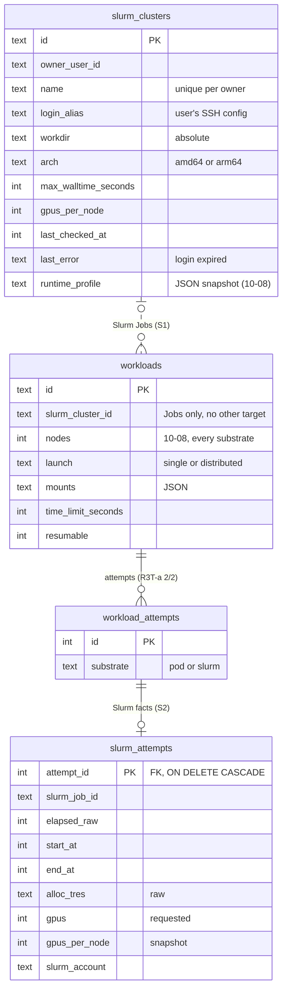

# RFC 0046: Slurm Jobs on an attached cluster

> Status: Accepted
> Date: 2026-10-05
> Author: Claude draft, for Luis Fernando De Pombo

**Attach surface removed, 10-06.** The owner paused Slurm ("no slurm for now;
also we shouldn't mount ~/.ssh read-only"). S1's attach surface was removed
pending a Slurm restart: `cluster attach` and `detach`, preflight and the login
module, the Slurm entries in `cluster list`, `status` and `wait`, and the local
API's `~/.ssh` and Clifton cache mounts. Migration 0135 shipped in v0.1.66, so
`slurm_clusters` and `workloads.slurm_cluster_id` stayed, unwritten, with the
`vmHostOwnedSql()` exclusion and resubmit guard that kept them consistent,
until P1.1 dropped them (§ Phases). P2.1 rebuilds attach, forwarding
the user's `SSH_AUTH_SOCK` into the container instead of mounting `~/.ssh`.

**Amended 10-08: a neutral Job spec.** The owner reviewed how the customer
actually uses Slurm (§ Workload fit), and the draft served none of it. The
owner rejected a "bring your own sbatch script" MVP as "too hacky, I would
still like the substrate to make sense" and approved ("yes") a neutral Job spec
that every substrate renders: § The neutral Job spec, § The runtime profile and
§ Rendering. The amendment also corrects the Context's container runtime, and
revises the runtime, time limit, images, invariants, scenarios, alternatives,
risks, Later and Tracking sections to match. § Phases sizes the work, and
§ What carries over from the old S2 branch says what Phase 2 reuses.

**Owner decisions, 2026-10-09** (15–19): the time limit is `--time-limit`
(`timeLimit`); Apptainer is the only launcher; `--runtime-profile` takes a
user-written file, with no built-in profiles; pools refuse the multi-node,
distributed and mount fields for now; and a resumable Job keeps the standard
retry budget.

**Split into two phases, 2026-10-09** (decision 20): Phase 1 prepares the
interface on every substrate and removes the current Slurm leftovers; Phase 2
adds Slurm on the new spec. The old S2 branch closes unmerged (§ Phases). Phase 1 is
accepted for implementation now, and Phase 2 is backlog (decision 22).

## Summary

A user with an account on a Slurm site, a GH200 pilot site first, can't run an
anycloud Job there. This RFC lets them attach the cluster they already log in
to, `anycloud cluster attach NAME --login <ssh-alias> --runtime-profile
<file>`, and then run
`anycloud job IMAGE --cluster NAME -- cmd`. anycloud runs on the user's own
devbox (the local API) and reaches the login node through the user's own SSH
config. It submits one `sbatch` per attempt and runs the OCI image inside the
allocation on one or more nodes, through Apptainer. The Job spec is
substrate-neutral: nodes, GPUs per node, how processes launch, mounts, the
time limit and whether the Job resumes mean the
same on pools. A site runtime profile says how this site runs them. It
observes the job with `squeue` and `sacct`, writes each outcome through the
shared attempt writer as a `Cause`, and counts node-hours. Slurm keeps
scheduling, fair share and QoS.

Slurm is a substrate, never a `CloudType` and never a `PoolOwner`. In
RFC 0044's onion it shares layers 1–4 (the surface, the Workload records, the
outcome policy and the shared contracts). Admission, the polling loop,
execution and its spend calculator are its own. It has no placement or
capacity layer, because anycloud submits to the site and never places or
scales it.

**Relations.** It builds on RFC 0044 (the outcome module `job-outcome.ts`,
`workload_attempts` and its Class Table Inheritance extensions, owner decision
21 and the Slurm rows of its target ER diagram) and RFC 0025 (enforcement
vocabulary). Its e2e members, `e2e-slurm-local` and `e2e-slurm-site`, are
registered by RFC 0017's RF17 amendment. It records the owner's
10-04 decisions, which until now lived only in planning notes.

## Context

- **Customer.** A national GH200 cluster: aarch64 GH200 nodes with 4 GPUs each,
  Slurm 24.11 with `slurmdbd` accounting, cgroup v2 with
  `ConstrainRAMSpace`, one default partition with no partition time limit,
  and short-lived SSH certificates from the site's own login tool. The site
  offers both `podman-hpc` and Apptainer. The customer uses Apptainer, through
  the site module `brics/apptainer-multi-node`, and runs on several nodes
  (§ Workload fit). The draft before 10-08 named `podman-hpc` as the
  customer's runtime, which was wrong. Access is per project member, from
  their own machine. The site's published unit is node-hours at 0.25 node per GPU.
- **A site spike (10-04)** ran one probe and one lifecycle run from a project
  member's own login, with no anycloud code in the path. It measured what
  this RFC relies on: exit codes, adoption after a kill, the `squeue` to
  `sacct` hand-off, billing, pull times and the GPU path. Its findings are
  folded in below; the raw output stays out of this repository. It tested
  mechanics, not the customer's workload.
- **The customer's workload** was reviewed only after S2 opened;
  § Workload fit records it.
- **Code on `main`.** RFC 0044's R3T-a 1/2 put `Cause`, `Outcome`,
  `OutcomePolicy` and `BATCH_POLICY` in `src/api/services/job-outcome.ts`.
  R3T-a 2/2 (merged) added `workload_attempts` and its fenced writer
  `recordAttemptOutcome`. Every `CloudType` is a VM host, and non-VM
  substrates are selected by record (`deployment_id`, `node_pool_id`). The
  experiment `experiments/slurm-podman/` holds the dockerized spike.

## Proposal

### Phases

The owner asked (2026-10-09): "can we split this up in the interface changes
in prep and removal of current slurm and 2nd part actually adding it? and have
rfc have the two phases". Phase 1 runs no Slurm. Phase 2 adds Slurm on the
spec Phase 1 defines. The old S2 branch closes unmerged, and Phase 2
reuses its code where it fits (§ What carries over from the old S2 branch). The section
labels S1 and S2 below now mean P2.1 and P2.2–P2.3.

The milestone is done when a devbox user runs the customer's 2-node training
chain (§ Workload fit, W1) on the pilot site and sees its status, logs, outcomes and
node-hours. Sizes are rough line counts. "Source" means production code and
the e2e harness, which counts as source (CONTRIBUTING § Size estimates).

#### Phase 1: interface prep, and removal of the current Slurm code

Accepted for implementation now (decision 22). Phase 1 changes no behaviour
for existing Jobs: every VM-host, targeted and pool workload runs as before,
and only the new fields are refused.

No substrate on `main` can run a new field cheaply yet. Pool command Jobs
arrive with RFC 0044 PRs 6 and 8: PR 6's runner enforces `timeLimit` and
reports reaching it as a deadline, and PR 8's admission refuses the rest
(§ The neutral Job spec). The VM host is frozen, and targeted Jobs run inside
a Deployment replica's claim queue. Phase 1 therefore adds the fields to the
API and the CLI and the layer 3 rule, and stores nothing: the `workloads`
columns and record plumbing land in P2.2, the first PR whose substrate admits
a field. VM-host and targeted Job admission refuse a non-default `nodes`,
`launch`, `mounts`, `timeLimit` or `resumable`, naming the field and its flag.
An explicit `--gpus-per-node` is admitted only on a VM-host Job with exactly
one `--gpu-type <type>:<N>`, or one `--vm-type` the catalog gives N GPUs
and the same count; it is refused with several GPU or VM types, with
`--gpus`, and on a targeted Job. Existing GPU Jobs are unchanged.
The six CLI flags stay hidden from `--help` until a substrate admits one, so
the CLI doesn't advertise a flag every substrate refuses.

**Two PRs.** Phase 1 is built as two pull requests: P1.1 (merged)
and P1.2. P1.1 took migration 0136; P1.2 has no migration, and P2.2
numbers its own when it lands. Neither needs a
paid live run or a changelog entry, since neither changes what a user can do.
Phase 1 has no dependency on other open work: R3T-a 2/2 has merged,
and RFC 0044 PR 6 builds on Phase 1's fields later.

**P1.1: remove the Slurm leftovers** (merged; layer 2, shared records).
About +25/−5 source, +40/−85 test and −40 docs lines, plus the experiment's
−1,963.

| File                                                                                     | Change                                                                                                                                                                                                                                                                                                                                                                          |
| ---------------------------------------------------------------------------------------- | ------------------------------------------------------------------------------------------------------------------------------------------------------------------------------------------------------------------------------------------------------------------------------------------------------------------------------------------------------------------------------- |
| `migrations/0136_drop_slurm_clusters.sql`                                                | new: drop triggers `workloads_slurm_cluster_exists` and `slurm_clusters_detach_requires_no_live_jobs`, index `idx_workloads_slurm_cluster`, table `slurm_clusters` and index `idx_slurm_clusters_owner_name`; recreate `workloads_identity_immutable` without `slurm_cluster_id`; `ALTER TABLE workloads DROP COLUMN slurm_cluster_id` (a table rebuild only if SQLite refuses) |
| `src/api/services/repositories/workload-queries.ts`                                      | `vmHostOwnedSql()` drops its `slurm_cluster_id IS NULL` clause and the Slurm sentence of its doc comment                                                                                                                                                                                                                                                                        |
| `src/api/services/repositories/workload-outcomes.ts`                                     | the resubmit guard drops its `slurm_clusters` clause                                                                                                                                                                                                                                                                                                                            |
| `test/unit/services/repositories/slurm-cluster-schema.spec.ts`                           | deleted                                                                                                                                                                                                                                                                                                                                                                         |
| `test/unit/services/repositories/{container-spec,deployment,workload}-migration.spec.ts` | drop `slurm_cluster_id` from expected columns                                                                                                                                                                                                                                                                                                                                   |
| `test/unit/services/repositories/migrations-upgrade-path.spec.ts`                        | S19 (`test:0046/S19`)                                                                                                                                                                                                                                                                                                                                                           |
| `ARCHITECTURE.md`                                                                        | Durable Data Model: the diagram's `slurm_clusters`, edge and column, the dotted-line note's Slurm example, the `slurm_clusters` and `workloads.slurm_cluster_id` notes, and the design rule that uses `slurm_clusters` as its example (give it another); Provider and Runtime Model: the "withdrawn" note                                                                       |
| `experiments/slurm-podman/`                                                              | deleted (below)                                                                                                                                                                                                                                                                                                                                                                 |

Kept: 0134's `'slurm'` substrate value and `workload-attempts.ts`'s
`'pod' | 'slurm'` type, which Phase 2 writes, and `scripts/pr-sections.ts`'s
Slurm column. P1.1 drops attach records a v0.1.66 user may have made with the
since-removed `cluster attach`. No Job ever ran on them, because S2 never
shipped, so no in-flight work is lost; Phase 2's attach needs a runtime
profile anyway.

**`experiments/slurm-podman/`** is deleted in P1.1. Its deletion criterion
("when the provider decision rejects Slurm/Podman as a supported substrate")
is met: Podman is dropped (decision 16), and Phase 2's local harness replaces
its dockerized site. Following CONTRIBUTING § Directory ownership, nothing is
promoted from it.

**P1.2: the neutral Job spec at layers 1 and 3** (layers 1 and 3, shared;
layer 5, VM host, targeted Jobs and pool Services). It stores nothing
(decision 23). About +130 source and +165 test lines.

| File                                                                                                                                                                      | Change                                                                                                                                                                                                                                                                                                                                                                                       |
| ------------------------------------------------------------------------------------------------------------------------------------------------------------------------- | -------------------------------------------------------------------------------------------------------------------------------------------------------------------------------------------------------------------------------------------------------------------------------------------------------------------------------------------------------------------------------------------- |
| `src/shared/api-contract/workload-admission-schemas.ts`                                                                                                                   | six optional fields: `nodes`, `gpusPerNode`, `launch`, `mounts` (`[{name, path, ro}]`), `timeLimit` (seconds) and `resumable`                                                                                                                                                                                                                                                                |
| `src/shared/api-contract/openapi.generated.json`                                                                                                                          | regenerated (`yarn generate:openapi`); optional fields only. The generated Python SDK picks them up                                                                                                                                                                                                                                                                                          |
| `src/api/services/job-outcome.ts`                                                                                                                                         | `batchPolicy({ resumable })` replaces `BATCH_POLICY`: `deadline` is Retrying when resumable, Failed otherwise                                                                                                                                                                                                                                                                                |
| `src/cli/commands/submit.ts`, `src/cli/utils/duration.ts`                                                                                                                 | six hidden `job` flags; `--mount NAME:PATH[:ro]` repeatable; `--time-limit` through `parseDurationMs`, requiring a unit and at least 1 s                                                                                                                                                                                                                                                     |
| `src/api/services/workload-admission-resolution.ts` (VM host), `src/api/services/targeted-job-admission.ts`                                                               | refuse a non-default `nodes`, `launch`, `mounts`, `timeLimit` or `resumable`, naming the field and its flag. `gpusPerNode` is admitted only on a VM-host Job with exactly one `--gpu-type <type>:<N>` (a type with no count means 1), or one `--vm-type` with N catalog GPUs, and the same count, then discarded; it is refused with several GPU types, with `--gpus`, and on a targeted Job |
| `src/api/services/node-pool-service-admission.ts`                                                                                                                         | refuse all six fields on a pool Service, naming the field and its flag: pool Services share the admission schema, so the fields would otherwise be silently ignored                                                                                                                                                                                                                          |
| `test/unit/services/job-outcome.spec.ts`                                                                                                                                  | S22                                                                                                                                                                                                                                                                                                                                                                                          |
| `test/unit/services/workload-admission-resolution.spec.ts`, `test/unit/services/targeted-job-admission.spec.ts`, `test/unit/services/node-pool-service-admission.spec.ts` | S20, S21                                                                                                                                                                                                                                                                                                                                                                                     |
| CLI spec                                                                                                                                                                  | flag parsing and the unit rule                                                                                                                                                                                                                                                                                                                                                               |

**Acceptance.** P1.1: S19 passes, and the Data model Before / After shows the
dropped Slurm table and column. P1.2: S20–S22 pass, the API contract section
shows only added optional fields, and there is no Data model change. For both,
the existing unit, integration and e2e suites pass, with only the spec edits
listed above. Open PRs touch some of P1.2's files, so P1.2
rebases onto the current `main`, regenerates the OpenAPI document and re-runs
CI before merge.

#### Phase 2: add Slurm on the new spec

Accepted as the plan and deferred to the backlog (decision 22). Open decision
21 must be resolved before P2.2 starts.

| PR   | Scope                                                                                                                                                                                                                                                                                                                                                                                                                                                                                                                                                                                                                                                                                                                                                                                                                                | Layers and substrates                                                       | Size                                                                                                                                                                   | Acceptance                                                                                    |
| ---- | ------------------------------------------------------------------------------------------------------------------------------------------------------------------------------------------------------------------------------------------------------------------------------------------------------------------------------------------------------------------------------------------------------------------------------------------------------------------------------------------------------------------------------------------------------------------------------------------------------------------------------------------------------------------------------------------------------------------------------------------------------------------------------------------------------------------------------------ | --------------------------------------------------------------------------- | ---------------------------------------------------------------------------------------------------------------------------------------------------------------------- | --------------------------------------------------------------------------------------------- |
| P2.1 | **Attach with a runtime profile** (S1 rebuilt). A migration, numbered when it lands, re-creates `slurm_clusters` with `runtime_profile` and `workloads.slurm_cluster_id` with its checks and triggers. `cluster attach --login <alias> --runtime-profile <file>`, `detach`, the kind column in `list`, a minimal `status`, and preflight with the profile's checks. `slurm/runtime-profile.ts`. The login module forwards `SSH_AUTH_SOCK` instead of mounting `~/.ssh`                                                                                                                                                                                                                                                                                                                                                               | layer 1 (cluster CLI and RPC), 2 (records), 5 (preflight), 7 (login), Slurm | source about +990 (an earlier removal of about 890 restored, less the `podman-hpc` check and the `~/.ssh` mounts; profile +45; agent forwarding +20); tests about +800 | S1, S8; L1 on the pilot site                                                                  |
| P2.2 | **Run Slurm Jobs** (S2 rebuilt, without spend). `job --cluster`, `renderSbatch(spec, profile)` with Apptainer, multi-node `srun`, mounts, `--time` and resumable attempts sharing `state`; admission against the profile; the `workloads` columns for the spec fields (`nodes`, `launch`, `mounts`, `time_limit_seconds`, `resumable`) with a migration numbered when it lands, and their record plumbing in `workload-record.ts`, `workload-creation.ts` and `workload-queries.ts`; the loop, controller, observation and classification; `slurm_attempts`; logs, terminate and cleanup; the Slurm filters on both digest queries, so Slurm Jobs never reach the VM digest; the boundary rules; and the `e2e-slurm-local` member with a stand-in `apptainer`, a `module` shim, `/lustre`, a test profile file and a second `slurmd` | layers 1 (`--cluster`), 4 (`classify`), 5, 6, 7, Slurm                      | source about +1,490 production and +1,580 harness; tests about +1,330                                                                                                  | S2–S7, S9–S11, S16, S17; the store specs' digest-query filters (§ Acceptance scenarios)       |
| P2.3 | **Node-hours and the digest.** `slurm_attempts` node-hours in `status` and `list`, the submit estimate, and the daily digest's Slurm section                                                                                                                                                                                                                                                                                                                                                                                                                                                                                                                                                                                                                                                                                         | layers 1 and 8, Slurm and shared spend                                      | source about +200; tests about +120                                                                                                                                    | the digest unit tests (§ Acceptance scenarios); then L2 runs S12–S15 and S18, the gate for W1 |

P2.1 lands first, because P2.2 needs an attached cluster. P2.3 follows P2.2,
which writes the facts it reads. Live gate **L1** runs after P2.1: `cluster
attach` and `cluster status` with no allocation. **L2** runs after P2.3, so S18
can check node-hours: the `pilot-site` target of the `e2e-slurm-site` member.
Each needs owner approval and a site account. If the owner chooses early
queueing (decision 21), P2.2 grows by about +60–100 lines.

**Totals.** Phase 1 is about +155/−5 source lines and about +205/−85 test
lines, with the experiment's −1,963. Phase 2 is about +2,680 production,
+1,580 harness and +2,250 test lines.

Excluded: a catalog, `serve`, bursting, bucket sync, `exec`, steps inside a
running allocation (`srun --overlap`), per-Job partition, account and QoS, and
a price (§ Later). Slurm has no spend controls, now or later: no caps, budgets
or spend-based admission gates (owner, 10-05).

### Workload fit

This section applies the workload-fit convention. The owner reviewed
the customer's Slurm job scripts and accounting records after S2 was
opened. The evidence stays outside this repository; below it is de-identified,
with no hostnames, usernames, project codes or job IDs.

| #   | The customer's workload                                                                                                                                                                                                                                                                                                                            | Spec                                                                                                                                                                                                                   | Served                                                                                                                                                               |
| --- | -------------------------------------------------------------------------------------------------------------------------------------------------------------------------------------------------------------------------------------------------------------------------------------------------------------------------------------------------- | ---------------------------------------------------------------------------------------------------------------------------------------------------------------------------------------------------------------------- | -------------------------------------------------------------------------------------------------------------------------------------------------------------------- |
| W1  | PyTorch DDP training on 2 nodes × 4 GH200, launched as one task per GPU with `srun --mpi=pmi2`, inside Apptainer loaded from the site module `brics/apptainer-multi-node`. It reads 22–636 GB of data from Lustre. Each job runs 24 h, the next one is queued with `--dependency=singleton`, and each resumes from the latest checkpoint on Lustre | `nodes: 2`, `gpusPerNode: 4`, `launch: distributed`, a read-only site-path mount for the data, a `state` mount (or a site path) for checkpoints, `timeLimit: 24h`, `resumable: true`; the pilot site's runtime profile | Yes, after this amendment; multi-node Apptainer is proven only at L2 (§ Risks). Whether the next attempt is queued early, as `singleton` does, is open (decision 21) |
| W2  | Evaluations run as `srun --overlap` steps inside the training allocation                                                                                                                                                                                                                                                                           | none: a Job is one allocation running one command                                                                                                                                                                      | **No.** An evaluation runs as its own Job that mounts the checkpoint path read-only; in-allocation steps are Later                                                   |

The draft before this amendment served neither: it hard-coded `--nodes=1`,
`podman-hpc`, the site-maximum walltime and a directory per attempt, with no
mounts.

### The neutral Job spec

The owner asked: "does slurm differ so much from k8? is there not a better way
to overlay this in the onion". The Job spec in layers 1–2 now describes the
work, not the place it runs. Six fields join today's image, command, env,
secrets and `gpuType`. Each means the same on every substrate:

| Field         | Meaning                                                                                                                                                                                                                                                                                   | Default                         |
| ------------- | ----------------------------------------------------------------------------------------------------------------------------------------------------------------------------------------------------------------------------------------------------------------------------------------- | ------------------------------- |
| `nodes`       | how many machines the Job spans                                                                                                                                                                                                                                                           | 1                               |
| `gpusPerNode` | GPUs on each node: the count today's flags already give, `--gpu-type gh200:4` on Slurm or `--gpus 4` on a pool. A conflicting `--gpus-per-node` is refused                                                                                                                                | from those flags                |
| `launch`      | `single`: one process per node; with `nodes > 1` it also gets `NNODES`, `NODE_RANK`, `MASTER_ADDR` and `MASTER_PORT`, for a launcher such as `torchrun`. `distributed`: one process per GPU, with `RANK`, `LOCAL_RANK`, `WORLD_SIZE`, `LOCAL_WORLD_SIZE`, `MASTER_ADDR` and `MASTER_PORT` | `single`                        |
| `mounts`      | `[{name, path, ro}]`. `name` is `state` or an absolute path on the substrate. `state` is a directory owned by the Job, shared by all its attempts and kept after it ends                                                                                                                  | none                            |
| `timeLimit`   | the longest one attempt may run: the runner stops the command on a pool and reports a deadline; `--time` on Slurm, ending as `TIMEOUT`                                                                                                                                                    | none; on Slurm the site maximum |
| `resumable`   | reaching `timeLimit` ends the attempt, not the Job: the next attempt starts with the same mounts                                                                                                                                                                                          | `false`                         |

The owner's example, with the time-limit flag as decided on 2026-10-09 and the
project path left as a placeholder:

```sh
anycloud job IMAGE --cluster pilot-site --nodes 2 --gpus-per-node 4 \
  --launch distributed --mount /lustre/<project>/data:/data:ro --mount state:/state \
  --time-limit 24h --resumable -- python train.py
```

Each layer of RFC 0044's onion treats the fields as follows:

| Layer            | Treatment                                                                                                                                                                                                                                                                                              |
| ---------------- | ------------------------------------------------------------------------------------------------------------------------------------------------------------------------------------------------------------------------------------------------------------------------------------------------------ |
| 1 Surface        | `--nodes`, `--gpus-per-node`, `--launch`, `--mount NAME:PATH[:ro]` (repeatable), `--time-limit <duration>` and `--resumable` on `job`, with the same fields in the API and the Python SDK. From P2.2, `status` shows them. They are shared flags, not Slurm flags                                      |
| 2 Records        | From P2.2 (decision 23), `workloads` gains `nodes`, `launch`, `mounts` (JSON), `time_limit_seconds` and `resumable`, immutable after admission like the rest of the spec. `gpusPerNode` stays where today's GPU count is stored. The one retry budget is unchanged                                     |
| 3 Outcome policy | **One rule: a deadline is retryable when the Job is resumable.** `job-outcome.ts` replaces the `BATCH_POLICY` constant with `batchPolicy({ resumable })`, whose `deadline` entry returns Retrying for a resumable Job and Failed otherwise. Every deadline retry draws from the Job's one retry budget |
| 4 Contracts      | each `classify` returns `deadline` with a detail naming the time limit: Slurm's `TIMEOUT` here, the runner's time-limit report in RFC 0044                                                                                                                                                             |
| 5 Admission      | each substrate refuses, naming the field, what it can't do yet (table below)                                                                                                                                                                                                                           |
| 6 Loop           | unchanged: a resumable Job's next attempt is opened and submitted on the next tick, like any retry                                                                                                                                                                                                     |
| 7 Execution      | Slurm renders `sbatch` from the spec and the cluster's runtime profile (§ Rendering). On pools the runner enforces `timeLimit`                                                                                                                                                                         |
| 8 Spend          | Slurm node-hours use the GPU share of `nodes × gpusPerNode` GPUs (§ Spend). A pool's share per replica is unchanged                                                                                                                                                                                    |

Admission per substrate:

| Field                 | Slurm                                           | Pools (RFC 0044)                               | VM host and targeted Jobs                                                                               |
| --------------------- | ----------------------------------------------- | ---------------------------------------------- | ------------------------------------------------------------------------------------------------------- |
| `nodes > 1`           | admitted                                        | refused for now (Later: Indexed Job or JobSet) | refused                                                                                                 |
| `launch: distributed` | admitted when the profile names an MPI plugin   | refused for now (Later: Indexed Job or JobSet) | refused                                                                                                 |
| `gpusPerNode`         | at most the site's `gpus_per_node`              | at most the pool's GPUs per Node               | VM host: only with one `--gpu-type <type>:<N>` or `--vm-type` of the same count; targeted Jobs: refused |
| a mount of a path     | admitted under one of the profile's mount roots | refused for now (Later: pool storage)          | refused                                                                                                 |
| a `state` mount       | admitted                                        | refused for now (Later: pool storage)          | refused                                                                                                 |
| `timeLimit`           | at most the site maximum, when one is set       | admitted                                       | refused                                                                                                 |
| `resumable`           | admitted                                        | admitted                                       | refused                                                                                                 |

### Attach and login (S1)

- **`anycloud cluster attach NAME --login <ssh-alias> --runtime-profile <file> [--workdir <path>]`**
  registers an existing cluster the user can already log in to. `attach` is
  kind-neutral: `--login` selects Slurm, and a later `--context` would select
  a bring-your-own Kubernetes cluster (owner, 10-04). It runs preflight and
  stores the record only on a pass; attaching again re-checks it and
  refreshes the site profile.
- **The login is the user's own.** The record holds only the alias from the
  user's `~/.ssh/config`, so the site's certificate, `ProxyJump` and host
  keys apply. anycloud stores no key, certificate, host key, user or host,
  and never mints a certificate; a later version may run the site's own login
  tool (`clifton auth`) for the human to approve (§ Later). A hosted API
  refuses attach, because it can't use the user's SSH config.
- **Mount rule, as S1 shipped it (owner, 10-05: "Dir mounts + `ssh -G` check");
  the restart replaces it with agent forwarding (the 10-06 note).** The local
  API container mounts `~/.ssh` read-only, at `~/.ssh` and at its host path, and
  the site login tool's certificate cache (Clifton's
  `dirs::cache_dir()/clifton`, `~/.cache/clifton` on Linux) read-only at its
  host path when it exists. Clifton's `config_clifton` names its
  `CertificateFile` there by absolute path, and rewrites it in place on renewal,
  so a directory mount follows rotation. Before calling the API, `cluster
attach` runs `ssh -G <alias>` on the host and refuses, naming the fix, when a
  resolved `IdentityFile` or `CertificateFile` lies outside those directories.
  Every unencrypted key in `~/.ssh` is therefore readable by the local API
  container, and the cluster's key must have no passphrase: the container has no
  agent and no terminal.
- **One short connection per operation:** `ssh -F ~/.ssh/config -o
BatchMode=yes -o ConnectTimeout=… -o ControlMaster=no -o ControlPath=none -o
IgnoreUnknown=UseKeychain <alias> 'bash -s'`, the script on stdin. The user's
  multiplexing can't bind on the read-only mount, and a macOS config's
  `UseKeychain` is fatal to Linux OpenSSH.
  No ControlMaster and no persistent session; `SSHManager`, which forces
  `-F /dev/null`, a key file and a ControlMaster, is not reused.
- **Noise-tolerant.** On a fresh pilot-site account ssh prints "Could not
  chdir" and `.bashrc` errors and lands in `/`. anycloud parses only its own
  tagged stdout lines and assumes no working directory: every command uses
  absolute paths and `--chdir`.
- **Login expired.** Any authentication failure records "login expired" as
  the cluster's `last_error`. `status` shows it, the loop and cleanup pause
  for that cluster, and running Jobs keep running. When login returns,
  observation resumes and `sacct` supplies any outcome that happened
  meanwhile. A sleeping devbox pauses the same way.
- **`cluster detach NAME`** removes only anycloud's record, and is refused
  while a Job on the cluster is live or not yet cleaned up. `create`,
  `delete`, `forget` and the restore form stay Kubernetes-only; the separate
  tables make a Slurm name "not found" there, and `delete` says to use
  `detach`. `list` shows both kinds with a kind column.

**Preflight** makes no allocation. It refuses, naming the fix, when the login
fails, when `sacct` doesn't answer (accounting is required in code, not a
profile field), when `sbatch --test-only` refuses a one-GPU one-node Job (which
also checks the default account and partition), when the runtime profile fails
its checks (§ The runtime profile), when the default partition has no GPUs or an
architecture other than `amd64` and `arm64`, or when the workdir (default
`$SCRATCH`, shared with the compute nodes) isn't writable. An unreadable `$HOME`
is reported, not refused: Apptainer reads its configuration there, so S2's
script points `HOME` at the attempt directory. GPU access through Apptainer
and a workdir shared with the compute nodes are live-gate checks, not product
code.

**Site profile:** `arch`, `max_walltime` and `gpus_per_node`. The walltime
comes from the default QOS's `MaxWall`, then the association's, then the
partition's `MaxTime`: the pilot site's partition and association both say no
limit. When none sets one, `max_walltime` is NULL; anycloud invents no limit
and preflight doesn't refuse (owner, 10-05). A user with several associations
gets the first that `sacctmgr` lists, and with no default QOS and several QOS
anycloud assumes `normal`; both hold on the pilot site (one association,
`qos=normal`), and a second site may need the account on the record (§
Later). The user's runtime profile (§ The runtime profile) holds the modules,
the MPI plugin, the mount roots and the image cache. Everything else is code:
Apptainer, `--no-requeue`, the 60 s poll floor and required accounting.

### Records



- **`slurm_clusters`** is its own table, not a `kind` on `clusters`.
  `clusters` is the installation's one k3s control plane, owned by the
  installer API, with NOT NULL bootstrap columns and singleton constraints
  that mean nothing for Slurm. A `kind` column would need a table rebuild
  under the restore and identity code and a kind filter at every reader. The
  `cluster` noun stays one CLI and RPC surface; `list` and `get` return a
  kind-tagged union backed by both tables, and attach keeps names unique
  across them.
- **`workloads.slurm_cluster_id`** (owner, 10-04: keep the column) follows
  the existing per-substrate targets. A CHECK keeps it on Jobs and exclusive
  with `deployment_id` and `node_pool_id`; it is immutable with the other
  targets; `vmHostOwnedSql()` excludes it, so the VM scheduler and monitor
  never see a Slurm Job. It is a reference, not a foreign key: an insert
  trigger checks that the cluster exists, a deletion trigger refuses detach
  while a Job naming the cluster hasn't finished cleanup, resubmit requires
  the cluster to exist, and cleaned-up Jobs keep the id as history. **This
  departs from RFC 0044's target ER**, which drew an FK: an FK would refuse
  detach forever once any Job had used the cluster, and `SET NULL` would make
  a Slurm Job look VM-host. This PR corrects RFC 0044's diagram.
- **`slurm_attempts`** (S2; owner, 10-04: "yes", Class Table Inheritance) is
  the 1:1 extension of `workload_attempts`, keyed by `attempt_id`, for
  attempts whose `substrate` is `slurm`. At most one extension row exists per
  attempt, of the discriminator's kind. Only Slurm code writes it, in its own
  transaction: the job ID once `sbatch` returns, the raw `sacct` facts at
  settle. `recordAttemptOutcome` never touches it.
- **Identity is derived from the attempt ID.** The job name is
  `ac-<attemptId>`, the attempt directory is
  `${workdir}/anycloud/${workloadId}/${attempt}`, the Job's `state` directory,
  shared by its attempts, is `${workdir}/anycloud/${workloadId}/state`, and the
  nodes are re-read from
  `squeue %N` or `sacct NodeList` on demand. Login nodes can differ per
  connection, so no login host is part of the identity. No attempt column is
  added to `workloads`.

### The runtime profile

A **site runtime profile** says how a site runs containers. It is data, like a
Kubernetes RuntimeClass, which names a handler the node already has. Apptainer
is the only launcher (owner, 2026-10-09); its command template is code, and
the profile only parameterises it. It belongs to layer 7 on the Slurm side, in
`slurm/runtime-profile.ts`. Layers 1–4 never read it. It is separate from the
detected site profile (`arch`, `max_walltime`, `gpus_per_node`, § Attach and
login), which preflight measures.

The user writes the profile; anycloud ships none (owner, 2026-10-09).
`cluster attach --runtime-profile <file>` is required. The CLI reads the file,
and the API validates it and stores a snapshot in
`slurm_clusters.runtime_profile`, with variables such as `$SCRATCH` resolved on
the login node. Attaching again with an edited file refreshes it. The file is
JSON with these fields, all required:

| Field        | Type             | Meaning                                                                                         |
| ------------ | ---------------- | ----------------------------------------------------------------------------------------------- |
| `name`       | string           | a label shown by `cluster status`                                                               |
| `modules`    | array of strings | `module load`ed in order by the batch script; may be empty                                      |
| `mpi`        | string or null   | the `srun --mpi=` plugin for distributed Jobs; null refuses `launch: distributed`               |
| `mountRoots` | array of strings | absolute paths, or paths starting with a login-node variable; a mounted path must lie under one |
| `imageCache` | string           | an absolute path, or one starting with a login-node variable, where pulled images are kept      |

Unknown fields are refused, so a typo is never silently ignored.
Preflight checks the snapshot: `apptainer` runs after the modules load, `srun
--mpi=list` lists the MPI plugin, each mount root exists, and the image cache
can be created. The pilot site's profile, as a worked example:

```json
{
  "name": "pilot-site",
  "modules": ["brics/apptainer-multi-node"],
  "mpi": "pmi2",
  "mountRoots": ["/lustre"],
  "imageCache": "$SCRATCH/anycloud/images"
}
```

L1 confirms the mount roots and that the module provides `apptainer`.

### Rendering

`renderSbatch(spec, profile)` stays pure. For the owner's example it renders
these flags:

```text
--job-name=ac-<attemptId> --no-requeue --nodes=2 --gpus-per-node=4
--ntasks-per-node=4 --time=1440 --output=<dir>/out.log --chdir=<dir>
```

and this batch script, where `<dir>` is the attempt directory and `<state>` is
`${workdir}/anycloud/${workloadId}/state`:

```bash
#!/bin/bash
[ -r "$HOME" ] && [ -x "$HOME" ] || export HOME=<dir>
{ module load brics/apptainer-multi-node &&
  export APPTAINER_CACHEDIR=<imageCache>/cache APPTAINER_TMPDIR=<imageCache>/tmp &&
  mkdir -p "$APPTAINER_CACHEDIR" "$APPTAINER_TMPDIR"; } > <dir>/setup_error 2>&1 || exit 70
rm -f <dir>/setup_error
sif=<imageCache>/<image digest>.sif
srun --job-name=pull -N1 -n1 timeout 900 sh -c \
  '[ -s "$1" ] || { apptainer pull "$1.$SLURM_JOB_ID" "docker://$2" && mv "$1.$SLURM_JOB_ID" "$1"; }' \
  _ "$sif" <repository>@<image digest> || exit $?
export MASTER_ADDR=$(scontrol show hostnames "$SLURM_JOB_NODELIST" | head -n1)
export MASTER_PORT=$((20000 + SLURM_JOB_ID % 20000))
srun --job-name=main --mpi=pmi2 --kill-on-bad-exit=1 bash -c \
  'exec apptainer run --nv --env-file "$1" \
     --env RANK=$SLURM_PROCID,LOCAL_RANK=$SLURM_LOCALID,WORLD_SIZE=$SLURM_NTASKS,LOCAL_WORLD_SIZE=$SLURM_NTASKS_PER_NODE \
     --bind <dir>/output:/mnt/output,/lustre/<project>/data:/data:ro,<state>:/state \
     "$2" "${@:3}"' _ <dir>/env "$sif" python train.py
code=$?
echo "$code" > <dir>/exit_code
exit "$code"
```

- **Nodes and tasks.** `--nodes` and `--gpus-per-node` come from the spec.
  `--ntasks-per-node` is `gpusPerNode` for `distributed` and 1 for `single`.
  `--mpi` is added only for `distributed`. `srun` returns the highest task
  exit code, and `--kill-on-bad-exit` ends every rank when one fails.
- **Rank variables** are set per task by a host-side `bash -c` from Slurm's own
  task variables, so the image runs unmodified and needs no shell. Apptainer
  also passes the host's `SLURM_*` variables, so code that reads them still
  works. With `single` and `nodes > 1`, the step sets `NNODES` and
  `NODE_RANK` instead.
- **Apptainer.** `apptainer run --nv` keeps the image's entrypoint, as
  `docker run` does. The profile's modules load first.
- **Images.** Every attempt runs the digest admission resolved,
  `<repository>@<image digest>`, never a tag that may have moved. Apptainer
  pulls once per digest into the
  profile's image cache, on one node, through a temporary name and a rename, so
  concurrent Jobs never read a partial file. Its layer cache and temporary files
  go there too, not to `$HOME`.
- **Setup failure.** A module that fails to load, or an image cache that
  can't be created, leaves its output in
  `<dir>/setup_error`, which `classify` reads as `unrecoverable` (row 6a), not
  as a lost Job.
- **Mounts.** Each mount is one `--bind`, read-only when `ro`.
  `state` resolves to `<state>`, which the submit script creates before the
  first attempt; `output/` stays at `/mnt/output`.
- **`--time`** is `timeLimit` in minutes. Without one, it is the site maximum,
  and when the site sets none it is omitted, as before.
- **Continuation.** When a resumable attempt ends in `TIMEOUT`, `classify`
  returns `deadline` and `batchPolicy` returns Retrying. The loop opens attempt
  n + 1, with a new attempt directory and job name, and the same mounts,
  `state` included, so the program resumes from its own checkpoint. Adoption
  by name, the 0600 env file and `--no-requeue` are unchanged. Until the
  owner decides otherwise (decision 21, open), anycloud submits the next
  attempt only after the previous one ends.

### Runtime (S2)

| Concern   | Design                                                                                                                                                                                                                                                                                                                                                                                                                                                                                                                                  |
| --------- | --------------------------------------------------------------------------------------------------------------------------------------------------------------------------------------------------------------------------------------------------------------------------------------------------------------------------------------------------------------------------------------------------------------------------------------------------------------------------------------------------------------------------------------- |
| Submit    | A pure `renderSbatch(spec, profile)` (§ Rendering): `--job-name=ac-<attemptId>`, `--no-requeue`, `--nodes`, `--gpus-per-node` (never `--cpus-per-task`), `--ntasks-per-node`, `--time` from `timeLimit` or else the site maximum (omitted when neither is set), `--output=<dir>/out.log`, `--chdir`. The profile's modules load first. Two named `srun` steps: `pull` under `timeout 900`, then `main`. The script writes `main`'s full exit code to `<dir>/exit_code` and exits with it. No sshd, no sentinel, no hold-open allocation |
| GPU       | `main` runs `apptainer run --nv --env-file <dir>/env` with the Job's binds. The draft's `podman-hpc run --device nvidia.com/gpu=all` is gone (owner, 2026-10-09; § Alternatives)                                                                                                                                                                                                                                                                                                                                                        |
| Rejection | `sbatch` refusing the job (over a QoS limit, a bad directive) fails the attempt at once: `unrecoverable('sbatch refused the Job: <text>')` → Invalid. A connection error is a failed read: the controller backs off and retries on a later tick, never in a hot submit loop                                                                                                                                                                                                                                                             |
| Adopt     | For an open attempt with no `slurm_attempts` row: `squeue --me --name=ac-<attemptId>`, then `sacct --name -S <opened_at minus one day>`, before any submit. `-S` is in the cluster's local time, hence the margin, and `sacct` name lookups lag 2–5 s, hence the order                                                                                                                                                                                                                                                                  |
| Observe   | One `squeue --me -h -o '%i\|%T\|%r\|%N'` per cluster per tick, filtered client-side (never `squeue -j`, which exits 1 for a purged id), then `sacct -X -P -n` with the step rows for ids that left the queue. At most once every 60 s                                                                                                                                                                                                                                                                                                   |
| Loop      | `discover()` returns non-terminal rows with `slurm_cluster_id`; each is reconciled level-triggered on `reconciliation/scheduler.ts`. Not `pool-reconciler.ts`, no watch. Rows of a cluster whose login expired are skipped, not failed                                                                                                                                                                                                                                                                                                  |
| FSM       | `queued` → `provisioning` (submitted, `PENDING`) → `running` → terminal, or `retrying` with a new `sbatch`. `status` shows the pending reason. No anycloud pending deadline: the queue is the site's                                                                                                                                                                                                                                                                                                                                    |
| Settle    | `tail -c 1048576 out.log`, `cat exit_code` and `cat setup_error` (when present) in one call → `classify` → `batchPolicy({ resumable })` → `recordAttemptOutcome(attempt, cause, outcome, tail)`, then the node-hours. No finalizer: `sacct` keeps terminal records                                                                                                                                                                                                                                                                      |
| Terminate | `scancel <id>`, then confirm the job is gone from `squeue`. The terminate record wins a race with the end; a job still `COMPLETING` after `scancel` counts as ended, with its outcome from `sacct`                                                                                                                                                                                                                                                                                                                                      |
| Cleanup   | A `slurmClusterId` branch in shared terminal cleanup: `scancel` every attempt id (idempotent), remove only the scripts and the env file, keep `output/`, `out.log` and `state`, then mark cleanup complete. Deferred while the login is unreachable or expired                                                                                                                                                                                                                                                                          |
| Logs      | `tail -c 1048576 [-F] <dir>/out.log` over the login, then the stored tail after the end. While the job is pending or before `out.log` exists, `LOGS_CONTAINER_NOT_READY` (RFC 0041), so `logs -f` waits. `ssh` is refused and points to `logs`; `exec` is Later                                                                                                                                                                                                                                                                         |

**`sacct` → `Cause`.** `slurm/classify.ts` is pure and total. It reads the job
row first, then the `main` step by name; the first matching row wins. The
outcomes come from `batchPolicy({ resumable })` in `job-outcome.ts`. Job
states match as a prefix, because a cancelled job row reads
`CANCELLED by <uid>`.

| #   | Evidence (job and steps)                 | `Cause`                                         | Outcome                                  |
| --- | ---------------------------------------- | ----------------------------------------------- | ---------------------------------------- |
| 1   | No record after a consistent read        | `lost('no Slurm record for job N')`             | Failed                                   |
| 2   | Terminate requested by anycloud          | superseded by the terminate record              | the operator's state                     |
| 3   | `PREEMPTED`, `NODE_FAIL`, `BOOT_FAIL`    | `disrupted('<STATE>: <reason>')`                | Retrying (budget)                        |
| 4   | Job row `TIMEOUT`                        | `deadline('reached its time limit (<h>)')`      | Failed; Retrying (budget) when resumable |
| 5   | `CANCELLED*` with no terminate record    | `lost('cancelled outside anycloud')`            | Failed                                   |
| 6   | `pull` step ≠ 0                          | `unrecoverable('image pull failed: <tail>')`    | Invalid                                  |
| 6a  | No `pull` step, and a `setup_error` file | `unrecoverable('setup failed: <text>')`         | Invalid                                  |
| 7   | `main` step `OUT_OF_MEMORY` (cgroup)     | `exit(code, oom: true)`                         | Errored "OOMKilled"                      |
| 8   | `main` ended                             | `exit(code, oom: false)`, code from `exit_code` | Completed if 0, else Errored             |
| 9   | Any other terminal state                 | `lost('state S, no main step')`                 | Failed                                   |

Every non-exit cause carries one `detail`, as `job-outcome.ts` on main
defines it. Slurm produces neither `helper` nor `evicted-storage`: a failed
`pull` is `unrecoverable`, like an image Kubernetes can't pull (RFC 0044), not
`helper`. No new `Cause` kind is needed. A submit rejection reuses `unrecoverable`
because, like an unpullable image, the attempt can't start and a retry won't
help; `unbound` keeps meaning only "never placed before a deadline".

**Exit-code authority.** `sacct` step rows keep 7 bits (an exit of 137 shows
as `FAILED 9:0`, confirmed on the pilot site), and the job row's `DerivedExitCode`
is a maximum across steps, so neither stands in for `main`'s code. The
`exit_code` file is the authority; `sacct`'s step code is the fallback, used
only when the file is missing (a timeout or a cancel). The file never decides
the end state: `TIMEOUT`, `PREEMPTED`, `NODE_FAIL` and OOM come from `sacct`.
For a multi-task `main`, the file holds `srun`'s aggregate: the highest task
code, so when one rank fails and `--kill-on-bad-exit` stops the rest, the code
can be the peers' 137, not the failing rank's. `out.log` names the rank that
failed first; S16 checks the aggregation on Slurm 24.11.

### Admission and the CLI (S2)

`anycloud job IMAGE --cluster NAME [--gpu-type <type>:<count>] [-e K=V] -- cmd`
is admitted by `slurm-job-admission.ts` as an allowlist: the image, the
command, `-i/--id`, `-e`, `--env-file`, `--gpu-type`, `--cluster` and the six
neutral fields (`--nodes`, `--gpus-per-node`, `--launch`, `--mount`,
`--time-limit`, `--resumable`), checked as § The neutral Job spec's admission
table says. Every other flag is refused with one message naming it, and new
flags stay refused until someone allows them. `--gpu-type gh200:1` becomes
`--gpus-per-node=1`; a CPU-only Job still gets one GPU, the site minimum.
`--cluster` is exclusive
with `--deployment` and `--node-pool`, and naming the Kubernetes cluster there
is refused with a pointer to `--node-pool`. Admission refuses an image with no
build for the cluster's `arch`; `image-manifest.ts` passes the arch through
instead of its amd64-only refusal.

### Secrets (S2)

`-e` values passed through `sbatch` would land in Slurm's stored job record,
which site administrators can read. S2 writes them over the login to a mode
0600 `env` file in the attempt directory, readable only by the user; `main`
passes it with Apptainer's `--env-file`, and cleanup deletes it with the
scripts (owner, 10-04, Q5: "0600 env file"). No value appears in the `sbatch`
command line or script. Apptainer reads its env file as shell, so S2 writes
each value single-quoted, with `'` escaped. S10 uses a value with `$`, a quote
and a space.

### Time limit and resumable Jobs (S2)

`--time-limit` (`timeLimit`, owner, 2026-10-09) sets `--time`, and admission
refuses one above the site maximum. Without it, a Slurm Job is submitted with
the site maximum (24 h on the pilot site, which L1 confirms), and the submit output
says so (owner, 10-04). This replaces the 10-04 decision to add no flag. An
attempt that reaches its time limit ends as `TIMEOUT` → `deadline`: Failed, or
Retrying when the Job is `--resumable`, and the next attempt mounts the same
`state` (§ Rendering). A resumable Job keeps the standard retry budget of 100
attempts (owner, 2026-10-09). On the pilot site a job starts only if enough
node-hours remain to run it to its limit, so the up-front estimate is the GPU
share (§ Spend) × the time limit per attempt. When neither `--time-limit` nor
the site sets a limit (`max_walltime` NULL), S2 submits without `--time`, and
the estimate shows as unknown (owner, 10-05).

### Spend (S2)

- **Node-hours = GPU share × `sacct` elapsed.** The share is
  `max(gpus, 1) / gpus_per_node`, where `gpus` is `nodes × gpusPerNode`, so
  one GPU on the pilot site is 0.25 node and the 2 × 4 Job is 2 nodes. Elapsed is
  `ElapsedRaw`, per second. It is never derived from Slurm's
  `billing` TRES: with no `TRESBillingWeights`, the pilot site's `billing` for a
  one-GPU job is 1/18 of a node, not the published 0.25.
- **"Profile + rate" (owner, 10-04).** Spend is share × hours × a nullable
  price; with no price, node-hours only. There is no catalog: the site
  profile holds the node shape. S2 stores the raw facts per attempt in
  `slurm_attempts` (`ElapsedRaw`, start, end, raw `AllocTRES`, requested
  GPUs, a `gpus_per_node` snapshot and the account), so a later formula needs
  no history, even after the site purges `sacct`. A later rate is one
  nullable `slurm_clusters` column copied onto each attempt's row when its
  outcome is recorded, so a rate change never reprices history.
- **Daily usage digest (owner, 10-05).** S2 adds a per-user "Slurm Jobs"
  section to the daily Slack usage digest: attempts, results and node-hours
  from `slurm_attempts`, counted on the day each attempt settled and shown to
  one decimal place ("0.3 node-hours"). A settled Slurm attempt counts as
  digest activity, so a day with only Slurm Jobs still posts. S2 filters
  Slurm rows (`slurm_cluster_id IS NOT NULL`) out of both digest queries
  (`listTerminalWorkloadsByDateRange`, `summarizeWorkloadStartsInWindow`).
  The spend line is shown whenever Slurm node-hours are non-zero, even with
  no active VMs, with the suffix "Slurm: N node-hours (not in total; rate
  not set)". Once the Later rate exists, Slurm USD joins the total.
- **Budgets don't stop Slurm Jobs.** Slurm spend feeds no cap: anycloud
  budgets and throttles count `vms` and `pool_occupancy`, not node-hours. The
  site allocation is the limit, and the submit output and
  `docs/reference/cli/cluster.md` say so. The pilot site exposes no remaining
  allocation (`GrpTRESMins` is empty), so there is no allocation display.
- The share function stays in `slurm/`: a three-line duplicate of the pool
  share, not shared across the Slurm and pool boundary.

### Images and data (S2)

The `pull` step runs `apptainer pull` inside the job, as the cluster user;
pulls never run on a login node. Apptainer keeps one SIF per image in the
profile's image cache (§ Rendering). On 10-04 the spike pulled a 9.2 GB
PyTorch image through `podman-hpc` in 184 s cold and 3.6 s cached; an
Apptainer SIF build from OCI layers is unmeasured, and S14 checks it against
the 15-minute pull timeout. Copies
are kept for reuse, and cleanup never removes them. Inputs come from the image,
the network or a mounted site path, which anycloud never copies; the
customer's 22–636 GB datasets stay on Lustre. Outputs stay in the attempt's
`output/` (`/mnt/output` in the container) and in `state`, both of which
cleanup keeps.

### Boundaries (S2)

- Layers 1–4 import nothing under `slurm/` or `kubernetes/` (invariant 12,
  widening RFC 0044's invariant 17). `Cause`,
  `Outcome`, `OutcomePolicy` and `batchPolicy` live in `job-outcome.ts`
  (owner, 10-04, Q4), and policy strings take their substrate words from the
  cause's detail.
- **`slurm-substrate-boundary`**, a new dependency-cruiser rule: `slurm/**`
  imports nothing from `kubernetes/**` or `pool-*`. RT12's pool rule adds the
  reverse direction. Slurm is never a `PoolOwner`: the pool loop's owner
  is driven by a Pod watch, which Slurm doesn't have.
- `slurm-job-controller.ts` joins the importers of
  `repositories/workload-attempts.ts`; only Slurm code writes
  `slurm_attempts`.
- Two branches an earlier change deleted come back keyed on `workload.slurmClusterId`
  instead of a `CloudType`: one in the Job operations router and one in
  shared terminal cleanup. `ExecutionModel`, `CloudType.Slurm` and a
  `PROVIDER_DATA` entry do not.

### What carries over from the old S2 branch

The old S2 branch closes unmerged. It branched from before S1's 10-06 removal and
built on the single-node shape. Phase 2 rebuilds S2 on the spec, taking its
code where it fits:

| From the old S2 branch (lines)                                                                                             | Phase 2 use                                                                                                                                              |
| -------------------------------------------------------------------------------------------------------------------------- | -------------------------------------------------------------------------------------------------------------------------------------------------------- |
| `slurm/observe.ts` (114), `slurm/reconciler.ts` (79), `slurm/default-runtime.ts` (33), `slurm/login.ts` changes            | P2.2, as is                                                                                                                                              |
| `slurm/classify.ts` (68)                                                                                                   | P2.2, plus the `TIMEOUT` detail and row 6a (+8)                                                                                                          |
| `repositories/slurm-jobs.ts` (242), the `slurm_attempts` migration (37)                                                    | P2.2, renumbered; `gpus` becomes `nodes × gpusPerNode` (+3)                                                                                              |
| `slurm/job-controller.ts` (350)                                                                                            | P2.2, with the spec and profile, `state` and `batchPolicy` (+15)                                                                                         |
| `slurm/job-admission.ts` (165)                                                                                             | P2.2, with the six fields and the profile and time-limit checks (+55)                                                                                    |
| `slurm/sbatch.ts` (114)                                                                                                    | P2.2: identity, the adopt-then-submit script and job-ID parsing kept; `renderSbatch` rewritten for Apptainer (+95), its `podman-hpc` lines deleted (−10) |
| Job operations, cleanup, monitor, composition, config, `workload-attempts.ts` and `image-manifest.ts` branches (about 150) | P2.2                                                                                                                                                     |
| spend, digest, queries and the `status` and `list` renderers (about 170)                                                   | P2.3                                                                                                                                                     |
| shared schemas and `submit.ts` flag handling (about 150)                                                                   | superseded by P1.2's shared fields; P2.2 keeps only `--cluster`                                                                                          |
| the `e2e-slurm-local` harness (about 1,350) and its unit tests                                                             | P2.2, with a stand-in `apptainer` replacing the 65-line `podman-hpc` stand-in                                                                            |
| the `slurm-podman` experiment's deletion                                                                                   | done earlier, in P1.1                                                                                                                                    |

## Required invariants

1. Every Slurm submission carries `--no-requeue`; anycloud owns retries
   through the attempt budget.
   _Enforcement: review — S2's `renderSbatch` golden test will hold it;
   nothing on `main` renders an `sbatch` yet._
2. No attempt is submitted before adoption by job name has looked for it:
   `squeue --me --name=ac-<attemptId>` first, then
   `sacct --name -S <opened_at minus one day>`.
   _Enforcement: review — S2's controller tests (a crash between `sbatch`
   and the database write adopts and never submits twice) and its
   mutant-parity floor will hold it; nothing on `main` submits yet._
3. A read whose command exits non-zero draws no conclusion; an attempt is
   `lost` only when a successful `squeue` and a successful `sacct` both lack
   its job.
   _Enforcement: review — S2's observation parsers and controller tests, with
   a mutant-parity floor on the synced rule, will hold it._
4. anycloud polls a cluster's queue at most once every 60 s.
   _Enforcement: review — the floor is a constant in S2's reconciler, and
   the cadence is injected as configuration for tests, never a test-mode
   branch._
5. Env values reach the container only through a mode 0600 file in the
   attempt directory, never through the `sbatch` command line or script, and
   cleanup deletes the file.
   _Enforcement: review — S2's controller test will check the mode, the
   absence of every value from the rendered command and script, and the
   deletion._
6. anycloud budgets and throttles don't stop Slurm Jobs: Slurm spend is never
   a cap source, and the site allocation is the limit.
   _Enforcement: review — S2 keeps node-hours in `slurm_attempts`, which no
   cap reads; the submit output and the docs state the rule._
7. `slurm/**` imports nothing from `kubernetes/**` or `pool-*`.
   _Enforcement: review — S2 adds the `slurm-substrate-boundary` graph rule with the
   first `slurm/` runtime module and retags this entry as that rule._
8. GPUs reach a Slurm container only through `apptainer run --nv`.
   _Enforcement: review — S2's `renderSbatch` golden test will hold it._
9. anycloud reaches a login node only with one short connection through the
   user's own SSH config, and stores no key, certificate or host key.
   _Enforcement: review — the record has no credential column. S1's login
   module, removed on 10-06, was the only Slurm SSH call site; S2's
   boundary rule can make the call site exclusive._
10. Slurm Jobs never enter the VM-host pipeline: a Job with a
    `slurm_cluster_id` carries no other target, and `vmHostOwnedSql()`
    excludes it.
    _Enforcement: review — P1.1 dropped the Slurm schema and its
    schema spec, so nothing holds this until P2.1 re-creates the schema with a
    test._
11. A Slurm cluster can't be detached while a Job naming it hasn't finished
    cleanup.
    _Enforcement: review — P1.1 dropped the Slurm schema and its
    schema spec, so nothing holds this until P2.1 re-creates the schema with a
    test._
12. Layers 1–4 (the surface, the Workload records, the outcome policy and
    the shared contracts) import nothing under `src/api/services/slurm/`,
    widening RFC 0044's invariant 17.
    _Enforcement: review — S1 widened `graph:substrate-neutral-core`'s
    target to `(kubernetes|slurm)/`; the 10-06 removal narrowed it back to
    `kubernetes/`. A restart widens it again and retags this entry as that rule._
13. Every attempt of a Job with a `state` mount mounts the same `state`
    directory, and cleanup never removes it.
    _Enforcement: review — S2's `renderSbatch` golden test and 0046/S3 will
    hold it._
14. A mounted path lies under one of the cluster's runtime-profile mount
    roots, checked at admission.
    _Enforcement: review — S2's admission test will hold it._

On 2026-10-09 that is **0 of 14 verified wired, 0 cited, and 14 resting on
review**: invariants 1, 2, 3, 4, 5, 6, 7, 8, 9, 10, 11, 12, 13, and 14.

## Acceptance scenarios

S19–S22 are Phase 1's and run in the unit and integration suites. The rest are
Phase 2's. S1–S11, S16 and S17 run in the `e2e-slurm-local` member on every PR:
one Docker container with `slurmctld`, `slurmd`, `slurmdbd` and MariaDB, a
second `slurmd` node, a stand-in `apptainer`, a `module` shim, a `/lustre`
directory and a test profile file shaped like the pilot site's, a non-root user, and
login SSH through a test `~/.ssh/config` alias, so the product needs no test
hook. It drives the real anycloud binary and local API. S12–S15 and S18 run in
the `pilot-site` target of the `e2e-slurm-site` member (`yarn
test:e2e-slurm-site:vitest`, L2), devbox-run with owner approval, its evidence
read by the harness.

The daily digest's Slurm section is pinned by unit tests, not by
`e2e-slurm-local`: `test/unit/services/notifications-digest.spec.ts` (a day
with only settled Slurm attempts posts),
`notifications-digest-format.spec.ts` (the section, one-decimal node-hours,
and the spend line with Slurm node-hours and no active VMs) and the store
specs `repositories/workload-outcomes.spec.ts` and
`repositories/workload-spend.spec.ts` (Slurm rows filtered out of both
digest queries).

| ID  | Scenario                                                                                                                                                                                                                                                                                                                                                                             | Required result                                                                                                                                                               | Coverage                                                                        |
| --- | ------------------------------------------------------------------------------------------------------------------------------------------------------------------------------------------------------------------------------------------------------------------------------------------------------------------------------------------------------------------------------------ | ----------------------------------------------------------------------------------------------------------------------------------------------------------------------------- | ------------------------------------------------------------------------------- |
| S1  | `cluster attach` with a valid profile file on a site that passes preflight, on one without `sacct`, and with a profile file that has an unknown field                                                                                                                                                                                                                                | the first is stored with its profile and shown by `list` and `status`; the second is refused naming `slurmdbd`, the third naming the field, and nothing is stored             | review — to become test:0046/S1 in `e2e-slurm-local` (S2); L1 on the pilot site |
| S2  | `job IMAGE --cluster C -- cmd` exits 0, and again exits 3                                                                                                                                                                                                                                                                                                                            | `completed` with `logs`; `errored` with exit code 3, from the `exit_code` file                                                                                                | review — to become test:0046/S2 in `e2e-slurm-local`                            |
| S3  | A Job runs past its `--time-limit`, once without `--resumable` and once with it                                                                                                                                                                                                                                                                                                      | the first `failed` with the `deadline` cause; the second `retrying`, then a second attempt that mounts the same `state`, finds the first attempt's file there and `completed` | review — to become test:0046/S3 in `e2e-slurm-local`                            |
| S4  | A site administrator cancels a Job with `scancel`                                                                                                                                                                                                                                                                                                                                    | `failed`, "cancelled outside anycloud"                                                                                                                                        | review — to become test:0046/S4 in `e2e-slurm-local`                            |
| S5  | `terminate` while the Job is pending, and while it is running                                                                                                                                                                                                                                                                                                                        | `scancel` confirmed, the Job `terminated`, `output/` and `out.log` kept, the scripts and env file gone                                                                        | review — to become test:0046/S5 in `e2e-slurm-local`                            |
| S6  | The login is revoked while a Job runs, then restored                                                                                                                                                                                                                                                                                                                                 | `status` shows "login expired" and the Job keeps running; after the login returns, the outcome is recorded from `sacct`                                                       | review — to become test:0046/S6 in `e2e-slurm-local`                            |
| S7  | The API is killed between `sbatch` and recording the job ID, then restarted                                                                                                                                                                                                                                                                                                          | the same Slurm job is adopted by name and recorded once; no second submission                                                                                                 | review — to become test:0046/S7 in `e2e-slurm-local`                            |
| S8  | `cluster detach` while a Job is live                                                                                                                                                                                                                                                                                                                                                 | refused; after the Job is cleaned up, detach removes only the record                                                                                                          | review — to become test:0046/S8 in `e2e-slurm-local`                            |
| S9  | `logs -f` started while the Job is pending                                                                                                                                                                                                                                                                                                                                           | waits through `LOGS_CONTAINER_NOT_READY`, then follows `out.log`                                                                                                              | review — to become test:0046/S9 in `e2e-slurm-local`                            |
| S10 | A Job with `-e SECRET=…`                                                                                                                                                                                                                                                                                                                                                             | the value is in the container, absent from `scontrol show job` and the script, and the env file is mode 0600 and deleted at cleanup                                           | review — to become test:0046/S10 in `e2e-slurm-local`                           |
| S11 | Repeated `squeue` failures while a Job runs                                                                                                                                                                                                                                                                                                                                          | no outcome is recorded; observation resumes after the failures stop                                                                                                           | review — to become test:0046/S11 in `e2e-slurm-local`                           |
| S12 | One single-GPU CUDA matmul under the pilot site profile's `apptainer run --nv`                                                                                                                                                                                                                                                                                                       | `completed`; the harness compares its checksum with a local CPU reference, and its node-hours with `sacct`                                                                    | review — to become test:0046/S12 in `e2e-slurm-site`'s `pilot-site` target (L2) |
| S13 | A seconds-long Job that allocates past its memory on the pilot site                                                                                                                                                                                                                                                                                                                  | `errored` "OOMKilled" from the cgroup's `OUT_OF_MEMORY` (owner, 10-04)                                                                                                        | review — to become test:0046/S13 in `e2e-slurm-site`'s `pilot-site` target (L2) |
| S14 | A large image pulled cold through the `pull` step on the pilot site (owner, 10-04)                                                                                                                                                                                                                                                                                                   | completes within the 15-minute timeout; the Apptainer SIF build time is recorded beside the spike's 184 s `podman-hpc` pull                                                   | review — to become test:0046/S14 in `e2e-slurm-site`'s `pilot-site` target (L2) |
| S15 | After L2                                                                                                                                                                                                                                                                                                                                                                             | `squeue --me` is empty, `output/` remains, and the node-hours used are recorded in the tracker                                                                                | review — L2's evidence step, recorded with the run                              |
| S16 | `--nodes 2 --gpus-per-node 2 --launch distributed` through a stand-in `apptainer` on two `slurmd` nodes                                                                                                                                                                                                                                                                              | 4 tasks with distinct `RANK` 0–3, `WORLD_SIZE` 4 and one `MASTER_ADDR`; the read-only mount can't be written                                                                  | review — to become test:0046/S16 in `e2e-slurm-local`                           |
| S17 | A mount outside the profile's roots, `--launch distributed` with a profile whose `mpi` is null, and a time limit above the site maximum                                                                                                                                                                                                                                              | each refused, naming the field; nothing stored                                                                                                                                | review — to become test:0046/S17 in `e2e-slurm-local`                           |
| S18 | The customer's chain (W1) in miniature on the pilot site: 2 × 4 GH200, `distributed`, the pilot site's profile file, a read-only data mount, `state`, `--time-limit 10m --resumable`, a DDP stub that all-reduces across nodes and checkpoints to `state`                                                                                                                            | the first attempt ends `deadline` and retries; the second resumes from the checkpoint and `completed`; the all-reduce sum matches all 8 ranks; node-hours match `sacct`       | review — to become test:0046/S18 in `e2e-slurm-site`'s `pilot-site` target (L2) |
| S19 | Phase 1: migration 0136 on a database at 0135, with a `slurm_clusters` row and existing Job, Deployment and pool rows                                                                                                                                                                                                                                                                | the Slurm table, column, index and triggers are gone; every other row and the identity trigger's other checks are unchanged                                                   | review — retired once every database reached 0143; no DB runs 0136 again        |
| S20 | Phase 1: the existing VM-host, targeted Job and pool suites after P1.1 and P1.2, and a VM-host GPU Job whose `--gpus-per-node` equals the count of its one `--gpu-type <type>:<N>`                                                                                                                                                                                                   | pass, with only the spec edits P1.1 and P1.2 list; a Job submitted without the new fields, or with a matching `--gpus-per-node`, is admitted and behaves as before            | review — to become test:0046/S20 in P1.2's admission specs                      |
| S21 | Phase 1: `nodes`, `launch`, `mounts`, `timeLimit` and `resumable`, each with a non-default value, on a VM-host Job and on a targeted Job; each of the six fields on a pool Service; a `--gpus-per-node` that differs from the count, or comes with several `--gpu-type` values, with `--gpus` or with no GPUs, or is on a targeted Job; also `--time-limit 60` and `--time-limit 0s` | refused, naming the field and its flag (the time limits as needing a unit and at least 1 s); nothing stored                                                                   | review — to become test:0046/S21 in P1.2's admission specs                      |
| S22 | Phase 1: `batchPolicy` with a `deadline` cause, resumable and not                                                                                                                                                                                                                                                                                                                    | Retrying and Failed; every other cause maps as `BATCH_POLICY` did                                                                                                             | review — to become test:0046/S22 in `job-outcome.spec.ts`                       |

## Alternatives considered

- **Bring your own `sbatch` script** (10-08). The user would hand anycloud
  their own script, and anycloud would submit and observe it. It is the
  smallest change, but anycloud could no longer say what a Job is: no
  admission, no shared outcome rule, nothing pools could also run. Rejected by
  the owner: "too hacky, I would still like the substrate to make sense".
- **Slurm-only flags** for nodes, mounts and the time limit, accepted only with
  `--cluster`. Rejected: the fields mean the same on pools, and keeping them in
  layers 1–3 lets one outcome rule serve both substrates. Each substrate
  refuses at admission what it can't do yet.
- **`podman-hpc` as a second launcher** (dropped, owner, 2026-10-09). The
  draft hard-coded it, and 10-04's diagnostic job showed its GPU path needs
  `--device nvidia.com/gpu=all`, never `--gpu`. Dropped: the customer uses
  Apptainer, it would be a second render path to test and keep, and it is
  single-node only. A site that needs it brings it back as a profile option
  (§ Later).
- **Built-in profiles** (dropped, owner, 2026-10-09). The user writes the
  profile file; anycloud ships none, so no site's paths or modules live in the
  product. Probing a profile at attach is Later.
- **Wall-clock naming: `--walltime` or `--max-duration`.** Rejected for
  `--time-limit` (owner, 2026-10-09), which names the same limit on every
  substrate and matches Slurm's `--time`.
- **Chaining attempts with `--dependency=singleton`**, as the customer does
  by hand. Whether to queue the next attempt early is open (decision 21);
  either way anycloud, not Slurm, owns the attempts.
- **One phase.** Building the spec and Slurm together, as the prior attempt did. Split
  (decision 20) so the interface lands, and the unused Slurm schema leaves,
  before any Slurm execution code.
- **A `kind` column on `clusters`.** One table and one `list` query, at the
  cost of a rebuild under the restore and identity code, NOT NULL bootstrap
  columns with no Slurm meaning, and a kind filter at about 24 readers.
  Rejected for separate tables (§ Records).
- **Slurm as a VM host.** An allocation would expose an SSH endpoint where the
  VM pipeline installs Docker and rclone. HPC sites give no root Docker, and
  VM Jobs retire under pools-only. Rejected.
- **An SSH sentinel or `scontrol` as the completion source.** A sentinel
  misses `TIMEOUT`, `PREEMPTED`, `NODE_FAIL` and cgroup OOM kills, and
  `scontrol` forgets a job after `MinJobAge` (300 s on the pilot site). `squeue`
  while queued or running, then `sacct`, reads what the scheduler reports,
  the way the Pod core reads the kubelet. The `exit_code` file is kept only
  as `main`'s exit-code authority, never as the end state.
- **An sshd in the allocation, with tunnels** (the 06-02 session's endpoint).
  It needs an sshd on compute nodes, an open port and a hold-open allocation.
  Rejected: `logs` reads `out.log` through the login node, and Later `exec`
  uses `srun --overlap`, the analogue of `pods/exec`, which the site spike
  proved (exact exit codes, about 0.5 s a call; SSH to compute nodes is
  refused).
- **A Slurm catalog or stored partition, account and QoS.** The scheduler owns
  partitions, QoS, accounts and GRES names, so a catalog would be stale. The
  MVP uses the user's site defaults, which `sbatch --test-only` checks.
- **Node-hours from Slurm's `billing` TRES.** Rejected: it gives 1/18 of a
  node per GPU on the pilot site, not the site's published 0.25.
- **A stored profile with credentials** (06-21). Replaced by the user's own
  SSH config on their devbox (owner, 10-04).

## Risks

- **Budgets don't see Slurm.** The docs and the submit output say so; the
  site allocation is the real limit.
- **Multi-node Apptainer needs a live gate.** Nothing yet shows that
  `apptainer run --nv` under `srun --mpi=pmi2`, with the site module
  `brics/apptainer-multi-node`, gives the container the site's NCCL plugin
  and interconnect. The local member can't, so S18 (L2) is the gate, and W1
  isn't served until it passes. The pilot site's driver tops out at CUDA 12.7, so
  newer images fail at run time as ordinary errors.
- **Apptainer isolates less than a container runtime.** By default it passes
  the host's environment and binds `$HOME` and the working directory. anycloud
  relies on that for the module's settings and `SLURM_*`; S18 checks that the
  env file still wins.
- **A resumable Job that never checkpoints reruns from scratch** until the
  retry budget (100 attempts) is spent: for W1's shape, up to about 4,800
  node-hours, with no anycloud spend control on Slurm. Once pools admit
  resumable Jobs (RFC 0044 PR 6), every pool attempt reruns from scratch
  until pool storage backs `state`. Docs and the submit output say so. The
  owner accepted this and kept the standard budget (decision 19).
- **A gap between attempts.** Unless decision 21 chooses early queueing, the
  next attempt is submitted after the previous one ends, at most a minute
  later. On a flat first-come, first-served queue each link re-queues at the
  back, losing the place a `singleton` chain keeps.
- **Phase 1 fields that every substrate refuses.** Until RFC 0044 PR 6 or
  P2.2 admits them, the fields exist only in the API and hidden flags, so the
  interface could drift from what Phase 2 needs. Phase 2 can still change
  them before any substrate admits one.
- **Without `exec`, a running Job is debugged through `logs`.** Users can
  still `srun --overlap` themselves.
- **One launcher.** A site without Apptainer needs a new template in
  `sbatch.ts`; anything else is a runtime profile.
- **A hand-written profile can be wrong.** Preflight checks its modules, MPI
  plugin, mount roots and image cache, and refuses unknown fields; a wrong
  root or plugin still surfaces only when a Job uses it.
- **The local member can't exercise real Apptainer.** Pull
  failures and GPU pass-through are proven only at L2.
- **The SSH key must work without a prompt.** The local API container has
  no SSH agent and no terminal, so a passphrase-protected key can't be used,
  with or without the site's certificate; the login fails as "login
  expired". The S1 restart's agent forwarding removes this (the 10-06 note).
- **The certificate must be visible in the container.** A login tool that
  keeps its certificate outside `~/.ssh` and Clifton's cache fails the
  attach-time `ssh -G` check, which names the fix; a tool that later moves
  its cache would fail L1 the same way.
- **`~/.ssh` exposure.** Every unencrypted key in `~/.ssh`, for any system,
  is readable inside the local API container, for every local API user.
  The S1 restart replaces the mount with agent forwarding (the 10-06 note).
- `sacct` retention is the site's purge setting, far beyond the poll floor;
  Jobs can outlive a 12 h login certificate, which the login-expired pause
  covers. Egress and OOM classification are still unmeasured on the pilot site.

## Owner decisions

All 10-04 unless noted.

1. **Milestone** ("Slurm on a pilot site milestone"): its own milestone, with S1,
   S2, L1 and L2, in parallel with milestones 2 and 4. Slurm is the one
   explicit exception to "pools are the only substrate", because anycloud
   submits to it and never places or scales it.
2. **Kind-neutral attach:** `cluster attach NAME --login <ssh-alias>`, where
   `--login` selects Slurm; an explicit verb, not flag inference.
3. **The user's own SSH config** on their devbox, with nothing stored,
   replacing the 06-21 stored profile.
4. **`workloads.slurm_cluster_id`** stays the column name.
5. **`Cause` in `job-outcome.ts`** (Q4): R3T-a defines the outcome module
   there, with the layers 1–4 graph rule.
6. **0600 env file** (Q5) for secrets.
7. **`slurm_attempts`** ("yes"): Class Table Inheritance over
   `workload_attempts`.
8. **"Profile + rate"** for pricing: raw `sacct` facts now, a nullable rate
   later, no catalog.
9. **Large-image pull spike** in L2.
10. **The e2e audit's Slurm edits:** the `e2e-slurm-local` member on every PR,
    and an OOM Job in L2.
11. **MVP trim:** bucket sync, the raw `podman` runtime and per-Job
    partition, account and QoS move to Later.
12. **A neutral Job spec (10-08):** after asking "does slurm differ so much
    from k8? is there not a better way to overlay this in the onion", the
    owner approved ("yes") `nodes`, `gpusPerNode`, `launch`, `mounts` with a
    persistent `state`, a time limit and `resumable` in layers 1–2; one layer-3
    rule that a deadline is retryable when the Job is resumable; per-substrate
    admission; and a site runtime profile at layer 7. It replaces the
    draft's single-node scope and the 10-04 "no walltime flag".
13. **No "bring your own sbatch script" (10-08):** "too hacky, I would still
    like the substrate to make sense".
14. **Workload fit before acceptance (10-08):** "yes" to the convention
    that a substrate RFC maps the customer's real workloads first.
15. **Time-limit flag (2026-10-09):** "`--time-limit`, not `--walltime`". It
    replaces RFC 0044's planned `--max-duration`; the spec field is
    `timeLimit`, enforced by the runner on pools (RFC 0044 decision 26) and
    mapped to `--time` (`TIMEOUT`) on Slurm.
16. **Apptainer only (2026-10-09):** "Drop podman-hpc. Apptainer is the only
    launcher." A site that needs `podman-hpc` brings it back as a profile
    option (§ Later).
17. **User-written profiles (2026-10-09):** "`--runtime-profile` is required
    and user-written only", with no built-in profiles. Probing at attach is
    Later.
18. **Pools refuse the new fields for now (2026-10-09):** "Pools refuse the
    new fields for now: `nodes>1`, distributed launch, path mounts and `state`
    mounts." Pool multi-node and pool storage are Later.
19. **Resumable budget (2026-10-09):** "keep the standard 100-attempt
    budget", accepting the worst case of about 4,800 node-hours in § Risks.
20. **Two phases (2026-10-09):** "can we split this up in the interface
    changes in prep and removal of current slurm and 2nd part actually adding
    it? and have rfc have the two phases". Phase 1 is the neutral spec at
    layers 1–3 and the removal of the Slurm leftovers. Phase 2 adds Slurm.
    The prior attempt closes unmerged (§ Phases).
21. **Next resumable attempt** _(Open)_: submit it after the previous one
    ends, or queue it early with `--dependency=afterany:<job>`. On a flat
    first-come, first-served queue, each link of the first re-queues at the
    back. Early queueing keeps the place but costs about +60–100 lines in
    P2.2: one extra job per chain to adopt, cancel and account for.
22. **Phase 1 now, Phase 2 backlog (2026-10-09):** "phase 2 in backlog and
    phase 1 now". Phase 1 (P1.1, P1.2) is accepted for implementation now.
    Phase 2 (P2.1–P2.3) is accepted as the plan and deferred to the backlog;
    decision 21 must be resolved before P2.2.
23. **P1.2 stores nothing (2026-10-09, the lead, for the owner's lean-code
    preference):** "P1.2 stores nothing yet". P1.2 is the API fields, the
    hidden CLI flags, the admission refusals and `batchPolicy({ resumable })`.
    The `workloads` columns and record plumbing move to P2.2, the first PR
    whose substrate admits a field, with the migration numbered then.

## Later, with triggers

| Item                                                                                                       | Trigger                                                               |
| ---------------------------------------------------------------------------------------------------------- | --------------------------------------------------------------------- |
| `exec` (`srun --overlap`, then `apptainer exec`)                                                           | The first user who needs live debugging                               |
| A nullable rate column, copied onto each attempt at settle; the daily digest's Slurm USD                   | The owner wants Slurm in `spend`                                      |
| Profile fields: GRES request, CPU and memory shape, billing rule                                           | The first non-pilot site                                              |
| Partition, account and QoS, on the record or per Job                                                       | A site whose defaults are wrong, or a second partition                |
| Bucket sync                                                                                                | A user needs object-store I/O and the site confirms node egress       |
| `unbound` for permanent pending reasons; a non-cgroup OOM fallback                                         | User confusion, or a site without `task/cgroup`                       |
| A `cluster status` `sinfo` summary and live Jobs                                                           | User demand                                                           |
| anycloud running the site's login tool (`clifton auth`) for the human to approve                           | Login friction                                                        |
| Abandon a cluster whose login won't return: mark its Jobs `lost` and cleaned up, then detach               | A user loses access with Jobs recorded                                |
| The account (and QOS) on the record, chosen at attach                                                      | A user with several associations, or a second site                    |
| Pruning the cached SIFs                                                                                    | The quota is hit                                                      |
| Steps inside a running allocation (`srun --overlap`), such as evaluations                                  | A user needs evaluations to share the training allocation             |
| Mount another Job's `state`, read-only                                                                     | A user evaluates checkpoints kept in `state`, not a site path         |
| A warning signal before the time limit (`--signal`)                                                        | A user's program can't checkpoint often enough                        |
| `podman-hpc` as a profile `launcher` option, with its own render path                                      | A site that needs it instead of Apptainer                             |
| Probing a runtime profile at attach (modules, MPI plugins, filesystems) to draft the file                  | Users find writing the profile error-prone, or a second site attaches |
| Pool multi-node: an Indexed Job or JobSet render, admitting `nodes > 1` and `launch: distributed` on pools | A pool user needs a multi-node or distributed Job                     |
| Pool storage backing `state` and path mounts (the RFC 0043 draft)                                          | A pool user needs checkpoints that outlive an attempt, or shared data |
| A site without `slurmdbd`                                                                                  | A real site needs it                                                  |

## Tracking

Phase 1, now:

- P1.1, remove the Slurm leftovers — merged.
- P1.2, the neutral Job spec at layers 1 and 3 — open.

Phase 2, backlog:

- P2.1, attach with a runtime profile — not started. It rebuilds S1, whose surface was removed on 10-06.
- P2.2, run Slurm Jobs — not started. It rebuilds S2 from the prior attempt,
  which closes unmerged. R3T-a 2/2, its dependency, has merged.
- P2.3, node-hours and the digest — not started.
- L1 and L2 — the owner's live gates, recorded separately.

Related:

- The workload-fit convention — tracked separately.
- RF17, the RFC 0017 amendment registering `e2e-slurm-local` and
  `e2e-slurm-site` — merged.

## Decision

Accepted on 2026-10-09. The owner accepted the plan with "phase 2 in backlog
and phase 1 now" (decision 22), after the amendments of 10-08 (decisions
12–14) and 2026-10-09 (decisions 15–20), which the amending pull request
lists.

- **Phase 1** (P1.1 and P1.2, two PRs) is accepted for implementation now.
  P1.2 stores nothing; the spec's `workloads` columns land in P2.2
  (decision 23).
- **Phase 2** (P2.1–P2.3) is accepted as the plan but deferred to the
  backlog. Open owner decision 21 must be resolved before P2.2.
