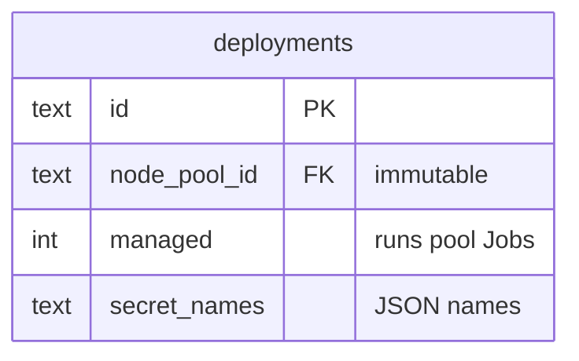
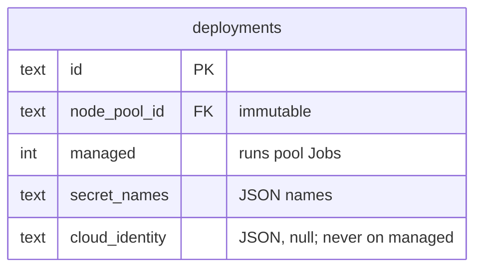

# RFC 0050: Deployment cloud identity and bucket expiry

> Status: Superseded by the scoped-token member endpoint design
> Date: 2026-11-10
> Author: Claude draft, for Luis Fernando De Pombo

> Supersession: The owner chose a scoped-token member endpoint
> over
> this RFC's per-Deployment cloud identity. A minted token reaches the same
> objects as this RFC's per-object signed URL — the boundary in both designs
> is the granted prefix plus no delete — but lets clients use each cloud's
> standard SDK transfer code instead of custom URL-signing logic, needs no
> per-cloud federation setup or trust for the user to apply, and reuses the
> production minter (`mintScopedStorageToken`) that already serves VM hosts
> and pool Jobs. `bucket create --expire-days` (§ 4) carries over to its own
> issue; none had been filed separately as of this writing, so it remains
> tracked here for now.
>
> The Deployment workload identity this RFC built on was itself removed, along
> with Kubernetes Deployments.

## Summary

A program running as a Kubernetes Deployment cannot get cloud credentials of
its own today. Its replicas get two projected ServiceAccount tokens, for the
`anycloud-runtime` and `anycloud-api` audiences
([`pool-objects.ts`](../src/api/services/kubernetes/pool-objects.ts)
`podTemplate`), and neither audience can be changed. Role connections
([RFC 0047](./0047-credential-scope-and-least-privilege-provisioning.md)
§ Role connections) federate only the API's own ServiceAccount
(`anycloud-system:anycloud-api`), and their save-time check refuses any other
subject. A Deployment that must hand short-lived, per-object pre-signed URLs to
clients holding no cloud credential has two options today: put a long-lived
key in a Secret, or have its users build the federation by hand around a token
anycloud does not project.

This RFC adds two things:

1. **Deployment cloud identity.** A Deployment declares a cloud
   (`--cloud-audience aws|gcp|azure`) and the buckets it may use. anycloud
   generates the cloud-side trust for that one Deployment's ServiceAccount,
   applies it through the user's own cloud CLI on request, and projects a
   token with that cloud's audience into the replicas, with the cloud SDK's
   standard environment variables set. The program then gets short-lived
   credentials from the SDK's default chain, scoped to the named buckets.
2. **Bucket expiry.** `anycloud bucket create --expire-days <n>` sets a
   lifecycle rule that deletes objects `n` days after they are created, on
   AWS, GCP, Azure and Cloudflare R2.

Both reuse what RFC 0047 built: the public issuer the hosted API already
serves, the trust conditions, the setup templates and their `--apply` path,
and the signing-key rotation.

## Context: what exists today

Read from `main` at 5ec9abe22.

- **The cluster already exposes an OIDC issuer.** K3s signs ServiceAccount
  tokens with `service-account-issuer=https://<cluster-id>.anycloud.sh`, with
  the in-cluster issuer listed second and `service-account-jwks-uri` next to it
  ([`management-boot.ts`](../src/shared/management-boot.ts) and
  [`management-host.ts`](../src/api/services/system-release/management-host.ts)).
  The hosted API serves `/.well-known/openid-configuration` and
  `/openid/v1/jwks`, unauthenticated, and reads both from its own Kubernetes
  API on every request
  ([`service-account-issuer.ts`](../src/api/services/kubernetes/service-account-issuer.ts),
  [`server.ts`](../src/api/server.ts)). Every token in the cluster, including a
  Deployment's, is signed by that issuer. No new issuer, bucket-hosted
  discovery document or cluster setting is needed. A local API has no
  cluster, issuer or Deployments.
- **Each Deployment has its own ServiceAccount.**
  `renderDeploymentObjects` ([`deployment-objects.ts`](../src/api/services/deployment-objects.ts))
  creates one per Deployment record, named from the record's ID
  (`kubernetesWorkloadResourceName('deployment', id)`), in its node pool's
  namespace (`nodePoolNamespace`). Its subject,
  `system:serviceaccount:<pool-namespace>:<deployment-name>`, is stable for the
  record's life, because the node pool target is immutable, and is never
  reused, because IDs are not reused.
- **Trust templates and `--apply` exist for one subject.**
  [`role-connection-setup-templates.ts`](../src/api/services/role-connection-setup-templates.ts)
  generates an AWS CloudFormation template (the IAM OIDC provider, created
  only when the account lacks it, plus a role), a GCP Cloud Shell script (a
  pool, a provider and an impersonation binding) and an Azure ARM template (a
  user-assigned identity and a federated credential). Each pins issuer,
  audience and subject, with no wildcard. `credentials new --role --apply`
  applies them with the user's signed-in `aws`, `gcloud` or `az`
  ([`role-connection-apply.ts`](../src/cli/services/role-connection-apply.ts)),
  and [`role-connection-check.ts`](../src/api/services/role-connection-check.ts)
  proves the pinning by asking the cloud to refuse a probe subject and a probe
  audience.
- **Buckets have no lifecycle rules.** `bucket create` calls `upsertBucket`
  through [`bucket-metadata-domain.ts`](../src/api/services/bucket-metadata-domain.ts)
  and stores nothing. No gateway calls a lifecycle API, and the published
  policies grant none: `AnycloudAccess` lacks
  `s3:Get/PutLifecycleConfiguration`, and the Azure role lacks
  `managementPolicies`. The GCP role already has `storage.buckets.update`.

## Proposal

- **Smallest useful release.** On a hosted API, a user Deployment on any node
  pool can be given an identity on AWS, GCP or Azure scoped to named buckets in
  one account. A program in its replicas uses the cloud SDK's default
  credential chain, unchanged, to read, write or delete objects in those
  buckets, or to sign URLs that let other clients do so. A bucket on AWS, GCP,
  Azure or R2 can be created, or updated, with an age-based expiry rule.
  Excluded: managed Deployments (which run pool Jobs from any submitter),
  Jobs, Services and VMs; permissions other than bucket object access and
  self-signing; more than one cloud per Deployment; a local API; and removing
  an expiry rule (§ Open questions).

### 1. Declaring the identity

A Deployment gains one optional cloud identity:

| Field       | Set by                                                                                                                   | Meaning                                                                                                                       |
| ----------- | ------------------------------------------------------------------------------------------------------------------------ | ----------------------------------------------------------------------------------------------------------------------------- |
| cloud       | `--cloud-audience aws\|gcp\|azure` on `create` or `upgrade`                                                              | Which cloud's STS the token is for                                                                                            |
| credentials | `--credentials <name>`                                                                                                   | The saved credential whose account, project or subscription (and Azure storage account) holds the buckets; never used to sign |
| buckets     | repeatable `--cloud-bucket <bucket>=<read,write,delete>`                                                                 | Template input only: what the role may do                                                                                     |
| role        | `--role-arn`, `--workload-identity-provider` with `--service-account-email`, or `--application-id` with `--directory-id` | The identifiers of the trust created for it; the same flags and shapes as a role connection                                   |

The record stores only the cloud, the role identifiers and the issuer,
audience and subject they trust: no secret and no permission list. The cloud
policy is the source of truth for permissions, as for role connections.
Storing the bucket list would add a copy that drifts from the role whenever an
administrator edits the role, which they own.

The flags follow the existing conventions: `--credentials` is how `bucket`
commands name an account, and the role flags are `credentials new --role`'s.
The audience is per cloud and fixed, never free text, so a token minted for
one cloud's STS cannot be replayed to another's, and the anycloud audiences
can never be chosen:

| Cloud | Audience                                                  | Same as role connections |
| ----- | --------------------------------------------------------- | ------------------------ |
| AWS   | `sts.amazonaws.com`                                       | yes                      |
| GCP   | `https://iam.googleapis.com/<workload identity provider>` | yes                      |
| Azure | `api://AzureADTokenExchange`                              | yes                      |

GCP's audience names the provider, so it is known only once the role is
recorded.

### 2. Setting up the trust

The cloud credential anycloud holds needs no IAM rights (RFC 0047
invariant 1, and the published policies grant none). So the API never creates
a trust. It generates the template; the user's own cloud CLI, signed in as an
administrator, applies it; the API then checks it and records it. This is the
`credentials new --role --apply` path with a different subject and policy.

`GET /v1/deployments/{id}/cloud-trust` (authenticated) returns the issuer, the
subject, the audience and the template, generated by the existing template
module with two changes: the subject is the Deployment's ServiceAccount, and
the policy comes from `--cloud-bucket` instead of the published anycloud role.

| Cloud | Trust (one per Deployment)                                                                                                                                                                                                                                                     | Permissions from `--cloud-bucket`                                                                                                                                                                                                  |
| ----- | ------------------------------------------------------------------------------------------------------------------------------------------------------------------------------------------------------------------------------------------------------------------------------ | ---------------------------------------------------------------------------------------------------------------------------------------------------------------------------------------------------------------------------------- |
| AWS   | Stack `anycloud-deployment-<id>`: the IAM OIDC provider for the issuer only when the account lacks it (the existing `IssuerProviderExists` parameter), and a role whose trust policy matches the provider with `StringEquals` on `aud` and `sub`; `MaxSessionDuration` 1 h     | An inline policy on `arn:aws:s3:::<bucket>` and `/*`: read is `s3:GetObject` and `s3:ListBucket`; write is `s3:PutObject` and `s3:AbortMultipartUpload`; delete is `s3:DeleteObject`                                               |
| GCP   | In the `anycloud` workload identity pool that role connections use, created if missing, a provider per Deployment whose attribute condition names the subject, a service account, and a `roles/iam.workloadIdentityUser` binding on that one `principal://…/subject/<subject>` | Bucket IAM bindings: read is `roles/storage.objectViewer`; write is `roles/storage.objectCreator`; delete is `roles/storage.objectUser`. Plus `roles/iam.serviceAccountTokenCreator` on the service account itself, for `signBlob` |
| Azure | A user-assigned managed identity and one federated credential naming issuer, subject and audience, with no claims-matching expression                                                                                                                                          | Role assignments on each container: read is Storage Blob Data Reader; write and delete are a custom role per access set. Plus Storage Blob Delegator on the storage account, for `generateUserDelegationKey`                       |

Self-signing (GCP `signBlob` on its own service account, Azure's user
delegation key) is always granted, because a URL it signs carries no more than
the identity holds: a GCP V4 URL is authorized as the signing service account,
and an Azure user-delegation SAS is intersected with the identity's role
assignments. AWS presigns with the session's own credentials, so it needs
nothing extra.

After the template is applied, `deployment upgrade --role-arn …` (or the
cloud's equivalent) saves the identifiers. Saving runs the role-connection
check with the Deployment's subject: one exchange with a token for the
Deployment's ServiceAccount, which the API requests with TokenRequest, then
the cloud must refuse the trust-probe ServiceAccount's token and a token for
another audience. The chart's `anycloud-api-token` Role gains `create` on
`serviceaccounts/token` in pool namespaces for this. A failed check refuses
the save and names the unpinned subject or audience. The save then rolls the
replicas once, as registering an API client does.

`deployment create … --cloud-audience <cloud> --apply` does the three steps in
one command: create the record, fetch and apply the template through the
signed-in cloud CLI, and save the identifiers. Without `--apply`, `create`
prints the template's location and the `upgrade` command that finishes it, as
`credentials new --role` does.

The cloud that runs the node pool does not matter: the issuer is public, so a
Deployment on a Lambda or GCP pool can federate into AWS.

### 3. What the replicas get

Once the role is saved, the replicas' existing `anycloud-runtime-identity`
projected volume gains a third source: a token for the cloud's audience at
`/var/run/secrets/anycloud/cloud-token`, valid for one hour and refreshed by
the kubelet. The container gets `ANYCLOUD_CLOUD_TOKEN_FILE` and the cloud
SDK's own variables, so no anycloud code is needed in the program:

| Cloud | Environment                                                                                                                                                                                                   |
| ----- | ------------------------------------------------------------------------------------------------------------------------------------------------------------------------------------------------------------- |
| AWS   | `AWS_ROLE_ARN`, `AWS_WEB_IDENTITY_TOKEN_FILE`, `AWS_ROLE_SESSION_NAME=<deployment-name>`                                                                                                                      |
| GCP   | `GOOGLE_APPLICATION_CREDENTIALS` naming an `external_account` configuration (audience, token file, `service_account_impersonation_url`) in the Deployment's owned Secret, mounted read-only next to the token |
| Azure | `AZURE_CLIENT_ID`, `AZURE_TENANT_ID`, `AZURE_FEDERATED_TOKEN_FILE`, `AZURE_AUTHORITY_HOST`                                                                                                                    |

A user Deployment that declares no cloud identity renders exactly as today.

### 4. Bucket expiry

`anycloud bucket create <bucket> --expire-days <n>` (1 to 3650) creates the
bucket if needed, then sets one anycloud-named rule that deletes each object
`n` days after it was created. On an existing bucket it replaces only that
rule, so re-running with another `n` changes it. Every other rule on the bucket
is kept: each cloud stores lifecycle configuration as one document, so each
gateway reads, edits and writes it.

| Cloud         | Rule                                                                                                                                                            | Credential needs                                                                          |
| ------------- | --------------------------------------------------------------------------------------------------------------------------------------------------------------- | ----------------------------------------------------------------------------------------- |
| AWS           | Lifecycle rule `anycloud-expire`, empty filter, `Expiration.Days = n`, `AbortIncompleteMultipartUpload.DaysAfterInitiation = n`                                 | `s3:GetLifecycleConfiguration`, `s3:PutLifecycleConfiguration`, added to `AnycloudAccess` |
| Cloudflare R2 | The same S3 call, through the existing R2 storage                                                                                                               | An R2 token with bucket write, as today                                                   |
| GCP           | Lifecycle rules `Delete` and `AbortIncompleteMultipartUpload`, each with `condition.age = n`, in bucket metadata, matched by action and condition when replaced | `storage.buckets.update`, already in the published role                                   |
| Azure         | Rule `anycloud-expire-<container>` in the storage account's management policy, `prefixMatch` `<container>/`, `daysAfterCreationGreaterThan n`                   | `managementPolicies/read` and `write`, added to the published Azure role                  |

Incomplete multipart uploads are aborted after the same `n` days on AWS, R2
and GCP, because parts of an upload that never completes are billed and
invisible to listing. Azure discards uncommitted blocks after seven days on
its own. Lambda has no object storage.
A local API's directory storage has no lifecycle engine, so `--expire-days` is
refused there with that reason.

Expiry is a backstop, not a schedule. Each cloud runs lifecycle rules
asynchronously, usually within a day of the due date, and AWS rounds to the
next midnight UTC. On a versioned bucket the rule expires current objects
only: AWS and GCP keep a noncurrent version, and Azure keeps previous
versions. anycloud-managed checkpoint buckets are versioned, so `--expire-days`
does not suit them.

- **Implementation choices.**
  - **The CLI applies the trust, not the API.** The API would need an
    IAM-capable credential, which RFC 0047 removed. The user's own cloud CLI
    already applies role-connection templates, and the trust belongs to the
    user, who can edit or delete it.
  - **A trust per Deployment, never per name.** The subject comes from the
    Deployment's ID, so a later Deployment with the same name gets no access.
    A registered API client is matched by name (RFC 0049 C29); a cloud role
    is a standing grant in another system, so silent inheritance there would
    be worse.
  - **Bucket grants, not a raw policy.** The concrete need is object access
    and URL signing, and a three-word vocabulary maps onto all three clouds
    and can be read in review. Users who need more edit the role they own.
  - **The SDKs' own variables.** Every AWS, Google and Azure SDK reads these
    and refreshes from the token file. An anycloud-specific exchange helper
    would be code to keep in every language.
- **Accepted limitations.**
  - Write semantics differ by cloud: on GCP, write without delete cannot
    overwrite an existing object, while AWS and Azure overwrite. The docs say
    so.
  - Access granted to GCP or Azure is coarser than the vocabulary where no
    built-in role fits: GCP delete is `objectUser`, which also reads and
    writes.
  - Replicas start without the cloud token until the role is saved; with
    `--apply` that is the length of one apply.
  - Deleting the Deployment does not delete its trust. `deployment delete`
    names the stack, the GCP provider and service account, or the Azure
    identity to remove, and `--apply` removes them through the cloud CLI, as
    `role-connection-teardown.ts` does. A leftover trust names a subject no
    ServiceAccount will have again, but it names the cluster's hostname, so
    it must go before the cluster is deleted (RFC 0049 § C26, role-connection
    trust objects).

## Rotation and expiry

| What                   | Lifetime                                                                                                              | Renewed by                                                 |
| ---------------------- | --------------------------------------------------------------------------------------------------------------------- | ---------------------------------------------------------- |
| Projected cloud token  | 1 hour, bound to the Pod                                                                                              | The kubelet, at 80% of its life; the SDK re-reads the file |
| AWS session            | Up to the role's 1-hour `MaxSessionDuration`                                                                          | The SDK, with a fresh token                                |
| GCP access token       | 1 hour                                                                                                                | The SDK                                                    |
| Azure access token     | About 1 hour                                                                                                          | The SDK                                                    |
| A pre-signed URL       | Its requested expiry, capped by the session on AWS, by 7 days on GCP, by the delegation key on Azure (7 days at most) | Not renewed; the program signs a new one                   |
| The issuer signing key | Until an operator rotates it                                                                                          | RFC 0047 § Signing-key rotation, unchanged                 |

The cloud does not check Pod binding: a copied token is accepted until its own
expiry, at most one hour, even after its Pod is gone. In-cluster, TokenReview
refuses it at once.

Signing-key rotation needs no change. Its 24-hour overlap covers every
one-hour Deployment token. Its compromise response, which revokes each
cloud's trust and recreates it, now also covers each Deployment trust: the
rotation command lists them from the Deployment records, with the role
connections. A URL a GCP or Azure identity signed before revocation stays
valid until its own expiry, so programs should keep URLs short-lived.

The hosted API must be reachable for exchanges: Azure reads the JWKS at every
exchange, and AWS and GCP when their caches refresh. While the hosted API is
down, a Deployment on Azure cannot get new credentials, although its
replicas, running on the pool, are unaffected otherwise.

## Security boundaries

Per [ARCHITECTURE.md](../ARCHITECTURE.md#credentials-authentication-and-security):

- **Peers.** Every member of a hosted API is an equal peer. Anyone who can
  update the Deployment's image or command, or submit a Job a Deployment runs
  as code, can use its cloud identity. That is no wider than today: peers
  already hold the API's cloud credentials. What changes is containment: a
  token leaked from a replica reaches only the named buckets, for at most an
  hour.
- **Managed Deployments are refused.** They run pool Jobs from any
  submitter in the same container, so the identity would be shared by every
  Job's code.
- **Shared Nodes.** A privileged Job on the same Node can read the kubelet's
  credentials and mint any ServiceAccount's token. As for a registered API
  client, the docs say to run the Deployment on a node pool created without
  `--allow-privileged-jobs`.
- **No crossover with anycloud tokens.** The cloud audience is never
  `anycloud-runtime` or `anycloud-api`, and the API's TokenReview requires one
  of those, so a cloud token is useless against the API. Cloud trusts pin the
  cloud audience, so neither anycloud token reaches a cloud.
- **The API's own credential is unchanged.** It signs nothing for the
  Deployment and needs no new IAM rights. Only bucket expiry adds storage
  rights to the published policies.
- **One subject per trust.** The save-time probe proves each trust refuses
  another subject and another audience, as RFC 0047 invariant 10 requires for
  role connections.

## Data model: Before / After

One migration, written by `deployment-store.ts`. Buckets keep no record;
expiry lives only in the cloud.





| Table         | Change                                                                                                                                                                                                                               | Writer                |
| ------------- | ------------------------------------------------------------------------------------------------------------------------------------------------------------------------------------------------------------------------------------ | --------------------- |
| `deployments` | Add nullable `cloud_identity`: `{cloud, credentialName, role, issuer, audience, subject}`, where `role` is the role-connection identifier shape for that cloud, or null until saved. `CHECK (cloud_identity IS NULL OR managed = 0)` | `deployment-store.ts` |

The wire format gains `cloudAudience`, `credentials`, `cloudBuckets` and the
role fields on create and upgrade, and `cloudIdentity` on the Deployment
summary. Added response fields keep the previous release's CLI working. The
replica routes are unchanged. `createBucket` gains an optional `expireDays`
query parameter. The Python SDK is regenerated.

## CLI: Before / After

Before:

```text
$ anycloud deployment create signer ghcr.io/acme/signer:1 --node-pool cpu --cloud-audience aws
error: unknown option '--cloud-audience'

$ anycloud bucket create scratch-use1 --credentials prod-aws --expire-days 30
error: unknown option '--expire-days'
```

After:

```text
$ anycloud deployment create signer ghcr.io/acme/signer:1 --node-pool cpu \
    --cloud-audience aws --credentials prod-aws \
    --cloud-bucket scratch-use1=read,write --apply
✓ Deployment signer creation started.
✓ Trust applied with aws (stack anycloud-deployment-signer-1762800000, account 123456789012)
✓ Cloud identity saved: arn:aws:iam::123456789012:role/anycloud-deployment-signer-1762800000
  subject  system:serviceaccount:anycloud-node-pool-<pool>:<deployment-name>
  token    /var/run/secrets/anycloud/cloud-token (aws, sts.amazonaws.com)

$ anycloud deployment create signer ghcr.io/acme/signer:1 --node-pool cpu \
    --cloud-audience gcp --credentials prod-gcp --cloud-bucket scratch=read,write
✓ Deployment signer creation started.
! Cloud identity pending. Apply the trust with your gcloud, then save it:
    anycloud deployment cloud-trust signer > trust.sh && bash trust.sh
    anycloud deployment upgrade signer \
      --workload-identity-provider projects/<number>/locations/global/workloadIdentityPools/anycloud/providers/<provider> \
      --service-account-email <account>@<project>.iam.gserviceaccount.com

$ anycloud deployment status signer
...
Cloud identity  aws  arn:aws:iam::123456789012:role/anycloud-deployment-signer-1762800000

$ anycloud bucket create scratch-use1 --credentials prod-aws --expire-days 30
✓ Bucket scratch-use1 ready; objects expire 30 days after creation
```

`anycloud deployment cloud-trust <deployment>` prints the template for a user
who applies it another way, such as in a console or their own infrastructure
code. `deployment upgrade --no-cloud-audience` removes the identity and rolls
the replicas; the trust stays until the user deletes it.

## Required invariants

1. The API never creates, edits or deletes a cloud trust or role for a
   Deployment; only the user's cloud CLI does.
   _Enforcement: review — no code exists yet; the implementation extends
   RFC 0047 invariant 1's tests to assert no IAM call from the API._
2. A Deployment's cloud identity is saved only after the cloud refuses another
   subject's token and another audience's token.
   _Enforcement: review — lands with the save path, which reuses
   `src/api/services/role-connection-check.ts`._
3. A Deployment's cloud audience is one of the three fixed per-cloud values
   and never an anycloud audience.
   _Enforcement: review — the schema will make it a closed enum mapped in
   code; no code exists yet._
4. A managed Deployment never has a cloud identity.
   _Enforcement: review — the migration's `CHECK` and admission will hold it;
   no code exists yet._
5. Setting a bucket's expiry leaves every other lifecycle rule on that bucket
   unchanged.
   _Enforcement: review — each gateway's read-modify-write lands with its
   integration test._

**0 of 5 verified wired, 0 cited, and 5 resting on review**: invariants 1, 2,
3, 4, and 5.

## Acceptance scenarios

| ID  | Scenario                                                                                                                                                                         | Required result                                                                                                                                                                     | Coverage                                        |
| --- | -------------------------------------------------------------------------------------------------------------------------------------------------------------------------------- | ----------------------------------------------------------------------------------------------------------------------------------------------------------------------------------- | ----------------------------------------------- |
| S1  | Hosted API; a Deployment on AWS, GCP and Azure each, created with `--cloud-bucket <b>=read,write --apply`; the program signs a PUT URL and a GET URL with the SDK default chain. | An outside client uploads through the PUT URL; the object read back with the saved credential has the uploaded bytes; the GET URL returns them.                                     | review — becomes a test with the implementation |
| S2  | Same Deployments; the program signs a DELETE URL, and lists another bucket.                                                                                                      | The cloud refuses both.                                                                                                                                                             | review — becomes a test with the implementation |
| S3  | A trust edited to admit any subject, or any audience, then saved.                                                                                                                | Save refused, naming the subject or audience; no replica rolls.                                                                                                                     | review — becomes a test with the implementation |
| S4  | A second Deployment on the same pool with no cloud identity.                                                                                                                     | No cloud token file and no cloud SDK variables in its replicas; a token requested for the first Deployment's audience under its own ServiceAccount is refused by the first's trust. | review — becomes a test with the implementation |
| S5  | A Deployment with a cloud identity, running longer than two token lifetimes.                                                                                                     | Signing keeps working after the first token expires.                                                                                                                                | review — becomes a test with the implementation |
| S6  | `--cloud-audience` on a managed Deployment's target, or on a local API.                                                                                                          | Refused with the reason; nothing stored.                                                                                                                                            | review — becomes a test with the implementation |
| S7  | `bucket create --expire-days 30` on a new AWS, GCP, Azure and R2 bucket, then `--expire-days 7` on the same bucket, which also holds an unrelated rule.                          | Each cloud reads back one anycloud rule with 7 days, and the unrelated rule unchanged.                                                                                              | review — becomes a test with the implementation |
| S8  | `--expire-days` on a local API.                                                                                                                                                  | Refused, naming directory storage.                                                                                                                                                  | review — becomes a test with the implementation |
| S9  | `deployment delete --apply` on each cloud.                                                                                                                                       | The trust objects are gone and the Deployment record is deleted.                                                                                                                    | review — becomes a test with the implementation |

## Test and e2e plan

Every cloud with the behavior is covered. Cloud identity: AWS, GCP and Azure.
Lambda and Cloudflare have no federation to trust, so they are left out of
identity; a Lambda node pool is still in scope as a place the Deployment runs.
Expiry: AWS, GCP, Azure and R2; Lambda has no storage, and Local is the
refusal case.

- **Unit.** Template generation per cloud from bucket grants, asserting the
  pinned issuer, audience and subject and the exact actions or roles; replica
  rendering (token source, path, environment, the GCP credential file) and
  its absence without an identity; the closed audience mapping; refusal on
  managed Deployments and local APIs; each gateway's lifecycle
  read-modify-write against recorded documents, including a foreign rule; the
  `AnycloudAccess` and Azure role drift checks, which fail until the
  lifecycle actions are added.
- **Integration (`-happy.spec.ts`, real clouds).** Bucket lifecycle set,
  replaced and read back on AWS, GCP, Azure and R2 (S7), extending the
  existing `test:*-bucket-sync` suites.
- **E2E.** A `deployment-cloud-identity` live check in `e2e-cluster-cloud` on
  `hosted_stage`, beside `role-connections` and `role-apply`, using the workflow's existing
  sign-ins for `aws`, `gcloud` and `az`. One run covers AWS, GCP and Azure
  targets with S1 to S5 and S9, from an image that signs with each cloud's
  SDK, and deletes every trust it creates. One cell runs on a pool whose cloud
  differs from its target. It is dispatch-only, so the implementation PR links
  a green dispatch.

## Size estimate

| Part                                                                                     |     Source |      Tests |
| ---------------------------------------------------------------------------------------- | ---------: | ---------: |
| Schema, migration, store, admission, summary fields                                      |       +140 |       +160 |
| Replica rendering: token source, environment, GCP credential file                        |        +90 |       +120 |
| Trust templates from bucket grants (extending the role-connection module), route         |       +260 |       +220 |
| Save-time check with the Deployment subject, chart Role change                           |        +70 |        +90 |
| CLI: flags, `--apply`, `cloud-trust`, delete teardown (reusing the role-connection code) |       +230 |       +150 |
| Bucket expiry: four gateways, contract, CLI, two published policies                      |       +190 |       +260 |
| E2E live check and its signing image                                                     |       +260 |        +80 |
| **Total**                                                                                | **+1,240** | **+1,080** |

Docs (the Deployments and Buckets pages, cloud credentials) are about +150
lines and are not counted. No code is removed.

## Alternatives / open questions

- **Long-lived keys in a Secret.** Works today with no anycloud change. A key
  in a Secret is readable by every peer, survives in backups, is never rotated
  by anything, and works from anywhere after a leak. Rejected: this is the
  credential that RFC 0047 removed from the API.
- **Node identity** (an instance profile, attached service account or managed
  identity on pool VMs). No token in the Pod, but every Pod on the Node gets
  the role, nodes on another cloud have none, and RFC 0047 removed VM
  identities so that the compute credential needs no IAM. Rejected.
- **Prefix grants minted by the API** (`mintScopedStorageToken`, RFC 0043):
  the API signs a prefix-scoped token per request and delivers it to the
  workload. No trust to set up and no role held by the program, but the
  holder gets a token rather than a per-object URL, every cloud needs a
  prefix-capable minter (Azure's is still open, RFC 0047 § Dependency), and
  the API's credential signs for another program. Kept as the fallback if the
  setup step proves too heavy.
- **Trusting the existing `anycloud-api` token.** Would send an anycloud API
  bearer to each cloud's STS. Rejected.
- **A raw policy file** (`--cloud-policy <file>` per cloud). Expresses
  anything, but anycloud cannot check its scope, and each cloud has its own
  format. Deferred until a need beyond buckets appears.
- **Open: who applies the trust.** This RFC has the CLI apply it through the
  user's cloud CLI. The alternative, the API applying it with an IAM-capable
  credential, contradicts RFC 0047 invariant 1. Recommended: the CLI.
- **Open: token lifetime.** One hour, like the other projected tokens, or 10
  minutes (Kubernetes' minimum) to shorten a leaked token's life at the cost
  of more refreshes. Recommended: one hour.
- **Open: removing an expiry rule.** Not in the smallest release.
  `bucket create --expire-days 0` or a `bucket expiry` command could remove
  it. Recommended: add it only when asked.
- **Open: GCP's JWKS cache bound** (RFC 0047 amendment 11) applies to
  Deployment trusts too, and is still unmeasured.
- **Open: one GCP provider per Deployment.** A pool holds a limited number of
  providers. A shared provider per issuer with a subject condition per
  binding would scale further but loosens the provider's condition.
  Recommended: one per Deployment until a user approaches the limit.

## Tracking

As changes ship, link each independently shippable change to its PR.

1. Bucket expiry on AWS, GCP, Azure and R2 (S7, S8). Independent of the rest.
2. Deployment cloud identity: record, rendering, templates, save-time check,
   CLI and teardown (S1 to S6, S9), with the e2e live check.

## Decision

Superseded on 2026-11-11 by the owner, relayed by the coordinating session.
The owner chose a scoped-token member endpoint over this RFC's
per-Deployment cloud audience; see the
Supersession note above for the reasoning.
